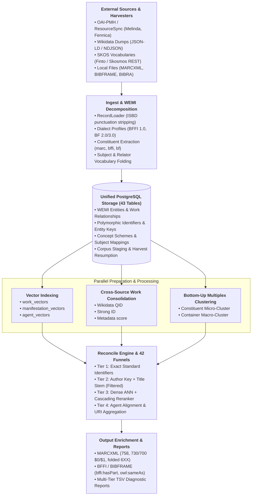

# Reconciliator

<p align="center">
  
</p>

<p align="center">
  <strong>Bibliographic Authority Reconciliation & Multi-Format WEMI Multiplex Clustering Platform</strong>
</p>

`reconciliator` is an automated, bibliographic entity resolution, WEMI multiplex clustering, and authority enrichment platform built for Finnish and international library catalog ecosystems. It decomposes bibliographic records into normalized IFLA LRM / FRBR entities (**Work**, **Expression**, **Manifestation**, **Item**), performs bottom-up multiplex co-reference resolution, unifies cross-source works, enriches agents and subjects with configurable canonical persistent identifiers (defaults to KANTO, ISNI, VIAF, Wikidata and YSO), and serializes enriched records back to native formats without lossy cross-translations.

---

## Key Capabilities

### 1. 4-Tier WEMI Decomposition & Entity Modeling
Decomposes complex bibliographic metadata into normalized entities stored across **43 PostgreSQL tables**:
- **Works**: Conceptual intellectual creation (`works`), tracking original language, work types, and canonical work clusters.
- **Expressions**: Realization of works (`expressions`), tracking language, content types, version designations, and musical arrangements.
- **Manifestations**: Physical or digital embodiment (`manifestations`), tracking publication years, publishers, carriers, and physical descriptions.
- **Items**: Exemplar physical copies or digital holdings (`items`), including post-publication bound-with composite volumes (*sammelbände*).
- **M:N Junctions & Contributions**: `manifestation_expressions` (supporting complex anthologies and sound recordings) and polymorphic `contributions` with standardized relator codes (RDA / MARC relators).

### 2. Multi-Format Native Interoperability
Ingests and enriches bibliographic sources in their native syntax without translation loss:
- **MARCXML (MARC 21)**: Full bibliographic and authority MARC parsing, subfield punctuation normalisation, and field injection (`$0`, `$1`).
- **Finnish BFFI 1.0 (LKD)**: Strict alignment with the National Library of Finland Linked Library Data profile (`https://schema.finto.fi/bffi/1-0-0/lkd.rdf`), using pure `bffi:` and W3C namespaces.
- **LC BIBFRAME 2.0 / 3.0**: Native RDF graph parsing (Turtle, RDF/XML, N-Triples) and streaming JSON-LD parser, including Performed Music Ontology (PMO) structures (`bf:mediumOfPerformance`).
- **BIBRA JSON**: Native ingest and in-place enrichment of Finnish municipal library JSON records.

### 3. Pure-Graph Aggregate Modeling & Containment
Maintains whole-part relationships strictly as first-class graph edges (no boolean flags or shims):
- Outgoing `has_part` edges with 1-based `sequence_number` in `work_relationships` and `corpus_work_relationships`.
- Declarative multi-format extraction profiles: [`marc_enhanced.yaml`](src/reconciliator/defaults/constituent_profiles/marc_enhanced.yaml), [`bffi_haspart.yaml`](src/reconciliator/defaults/constituent_profiles/bffi_haspart.yaml), and [`bibframe_haspart.yaml`](src/reconciliator/defaults/constituent_profiles/bibframe_haspart.yaml).
- High-fidelity enrichment: Appends canonical `$0` URIs into MARC `730`/`700`/`740` fields, injects `owl:sameAs` into `bffi:hasPart` nodes, and updates `bffi:marcKey` literals.

### 4. Bottom-Up Multiplex Clustering
Intra-corpus resolution uses a bottom-up, content-informed clustering engine:
- **Constituent Micro-Clustering First**: Clusters individual constituent songs, tracks, and articles into deterministic `va_const_work_{sha256}` clusters before clustering container publications.
- **Container Fingerprinting**: Decorates each container `MatchRecord` with its ordered list of constituent cluster IDs.
- **Cross-Format Macro-Clustering**:
  - **Jaccard Merge Bonus**: Container records sharing $\ge 80\%$ constituent works merge into a single Work cluster, even with significant title variations.
  - **Sequence Alignment**: Evaluates Longest Common Subsequence (LCS) ratio ($\ge 0.70$) to distinguish identical track sequences from scrambled compilations.
  - **Content Mismatch Veto**: Container records sharing $\le 30\%$ constituent works are hard-vetoed (`aggregate_content_mismatch`).
  - **Container-Part Anti-Collision**: Prevents albums from accidentally merging with individual constituent tracks (`container_part_collision`).

### 5. 42 Specialized Material Domains & Dispatch Funnels
Declarative, precedence-ordered `FunnelSpec` entries tailoring matching and discriminators across 42 distinct bibliographic categories:
- Monographs, Serials / Continuing Resources, Multi-Part Series, Recorded Sound (CDs/Vinyl), Notated Music (Scores/Parts), Article / Serial Components, Audiobooks / Spoken Word, Moving Image (Film/TV), Anthologies, Conference Proceedings, Theses / Dissertations, Cartographic Materials, Graphic Novels / Comics / Manga, Datasets, Standards / Technical Reports, Government Publications, 3D Objects / Realia, Archival Collections & Manuscripts, Still Images / Artworks, Legal Norms & Statutes, Patents & IP, Video Games, Loose-Leaf Integrating Resources, Board Games / Tabletop Games, Incunabula & Hand-Press Books (C15–C18 with Fingerprints), Tactile Media (Braille/DAISY), Software Source Code & AI Models, Dramatic Works & Choreography, Broadcast Podcasts, Sammelbände (Bound-Withs), Web Archives (WARC), Oral Histories, Linear Broadcast Flow, Parallel Multilingual Editions, Preservation Surrogates, Fragmenta Membranea (Medieval Fragments), Pienpainatteet (Ephemera), Exhibition Catalogues, Variorum Critical Editions, Spatial Geodata (GIS), Numismatics & Philately, and 3D Cultural Heritage Digital Twins.

### 6. Authority Grounding & URI Aggregation
- **Split KANTO Sources**: Differentiates personal authorities (`kanto_pn` with `https://urn.fi/URN:NBN:fi:au:pn:*`) from corporate/conference authorities (`kanto_cn` with `https://urn.fi/URN:NBN:fi:au:cn:*`).
- **Vocabulary & Thesauri Folding**: Standardizes subject headings against YSO, KAUNO, SLM, and SEKO, automatically folding legacy Finnish thesauri and ontologies (YSA $\rightarrow$ YSO, Allärs $\rightarrow$ YSO, Kaunokki $\rightarrow$ KAUNO/SLM, MUSA/MUSO $\rightarrow$ YSO, and performance medium $\rightarrow$ SEKO).

### 7. Cascading Hybrid Rerankers & Vector Engines
- **ANN Vector Search**: High-throughput semantic candidate retrieval via FAISS or PyTorch (supporting Apple Silicon MPS and NVIDIA CUDA).
- **Adaptive Reranker Cascade**: Fast CPU heuristics (BM25, Fuzzy token matching, Cross-Encoders) resolve unambiguous matches and distant false positives at thousands of records/second; ambiguous borderline cases escalate to an autoregressive KV-branching LLM Judge with zero-copy cache truncation.

---

## Architectural Overview



---

## Quickstart

### Prerequisites
- Python 3.11+
- [uv](https://docs.astral.sh/uv/) package manager
- PostgreSQL 15+ (with `pg_trgm` extension)

### Installation
```bash
git clone https://github.com/NatLibFi/reconciliator.git
cd reconciliator
uv sync
source .venv/bin/activate
```

### Running Tests
Execute the comprehensive test suite:
```bash
pytest
```

### CLI Commands
All capabilities are exposed via the unified Typer CLI. Ensure your virtual environment is active (`source .venv/bin/activate`):

```bash
# 1. Reset / initialize database tables
reconciliator reset -c config.yaml

# 2. Download and ingest controlled vocabularies from Finto (YSO, SLM, KANTO)
reconciliator download-skosmos -c config.yaml
reconciliator ingest-vocab -c config.yaml

# 3. Harvest source data (OAI-PMH, ResourceSync, or local files)
reconciliator ingest-oai --all -c config.yaml

# 4. Ingest Wikidata authority dumps (optional)
reconciliator ingest-wikidata -c config.yaml

# 5. Build dense vector ANN indices
reconciliator build-index -c config.yaml
reconciliator build-agent-index -c config.yaml

# 6. Unify cross-source work identities
reconciliator consolidate-works -c config.yaml

# 7. Cluster agent authority records
reconciliator cluster-agents -c config.yaml

# 8. Run full intra-corpus clustering, reconciliation, and output enrichment
reconciliator reconcile -c config.yaml

# 9. Or execute the entire end-to-end pipeline in one automated pass
reconciliator run -c config.yaml

# 10. Start the REST API service
reconciliator serve --host 127.0.0.1 --port 8000
```

---

## Documentation Index

- [Pipeline Overview](docs/pipeline_overview.md): Comprehensive walkthrough of the end-to-end pipeline, funnels, and multiplex clustering.
- [Data Model Specification](docs/datamodel.md): Complete schema documentation covering all 43 PostgreSQL tables, WEMI entities, and cluster relationships.
- [Aggregate Architecture](docs/aggregates.md): Pure-graph whole-part containment (`has_part`), constituent micro-clustering, and multi-format enrichment.
- [Operational Runbook](docs/runbook.md): Administrator guide for configuration, CLI execution, deployment workflows, and troubleshooting.
- [Recurring Task Scheduling](docs/recurring_task_scheduling.md): Orchestration guide for automated runs using systemd timers, crontab, and Kubernetes CronJobs.
- [Cascading Dual-Route Reranker](docs/cascading_dual_route_reranker_architecture.md): Deep-dive into adaptive CPU heuristic / GPU LLM routing.
- [Two-Stage KV-Branching LLM Judge](docs/two_stage_llm_judge_architecture.md): Architecture of autoregressive target encoding and zero-copy candidate evaluation.
