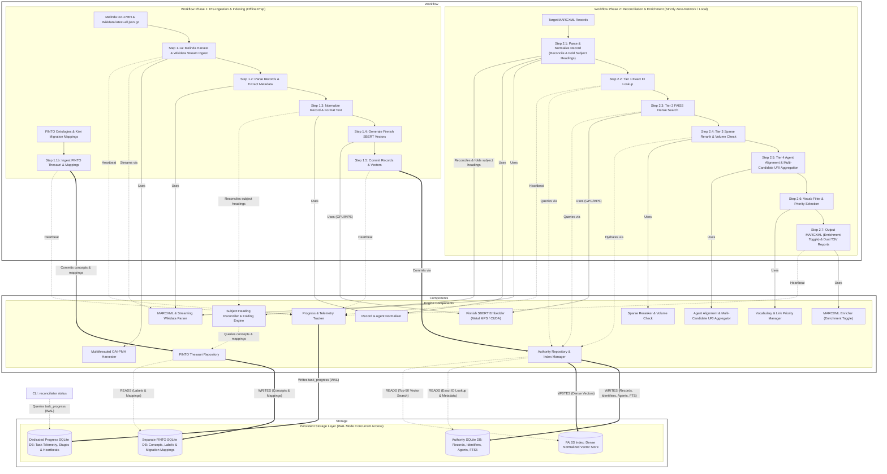
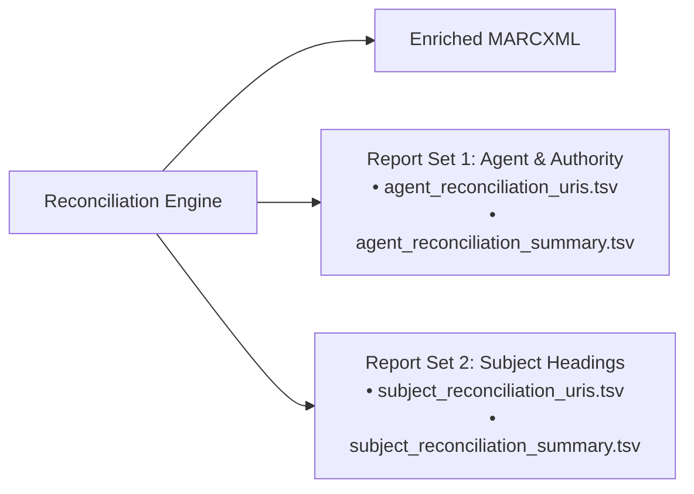

# Bibliographic Record Reconciliation Architecture

## Overview

This project implements an automated reconciliation and agent URI enrichment engine specifically designed for Finnish library bibliographic records. It reconciles target **MARCXML** records against authoritative **Finnish MARCXML** data source (i.e. Melinda) and Wikidata.

The architecture is decoupled into **two strictly separated phases**, with **real-time progress telemetry** queryable via the CLI (`reconciliator status`).

### Layered architecture


### Phase 1: Ingestion & Indexing (Separate Offline Pre-Processing)
   - **Step 1.1a (Multithreaded Harvest / Stream Ingest)**: Ingests **Melinda** authority records via a multithreaded OAI-PMH harvester (with date-window partitioning and decoupled parallel XML parsing) or static MARCXML, and ingests **Wikidata** records by streaming directly from disk from `latest-all.json.gz` in constant $O(1)$ memory. Emits progress on partition completion, queue depth, and gzip byte offsets.
   - **Step 1.1b (Ingest FINTO Subject Heading Thesauri & Mappings)**: Ingests FINTO subject heading ontologies (YSO, KAUNO, MUSO, SLM, SEKO) and legacy thesauri migration tables (YSA, Allärs, Kaunokki, MUSA) into a **dedicated, separate local SQLite database (`finto.db`)**.
   - **Step 1.2 (Parse Records & Extract Metadata)**: Parses MARCXML and streaming Wikidata entity JSON lines, extracting rich bibliographic descriptors, identifiers, and authority links.
   - **Step 1.3 (Normalize Record & Format Text)**: Runs both sources through shared Record, Agent, and Identifier Normalizers, folding and reconciling subject headings against `finto.db` and generating structured text serializations via a configurable Jinja2 template file referencing internal data model fields.
   - **Step 1.4 (Generate Dense Semantic Vectors)**: Computes dense sentence embeddings using hardware-accelerated SentenceTransformers and a file-based Jinja2 text serialization template (configured entirely via the YAML configuration file under `embedding` using model name, template file path, hardware accelerator device, and batch size).
   - **Step 1.5 (Commit Records & Vectors)**: Commits records, identifiers, agents, and FTS5 data to concurrent SQLite (`authority.db` in WAL mode) and appends normalized dense vectors to the unified FAISS index via `AuthorityStore`.
### Phase 2: Zero-network reconciliation & Enrichment Process
   - Reconciles target MARCXML records purely using the local SQLite databases (`authority.db` and `finto.db`) and FAISS index.
   - **No external network calls are made during reconciliation.**
   - **Step 2.1 (Parse & Normalize Full Record, Reconcile & Fold Subject Headings)**:
     - Extracts and normalizes maximum available bibliographic data (titles, uniform titles, imprint publisher/year, edition, series, volume/part info, agents, standard identifiers, language, subjects) using the **identical shared normalization pipeline as Step 1.3** (`RecordNormalizer`, `AgentNormalizer`, `IdentifierNormalizer`).
     - **Subject Heading Reconciliation Folding**: Reconciles and folds subject headings (`650`, `655`, `651`, `382`) from legacy thesauri (**YSA**, **Allärs**, **Kaunokki/Bella**, **MUSA/Cilla**) into canonical modern counterparts (**YSO**, **KAUNO**, **MUSO**, **SLM**, **SEKO**) **as part of record normalization** via `finto.db` (identically to Step 1.3), ensuring strict symmetry between target queries and indexed authority records.
   - **Step 2.2 (Tier 1 Exact ID Lookup)**: Fast-path exact match on normalized standard identifiers (ISBN, ISSN, URN, control numbers) in SQLite (prioritizing Melinda, then Wikidata fallback).
   - **Step 2.3 (Tier 2 FAISS Dense Search)**: Fetches top-$k$ semantic candidates from the unified FAISS index using query embeddings (which incorporate the modern folded YSO/SLM subject terms).
   - **Step 2.4 (Tier 3 Sparse Rerank & Volume Check)**: Lexical BM25 reranking, volume/part discrimination (`1. osa` vs `2. osa`), and year/surname verification against candidate metadata from SQLite.
   - **Step 2.5 (Tier 4 Agent Alignment & Multi-Candidate URI Aggregation)**: Aligns target agents against **all** candidate records exceeding the acceptance threshold, aggregating all discovered authority URIs (`$0` KANTO/Asteri, ISNI, VIAF; `$1` Wikidata QID) into a deduplicated set.
   - **Step 2.6 (Vocabulary Filter & Priority Selection)**:
     - **Vocabulary Filtering**: Filters aggregated URIs against configured modern authority record and value vocabularies (e.g. `KANTO`, `YSO`, `MUSO`, `KAUNO`, `SLM`, `SEKO`, `VIAF`, `ISNI`, `WIKIDATA` configured in YAML).
     - **Link Prioritization**: Applies priority fallback rules (lower-priority source added only if higher-priority source is absent) or adds all reconciled links as specified in YAML.
   - **Step 2.7 (Output MARCXML, Enrichment Mode & Dual TSV Reporting)**: Configured in the YAML file under `reconcile.enrich: true/false` and dedicated report settings (`agent_reports`, `subject_reports`). In pure reconciliation mode (`enrich: false`), discovered authority matches are audited and reported without altering original records. In enrichment mode (`enrich: true`), configured authority links that were not present on the original record are injected into the target MARCXML with modern canonical vocabulary codes. Emits two completely decoupled, dedicated TSV report sets:
     1. **Agent & Descriptive Authority Reports**: Row-per-URI audit log (`agent_reports.detailed_file`) and aggregate funnel summary (`agent_reports.summary_file`).
     2. **Subject Headings Reconciliation Reports**: Row-per-URI thesauri folding log (`subject_reports.detailed_file`) and ontology mapping summary (`subject_reports.summary_file`).
### Cross-Phase Progress Telemetry & Dedicated Progress Database (`progress.db`)
   - All ingestion and reconciliation runs continuously stream heartbeats and metrics into a **dedicated, separate SQLite database (`progress.db`, `task_progress` table)** in WAL mode, completely decoupled from authority catalog data and indexing locks.
   - Any terminal can query active or past task progress in real time via `reconciliator status --config <path/to/config.yaml> [--watch] [--json]`.
### Unified Configuration Surface via YAML (`--config`)
   - The entire solution configuration surface (database and index paths, embedding models and template files, ingestion settings, reconciliation thresholds, vocabulary rules, link prioritization policies, and enrichment options) is defined in a single `.yaml` configuration file and supplied to the CLI via `--config <path/to/config.yaml>`. There is no configuration flag proliferation across CLI subcommands.

---

## Detailed Component Specifications

### 1. Comprehensive Record Parsing & Normalization Pipeline

#### 1.1 Symmetrical Normalization Architecture & Scope

Implemented across [`reconciliator/loaders/marcxml.py`](#reconciliator-loaders-marcxml-py), [`reconciliator/normalizers/record.py`](#reconciliator-normalizers-record-py), [`reconciliator/normalizers/agent.py`](#reconciliator-normalizers-agent-py), and [`reconciliator/normalizers/identifiers.py`](#reconciliator-normalizers-identifiers-py).

Step 2.1 (target records) and Step 1.3 (authority records) share the **exact same parsing, normalization, and FINTO folding engine**. Symmetrically normalizing both authority and target records is strictly necessary to guarantee that:
- Exact standard identifier lookups (ISBN, ISSN, URN) match cleanly without punctuation or formatting differences.
- Text serializations generated for dense embeddings use the exact same configurable Jinja2 template file and field representations via the template engine.
- Legacy subject headings (YSA, Allärs, Kaunokki, MUSA) are folded into modern canonical concepts (YSO, KAUNO, MUSO, SLM, SEKO) on both sides prior to embedding and indexing.
- Sparse lexical features (BM25 token overlap, author surname tokens, volume numbers) align reliably without false negatives.

#### 1.2 Internal Unified Data Model

Defined in [`reconciliator/models.py`](#reconciliator-models-py). To decouple reconciliation logic from heterogeneous ingestion formats (MARCXML vs. Wikidata JSON-LD), all bibliographic entities ingested from authority catalogs (Melinda, Wikidata) and target records are parsed and normalized into a unified Pydantic data model (`BibliographicRecord`).

The table below specifies the internal data model fields, their types, semantic roles in the reconciliation pipeline, and canonical format constraints:

| Field Name | Type | Semantic Reconciliation Role | Canonical Format & Constraints |
| :--- | :--- | :--- | :--- |
| **`source_id`** (alias: `external_id`) | `str` | Record identification & audit provenance | Primary key string in source catalog (e.g. `(FI-MELINDA)000123456` or `Q123456`). |
| **`source`** | `Literal["melinda", "wikidata", "target"]` | Catalog origin tracking & prioritization | Identifies authority catalog or target input file. |
| **`title`** | `str` | Primary matching, BM25, SBERT dense embedding | Title proper concatenated with subtitle (e.g. `Sinuhe egyptiläinen : viisitoista kirjaa...`). Leading articles stripped, ISBD punctuation removed, diacritic-preserving case folded. |
| **`subtitle`** | `Optional[str]` | Secondary title matching & serialization | Isolated subtitle string, stripped of delimiters and ISBD punctuation. |
| **`uniform_title`** | `Optional[str]` | Work-level clustering & SBERT serialization | Collective/uniform/original work title (e.g. `Hamlet`). Brackets and non-filing characters removed. |
| **`variant_titles`** | `List[str]` | Lexical candidate recall & BM25 expansion | Alternative, translation, and analytical titles (from MARC 246/740 or Wikidata aliases). Deduplicated list. |
| **`publication_year`** | `Optional[int]` | Hard candidate filter & proximity reranker | Clean 4-digit Gregorian year (e.g. `1945`). Candidate disqualified if $\| \Delta \text{year} \| > 5$ without reprint note. |
| **`publisher`** | `Optional[str]` | BM25 sparse scoring & candidate verification | Cleaned publisher name. Legal entities (*Oy, Ab, Kustannusosakeyhtiö, Förlag, Ltd, GmbH*) stripped, case folded. |
| **`publication_place`** | `Optional[str]` | Descriptive metadata & secondary alignment | Clean publication place name (e.g. `Helsinki`). Enclosing brackets and trailing punctuation stripped. |
| **`language`** | `Optional[str]` | Language compatibility discriminator | Canonical ISO 639-2 three-letter language code of text (e.g. `fin`, `swe`, `eng`, `sme`). |
| **`original_language`** | `Optional[str]` | Work/translation alignment | Canonical ISO 639-2 three-letter code of original language (e.g. `swe`, `eng`, `fra`). |
| **`edition`** | `Optional[int]` | Edition matching & candidate discrimination | Positive integer representing edition ordinal (e.g. `2` for *"2. uud. p."* or Wikidata `"2"`). |
| **`extent`** | `Optional[int]` | Heuristic verification & duplicate detection | Physical pagination / page count integer (e.g. `245`). |
| **`series_title`** | `Optional[str]` | Series clustering & SBERT serialization | Clean series title proper (from MARC 490/830 or Wikidata P179). Punctuation stripped. |
| **`series_numbering`** | `Optional[str]` | Sequential position within series | Series sequential ordinal or designation (e.g. `"4"` or `"osa 4"`). |
| **`volume_designation`** | `Optional[str]` | Hard candidate filter (Strict volume discriminator) | Canonical volume designation `osa <int>` (e.g. `osa 2`). Both Arabic and Roman numerals converted to integer. Records with mismatched volume numbers are disqualified. |
| **`classifications`** | `List[ClassificationItem]` | Classification array for domain anchoring, BM25 & dense serialization | List of normalized classification items carrying notation, scheme, and primary flag. |
| **`classifications[].code`** | `str` | Classification literal / notation | Cleaned classification notation string (e.g. `"84.2"`, `"82-3"`, `"839.73"`). |
| **`classifications[].scheme`** | `str` | Classification system identification | Canonical lowercase scheme code (e.g. `"ykl"`, `"udc"`, `"ddc"`, `"lcc"`). |
| **`classifications[].is_primary`** | `bool` | Primary classification indicator | `True` for the primary / main classification of the work; `False` for secondary classifications. |
| **`identifiers.isbn`** | `List[str]` | Tier 1 Exact ID Lookup | Modulo-10 validated 13-digit EAN strings (e.g. `9789510123456`). ISBN-10 converted to ISBN-13; hyphens and qualifiers stripped. |
| **`identifiers.issn`** | `List[str]` | Tier 1 Exact ID Lookup (Continuing resources) | Canonical hyphenated 8-character string `\d{4}-\d{3}[\dX]` validated via modulo-11 checksum. |
| **`identifiers.urn`** | `List[str]` | Tier 1 Exact ID Lookup | Lowercase canonical persistent URN (e.g. `urn:nbn:fi:bib:20210001`). |
| **`identifiers.other_ids`** | `List[str]` | Tier 1 Exact ID Lookup & fallback | Other standard identifiers (DOI stripped of prefix, Handle, ISMN, MusicBrainz Work ID). |
| **`agents`** | `List[Agent]` | Agent alignment, surname hard filter, URI transfer | List of normalized agent models. |
| **`agents[].name`** | `str` | SBERT dense serialization & fuzzy name alignment | Canonical inverted order `"Surname, Forename"` for personal agents; direct order for corporate/meetings. |
| **`agents[].surname`** | `Optional[str]` | Hard candidate filter (Author surname overlap) | Isolated primary surname token (e.g. `"Waltari"`). Candidate must match at least one author surname. |
| **`agents[].role`** | `Optional[str]` | Relator qualification & role alignment | Standard 3-letter MARC relator code (e.g. `aut`, `edt`, `trl`, `ill`, `cmp`). |
| **`agents[].uri_subfield_0`** | `List[str]` | Authority URI transfer ($0 candidate aggregation) | Canonical authority URIs (Asteri URN `https://urn.fi/URN:NBN:fi:au:pn:...`, ISNI, VIAF). |
| **`agents[].uri_subfield_1`** | `List[str]` | Authority URI transfer ($1 candidate aggregation) | Wikidata entity URIs (`http://www.wikidata.org/entity/Q...`). |
| **`subjects`** | `SubjectsContainer` | Dense semantic embedding & concept enrichment | Folded topical, genre, geographic, and performance concepts. |
| **`subjects.topical`** | `List[SubjectItem]` | SBERT dense embedding & YSO/KAUNO/MUSO alignment | Folded canonical subject concepts: `uri` (`http://www.yso.fi/onto/yso/p...`), `pref_label`, `vocabulary`. |
| **`subjects.genre_form`** | `List[SubjectItem]` | Genre qualification & SLM alignment | Folded canonical genre concepts: `uri` (`http://urn.fi/URN:NBN:fi:au:slm:s...`), `pref_label`, `vocabulary` (`slm`). |
| **`subjects.geographic`** | `List[SubjectItem]` | Geographic qualification & YSO-paikat alignment | Folded geographic concepts: `uri` (`http://www.yso.fi/onto/yso/p...`), `pref_label`, `vocabulary` (`yso`). |
| **`subjects.medium_of_performance`** | `List[SubjectItem]` | Music ensemble qualification & SEKO alignment | Folded instrumentation concepts: `uri` (`http://urn.fi/URN:NBN:fi:au:seko:...`), `pref_label`, `vocabulary` (`seko`). |
| **`serialization`** | `str` | Input text representation for SBERT embedding | Template-formatted string rendered from the configured Jinja2 template file (`reconciliator/templates/default_serialization.j2` by default) referencing internal data model fields (`BibliographicRecord`). |

#### 1.3 Extracted & Sourced Data Elements (MARC vs. Wikidata)

The following table defines how every normalized field of the internal data model (`BibliographicRecord`) is sourced across MARCXML (Melinda and target records) and Wikidata (`latest-all.json.gz`):

| Internal Data Model Field | MARC Source (Melinda / Target MARCXML) | Wikidata Source (`latest-all.json.gz` Claims & Entities) |
| :--- | :--- | :--- |
| **`source_id`** (alias: `external_id`) | `001` (Control number) + `003` (Agency e.g. `FI-MELINDA`), `035 $a` | Entity `id` (e.g. `Q123456`) and `claims.P3595` (Melinda/Asteri ID) |
| **`source`** | Ingestion pipeline context (`"melinda"` or `"target"`) | Ingestion pipeline context (`"wikidata"`) |
| **`title`** (Title Proper) | `245 $a` (Title proper) + `$b` (Subtitle / remainder of title) | `claims.P1476` (title proper) + `claims.P1680` (subtitle) monolingual texts; fallback: `labels.fi.value` $\to$ `sv` $\to$ `en` |
| **`subtitle`** | `245 $b` (Remainder of title / subtitle) | `claims.P1680` (subtitle monolingual text) |
| **`uniform_title`** | `130 $a` / `240 $a` (Uniform / collective / original title) | `claims.P1448` (official name), `claims.P1705` (native label), or parent work label via `claims.P629` (edition/translation of) |
| **`variant_titles`** | `246 $a, $b` (Varying forms of title), `740 $a` (Analytical titles) | `aliases.fi`, `aliases.sv`, `aliases.en` (alternative title label arrays) |
| **`publication_year`** | `260 $c` or `264 ind2=1 $c` (clean 4-digit year), `008` (bytes 07–10) | `claims.P577[0].mainsnak.datavalue.value.time` (parsed for Gregorian 4-digit year); fallback `claims.P571` (inception) |
| **`publisher`** | `260 $b` or `264 ind2=1 $b` (stripped of *Oy, Ab, Kustannusosakeyhtiö*) | `claims.P123` (publisher entity QID, resolved to label string `fi` $\to$ `sv` $\to$ `en`) |
| **`publication_place`** | `260 $a` or `264 ind2=1 $a` (Place of publication) | `claims.P291` (place of publication QID, resolved to label string `fi` $\to$ `sv` $\to$ `en`) |
| **`language`** | `008` (bytes 35–37), `041 $a` (Text language) | `claims.P407` (language of work QID mapped to ISO 639-2: `Q1412` $\to$ `fin`, `Q9027` $\to$ `swe`) |
| **`original_language`** | `041 $h` (Original language) | `claims.P364` (original language of work QID mapped to ISO 639-2) |
| **`edition`** | `250 $a` (Edition statement, normalized to integer index) | `claims.P393` (edition number string / ordinal) |
| **`extent`** (Pagination) | `300 $a` (Physical extent / pagination heuristic) | `claims.P1104` (number of pages integer value) |
| **`series_title`** | `490 $a`, `830 $a` (Series title proper) | `claims.P179` (part of series entity QID, resolved to label `fi` $\to$ `sv` $\to$ `en`) |
| **`series_numbering`** | `490 $v`, `830 $v` (Volume / sequential designation within series) | `claims.P179.qualifiers.P1545` (series ordinal string) |
| **`volume_designation`** | `245 $n, $p`, `250 $a`, `490 $v` (canonical `\b(osa\|nide\|vol\|del)\s*(\d+\|[ivxlcdm]+)\b` $\to$ `osa <int>`) | `claims.P478` (volume string) or `qualifiers.P1545` (volume ordinal) normalized to canonical `osa <int>` |
| **`classifications`** | All `084 $a, $2` (with `$2 ykl` prioritized), `080 $a` (UDC), `082 $a` (DDC). First occurrence matching the prioritized scheme hierarchy (`084 $2 ykl` $\to$ `080` UDC $\to$ `082` DDC) is flagged `is_primary = True`. All others flagged `False`. | All `claims.P1190` (UDC), `claims.P1036` (DDC), `claims.P1149` (LCC). Preferred rank claim (or first claim if none preferred) is flagged `is_primary = True`. All others flagged `False`. |
| **`identifiers.isbn`** | `020 $a, $z` (ISBN-10 & ISBN-13; qualifiers like `(nid.)` stripped) | `claims.P212` (ISBN-13 string) & `claims.P957` (ISBN-10 string) |
| **`identifiers.issn`** | `022 $a, $l, $m, $y, $z` (canonical `\d{4}-\d{3}[\dX]`) | `claims.P236` (ISSN) & `claims.P8627` (ISSN-L) |
| **`identifiers.urn`** | `024 $a, $2` (where `$2 == 'urn'`), `856 $u` (`urn.fi/...`) | `claims.P1184` (URN-NBN) or parsed from URN URL in `claims.P856` |
| **`identifiers.other_ids`** | `024 $a, $2` (DOI, Handle, ISMN), `035 $a` (system control numbers) | `claims.P356` (DOI), `claims.P4184` (Handle), `claims.P434` (MusicBrainz Work ID) |
| **`agents.name`** | `100 $a` (personal), `110 $a` (corporate), `111 $a` (meeting), `700/710/711 $a`, `245 $c` | `claims.P50` (author), `claims.P98` (editor), `claims.P655` (translator), `claims.P110` (illustrator), `claims.P767` (contributor) entity labels (`fi` $\to$ `sv` $\to$ `en`); fallback `claims.P2093` (author name string) |
| **`agents.surname`** | Extracted from personal author name (`100/700 $a`) before first comma | Extracted via `claims.P734` (family name entity) or trailing token of direct name label |
| **`agents.role`** | `100/700 $e` (relator term e.g. *kirjoittaja*), `$4` (relator code e.g. *aut*) | Inferred from property ID (`P50` $\to$ `aut`, `P98` $\to$ `edt`, `P655` $\to$ `trl`, `P110` $\to$ `ill`, `P86` $\to$ `cmp`) |
| **`agents.uri_subfield_0`** | `100/700 $0` (Asteri URN `urn.fi/URN:NBN:fi:au:pn:*`, ISNI, VIAF) | From author entity via `wikidata_authors`: `P3595` (Asteri ID $\to$ URN), `P213` (ISNI `isni.org/*`), `P214` (VIAF `viaf.org/*`) |
| **`agents.uri_subfield_1`** | `100/700 $1` (Wikidata entity URI `wikidata.org/entity/Q*`) | Author entity QID (`http://www.wikidata.org/entity/` + `claims.P50[].id`) |
| **`subjects.topical`** | `650 $a, $0, $2` (folded from YSA/Kaunokki/MUSA to YSO/KAUNO/MUSO via `finto.db`) | `claims.P921` (main subject QID: matched to YSO concept via `finto.db` label lookup or `P2347` YSO ID) |
| **`subjects.genre_form`** | `655 $a, $0, $2` (folded from YSA/Allärs/Kaunokki/MUSA to SLM via `finto.db`) | `claims.P136` (genre QID: matched to SLM concept via `finto.db` label lookup or `claims.P31` instance of) |
| **`subjects.geographic`** | `651 $a, $0, $2` (folded to YSO-paikat via `finto.db`) | `claims.P840` (narrative location QID) or geographic entity from `claims.P921` matched to YSO-paikat |
| **`subjects.medium_of_performance`** | `382 $a, $0, $2` (folded from MUSA/Cilla to SEKO via `finto.db`) | `claims.P870` (instrumentation / medium of performance QID, matched to SEKO via label) |
| **`serialization`** | Symmetrically formatted from internal data model fields via configured Jinja2 template file (`reconciliator/template.py`) | Symmetrically formatted from internal data model fields via identical configured Jinja2 template file (`reconciliator/template.py`) |

#### 1.4 Detailed Normalization & Extraction Mechanics

The table below details the exact extraction regexes, cleaning algorithms, and normalization rules applied symmetrically across MARCXML and Wikidata inputs to populate the internal data model fields:

| Bibliographic Element & Rule | Normalization & Cleaning Mechanics |
| :--- | :--- |
| **Record & Control Numbers** (`source_id`, `external_id`) | **MARC**<br>From `001` + `003` / `035 $a`: Strip punctuation; extract Melinda system ID `(FI-MELINDA)012345678` or OCLC number.<br><br>**Wikidata**<br>From entity `id` (e.g. `Q123456`) and `claims.P3595` (Melinda/Asteri ID), stored as primary source identifiers. |
| **Title Proper & Subtitle** (`title`, `subtitle`) | **MARC**<br>From `245 $a` + `$b`: Concatenate title and subtitle into `title`; store isolated subtitle in `subtitle`. Strip non-filing characters using `245` 2nd indicator or regex for articles (*the, a, an, en, ett, den, det, de*). Strip trailing ISBD punctuation (` /`, ` :`, ` ;`, `.`, `=`). Case fold preserving Finnish diacritics (`ä`, `ö`, `å`).<br><br>**Wikidata**<br>From `claims.P1476` (title) + `claims.P1680` (subtitle) (monolingual text, preferring `fi` $\to$ `sv` $\to$ `en`) or fallback `labels.fi.value` $\to$ `sv` $\to$ `en`. Concatenate subtitle if not already present in title string. Strip non-filing articles via identical regex (*the, a, an, en, ett, den, det, de*), strip trailing ISBD punctuation, and apply identical diacritic-preserving case folding. |
| **Uniform & Original Title** (`uniform_title`) | **MARC**<br>From `130 $a` / `240 $a`: Skip non-filing characters via 2nd indicator. Strip enclosing brackets `[`, `]`, trailing punctuation, and case fold preserving diacritics.<br><br>**Wikidata**<br>From `claims.P1448` (official name), `claims.P1705` (native label), or parent work label via `claims.P629` (edition/translation of). Apply identical bracket/punctuation stripping and case folding. |
| **Variant & Analytical Titles** (`variant_titles`) | **MARC**<br>From `246 $a, $b` (varying titles) and `740 $a` (analytical entries): Strip punctuation and case fold. Deduplicate.<br><br>**Wikidata**<br>From `aliases.fi`, `aliases.sv`, `aliases.en` (alternative label string arrays): Strip punctuation and case fold. Deduplicate. |
| **Publication Year** (`publication_year`) | **MARC**<br>From `260 $c` or `264 ind2=1 $c`: Regex match `r"\b(1[5-9]\d{2}\|20\d{2})\b"` to extract clean 4-digit Gregorian year. Fallback to `008` (bytes 07–10).<br><br>**Wikidata**<br>From `claims.P577[0].mainsnak.datavalue.value.time` (or earliest `P577`), fallback `claims.P571` (inception): Regex extract 4-digit Gregorian year `r"\+(\d{4})"` (e.g. `"+1954-01-01T00:00:00Z"` $\to$ `1954`). |
| **Publisher Name** (`publisher`) | **MARC**<br>From `260 $b` or `264 ind2=1 $b`: Strip trailing punctuation and legal suffixes via regex `r"\b(Oy\|Ab\|Kustannusosakeyhtiö\|Förlag\|Kustannus\|Publishing\|Ltd\|GmbH)\b"`. Case fold.<br><br>**Wikidata**<br>From `claims.P123` (publisher entity QID): Resolve to preferred label string (`fi` $\to$ `sv` $\to$ `en`) via publisher lookup table or cache. Apply identical legal suffix stripping regex and case folding. |
| **Publication Place** (`publication_place`) | **MARC**<br>From `260 $a` or `264 ind2=1 $a`: Strip trailing punctuation (`:`, `;`, `,`, `[`, `]`) and whitespace.<br><br>**Wikidata**<br>From `claims.P291` (place of publication QID): Resolve to label string (`fi` $\to$ `sv` $\to$ `en`), strip punctuation. |
| **Language** (`language`, `original_language`) | **MARC**<br>From `008` (bytes 35–37) and `041 $a` (text) / `041 $h` (original): Canonical ISO 639-2 three-letter code (e.g. `fin`, `swe`, `eng`).<br><br>**Wikidata**<br>From `claims.P407` (language of work QID) and `claims.P364` (original language): Map QID to canonical ISO 639-2 three-letter code via static lookup table (`Q1412` $\to$ `fin`, `Q9027` $\to$ `swe`, `Q1860` $\to$ `eng`, `Q188` $\to$ `ger`, `Q150` $\to$ `fre`, `Q7737` $\to$ `rus`, `Q25167` $\to$ `sme`, `Q33454` $\to$ `smn`, `Q33987` $\to$ `sms`, `Q9056` $\to$ `est`, `Q25258` $\to$ `dan`, `Q9043` $\to$ `nor`). |
| **Edition Statement** (`edition`) | **MARC**<br>From `250 $a`: Extract numerical index via regex `r"(\d+)\."` (e.g. `"2. uud. p."` $\to$ `2`).<br><br>**Wikidata**<br>From `claims.P393` (edition number string / ordinal): Parse integer ordinal (e.g. `"2"`, `"2nd"` $\to$ `2`). |
| **Pagination & Extent** (`extent`) | **MARC**<br>From `300 $a`: Parse page count heuristic via regex `r"(\d+)\s*s\."` (e.g. `"245 s."` $\to$ `245`).<br><br>**Wikidata**<br>From `claims.P1104` (number of pages): Direct integer value (e.g. `245`). |
| **Series Title & Numbering** (`series_title`, `series_numbering`) | **MARC**<br>From `490 $a, $v` and `830 $a, $v`: Strip punctuation from title proper. Extract sequential numbering from `$v`.<br><br>**Wikidata**<br>From `claims.P179` (part of the series QID): Resolve entity label for title; extract `qualifiers.P1545` for sequential series ordinal string. Apply identical title punctuation stripping. |
| **Volume / Part Discrimination** (`volume_designation`) | **MARC**<br>Scanned across `245 $n, $p`, `250 $a`, `490 $v`: Extract volume designation via pattern `r"\b(osa\|nide\|vol\|nro\|del\|band\|tome\|v\.)\s*(\d+\|[ivxlcdm]+)\b"`. Convert Roman numerals to integers (`II` $\to$ `2`, `osa II` $\to$ `osa 2`). Store canonical `osa <int>`. Multi-volume works are strictly discriminated to prevent conflation.<br><br>**Wikidata**<br>Scanned across `claims.P478` (volume), `qualifiers.P1545` (volume ordinal), and title strings: Apply identical volume pattern `r"\b(osa\|nide\|vol\|nro\|del\|band\|tome\|v\.)\s*(\d+\|[ivxlcdm]+)\b"`. Convert Roman numerals to integers (`II` $\to$ `2`, `Vol. II` $\to$ `osa 2`) and store canonical `osa <int>`. |
| **Classifications Array** (`classifications`) | **MARC**<br>Scanned across all `084` (`$a` notation, `$2` scheme; default `ykl` if `$2` absent and ind2=blank), `080 $a` (UDC), `082 $a` (DDC): Strip whitespace, brackets, and trailing punctuation. Normalize separators. Map scheme to canonical lowercase (`ykl`, `udc`, `ddc`, `lcc`). Flag the first occurrence matching the prioritized scheme hierarchy (`084 $2 ykl` $\to$ `080` UDC $\to$ `082` DDC) as `is_primary = True`, and all other items as `is_primary = False`. Produces `List[ClassificationItem]`.<br><br>**Wikidata**<br>Scanned across all classification statements in claims: `P1190` (UDC), `P1036` (DDC), `P1149` (LCC): Strip whitespace, brackets, trailing punctuation, and normalize notation strings. Set `scheme` to lowercase identifier (`udc`, `ddc`, `lcc`). The statement with `rank: "preferred"` (or earliest/first statement if none preferred) is flagged `is_primary = True`; all others flagged `False`. Produces `List[ClassificationItem]`. |
| **ISBN-10 & ISBN-13** (`identifiers.isbn`) | **MARC**<br>From `020 $a, $z`: Strip parenthetical qualifiers `\s*\([^)]*\)` (e.g. `(nid.)`, `(sid.)`, `(pbk)`). Strip hyphens and spaces. Convert valid 10-digit ISBNs to 13-digit ISBNs using standard EAN-13 algorithm (`978` prefix + check digit recalculation). Validate modulo-10 checksum.<br><br>**Wikidata**<br>From `claims.P212` (ISBN-13) & `claims.P957` (ISBN-10): Strip hyphens, spaces, and qualifiers. If 10-digit ISBN (`P957`), convert to 13-digit via identical EAN-13 algorithm. Validate modulo-10 checksum. |
| **ISSN** (`identifiers.issn`) | **MARC**<br>From `022 $a, $l, $m, $y, $z`: Strip hyphens/spaces and format to canonical `\d{4}-\d{3}[\dX]`. Validate modulo-11 check digit.<br><br>**Wikidata**<br>From `claims.P236` (ISSN) & `claims.P8627` (ISSN-L): Strip whitespace and format to canonical `\d{4}-\d{3}[\dX]`. Validate checksum. |
| **URN, DOI & Standard IDs** (`identifiers.urn`, `identifiers.other_ids`) | **MARC**<br>From `024 $a` (where `$2 == 'urn'`), `856 $u`: Canonicalize URN to `urn:nbn:fi:...` lowercase. Extract DOI from `024 $a` (`$2 == 'doi'`), stripping `https://doi.org/` prefix.<br><br>**Wikidata**<br>From `claims.P1184` (URN-NBN) and `claims.P356` (DOI): Canonicalize URN prefix; strip `doi:` and URL prefixes from DOI. |
| **Agent Names & Surnames** (`agents.name`, `agents.surname`) | **MARC**<br>From `100 $a`, `700 $a`, `110 $a`, `710 $a` (fallback `245 $c`): Strip birth/death dates in `$d` or inline in `$a` via `r",?\s*\b\d{4}\s*-\s*(\d{4})?\b"`. Strip relator words in `$e` and codes in `$4`. Normalize direct names `"Mika Waltari"` $\to$ inverted `"Waltari, Mika"`. Extract surname `"Waltari"` for hard discriminator.<br><br>**Wikidata**<br>From `claims.P50` (author), `P98` (editor), `P655` (translator), `P110` (illustrator), fallback `claims.P2093` (author name string): Resolve author entity name (`fi` $\to$ `sv` $\to$ `en`). Invert direct natural order `"Mika Waltari"` to canonical `"Waltari, Mika"` using `claims.P734` (family name) or by splitting on last whitespace. Map properties to MARC relator codes (`P50` $\to$ `aut`, `P98` $\to$ `edt`, `P655` $\to$ `trl`, `P110` $\to$ `ill`, `P86` $\to$ `cmp`). Extract surname `"Waltari"` for hard discriminator. |
| **Agent Relator Roles** (`agents.role`) | **MARC**<br>From `100/700 $e` (relator term) or `$4` (relator code): Map to standard 3-letter MARC relator code (e.g. `aut`, `edt`, `trl`, `ill`, `cmp`).<br><br>**Wikidata**<br>Inferred from property ID (`P50` $\to$ `aut`, `P98` $\to$ `edt`, `P655` $\to$ `trl`, `P110` $\to$ `ill`, `P86` $\to$ `cmp`, `P767` $\to$ `ctb`). |
| **Agent Authority URIs** (`agents.uri_subfield_0`, `agents.uri_subfield_1`) | **MARC**<br>From `100/700 $0`: Extract Asteri URN (`urn.fi/URN:NBN:fi:au:pn:*`), Asteri ID `(FI-ASTERI-N)*`, ISNI (`isni.org/*`), VIAF (`viaf.org/*`). From `100/700 $1`: Extract Wikidata QID (`wikidata.org/entity/Q*`).<br><br>**Wikidata**<br>Resolved from author entity claims: `P3595` (Asteri ID $\to$ `https://urn.fi/URN:NBN:fi:au:pn:` + ID), `P213` (ISNI $\to$ `http://isni.org/isni/` + ID), `P214` (VIAF $\to$ `http://viaf.org/viaf/` + ID) into `$0`; author entity QID into `$1` (`http://www.wikidata.org/entity/` + QID). During `latest-all.json.gz` stream, author entities are cached in SQLite table `wikidata_authors` in `authority.db` so book records hydrate complete authority URIs without network access. |
| **Subject Headings & Genre/Forms** (`subjects.topical`, `subjects.genre_form`, `subjects.geographic`, `subjects.medium_of_performance`) | **MARC**<br>From `650`, `655`, `651`, `382`: Reconcile and fold legacy thesauri (`$2 ysa`, `allars`, `kaunokki`, `musa` or legacy `$0` URIs) into modern counterparts (**YSO**, **KAUNO**, **MUSO**, **SLM**, **SEKO**) via `finto.db`. Strictly enforce that `655` genre terms fold into **SLM** (never KAUNO). Replace terms with modern canonical preferred labels.<br><br>**Wikidata**<br>From `claims.P921` (main subject), `claims.P136` (genre), `claims.P840` (narrative location), `claims.P870` (instrumentation): If entity has `claims.P2347` (YSO ID string `p...`), format directly to canonical YSO URI (`http://www.yso.fi/onto/yso/p*`). For genre entities (`P136`), match against SLM concepts in `finto.db`. Otherwise, query `finto.db` using entity labels (`fi`, `sv`) to resolve canonical modern concept URI. Replace terms with canonical preferred labels, guaranteeing identical text representation in SBERT sentence vectors. |
| **Dense Text Serialization** (`serialization`) | **MARC**<br>Formatted symmetrically via configurable Jinja2 template file referencing internal data model fields (`reconciliator/template.py`). Supports configurable list/object expansion, filters, loops, and field fallbacks in dedicated `.j2` template files. Default template file: `reconciliator/templates/default_serialization.j2`.<br><br>**Wikidata**<br>Symmetrically formatted using identical configured Jinja2 template file and canonicalized internal data model terms. |

---

### 2. Configurable Sparse Reranking on top of Dense

#### 2.1 Problem Statement & Multi-Volume False Positives

Dense vectors can produce false positives on multi-volume works (e.g. *Sinuhe egyptiläinen 1. osa* vs *2. osa* scoring 0.98 similarity) or generic titles (*Vuosikertomus*). Pure dense semantic matching is insufficient without lexical discrimination and hard structural checks.

#### 2.2 Two-Stage Matching Funnel Architecture & Short-Circuiting

Implemented in [`reconciliator/matcher.py`](#reconciliator-matcher-py) and [`reconciliator/sparse.py`](#reconciliator-sparse-py). This subsystem combines lexical BM25 scoring, volume/part regex discrimination (`osa`/`vol`/`nide`), author surname token overlap checks, and publication year proximity penalties with high-throughput FAISS dense retrieval:

1. **Stage 1 (FAISS Dense Retrieval)**:
   - FAISS retrieves the top $k$ semantic candidates (configured via `reconcile.sparse_rerank.top_k`, default $50$) in milliseconds.
   - **High-Confidence Dense Short-Circuit (Fast-Path)**:
      - Candidates whose dense cosine similarity meets or exceeds a high-confidence threshold ($S_{\text{dense}} \ge \text{threshold}$, configured via `short_circuit.threshold`, default $0.98$) can **short-circuit past Stage 2 BM25 lexical reranking**, accepted directly under `match_tier = "tier2_dense_faiss"`.
      - **Hard Discriminator Safeguard**: Even during short-circuit, active hard discriminators (such as `require_volume_match`) are strictly evaluated. If a volume conflict is detected (e.g. `osa 1` vs `osa 2`), the short-circuit is aborted and the candidate is disqualified.
      - **Toggleable & Configurable**: Controlled via `short_circuit.enabled: true/false` and `short_circuit.threshold: 0.98` in `config.yaml`.
2. **Stage 2 (Sparse Candidate Reranker)**:
   - Candidates not short-circuited are evaluated against the target record using configurable lexical features and metadata discriminators:
     - **BM25 / Token Overlap**: High reward for matching distinct title and publisher tokens.
     - **Volume / Part Discriminator**: Regex pattern extraction (`\b(osa|nide|vol|nro|del)\s*(\d+|[ivxlcdm]+)\b`). When `require_volume_match: true`, candidate is **disqualified** if target has `osa 1` and candidate has `osa 2`.
     - **Author Surname Overlap**: When `require_surname_match: true`, requires exact token match of at least one author surname.
     - **Publication Year Proximity**: Linear penalty if $|\text{year}_{\text{target}} - \text{year}_{\text{auth}}| >$ `year_penalty_threshold`; disqualification if $>$ `max_year_difference` years unless marked as a reprint.
3. **Configurable Hybrid Score Fusion**:
   $$\text{Final Score} = w_{\text{dense}} \cdot S_{\text{dense}} + w_{\text{sparse}} \cdot S_{\text{sparse}}$$
   - **Toggable Execution**: If `sparse_rerank.enabled: false`, lexical reranking and hard discriminators are bypassed, evaluating candidates directly on FAISS dense similarity ($S_{\text{final}} = S_{\text{dense}}$).
   - **Acceptance Threshold**: When `enabled: true`, candidates must satisfy both the minimum hybrid score ($\text{Final Score} \ge \text{threshold}$, default $0.85$) and pass all enabled hard discriminators (volume, surname, year). Accepted candidates are logged with `match_tier = "tier3_hybrid_rerank"`.

#### 2.3 Configuration Surface & Scoring Parameters

Configured in `config.yaml` under the `reconcile.sparse_rerank` block:
- `enabled` (`bool`, default `true`): Toggles sparse lexical reranking on or off.
- `dense_weight` (`float`, default `0.6`): Weight for dense semantic cosine similarity ($0.0 \le w_{\text{dense}} \le 1.0$).
- `sparse_weight` (`float`, default `0.4`): Weight for sparse BM25 lexical similarity ($0.0 \le w_{\text{sparse}} \le 1.0$, requiring $w_{\text{dense}} + w_{\text{sparse}} = 1.0$).
- `top_k` (`int`, default `50`): Number of dense candidates retrieved from FAISS to rerank.
- `short_circuit.enabled` (`bool`, default `true`): Toggles the high-confidence dense short-circuit on or off. When `false`, all candidates proceed to Stage 2 BM25 reranking.
- `short_circuit.threshold` (`float`, default `0.98`): Configurable dense cosine similarity threshold ($0.0 \le \text{threshold} \le 1.0$) required to bypass BM25 lexical reranking.
- `require_volume_match` (`bool`, default `true`): Strict volume/part compatibility (rejects conflicting designations like `osa 1` vs `osa 2`).
- `require_surname_match` (`bool`, default `true`): Requires exact token match of at least one author surname.
- `max_year_difference` (`int`, default `5`): Maximum allowable difference in publication years before candidate rejection.
- `year_penalty_threshold` (`int`, default `1`): Year delta after which a linear proximity penalty is deducted from the sparse score.

---

### 3. Configurable Embedding Model, Text Template Engine & Hardware-Accelerated Indexing

#### 3.1 GPU / Hardware Acceleration Engine

Implemented in [`reconciliator/device.py`](#reconciliator-device-py). This component handles hardware accelerator resolution (NVIDIA CUDA, Apple Silicon Metal MPS, and CPU fallback), mixed-precision execution, and dynamic batch sizing.

- Automatically selects the optimal hardware accelerator:
  1. **Apple Silicon Metal (`mps`)**: Leverages Apple's Metal Performance Shaders and unified memory (native on macOS / M-series chips such as M2 Max).
  2. **NVIDIA CUDA (`cuda`)**: Leverages CUDA GPU cores with automatic mixed precision (`fp16`) on Linux/Windows.
  3. **CPU**: Fallback utilizing multi-threaded CPU matrix operations (`torch.set_num_threads`).
- Configured via `embedding.device: "auto"|"cuda"|"mps"|"cpu"` in the YAML configuration file.
- **Dynamic Batch Sizing**: Configured via `embedding.batch_size: <int>` in the YAML file. Automatically scales when GPU/Metal acceleration is detected for maximal ingestion and reconciliation throughput.

#### 3.2 Configurable Embedding Model & Vector Dimensionality

Implemented in [`reconciliator/embedder.py`](#reconciliator-embedder-py). This module wraps SentenceTransformers with dynamic vector dimension discovery and hardware-accelerated batch inference.

- **Default Model**: `TurkuNLP/sbert-cased-finnish-paraphrase` (specialized for Finnish sentence semantics and paraphrase matching).
- **Configurability**: Accepts any SentenceTransformer model identifier from Hugging Face Hub (e.g. `sentence-transformers/paraphrase-multilingual-mpnet-base-v2`, `intfloat/multilingual-e5-base`, domain-specific models) or a local filesystem directory path.
- **Configuration**: Declared in the YAML configuration file under `embedding.model_name: "..."`.
- **Dynamic Vector Dimensionality**: The embedding dimension $D$ (e.g. 768 for TurkuNLP SBERT, 384 for MiniLM, 1024 for large models) is dynamically discovered via `model.get_sentence_embedding_dimension()` and automatically configures the FAISS index dimension without hardcoded constraints.
- **Model & Dimension Metadata Verification**: Stores the model name and vector dimension in SQLite metadata and the FAISS index header. During reconciliation, the engine verifies that the query embedding model and dimension strictly match the ingested authority index, preventing silent misalignment.

#### 3.3 Configurable Text Template Engine

Implemented in [`reconciliator/template.py`](#reconciliator-template-py). This module provides a file-based Jinja2 text serialization engine (`RecordTemplateEngine`) with domain-specific bibliographic filters and SHA-256 template hashing for index symmetry validation.

- **Objective & File-Based Design**:
  - Converts any normalized `BibliographicRecord` into a dense, descriptive text string that captures critical semantic features prior to SentenceTransformer vector encoding.
  - **Strictly File-Based**: The Jinja2 template is **always loaded from a template file** (`.j2` or `.jinja`) rather than defined inline on the command line or in configuration strings. This ensures templates are version-controlled, multi-line readable, cleanly formatted, and easily audited without shell-escaping issues.
  - Uses **Jinja2** (`jinja2.Environment(autoescape=False, trim_blocks=True, lstrip_blocks=True)`) with file-based loading via `FileSystemLoader` or direct file reading.
- **Bundled Default Template File (`reconciliator/templates/default_serialization.j2`)**:
  The system ships with a production-tested default template file packaged directly in the module:
  ```jinja2
  Nimeke: {{ title }} : {{ subtitle }} [Yhtenäistetty: {{ uniform_title }}] | Tekijät: {{ agents | map(attribute='name') | join(', ') }} | Julkaisija: {{ publisher | default('', true) }} | Vuosi: {{ publication_year | default('', true) }} | Painos: {{ edition | default('', true) }} | Sarja: {{ series_title | default('', true) }} {{ series_numbering }} {{ volume_designation }} | Luokitus: {{ c.code }} | Aiheet: {{ subjects.topical | map(attribute='pref_label') | join(', ') }} ; Lajityyppi: {{ subjects.genre_form | map(attribute='pref_label') | join(', ') }}
  ```
- **Direct References to Internal Data Model Fields in Template Files**:
  - Every field in the unified internal data model (`BibliographicRecord`, detailed in Table 1.1) is directly bound to the Jinja2 context and accessible by name:
    - `title`: Cleaned title proper string (e.g. `{{ title }}`).
    - `subtitle`: Isolated subtitle (e.g. ` : {{ subtitle }}`).
    - `uniform_title`: Uniform / original title (e.g. ` [Yhtenäistetty: {{ uniform_title }}]`).
    - `variant_titles`: Alternative / analytical titles list (e.g. `{{ variant_titles | join(', ') }}`).
    - `publication_year`: Gregorian publication year integer (e.g. `{{ publication_year | default('', true) }}`).
    - `publisher`: Normalized publisher name (e.g. `{{ publisher | default('', true) }}`).
    - `publication_place`: Place of publication (e.g. `{{ publication_place | default('', true) }}`).
    - `language` / `original_language`: ISO 639-2 three-letter codes (e.g. `{{ language }}`).
    - `edition`: Normalized edition ordinal integer (e.g. `{{ edition }}`).
    - `extent`: Normalized pagination / page count integer (e.g. `{{ extent }}`).
    - `series_title`: Series title proper (e.g. `{{ series_title }}`).
    - `series_numbering`: Sequential series numbering (e.g. `{{ series_numbering }}`).
    - `volume_designation`: Canonical volume designator (e.g. `{{ volume_designation }}`).
    - `classifications`: List of `ClassificationItem` objects (`code: str`, `scheme: str`, `is_primary: bool`), e.g. ` | Luokitus: {{ c.code }}` or `{{ classifications | selectattr('is_primary') | map(attribute='code') | join(', ') }}`.
    - `source_id`: Source record identifier (e.g. `(FI-MELINDA)012345678` or `Q123456`).
    - `source`: Source origin (`melinda`, `wikidata`, `target`).
- **Configurable List and Object Expansion in Template Files**:
  - Complex nested structures (`agents`, `subjects`, `identifiers`, `classifications`) can be expanded, filtered, formatted, and joined using either Jinja2 loop syntax or filter pipelines:
    1. **Iteration & Loop Expansion**:
       ```jinja2
       
         {{ agent.name }} ({{ agent.role }}), 
       
       ```
       ```jinja2
       
         {{ item.pref_label }}; 
       
       ```
       ```jinja2
       
         {{ c.code }} ({{ c.scheme }})
       
       ```
    2. **Filter & Projection Pipelines**:
       - List of scalar attributes:
         - Agents: `{{ agents | map(attribute='name') | join(', ') }}`
         - Agent surnames: `{{ agents | map(attribute='surname') | reject('none') | join(', ') }}`
         - Topical subjects: `{{ subjects.topical | map(attribute='pref_label') | join(', ') }}`
         - Genre/form subjects: `{{ subjects.genre_form | map(attribute='pref_label') | join(', ') }}`
         - Geographic subjects: `{{ subjects.geographic | map(attribute='pref_label') | join(', ') }}`
         - Performance medium: `{{ subjects.medium_of_performance | map(attribute='pref_label') | join(', ') }}`
         - Standard IDs: `{{ identifiers.isbn | join(', ') }}`, `{{ identifiers.issn | join(', ') }}`
         - All classification codes: `{{ classifications | map(attribute='code') | join(', ') }}`
       - Filtering by object attribute before projection:
         - Author-only agents: `{{ agents | selectattr('role', 'equalto', 'aut') | map(attribute='name') | join(', ') }}`
         - Specific vocabulary subjects: `{{ subjects.topical | selectattr('vocabulary', 'equalto', 'yso') | map(attribute='pref_label') | join(', ') }}`
         - Primary classification code: `{{ (classifications | selectattr('is_primary') | map(attribute='code') | first) | default('', true) }}`
         - Specific classification scheme: `{{ classifications | selectattr('scheme', 'equalto', 'ykl') | map(attribute='code') | join(', ') }}`
    3. **Custom Ergonomic Jinja2 Filters**:
       `reconciliator/template.py` registers dedicated custom filters to handle null values and simplify common bibliographic expansions:
       - `join_names(agents, delimiter=', ')`: Safe null-handling extractor for `Agent.name`.
       - `join_surnames(agents, delimiter=', ')`: Extracts `Agent.surname` (falling back to `Agent.name` if missing).
       - `join_labels(subjects, delimiter=', ')`: Safe null-handling extractor for `SubjectItem.pref_label`.
       - `primary_code(classifications)`: Safe extractor for the `code` string of the primary classification (`is_primary=True`), or empty string if none.
       - `join_classifications(classifications, delimiter=', ', scheme=None)`: Joins classification codes, optionally filtered by scheme (e.g. `scheme='ykl'`).
       - `collapse_ws(text)`: Collapses consecutive whitespace, tabs, and newlines into a single clean space.
- **Template File Configuration in YAML**:
  - Declared under `embedding.template_path: "path/to/template.j2"` in the YAML configuration file.
  - Default fallback: bundled module package file `reconciliator/templates/default_serialization.j2`.
  - Validates that the specified file exists and is readable (raises clear `FileNotFoundError` otherwise).
- **Index Symmetry & Template Hash Verification**:
  - During authority indexing (`ingest-melinda` and `ingest-wikidata`), the active template file content and its SHA-256 hash are recorded into:
    - SQLite table `db_metadata` in `authority.db` (`embedding_template`, `embedding_template_hash`, `embedding_template_path`).
    - FAISS index header metadata.
  - During reconciliation (`reconcile`), the target record serialization template hash (derived from the active template file) is strictly compared against the stored authority index template hash. If an unexpected mismatch occurs, the pipeline rejects execution with an informative error detailing the template divergence (overrideable via `embedding.force_template: true` in the YAML configuration file), preventing silent semantic degradation from mismatched vector representations.

#### 3.4 Hardware-Accelerated FAISS Vector Store

Implemented in [`reconciliator/indexer.py`](#reconciliator-indexer-py). This module manages the persistent FAISS vector index, supporting vectors of dynamic dimension $D$, persistence to disk, and index metadata headers.

- Standard `faiss.IndexFlatIP` (exact cosine similarity on L2-normalized vectors of dynamic dimensionality $D$).
- On CUDA systems: supports optional transparent transfer to GPU (`faiss.index_cpu_to_gpu`).
- On Apple Silicon / CPU: utilizes ARM NEON vector instructions while PyTorch embeddings run on Metal GPU (`mps`).

---

### 4. Unified Solution Configuration via YAML

#### 4.1 Unified Configuration Principles & Elimination of CLI Flag Sprawl

The configuration surface of the entire solution is defined entirely in a `.yaml` file passed to the CLI via `--config <path/to/config.yaml>`.

Rather than exposing dozens of flags across subcommands (e.g. `--model`, `--template`, `--workers`, `--from-date`, `--until-date`, `--threshold`, `--vocabularies`, `--link-policy`, `--agent-priority`, `--device`), every operational setting is declared declaratively in YAML. This guarantees auditability, reproducible runs, version-controllable experiment configs, and clean CLI interactions.

#### 4.2 Pydantic Validation & Path Resolution

Implemented in [`reconciliator/config.py`](#reconciliator-config-py). This module implements strongly-typed Pydantic v2 schemas (`AppConfig`, `StorageConfig`, `EmbeddingConfig`, `SparseRerankConfig`, etc.) and the YAML loader with relative path resolution.

- The configuration file is validated on application startup using Pydantic v2 schemas (`AppConfig`).
- Missing mandatory fields, syntax errors, or invalid types (e.g. invalid device name, negative batch size, out-of-range thresholds) raise clear, human-readable error messages immediately before starting any processing.
- Relative filesystem paths within the YAML file are automatically resolved relative to the directory of the YAML configuration file itself.

#### 4.3 Complete YAML Configuration Reference Schema

Implemented in [`config.example.yaml`](#config-example-yaml). This reference configuration file provides the complete, production-ready schema for Reconciliator:

  ```yaml
  # config.yaml - Complete Configuration Surface for Reconciliator

  # 1. Storage & Persistence File Paths
  storage:
    authority_db: "data/authority.db"
    finto_db: "data/finto.db"
    progress_db: "data/progress.db"
    index_path: "data/authority.faiss"

  # 2. Embedding Model, Serialization Template & Hardware Acceleration
  embedding:
    model_name: "TurkuNLP/sbert-cased-finnish-paraphrase"
    template_path: "reconciliator/templates/default_serialization.j2"
    device: "auto"        # "auto" | "cuda" | "mps" | "cpu"
    batch_size: 64        # Inference batch size for dense sentence embedding
    force_template: false # When true, permits reconciliation even if template hash differs from index metadata

  # 3. FINTO Thesauri & Migration Ingestion
  ingest_finto:
    input_path: "tests/fixtures/sample_finto.ttl" # Directory or file path containing SKOS / Turtle / RDF dumps
    vocabularies:
      - "yso"
      - "kauno"
      - "muso"
      - "slm"
      - "seko"
    legacy_thesauri:
      - "ysa"
      - "allars"
      - "kaunokki"
      - "musa"

  # 4. Melinda Authority Ingestion
  ingest_melinda:
    source_type: "oai"    # "oai" (OAI-PMH harvest) or "file" (local MARCXML)
    input_path: null      # Local XML file path when source_type is "file"
    oai_url: "https://oai-pmh.api.melinda.kansalliskirjasto.fi/bib"
    metadata_prefix: "marc21"
    set_spec: null
    workers: 4
    from_date: null       # "YYYY-MM-DD"
    until_date: null      # "YYYY-MM-DD"
    slice_days: 30
    batch_size: 500

  # 5. Wikidata Authority Ingestion
  ingest_wikidata:
    dump_path: "data/wikidata/latest-all.json.gz"
    batch_size: 1000

  # 6. Target Reconciliation & Enrichment
  reconcile:
    target_file: "tests/fixtures/sample_target.xml"
    output_file: "data/enriched_records.xml"
    enrich: true          # true: inject novel $0/$1 URIs; false: audit & report only
    fold_legacy: true     # true: reconcile and fold legacy subject headings against finto.db
    threshold: 0.85       # Minimum hybrid score for candidate acceptance

    # Report Set 1: Agent & Descriptive Authority Reports (Melinda/Asteri, Wikidata, ISNI, VIAF)
    agent_reports:
      detailed_file: "data/reports/agent_reconciliation_uris.tsv"     # Row per reconciled agent URI
      summary_file: "data/reports/agent_reconciliation_summary.tsv"   # Aggregate agent metrics

    # Report Set 2: Subject Headings Reconciliation Reports (FINTO: YSO, SLM, KAUNO, MUSO, SEKO)
    subject_reports:
      detailed_file: "data/reports/subject_reconciliation_uris.tsv"   # Row per reconciled subject URI
      summary_file: "data/reports/subject_reconciliation_summary.tsv" # Aggregate subject & thesauri metrics

    sparse_rerank:
      enabled: true       # Toggle sparse reranking on/off (if false, pure dense scoring is used)
      dense_weight: 0.6   # Weight of dense semantic cosine similarity (0.0 - 1.0)
      sparse_weight: 0.4  # Weight of sparse BM25 lexical similarity (0.0 - 1.0)
      top_k: 50           # Number of FAISS dense candidates retrieved for sparse reranking
      short_circuit:
        enabled: true     # Fast-path shortcut: candidates with dense score >= threshold bypass sparse BM25 reranking
        threshold: 0.98   # Configurable dense similarity threshold for short-circuiting (default 0.98)
      require_volume_match: true   # Reject conflicting volume/part numbers ("osa 1" vs "osa 2")
      require_surname_match: true  # Require at least one matching author surname token
      max_year_difference: 5       # Max allowable publication year discrepancy before disqualification
      year_penalty_threshold: 1    # Year discrepancy after which linear proximity penalty begins
    link_policy: "priority_fallback"  # "priority_fallback" or "all"
    vocabularies:
      - "KANTO"
      - "YSO"
      - "MUSO"
      - "KAUNO"
      - "SLM"
      - "SEKO"
      - "VIAF"
      - "ISNI"
      - "WIKIDATA"
    agent_priority:
      - "KANTO"
      - "ISNI"
      - "VIAF"
      - "WIKIDATA"
    subject_priority:
      - "YSO"
      - "KAUNO"
      - "MUSO"
      - "SLM"
      - "SEKO"
      - "WIKIDATA"

  # 7. Telemetry & Progress Monitoring
  telemetry:
    heartbeat_interval_seconds: 1.0
    watch_interval_seconds: 1.0
  ```

---

### 5. Agent Alignment & Multi-Candidate URI Aggregation

#### 5.1 Multi-Candidate Authority URI Dispersion Problem

Authoritative identifier links are often distributed across multiple valid records (e.g. one Melinda print edition record contains a KANTO (Asteri) URN in `$0`, while an electronic edition or Wikidata entry contains an ISNI in `$0` or a Wikidata QID in `$1`).

Restricting URI transfer solely to the single top-ranked record misses authoritative identifiers present in other valid editions or records that also exceed the match threshold.

#### 5.2 Multi-Candidate Agent Alignment & Aggregation Pipeline

Implemented in [`reconciliator/agent_transfer.py`](#reconciliator-agent-transfer-py). This module performs fuzzy agent name alignment ($\ge 85$ similarity) and multi-candidate authority URI aggregation, transferring KANTO (Asteri), ISNI, and VIAF to `$0` and Wikidata QID to `$1`.

1. **Candidate Acceptance Filtering**:
   - Retains all candidate records from Tier 1 (exact matches) or Tier 3 (dense+sparse reranked) whose hybrid score $\ge \text{threshold}$ (default $0.85$, configurable) and pass all hard discriminators (volume/part match, surname overlap, year proximity).
2. **Target-to-Candidate Agent Alignment**:
   - For each agent in the target record (`100`, `700`, `110`, `710`, or `245$c` fallback):
     - Scan **all accepted candidate records**.
     - Perform fuzzy name alignment using normalized token-sort ratio (`rapidfuzz.fuzz.token_sort_ratio \ge 85`).
     - If an agent matches, extract all its authority URIs:
       - `$0`: KANTO / Asteri URN (`https://urn.fi/URN:NBN:fi:au:pn:...`), Asteri control number `(FI-ASTERI-N)...`, ISNI (`http://isni.org/...`), VIAF (`http://viaf.org/...`).
       - `$1`: Wikidata QID URI (`http://www.wikidata.org/entity/Q...`).
3. **Deduplication, Union & Provenance Tracking**:
   - Aggregate URIs across all matching candidate records into a deduplicated set of `$0` and `$1` links per target agent.
   - Track provenance for every URI (which source record and database ID contributed it).

---

### 6. FINTO Subject Heading Thesauri Ingestion & Reconciliation Folding

#### 6.1 Problem Addressed & Historical Background

Finnish library catalogs (Melinda, Fennica, and local Voyager/Koha catalogs) historically indexed subjects, genres, fiction, and music using specialized legacy thesauri maintained by the National Library of Finland. In 2019, maintenance of these legacy thesauri was permanently discontinued, and the Finnish library network transitioned to modern linked-data ontologies hosted on Finto (`https://finto.fi/` and `https://www.kiwi.fi/display/ysall2yso`).

Legacy MARC records frequently contain obsolete vocabulary codes in `$2` (`ysa`, `allars`, `kaunokki`, `bella`, `musa`, `cilla`) and legacy URIs in `$0` (`http://www.yso.fi/onto/ysa/...`, `urn:nbn:fi:au:ysa:...`, `http://www.yso.fi/onto/musa/...`, etc.).

To ensure interoperability, high-precision reconciliation, and modern URI enrichment, **FINTO subject heading thesauri and legacy migration rules are ingested in Phase 1 into a separate local SQLite database (`finto.db`)**, allowing **subject heading reconciliation and folding to happen directly as part of record normalization in Step 2.1**.

#### 6.2 Explicit Finto Legacy Thesauri Mappings

| Legacy Thesaurus | Language | Legacy Code (`$2`) | Legacy URI Space | Modern Counterpart Ontology | Modern Code (`$2`) | Modern URI Space | Functional Scope & Field Rules |
| :--- | :--- | :--- | :--- | :--- | :--- | :--- | :--- |
| **YSA** (Yleinen suomalainen asiasanasto) | Finnish | `ysa` | `http://www.yso.fi/onto/ysa/Y*`, `urn:nbn:fi:au:ysa:*` | **YSO** (Yleinen suomalainen ontologia) / **SLM** (Lajityyppi- ja muotosanasto) | `yso/fin` (subjects), `slm/fin` (genres/forms) | `http://www.yso.fi/onto/yso/p*`, `http://urn.fi/URN:NBN:fi:au:slm:s*` | General subject concepts $\to$ **YSO** (`650`). Genre/form concepts (e.g. *romaanit*, *elämäkerrat*) $\to$ **SLM** (`655`). Geographic concepts $\to$ **YSO-paikat** (`651`). |
| **Allärs** (Allmän tesaurus på svenska) | Swedish | `allars` | `http://www.yso.fi/onto/allars/Y*`, `urn:nbn:fi:au:allfo:*` | **YSO** (svenska termer) / **SLM** (svenska termer) | `yso/swe` (subjects), `slm/swe` (genres/forms) | `http://www.yso.fi/onto/yso/p*`, `http://urn.fi/URN:NBN:fi:au:slm:s*` | Swedish general concepts $\to$ **YSO** with Swedish preferred labels (`skos:prefLabel @sv`). Genre/form concepts $\to$ **SLM** (`slm/swe`). |
| **Kaunokki** / **Bella** | Finnish / Swedish | `kaunokki` (fi), `bella` (sv) | `http://urn.fi/URN:NBN:fi:au:kaunokki:*` | **KAUNO** (fiktiivisen aineiston ontologia) / **YSO** / **SLM** | `kauno/fin`, `kauno/swe`, `yso/fin`, `slm/fin` | `http://www.yso.fi/onto/kauno/p*`, `http://www.yso.fi/onto/yso/p*`, `http://urn.fi/URN:NBN:fi:au:slm:s*` | Fiction subject concepts $\to$ **KAUNO** or **YSO** (`650`). Fiction genre/form concepts $\to$ **SLM** (`655`). *Explicit Finto Rule*: KAUNO terms are **prohibited** in MARC `655`; all `655` terms must fold into **SLM**. |
| **MUSA** / **CILLA** | Finnish / Swedish | `musa`, `musa/fin` (fi), `cilla`, `musa/swe` (sv) | `http://www.yso.fi/onto/musa/p*`, `http://www.yso.fi/onto/musa/deprecated*` | **MUSO** (Musiikin ontologia) / **YSO** / **SEKO** / **SLM** | `muso`, `yso/fin`, `seko`, `slm/fin` | `http://www.yso.fi/onto/muso/p*`, `http://www.yso.fi/onto/yso/p*`, `http://urn.fi/URN:NBN:fi:au:seko:*`, `http://urn.fi/URN:NBN:fi:au:slm:s*` | Musical subject concepts $\to$ **MUSO** or **YSO** (`650`). Ensembles / mediums of performance $\to$ **SEKO** (`382`). Musical genre/form $\to$ **SLM** (`655`). Creator/audience characteristics $\to$ **YSO** (`385`/`386`). |

#### 6.3 Dedicated FINTO SQLite Database (`finto.db`) & Normalization Folding Mechanics

Implemented across [`reconciliator/ingestion/finto.py`](#reconciliator-ingestion-finto-py), [`reconciliator/finto_store.py`](#reconciliator-finto-store-py), and [`reconciliator/finto_folding.py`](#reconciliator-finto-folding-py). These modules provide ingestion of SKOS/RDF models and replacement tables, fast indexed local lookups in `finto.db`, and legacy thesauri folding into modern ontologies (`yso`, `kauno`, `muso`, `slm`, `seko`).

1. **Phase 1 Ingestion into Dedicated `finto.db`**:
   - FINTO concept distributions (YSO, KAUNO, MUSO, SLM, SEKO) and Kiwi migration tables (YSA $\to$ YSO/SLM, Allärs $\to$ YSO/SLM, Kaunokki $\to$ KAUNO/SLM, MUSA $\to$ MUSO/YSO/SEKO/SLM) are ingested into a separate SQLite database:
     - `finto_concepts`: `uri` (PRIMARY KEY), `vocabulary` (`yso`, `kauno`, `muso`, `slm`, `seko`), `pref_label_fi`, `pref_label_sv`, `pref_label_en`, `alt_labels_fi`, `alt_labels_sv`, `is_deprecated`, `target_field`.
     - `finto_mappings`: `legacy_uri`, `legacy_vocab`, `legacy_label_fi`, `legacy_label_sv`, `target_uri`, `target_vocab`, `mapping_type` (`skos:exactMatch`, `dct:isReplacedBy`), `target_field`.
     - Indexes on `(vocabulary, lower(pref_label_fi))`, `(vocabulary, lower(pref_label_sv))`, and `legacy_uri`.
2. **Subject Heading Reconciliation & Folding as Part of Record Normalization (Step 2.1)**:
   - When the Record Normalizer processes a MARCXML record, each subject and genre field is inspected:
     - **URI Equivalence**: If `$0` matches a legacy URI, `finto.db` returns the canonical replacement URI in YSO, KAUNO, MUSO, SLM, or SEKO.
     - **Heading & Vocabulary Re-mapping**:
       - `650` (Topical subjects) with `$2 ysa` $\to$ `$2 yso/fin`; with `$2 allars` $\to$ `$2 yso/swe`; with `$2 kaunokki/bella` $\to$ `$2 kauno/fin` or `yso/fin`; with `$2 musa/cilla` $\to$ `$2 muso` or `yso/fin`.
       - `655` (Genre/form) with `$2 ysa`, `allars`, `kaunokki`, or `musa` $\to$ `$2 slm/fin` or `$2 slm/swe` (**KAUNO terms in 655 are strictly prohibited and fold to SLM**).
       - `651` (Geographic) $\to$ **YSO-paikat** (`$2 yso/fin` or `$2 yso/swe`).
       - `382` (Medium of performance) with `$2 musa/cilla` $\to$ **SEKO** (`$2 seko`).
     - **Text Normalization Alignment**: Replaces obsolete terms with canonical preferred labels from `finto.db`, ensuring downstream text serialization and dense sentence vectors accurately reflect modern ontology concepts.

#### 6.4 Authority & Value Vocabulary Filtering & Link Prioritization

Implemented in [`reconciliator/vocabularies.py`](#reconciliator-vocabularies-py). This module manages namespace detection, vocabulary allowlist filtering, and link prioritization policies.

- **Supported Modern Vocabularies**:
  - `KANTO`: Finnish National Agent Authority (Asteri) (`urn.fi/URN:NBN:fi:au:pn:`, `(FI-ASTERI-N)`, `(FI-KANTO)`).
  - `YSO`: General Finnish Ontology / Yleinen suomalainen ontologia (`yso.fi/onto/yso/`, `(FI-YSO)`).
  - `MUSO`: Music Ontology / Musiikin ontologia (`yso.fi/onto/muso/`, `(FI-MUSO)`).
  - `KAUNO`: Fiction Ontology / Fiktiivisen aineiston ontologia (`yso.fi/onto/kauno/`).
  - `SLM`: Finnish Genre and Form Vocabulary / Suomalainen lajityyppi- ja muotosanasto (`urn.fi/URN:NBN:fi:au:slm:`).
  - `SEKO`: Finnish Medium of Performance Vocabulary / Suomalainen esityskokoonpanosanasto (`urn.fi/URN:NBN:fi:au:seko:`).
  - `VIAF`: Virtual International Authority File (`viaf.org/viaf/`, `(VIAF)`).
  - `ISNI`: International Standard Name Identifier (`isni.org/isni/`, `(ISNI)`).
  - `WIKIDATA`: Wikidata Entity QID (`wikidata.org/entity/`, `wikidata.org/wiki/`).
- **Vocabulary Filtering**:
  - Configurable allowlist of allowed vocabularies declared in YAML under `reconcile.vocabularies` (e.g. `["KANTO", "YSO", "MUSO", "KAUNO", "SLM", "SEKO", "VIAF", "ISNI", "WIKIDATA"]`).
  - Any URI/identifier from a vocabulary not in the allowed list is filtered out prior to enrichment or reporting.
- **Link Prioritization Policies**:
  - **Policy: `priority_fallback` (Priority Fallback)**:
    - Evaluates links of similar type/category (e.g., Agent Authorities or Subject/Genre Vocabularies) in configured order of priority.
    - Default Agent Priority: declared in YAML under `reconcile.agent_priority` (default `["KANTO", "ISNI", "VIAF", "WIKIDATA"]`).
    - Default Subject Priority: declared in YAML under `reconcile.subject_priority` (default `["YSO", "MUSO", "KAUNO", "SLM", "SEKO"]`).
    - Rule: A link from a lower-priority vocabulary is added **only if** a link from a higher-priority vocabulary is **not available** for that agent or concept.
    - *Example*: If an author has both a KANTO URN and a VIAF link, only KANTO is selected. If KANTO is missing, VIAF is selected as fallback.
  - **Policy: `all` (Add All Reconciled Links)**:
    - Retains and outputs all distinct links from allowed vocabularies without priority-based exclusion.
- **Configuration Surface**:
  - Configured entirely via the YAML configuration file (`--config <path/to/config.yaml>`) under the `reconcile` block (`vocabularies`, `link_policy`, `agent_priority`, `subject_priority`, `fold_legacy`, `enrich`, `threshold`).

---

### 7. Concurrent SQLite Database Architecture

#### 7.1 Concurrent WAL Mode & Pragmas Configuration

Implemented across [`reconciliator/db.py`](#reconciliator-db-py), [`reconciliator/finto_store.py`](#reconciliator-finto-store-py), and [`reconciliator/progress.py`](#reconciliator-progress-py). All local SQLite databases are configured specifically for **safe concurrent multi-process and multi-threaded access**:

- `PRAGMA journal_mode = WAL;` (Write-Ahead Logging allows simultaneous concurrent readers while writes occur).
- `PRAGMA busy_timeout = 30000;` (Waits up to 30 seconds to acquire locks rather than failing immediately).
- `PRAGMA synchronous = NORMAL;` (Ensures durability with high write throughput).
- `PRAGMA foreign_keys = ON;`

#### 7.2 Dedicated Database Schemas (`authority.db`, `finto.db`, `progress.db`)

Implemented in [`reconciliator/db.py`](#reconciliator-db-py) (for `authority.db`), [`reconciliator/finto_store.py`](#reconciliator-finto-store-py) (for `finto.db`), and [`reconciliator/progress.py`](#reconciliator-progress-py) (for `progress.db`). The storage architecture separates responsibilities across three dedicated local databases:

1. **Authority Database (`authority.db`)**:
   - `authority_records`: `id`, `source` (`'melinda'` | `'wikidata'`), `external_id` (Melinda control number or Wikidata QID), `title`, `title_normalized`, `uniform_title`, `edition`, `series`, `volume_info`, `year`, `publisher`, `language`, `subjects`, `created_at`.
   - `authority_identifiers`: `record_id`, `id_type` (`'isbn'`, `'issn'`, `'urn'`, `'melinda'`, `'wikidata_qid'`), `id_value` (normalized). Indexed on `(id_type, id_value)`.
   - `authority_agents`: `record_id`, `name`, `name_normalized`, `role`, `uri_subfield_0` (Asteri / ISNI / VIAF), `uri_subfield_1` (Wikidata QID / RWO). Indexed on `record_id` and `name_normalized`.
   - `wikidata_authors`: `qid` (PRIMARY KEY), `name`, `family_name`, `asteri_id`, `isni`, `viaf`. Populated during Wikidata dump processing to cache author identity and authority URIs without network queries.
   - `vector_mappings`: `faiss_id`, `record_id`.
   - `authority_fts`: SQLite FTS5 virtual table over `(title, uniform_title, author_names, publisher, subjects)` for rapid lexical candidate queries.
2. **Dedicated FINTO Thesauri Database (`finto.db`)**:
   - `finto_concepts`: `uri` (PRIMARY KEY), `vocabulary` (`yso`, `kauno`, `muso`, `slm`, `seko`), `pref_label_fi`, `pref_label_sv`, `pref_label_en`, `alt_labels_fi`, `alt_labels_sv`, `is_deprecated`, `target_field`. Indexed on `(vocabulary, lower(pref_label_fi))`, `(vocabulary, lower(pref_label_sv))`.
   - `finto_mappings`: `legacy_uri`, `legacy_vocab` (`ysa`, `allars`, `kaunokki`, `bella`, `musa`, `cilla`), `legacy_label_fi`, `legacy_label_sv`, `target_uri`, `target_vocab` (`yso`, `kauno`, `muso`, `slm`, `seko`), `mapping_type` (`exactMatch`, `isReplacedBy`), `target_field` (`650`, `655`, `651`, `382`). Indexed on `legacy_uri`, `(legacy_vocab, lower(legacy_label_fi))`, `(legacy_vocab, lower(legacy_label_sv))`.
3. **Dedicated Progress Database (`progress.db`)**:
   - Maintained as an independent SQLite database in WAL mode specifically to eliminate write lock contention between frequent background telemetry heartbeats (1.0 Hz) and heavy batch ingestions or dense vector indexing.
   - `task_progress`: `task_id` (PRIMARY KEY), `task_type` (`'oai_pmh_harvest'` | `'wikidata_ingest'` | `'finto_ingest'` | `'reconciliation'`), `status` (`'running'` | `'completed'` | `'failed'`), `current_stage`, `items_processed`, `items_total`, `bytes_processed`, `bytes_total`, `rate_per_sec`, `percentage`, `start_time`, `last_heartbeat`, `error_message`, `metadata_json`. Indexed on `task_type` and `status`.

#### 7.3 Automated Database Reset Mechanics

Implemented in [`reconciliator/db.py`](#reconciliator-db-py) and exposed via the CLI reset command.

The CLI provides a dedicated database reset command (`reconciliator reset --config <path/to/config.yaml>`) that resets the exact database files and FAISS vector index defined in the configuration file (`storage.authority_db`, `storage.finto_db`, `storage.progress_db`, `storage.index_path`).

- **Safe Teardown**: Closes open connection pools, unlinks the SQLite database files and any lingering WAL/SHM journal artifacts (`.db`, `.db-wal`, `.db-shm`), and removes the FAISS index file.
- **Clean Schema Initialization**: Immediately re-initializes clean schemas, tables, pragmas, indexes, and metadata in place, ensuring the environment is instantly ready for fresh ingestions without manual SQL scripting.
- **Granular Targeting & Confirmation**: By default, all databases and indices specified in the configuration are reset. Selective flags (`--authority`, `--finto`, `--progress`) allow resetting individual components. An interactive confirmation prompt safeguards against accidental deletion, bypassable in automated environments with `--yes` / `-y`.

---

### 8. Ingestion Pipelines

#### 8.1 FINTO Thesauri Ingestion Pipeline

Implemented in [`reconciliator/ingestion/finto.py`](#reconciliator-ingestion-finto-py). This pipeline ingests FINTO SKOS/RDF, Turtle (`.ttl`), or tabular CSV/JSON mapping dumps for **YSO, KAUNO, MUSO, SLM, SEKO** and legacy thesauri (**YSA, Allärs, Kaunokki, MUSA**) into the dedicated `finto.db`.

- Populates `finto_concepts` and `finto_mappings` with fast lookup indexes.
- Emits real-time progress heartbeats to `task_progress` in `progress.db`, queryable via `reconciliator status`.

#### 8.2 Melinda OAI-PMH Harvester & Batch Ingestion Pipeline

Implemented across [`reconciliator/harvest/oai_pmh.py`](#reconciliator-harvest-oai-pmh-py) and [`reconciliator/ingestion/melinda.py`](#reconciliator-ingestion-melinda-py). This component coordinates Melinda authority harvesting or static file parsing, normalization, embedding generation, FAISS indexing, and SQLite WAL persistence.

- **Configuration Surface**: Configured in the YAML file under `ingest_melinda`:
  - `source_type`: `"oai"` (open OAI-PMH harvest) or `"file"` (local static MARCXML file).
  - `input_path`: path to local MARCXML file (when `source_type` is `"file"`).
  - `oai_url`: National Library of Finland's open OAI-PMH endpoint (e.g. `https://oai-pmh.api.melinda.kansalliskirjasto.fi/bib`).
  - `workers`: pool size of worker threads (default 4).
  - `from_date` / `until_date`: temporal partition interval (`YYYY-MM-DD`).
  - `slice_days`: partition window width in days (default 30).
  - `batch_size`: batch size for vector embeddings and SQLite transactions (default 500).
- **Multithreaded OAI-PMH Harvester Architecture**:
  - **Date-Range Partitioning**: Subdivides harvest intervals (`from_date` to `until_date`) into parallel temporal windows (`slice_days`) allocated across worker threads (`workers`).
  - **Decoupled Producer-Consumer Architecture**: Network I/O threads continuously fetch OAI-PMH XML batches (`ListRecords` with `metadataPrefix=marc21`) and enqueue them into a bounded queue; concurrent worker threads parse `<record>` XML nodes and normalize records in parallel, keeping CPU and network pipelines saturated without memory exhaustion.
  - **Resumption & Resilience**: Independent `resumptionToken` pagination per partition, exponential backoff, rate limiting, and progress checkpoints.
  - **Concurrent DB Writes**: Uses SQLite WAL mode with batch transactions to commit records without write lock starvation.
  - **Internal Progress Telemetry**: Emits live heartbeats to SQLite `task_progress` in `progress.db`: partition slices completed/active, queue occupancy, records harvested and committed per partition, ingestion rate (records/sec), and estimated completion time (ETA).
- **Indexing Pipeline**: Feeds records into normalization (with subject heading folding via `finto.db`), Finnish SBERT embedding, FAISS indexing, and SQLite persistence via `AuthorityStore`.

#### 8.3 Wikidata Zero-RAM Streaming Ingestion Pipeline

Implemented in [`reconciliator/ingestion/wikidata.py`](#reconciliator-ingestion-wikidata-py). This pipeline provides a disk-streaming, zero-RAM gzipped JSON dump processor (`gzip.open` + `orjson`), fast pre-filtering, entity hydration, batch embedding, and storage persistence.

- **Configuration Surface**: Configured in the YAML file under `ingest_wikidata`:
  - `dump_path`: path to `latest-all.json.gz` on disk.
  - `batch_size`: batch size for vector embeddings and SQLite transactions (default 1000).
- **Disk-Streaming Architecture for `latest-all.json.gz`**:
  - Expects user to have downloaded the official full dump from `https://dumps.wikimedia.org/wikidatawiki/entities/latest-all.json.gz`.
  - Streams directly from the gzip-compressed file on disk via `gzip.open` with buffered I/O, maintaining constant $O(1)$ memory consumption without decompressing the multi-terabyte uncompressed dataset to disk.
  - **High-Throughput Fast-Filter**: Pre-scans lines for bibliographic keys (`P212` / `P957` for ISBN, `P3595` for Asteri, or `P31` instance of book/work `Q571`, `Q7725634`, `Q47461344`) prior to full JSON parsing with `orjson`.
  - **Stream Author & Entity Caching**: Pre-scans and caches human/author entities containing `P3595` (Asteri), `P213` (ISNI), `P214` (VIAF), and `P734` (family name) into the local `wikidata_authors` table. When streaming book entities (`P50` author reference), author names are normalized to `"Surname, Forename"` and hydrated with `$0` / `$1` authority URIs directly from `wikidata_authors` (with fallback to `P2093` author name strings).
  - Extracts titles/subtitles (`P1476` + `P1680`), publication dates (`P577` / `P571`), publishers (`P123`), languages (`P407` mapped to ISO 639-2), and subjects (`P921` / `P136` folded to YSO/SLM via `finto.db`).
  - Accumulates extracted bibliographic entities into batches (`batch_size`), generates Finnish SBERT embeddings on GPU/MPS, and commits records to SQLite and FAISS.
  - **Internal Progress Telemetry**: Tracks compressed byte position via `f.fileobj.tell()` against total file size (`os.path.getsize`) to provide precise percentage progress through the compressed dump, raw lines pre-filtered, bibliographic entities extracted, vector batch commitments, parsing speed (entities/sec), and ETA, streamed continuously to `progress.db`.

---

### 9. Offline Reconciliation Engine

#### 9.1 Zero-Network Local Operation & Telemetry Guarantees

Implemented in [`reconciliator/repository.py`](#reconciliator-repository-py) and [`reconciliator/progress.py`](#reconciliator-progress-py). The `AuthorityStore` repository mediates thread-safe reads against `authority.db` and the FAISS vector index, operating under strict offline constraints with real-time progress telemetry:

- **Zero-Network Guarantee**: Strictly operates against the local SQLite database and FAISS index via `AuthorityStore`. No HTTP or SPARQL queries are made during reconciliation.
- **Internal Progress Telemetry**: Emits heartbeats to `progress.db` tracking target records processed vs total, percentage, processing rate (records/sec), candidate match count, novel URIs discovered, and ETA.
- **Configured via YAML**: Sourced from the `reconcile` section of the YAML configuration file (`target_file`, `output_file`, `agent_reports`, `subject_reports`, `enrich`, `fold_legacy`, `threshold`, `sparse_rerank`, `vocabularies`, `link_policy`, `agent_priority`, `subject_priority`).

#### 9.2 Multi-Candidate Funnel & Matching Execution Stages

Implemented in [`reconciliator/matcher.py`](#reconciliator-matcher-py). This module executes the complete end-to-end multi-tier matching funnel:

1. **Step 2.1 (Parse & Normalize Full Record, Reconcile & Fold Subject Headings)**: Target MARCXML record is parsed, rich bibliographic descriptors are extracted, and subject headings are reconciled and folded from legacy thesauri (YSA, Allärs, Kaunokki, MUSA) to canonical modern counterparts (YSO, KAUNO, MUSO, SLM, SEKO) against the separate `finto.db` as part of record normalization.
2. **Step 2.2 (Tier 1 Exact ID Lookup)**: Queries `AuthorityStore` for normalized ISBN, ISSN, URN, or Melinda control number. Matches Melinda records first, falling back to Wikidata if unmatched. All exact matches are gathered as candidate records.
3. **Step 2.3 (Tier 2 FAISS Dense Vector Retrieval & Short-Circuit)**: Encodes the normalized record representation using Finnish SBERT and queries `AuthorityStore` to retrieve top-$k$ (e.g. `sparse_rerank.top_k`, default 50) nearest neighbors from the FAISS vector index. If `sparse_rerank.short_circuit.enabled` is `true` and a candidate achieves dense cosine similarity $S_{\text{dense}} \ge$ `short_circuit.threshold` (default 0.98) while passing volume compatibility checks, it short-circuits past Step 2.4 and is directly accepted with `match_tier = "tier2_dense_faiss"`.
4. **Step 2.4 (Tier 3 Sparse Reranker & Volume Check)**: For candidates not short-circuited, hydrates candidate metadata from SQLite via `AuthorityStore`. If `reconcile.sparse_rerank.enabled` is `true`, computes BM25 lexical overlap, fuses dense and sparse similarities via `dense_weight` and `sparse_weight`, strictly validates volume/part compatibility (`osa 1` vs `osa 2` if `require_volume_match: true`), verifies author surname token overlap (if `require_surname_match: true`), and validates publication year proximity (`max_year_difference` and `year_penalty_threshold`). If `sparse_rerank.enabled` is `false`, candidates bypass lexical reranking and are scored purely on dense similarity.
5. **Multi-Candidate Threshold Acceptance**: All candidate records with final score $\ge \text{threshold}$ (default $0.85$, configured via `reconcile.threshold`) and passing all active hard filters are accepted as valid matches (logged with `match_tier = "tier3_hybrid_rerank"` if evaluated in Step 2.4, or `"tier2_dense_faiss"` if short-circuited/pure dense).
6. **Step 2.5 (Tier 4 Agent Alignment & Multi-Candidate URI Aggregation)**: Aligns target agents with agents across **all** accepted candidate records (fuzzy name matching $\ge 85$), extracting and aggregating all discovered distinct `$0` (KANTO, ISNI, VIAF) and `$1` (Wikidata QID) URIs into a deduplicated set with provenance tracking.
7. **Step 2.6 (Vocabulary Filtering & Priority Selection)**: Filters aggregated authority URIs against configured modern vocabularies (`reconcile.vocabularies`) and applies configured link prioritization policies (`reconcile.link_policy`).
8. **Step 2.7 (Output MARCXML, Enrichment Mode & Dedicated TSV Reports)**: Injects non-present authority links into target MARCXML if `reconcile.enrich: true`, and emits two completely decoupled TSV report sets (`agent_reports` and `subject_reports`).

---

### 10. MARCXML Enrichment Engine & Dedicated TSV Reporting Architecture

#### 10.1 MARCXML Mutator & Enrichment Toggle Mechanics

Implemented in [`reconciliator/xml_enricher.py`](#reconciliator-xml-enricher-py). This module acts as the MARCXML tree mutator, injecting non-present authority `$0` and `$1` subfields into target XML trees when `enrich: true`, while strictly preserving namespaces, comments, control fields, and field formatting.

Enrichment behavior is controlled via `reconcile.enrich: true/false` in the YAML configuration:

- **Reconciliation Mode (`enrich: false`)**:
  - Reconciles target records against the authority database and FINTO without modifying the target XML with new authority links.
  - Generates full audit and summary reports across both report sets (`agent_reports` and `subject_reports`) for inspection and review.
  - If `output_file` is specified, writes unmodified original records.
- **Enrichment Mode (`enrich: true`)**:
  - Actively enhances the target MARCXML records by injecting selected authority links that **were not present on the original record**.
  - For each agent field (`100`, `700`, `110`, `710`), examines existing `$0` and `$1` subfields. Any filtered and prioritized URI not already present is appended as a new `<subfield code="0">` (KANTO / Asteri URN, ISNI, VIAF) or `<subfield code="1">` (Wikidata QID).
  - For each subject field (`650`, `651`, `655`, `382`), reconciles legacy headings to canonical modern ontologies (YSO, KAUNO, MUSO, SLM, SEKO), updating subfield `$2`, preferred label in `$a`, and appending novel `$0` concept URIs. Strict enforcement: `655` genre terms map to `SLM` (never KAUNO).
  - Existing subfields, XML comments, whitespace, control fields, and MARCXML namespace declarations are strictly preserved without duplication.

#### 10.2 Decoupled Report Sets Architecture & TSV Hygiene

Implemented in [`reconciliator/reports.py`](#reconciliator-reports-py). This module provides the dual TSV report generator, writing row-per-URI detailed audit logs and standardized tidy summary reports for both Agent Authority Reconciliation and Subject Headings Reconciliation.

Subject heading reconciliation (concept mapping, thesauri migration tables, ontology term replacement) and agent reconciliation (identity matching, entity disambiguation, multi-candidate URI aggregation) serve distinct cataloging workflows and governance roles. The system therefore emits **two dedicated, decoupled report sets in TSV format**:



Both report sets follow strict TSV data hygiene rules:
- **Delimiter**: Literal tab `\t` (`U+0009`), line breaks `\n` (`LF`), encoding UTF-8 without BOM.
- **Sanitization**: Any raw tabs (`\t`) or newlines (`\r`, `\n`) within text strings (titles, authorized names, terms) are replaced with a single space.
- **Missing Values**: Empty string between tabs (`\t\t`).
- **Precision**: Scores rounded to 4 decimals (`{score:.4f}`), percentages formatted with 1 decimal (`{pct:.1f}%`).

---

#### 10.3 Report Set 1: Agent & Descriptive Authority Reconciliation

Configured via `reconcile.agent_reports`:
- `detailed_file: "data/reports/agent_reconciliation_uris.tsv"` (a row per reconciled URI)
- `summary_file: "data/reports/agent_reconciliation_summary.tsv"` (aggregate funnel and quality summary)

##### Detailed Agent Report Columns (`agent_reconciliation_uris.tsv`)

| # | Column Name | Type | Nullable | Example Value | Description |
|---|---|---|---|---|---|
| 1 | `target_record_id` | `str` | No | `000100201` | Target record control number (MARC `001` or `035 $a`). |
| 2 | `target_title` | `str` | No | `Sinuhe egyptiläinen` | Clean title proper for human context. |
| 3 | `target_year` | `int` | Yes | `1945` | Publication year from target record. |
| 4 | `target_isbn` | `str` | Yes | `9789510000010` | Normalized 13-digit ISBN from target record. |
| 5 | `field_tag` | `str` | No | `100` | Target MARC tag (`100`, `700`, `110`, `710`). |
| 6 | `field_occurrence` | `int` | No | `1` | 1-based occurrence index for repeated tags on the record. |
| 7 | `subfield_code` | `str` | No | `0` | Subfield where URI belongs (`0` for Asteri/ISNI/VIAF, `1` for Wikidata). |
| 8 | `target_heading` | `str` | No | `Waltari, Mika` | Original agent heading literal on target record. |
| 9 | `target_role` | `str` | Yes | `aut` | MARC relator code (`$4`) or term (`$e`). |
| 10 | `uri` | `str` | No | `https://urn.fi/URN:NBN:fi:au:pn:000123456` | Reconciled canonical authority URI. |
| 11 | `vocabulary` | `str` | No | `KANTO` | Authority vocabulary (`KANTO`, `ISNI`, `VIAF`, `WIKIDATA`). |
| 12 | `authority_label` | `str` | Yes | `Waltari, Mika, 1908-1979` | Authorized heading label in authority source. |
| 13 | `authority_record_id` | `str` | No | `(FI-MELINDA)00001234` | Source control number or entity QID. |
| 14 | `authority_source` | `str` | No | `melinda` | Origin catalog (`melinda`, `wikidata`). |
| 15 | `match_tier` | `str` | No | `tier1_exact_id` | Match method (`tier1_exact_id`, `tier2_dense_faiss`, `tier3_hybrid_rerank`). |
| 16 | `match_score` | `float` | No | `1.0000` | Composite match score $[0.0, 1.0]$ (`1.0000` for exact ID). |
| 17 | `dense_score` | `float` | Yes | `0.9620` | FAISS SBERT cosine similarity (empty if Tier 1). |
| 18 | `sparse_score` | `float` | Yes | `0.9195` | BM25 lexical score (empty if Tier 1). |
| 19 | `agent_name_score` | `float` | Yes | `100.0` | Fuzzy name alignment score ($0.0 - 100.0$). |
| 20 | `action` | `str` | No | `injected` | Disposition: `injected`, `proposed`, `existing`, `suppressed_by_priority`, `filtered_vocab`, `below_threshold`. |
| 21 | `is_novel` | `bool` | No | `true` | `true` if URI was newly added; `false` if already present. |

##### Sample Detailed Agent Report Content (`agent_reconciliation_uris.tsv`)

```tsv
target_record_id	target_title	target_year	target_isbn	field_tag	field_occurrence	subfield_code	target_heading	target_role	uri	vocabulary	authority_label	authority_record_id	authority_source	match_tier	match_score	dense_score	sparse_score	agent_name_score	action	is_novel
000100201	Sinuhe egyptiläinen	1945	9789510000010	100	1	0	Waltari, Mika	aut	https://urn.fi/URN:NBN:fi:au:pn:000123456	KANTO	Waltari, Mika, 1908-1979	(FI-MELINDA)00001234	melinda	tier1_exact_id	1.0000			100.0	injected	true
000100201	Sinuhe egyptiläinen	1945	9789510000010	100	1	1	Waltari, Mika	aut	http://www.wikidata.org/entity/Q273115	WIKIDATA	Mika Waltari	Q273115	wikidata	tier1_exact_id	1.0000			100.0	injected	true
000100201	Sinuhe egyptiläinen	1945	9789510000010	100	1	0	Waltari, Mika	aut	http://viaf.org/viaf/111079447	VIAF	Waltari, Mika, 1908-1979	(FI-MELINDA)00001234	melinda	tier1_exact_id	1.0000			100.0	suppressed_by_priority	true
000100502	Tuntematon sotilas	1954		100	1	0	Linna, Väinö	aut	https://urn.fi/URN:NBN:fi:au:pn:000098765	KANTO	Linna, Väinö, 1920-1992	(FI-MELINDA)00005678	melinda	tier3_hybrid_rerank	0.9450	0.9620	0.9195	100.0	injected	true
000100502	Tuntematon sotilas	1954		700	1	0	Laine, Edvin	drt	https://urn.fi/URN:NBN:fi:au:pn:000054321	KANTO	Laine, Edvin, 1905-1989	(FI-MELINDA)00005678	melinda	tier3_hybrid_rerank	0.9450	0.9620	0.9195	94.2	injected	true
000100999	Muumipapan urotyöt	1994	9789510190001	100	1	0	Jansson, Tove	aut	https://urn.fi/URN:NBN:fi:au:pn:000011111	KANTO	Jansson, Tove, 1914-2001	(FI-MELINDA)00009999	melinda	tier1_exact_id	1.0000			100.0	existing	false
```

##### Agent Summary Report Schema (`agent_reconciliation_summary.tsv`)

Structured as a tidy 5-column TSV (`section\tmetric\tvalue\tpercentage\tdescription`):

```tsv
section	metric	value	percentage	description
execution	timestamp	2026-09-09T13:51:24+02:00		Execution start timestamp
execution	target_file	data/target_records.xml		Input target MARCXML file
execution	output_file	data/enriched_records.xml		Output enriched MARCXML file
execution	enrich_mode	true		MARCXML enrichment toggle (true: inject; false: audit)
execution	threshold	0.8500		Minimum hybrid score acceptance threshold
execution	link_policy	priority_fallback		Link prioritization policy
execution	elapsed_seconds	24.1		Agent reconciliation runtime in seconds
records	total_records	10000	100.0%	Total target MARCXML records processed
records	records_matched	8420	84.2%	Records with at least one accepted authority match
records	records_unmatched	1580	15.8%	Records with zero candidate matches above threshold
fields	total_agent_fields	13200	100.0%	Total personal/corporate agent fields (100, 700, 110, 710)
fields	fields_with_reconciled_uri	11450	86.7%	Agent fields successfully linked to authority URIs
uris	total_uris_discovered	22400	100.0%	Total candidate agent URIs aggregated across matches
uris	uris_novel_injected	12350	55.1%	Novel authority URIs injected into target records
uris	uris_existing_verified	3950	17.6%	Existing URIs confirmed present on original records
uris	uris_suppressed_priority	5400	24.1%	Lower-priority URIs suppressed (e.g. VIAF when KANTO present)
uris	uris_filtered_vocab	700	3.1%	URIs omitted due to vocabulary allowlist rules
tiers	tier1_exact_id	5890	69.9%	Matches resolved via exact identifier lookup (ISBN, ISSN, URN)
tiers	tier2_dense_faiss	410	4.9%	Matches accepted directly from dense vector similarity
tiers	tier3_hybrid_rerank	2120	25.2%	Matches resolved via hybrid dense + BM25 sparse reranking
vocabularies	KANTO	8150	66.0%	Finnish National Agent Authority Asteri URNs ($0)
vocabularies	WIKIDATA	1520	12.3%	Wikidata entity QID URIs ($1)
vocabularies	ISNI	580	4.7%	International Standard Name Identifier URIs ($0)
vocabularies	VIAF	210	1.7%	Virtual International Authority File URIs ($0)
sources	melinda	10600	85.8%	Agent links sourced from Melinda/Asteri
sources	wikidata	1750	14.2%	Agent links sourced from Wikidata
quality	score_0.95_to_1.00	7210	85.6%	Candidate matches with score in [0.95, 1.00]
quality	score_0.90_to_0.95	890	10.6%	Candidate matches with score in [0.90, 0.95)
quality	score_0.85_to_0.90	320	3.8%	Candidate matches with score in [0.85, 0.90)
```

---

#### 10.4 Report Set 2: Subject Headings Reconciliation

Configured via `reconcile.subject_reports`:
- `detailed_file: "data/reports/subject_reconciliation_uris.tsv"` (a row per reconciled subject heading)
- `summary_file: "data/reports/subject_reconciliation_summary.tsv"` (thesauri migration, ontology distribution, and tag conversion metrics)

##### Detailed Subject Report Columns (`subject_reconciliation_uris.tsv`)

| # | Column Name | Type | Nullable | Example Value | Description |
|---|---|---|---|---|---|
| 1 | `target_record_id` | `str` | No | `000100201` | Target record control number (`001` or `035 $a`). |
| 2 | `target_title` | `str` | No | `Sinuhe egyptiläinen` | Truncated title proper for human context. |
| 3 | `source_field_tag` | `str` | No | `650` | Original MARC tag on target record (`650`, `651`, `655`, `382`). |
| 4 | `field_occurrence` | `int` | No | `1` | 1-based occurrence index for repeated tags on the record. |
| 5 | `source_heading` | `str` | No | `historialliset romaanit` | Original subject literal present on the target record (`$a`). |
| 6 | `source_vocab` | `str` | Yes | `kaunokki` | Original vocabulary code in `$2` (`ysa`, `allars`, `kaunokki`, `musa`, or empty). |
| 7 | `source_uri` | `str` | Yes | `http://www.yso.fi/onto/ysa/Y9876` | Legacy URI in `$0` on target record (if previously present). |
| 8 | `language` | `str` | No | `fi` | Language of the heading (`fi`, `sv`, `und`). |
| 9 | `target_field_tag` | `str` | No | `655` | Target MARC tag (reflects reclassification, e.g. genre term moving from `650` to `655`). |
| 10 | `target_vocab` | `str` | Yes | `slm` | Modern canonical vocabulary code for `$2` (`yso`, `slm`, `kauno`, `muso`, `seko`). |
| 11 | `target_uri` | `str` | Yes | `http://urn.fi/URN:NBN:fi:au:slm:s123` | Canonical modern ontology URI. |
| 12 | `target_pref_label` | `str` | Yes | `historialliset romaanit` | Authorized preferred label in the target ontology (`skos:prefLabel`). |
| 13 | `mapping_type` | `str` | No | `exact_match` | Resolution method: `exact_match`, `is_replaced_by`, `pref_label_lookup`, `alt_label_lookup`, `existing_canonical`, `none`. |
| 14 | `action` | `str` | No | `injected` | Disposition: `injected`, `proposed`, `existing`, `unmapped`, `ambiguous`, `deprecated_no_replacement`. |
| 15 | `is_novel` | `bool` | No | `true` | `true` if URI was newly added; `false` if already present. |
| 16 | `tag_changed` | `bool` | No | `true` | `true` if field tag was converted (e.g. `650` $\to$ `655` for SLM). |

##### Sample Detailed Subject Report Content (`subject_reconciliation_uris.tsv`)

```tsv
target_record_id	target_title	source_field_tag	field_occurrence	source_heading	source_vocab	source_uri	language	target_field_tag	target_vocab	target_uri	target_pref_label	mapping_type	action	is_novel	tag_changed
000100201	Sinuhe egyptiläinen	650	1	lääkärit	ysa	http://www.yso.fi/onto/ysa/Y1002	fi	650	yso	http://www.yso.fi/onto/yso/p2591	lääkärit	exact_match	injected	true	false
000100201	Sinuhe egyptiläinen	650	2	historialliset romaanit	kaunokki		fi	655	slm	http://urn.fi/URN:NBN:fi:au:slm:s123	historialliset romaanit	exact_match	injected	true	true
000100201	Sinuhe egyptiläinen	651	1	Egypti	ysa		fi	651	yso	http://www.yso.fi/onto/yso/p105234	Egypti	pref_label_lookup	injected	true	false
000100502	Tuntematon sotilas	650	1	jatkosota	ysa		fi	650	yso	http://www.yso.fi/onto/yso/p1024	jatkosota	exact_match	injected	true	false
000100502	Tuntematon sotilas	655	1	sotakirjallisuus	kaunokki		fi	655	slm	http://urn.fi/URN:NBN:fi:au:slm:s456	sotakirjallisuus	exact_match	injected	true	false
000100502	Tuntematon sotilas	650	2	konekiväärijoukkueet	ysa		fi	650	yso	http://www.yso.fi/onto/yso/p8901	konekiväärikomppaniat	is_replaced_by	injected	true	false
000100888	Sibelius: Viulukonsertto	382	1	viulu	musa		fi	382	seko	http://urn.fi/URN:NBN:fi:au:seko:s789	viulu	exact_match	injected	true	false
000100999	Muumipapan urotyöt	650	1	muminfigurer	allars		sv	650	kauno	http://www.yso.fi/onto/kauno/k123	muminfigurer	exact_match	injected	true	false
000100999	Muumipapan urotyöt	650	2	satuhahmot	kaunokki		fi	650	kauno	http://www.yso.fi/onto/kauno/k456	satuhahmot	exact_match	injected	true	false
000100999	Muumipapan urotyöt	650	3	outo_paikallistermi			fi	650				none	unmapped	false	false
```

##### Subject Headings Summary Report Schema (`subject_reconciliation_summary.tsv`)

Structured as a tidy 5-column TSV (`section\tmetric\tvalue\tpercentage\tdescription`):

```tsv
section	metric	value	percentage	description
execution	timestamp	2026-09-09T13:51:24+02:00		Execution start timestamp
execution	target_file	data/target_records.xml		Input target MARCXML file
execution	enrich_mode	true		MARCXML enrichment toggle (true: inject; false: audit)
execution	fold_legacy_enabled	true		Legacy thesauri folding against finto.db enabled
execution	finto_db	data/finto.db		Path to FINTO SQLite reference database
execution	elapsed_seconds	18.4		Subject reconciliation runtime in seconds
execution	throughput_headings_sec	1820.6		Processing throughput (headings/second)
records	total_records_processed	10000	100.0%	Total MARCXML records evaluated
records	records_with_subjects	9420	94.2%	Records containing at least one subject/genre field
records	records_fully_reconciled	8250	87.6%	Records where 100% of subject terms mapped to modern ontologies
records	records_partially_reconciled	980	10.4%	Records where some terms mapped and some were unmapped
records	records_with_unmapped_terms	1170	12.4%	Records containing at least one unmapped subject term
headings	total_headings_evaluated	33500	100.0%	Total subject headings evaluated (650, 651, 655, 382)
headings	headings_successfully_mapped	31420	93.8%	Headings successfully resolved to modern ontology URIs
headings	headings_already_canonical	1250	3.7%	Headings already possessing modern canonical URI and $2
headings	headings_unmapped	720	2.1%	Headings with no matching concept in finto.db
headings	headings_ambiguous	110	0.3%	Headings with multiple conflicting concept matches
mapping_types	exact_match	22100	70.3%	Mappings resolved via SKOS exactMatch replacement tables
mapping_types	pref_label_lookup	5840	18.6%	Mappings resolved via direct modern skos:prefLabel match
mapping_types	is_replaced_by	2150	6.8%	Mappings resolved via dct:isReplacedBy obsolescence chain
mapping_types	alt_label_lookup	1330	4.2%	Mappings resolved via modern lead-in / skos:altLabel match
source_thesauri	ysa	21500	64.2%	Terms originated from YSA (Yleinen suomalainen asiasanasto)
source_thesauri	kaunokki	4200	12.5%	Terms originated from Kaunokki (fiktiivisen aineiston asiasanasto)
source_thesauri	allars	3100	9.3%	Terms originated from Allärs (Swedish general thesaurus)
source_thesauri	musa	1850	5.5%	Terms originated from MUSA (musiikin asiasanasto)
source_thesauri	cilla_bella	850	2.5%	Terms originated from Cilla / Bella (Swedish music & fiction)
source_thesauri	unspecified_legacy	2000	6.0%	Legacy terms with no $2 or local tags
target_ontologies	yso	23450	74.6%	Mapped to YSO (General Finnish Ontology)
target_ontologies	slm	4120	13.1%	Mapped to SLM (Finnish Genre and Form Vocabulary)
target_ontologies	kauno	1890	6.0%	Mapped to KAUNO (Fiction Ontology)
target_ontologies	muso	1140	3.6%	Mapped to MUSO (Music Ontology)
target_ontologies	seko	820	2.6%	Mapped to SEKO (Medium of Performance Vocabulary)
tag_migrations	650_to_655_slm	1280	--	Genre terms originally misfiled in 650 retagged to 655 SLM
tag_migrations	655_kaunokki_to_slm	2840	--	Legacy 655 Kaunokki genre terms folded to modern 655 SLM
tag_migrations	650_kaunokki_to_kauno	1360	--	Fiction topical terms in 650 folded to modern 650 KAUNO
tag_migrations	382_musa_to_seko	820	--	Medium of performance terms in 382 folded to 382 SEKO
```
---

### 11. Progress Telemetry & CLI Status Engine

#### 11.1 Non-Blocking Progress Telemetry & Heartbeat Architecture

Implemented in [`reconciliator/progress.py`](#reconciliator-progress-py). This module provides the `ProgressTracker` managing task lifecycle in `progress.db`, gzip stream byte-offset progress calculation, speed/ETA estimation, and rich table / JSON formatters.

- **Objective**: Provide comprehensive, non-intrusive, real-time observability into long-running OAI-PMH harvesting, Wikidata gzip decompression & indexing, and target record reconciliation, queryable at any time from the CLI across processes or sessions.
- **Heartbeat & Telemetry Tracking**:
  - `ProgressTracker` maintains in-memory metrics and writes periodic heartbeats (default every 1.0 second or every $N$ items) into the dedicated `progress.db` SQLite database via WAL mode.
  - Because `progress.db` is completely separate from `authority.db` and `finto.db`, querying progress via CLI never encounters lock contention with background batch insertions or vector indexing.

#### 11.2 Process-Specific Telemetry Metrics

1. **OAI-PMH Harvesting Progress**:
   - Partition slices (e.g. `window 3/12 [2021-01 to 2021-06]`).
   - Worker thread states and queue occupancy (items enqueued vs parsed vs committed).
   - Total records harvested, ingestion throughput (records/sec), elapsed time, estimated time of arrival (ETA).
   - Current resumptionToken and batch counter.
2. **Gzip Wikidata Ingestion Progress**:
   - Low-level byte position tracking via `f.fileobj.tell()` on the underlying compressed file compared to `os.path.getsize(dump_path)`.
   - Exact percentage of the gzip dump processed (e.g. `24.8 GB / 55.4 GB (44.8%)`).
   - Raw JSON lines scanned by fast pre-filter vs bibliographic entities accepted.
   - Entities embedded, FAISS batches committed, entity ingestion rate (entities/sec), ETA.
3. **Reconciliation Progress**:
   - Total target records, records completed, percentage complete.
   - Funnel metrics: Tier 1 exact hits, Tier 2 FAISS dense retrievals, Tier 3 sparse rerank passes.
   - Matches exceeding threshold accepted, novel `$0` and `$1` authority links discovered.
   - Reconciliation throughput (records/sec), elapsed time, and ETA.

#### 11.3 CLI Command Suite & Status Query Engine

Implemented in [`reconciliator/cli.py`](#reconciliator-cli-py). This Typer CLI application exposes `ingest-finto`, `ingest-melinda`, `ingest-wikidata`, `reconcile`, `status`, `reset`, and `run` subcommands through the unified `--config` file flag.

- **Command Signature**:
  ```bash
  reconciliator status [--config <path/to/config.yaml>] [--task-id <id>] [--watch] [--interval <seconds>] [--json]
  ```
- **Output Formats**:
  - **Interactive Table (default)**: Rich terminal table displaying active and recent tasks with progress bars, rates, percentages, stages, and status indicators (`RUNNING`, `COMPLETED`, `FAILED`).
  - **Live Watch Mode (`--watch`)**: Continuously refreshes the terminal display every $N$ seconds until the active task terminates.
  - **JSON Mode (`--json`)**: Emits structured JSON payload of current task metrics, suitable for shell pipelines, automated monitoring, or external orchestrators.

---

## Proposed Project Structure

### Project Setup

#### `pyproject.toml`
- Managed via `uv` targeting Python `>=3.14` (leveraging Python 3.14 threading optimizations and free-threaded execution capabilities for multithreaded OAI-PMH harvesting, parallel normalization, and concurrent SQLite WAL operations).
- Dependencies:
  - `pymarc`: MARCXML record handling.
  - `lxml`: XML tree processing and subfield injection.
  - `faiss-cpu`: Dense vector similarity indexing.
  - `sentence-transformers` & `torch`: Finnish sentence embeddings.
  - `jinja2`: Template engine for configurable embedding text serialization and list/object expansion.
  - `rank-bm25`: Fast sparse lexical scoring.
  - `httpx2`: Used exclusively in the pre-ingestion harvesting utility (never at reconciliation time; drop-in maintained fork of `httpx` with system truststore SSL).
  - `orjson`: Ultra-high-speed JSON parsing for streaming Wikidata JSON lines.
  - `rapidfuzz`: Fuzzy name matching.
  - `pydantic`: Structured schemas.
  - `pyyaml`: Configuration file loading for vocabulary and reconciliation rules.
  - `typer` & `rich`: CLI with progress bars and tables.
- Development Dependencies (`[dependency-groups] dev`):
  - `ruff`: Code style enforcement, formatting, and linting.
  - `mypy`: Strict static type checking and type safety analysis.
  - `pytest`: Comprehensive unit and integration test suite.
  - `pre-commit`: Git pre-commit hook framework for automated code quality and test execution.
  - `zensical`: High-performance Rust-powered static documentation site generator for GitHub Pages.

<a id="pre-commit-config-yaml"></a>
#### `.pre-commit-config.yaml`
- Declarative git hook configuration managing pre-commit validation gates:
  - **Linter & Formatter (`ruff`)**: Executes `ruff check --fix` and `ruff format` to catch syntax errors, linting violations, and code style issues across staged files.
  - **Static Type Checker (`mypy`)**: Runs `mypy` across `src/` and `tests/` to prevent typing regressions.
  - **Automated Test Suite (`pytest`)**: Runs `pytest` as a pre-commit gate to verify all unit tests pass before changes are committed.

<a id="githooks-pre-commit"></a>
#### `.githooks/pre-commit`
- Native git pre-commit hook shell script (configured via `git config core.hooksPath .githooks` or installed via `pre-commit install`):
  - Enforces automated quality and test gates before commits are finalized:
    ```bash
    #!/usr/bin/env bash
    set -e

    echo "==> Running linter (ruff)..."
    uv run ruff check .
    uv run ruff format --check .

    echo "==> Running tests (pytest)..."
    uv run pytest -q
    ```
  - Automatically aborts the commit if either the linter or the tests return a non-zero exit code.

<a id="zensical-toml"></a>
#### `zensical.toml`
- Configuration for the Zensical static site generator compiling project documentation into a fast, static GitHub Pages site:
  - **Homepage & Docs Structure**: Points `docs_dir = "docs"`, using the project `README.md` (copied to `docs/index.md` during build) as the site homepage, compiling all `.md` files under `docs/` (`docs/initial_architecture.md`, operational guides, API docs).
  - **Site Configuration & Theme**:
    ```toml
    [project]
    site_name = "reconciliator"
    site_description = "High-Performance Finnish Bibliographic Authority Reconciliation & Agent URI Enrichment Engine"
    site_url = "https://mikkovihonen.github.io/reconciliator/"
    docs_dir = "docs"
    site_dir = "site"

    nav = [
        { "Home" = "index.md" },
        { "Architecture Specification" = "initial_architecture.md" }
    ]

    [project.theme]
    name = "material"
    palette = [
        { scheme = "default", primary = "indigo", accent = "indigo", toggle = { icon = "material/brightness-7", name = "Switch to dark mode" } },
        { scheme = "slate", primary = "indigo", accent = "indigo", toggle = { icon = "material/brightness-4", name = "Switch to light mode" } }
    ]
    features = [
        "navigation.instant",
        "navigation.tracking",
        "navigation.sections",
        "navigation.top",
        "content.code.copy",
        "search.suggest",
        "search.highlight"
    ]

    [project.markdown_extensions]
    pymdownx.arithmatex = { generic = true }
    pymdownx.highlight = { anchor_linenums = true }
    pymdownx.superfences = {}
    pymdownx.details = {}
    admonition = {}
    tables = {}
    toc = { permalink = true }
    ```

<a id="github-workflows-ci-yml"></a>
#### `.github/workflows/ci.yml`
- GitHub Actions CI/CD pipeline triggered on all pull requests and pushes to `main`:
  - **Code Quality & Linting (`lint`)**: Runs on `ubuntu-latest`, initializes Python `>=3.14` via `uv`, and executes `ruff check .`, `ruff format --check .`, and `mypy src tests`.
  - **Automated Test Suite (`test`)**: Runs on `ubuntu-latest`, executing the full test suite with coverage via `uv run pytest -v`.
  - **Zensical Documentation & GitHub Pages Deployment (`docs`)**:
    - Runs on `ubuntu-latest` with `pages: write` and `id-token: write` permissions.
    - Validates documentation build on pull requests, and automatically deploys to GitHub Pages upon merge to `main`.
    - Automatically copies repository root `README.md` to `docs/index.md` so the root README functions as the site homepage while preserving all `.md` files under `docs/`.
    - Generates static site via `uv run zensical build --clean`.
    - Publishes to GitHub Pages via `actions/upload-pages-artifact@v3` and `actions/deploy-pages@v4`.
    ```yaml
    name: CI & Documentation

    on:
      push:
        branches: [main]
      pull_request:
        branches: [main]

    permissions:
      contents: read
      pages: write
      id-token: write

    concurrency:
      group: ${{ github.workflow }}-${{ github.ref }}
      cancel-in-progress: true

    jobs:
      lint:
        name: Lint & Type Check
        runs-on: ubuntu-latest
        steps:
          - uses: actions/checkout@v4
          - uses: astral-sh/setup-uv@v5
            with:
              enable-cache: true
          - name: Set up Python
            run: uv python install 3.14
          - name: Install dependencies
            run: uv sync --all-groups
          - name: Run Ruff Lint
            run: uv run ruff check .
          - name: Run Ruff Format Check
            run: uv run ruff format --check .
          - name: Run Mypy Type Check
            run: uv run mypy src tests

      test:
        name: Test Suite
        runs-on: ubuntu-latest
        steps:
          - uses: actions/checkout@v4
          - uses: astral-sh/setup-uv@v5
            with:
              enable-cache: true
          - name: Set up Python
            run: uv python install 3.14
          - name: Install dependencies
            run: uv sync --all-groups
          - name: Run Pytest
            run: uv run pytest -v

      docs:
        name: Build & Deploy Documentation
        runs-on: ubuntu-latest
        needs: [lint, test]
        steps:
          - uses: actions/checkout@v4
          - uses: astral-sh/setup-uv@v5
            with:
              enable-cache: true
          - name: Set up Python
            run: uv python install 3.14
          - name: Install dependencies
            run: uv sync --all-groups
          - name: Prepare Documentation Sources
            run: |
              mkdir -p docs
              cp README.md docs/index.md
          - name: Build Zensical Static Site
            run: uv run zensical build --clean
          - name: Upload Pages Artifact
            if: github.ref == 'refs/heads/main' && github.event_name == 'push'
            uses: actions/upload-pages-artifact@v3
            with:
              path: site
          - name: Deploy to GitHub Pages
            if: github.ref == 'refs/heads/main' && github.event_name == 'push'
            id: deployment
            uses: actions/deploy-pages@v4
    ```

---

### Implementation Modules

<a id="reconciliator-models-py"></a>
#### `reconciliator/models.py`
- Pydantic models establishing the internal data model and pipeline data structures:
  - `ClassificationItem`: Model for individual classification notations (`code: str`, `scheme: str`, `is_primary: bool = False`).
  - `BibliographicRecord`: Core internal model (`source_id: str`, `source: Literal["melinda", "wikidata", "target"]`, `title: str`, `subtitle: Optional[str]`, `uniform_title: Optional[str]`, `variant_titles: List[str]`, `publication_year: Optional[int]`, `publisher: Optional[str]`, `publication_place: Optional[str]`, `language: Optional[str]`, `original_language: Optional[str]`, `edition: Optional[int]`, `extent: Optional[int]`, `series_title: Optional[str]`, `series_numbering: Optional[str]`, `volume_designation: Optional[str]`, `classifications: List[ClassificationItem]`, `identifiers: RecordIdentifiers`, `agents: List[Agent]`, `subjects: SubjectsContainer`, `serialization: str`).
  - `RecordIdentifiers`: `isbn: List[str]`, `issn: List[str]`, `urn: List[str]`, `other_ids: List[str]`.
  - `Agent`: `name: str`, `surname: Optional[str]`, `role: Optional[str]`, `uri_subfield_0: List[str]`, `uri_subfield_1: List[str]`.
  - `SubjectItem`: `uri: str`, `pref_label: str`, `vocabulary: str`.
  - `SubjectsContainer`: `topical: List[SubjectItem]`, `genre_form: List[SubjectItem]`, `geographic: List[SubjectItem]`, `medium_of performance: List[SubjectItem]`.
  - `AgentURI`: `uri: str`, `vocabulary: str`, `subfield_code: str`, `source_record_id: str`, `source: str`.
  - `EmbeddingConfig`, `SparseRerankConfig`, `FintoConcept`, `FintoMapping`, `FintoLegacyMapping`, `ReconciliationMatch`, `ReconciliationReport`, `TaskProgress`, `TaskStatus`, `TaskType`, `VocabularyConfig`.

<a id="reconciliator-config-py"></a>
#### `reconciliator/config.py`
- Pydantic models and YAML configuration loader establishing the complete solution configuration surface:
  - `StorageConfig`: Persistence file paths (`authority_db: Path`, `finto_db: Path`, `progress_db: Path`, `index_path: Path`).
  - `EmbeddingConfig`: Vector embedding parameters (`model_name: str`, `template_path: Path`, `device: Literal["auto", "cuda", "mps", "cpu"]`, `batch_size: int`, `force_template: bool`).
  - `FintoIngestConfig`: FINTO ingestion parameters (`input_path: Path`, `vocabularies: List[str]`, `legacy_thesauri: List[str]`).
  - `MelindaIngestConfig`: Melinda harvest/ingest parameters (`source_type: Literal["oai", "file"]`, `input_path: Optional[Path]`, `oai_url: Optional[str]`, `metadata_prefix: str`, `set_spec: Optional[str]`, `workers: int`, `from_date: Optional[str]`, `until_date: Optional[str]`, `slice_days: int`, `batch_size: int`).
  - `WikidataIngestConfig`: Wikidata streaming parameters (`dump_path: Path`, `batch_size: int`).
  - `ShortCircuitConfig`: High-confidence dense fast-path parameters (`enabled: bool = True`, `threshold: float = 0.98`) with Pydantic validation ensuring `0.0 <= threshold <= 1.0`.
  - `SparseRerankConfig`: Sparse lexical reranking and discriminator parameters (`enabled: bool`, `dense_weight: float`, `sparse_weight: float`, `top_k: int`, `short_circuit: ShortCircuitConfig`, `require_volume_match: bool`, `require_surname_match: bool`, `max_year_difference: int`, `year_penalty_threshold: int`) with Pydantic validation ensuring `dense_weight + sparse_weight == 1.0`.
  - `ReportSetPathsConfig`: Destination paths for decoupled reconciliation report sets (`detailed_file: Path`, `summary_file: Path`).
  - `ReconcileConfig`: Offline reconciliation parameters (`target_file: Path`, `output_file: Optional[Path]`, `agent_reports: ReportSetPathsConfig`, `subject_reports: ReportSetPathsConfig`, `enrich: bool`, `fold_legacy: bool`, `threshold: float`, `sparse_rerank: SparseRerankConfig`, `vocabularies: List[str]`, `link_policy: Literal["priority_fallback", "all"]`, `agent_priority: List[str]`, `subject_priority: List[str]`).
  - `TelemetryConfig`: Progress monitoring intervals (`heartbeat_interval_seconds: float`, `watch_interval_seconds: float`).
  - `AppConfig`: Root application configuration combining all sub-configurations.
  - `load_config(config_path: Path | str) -> AppConfig`: Strictly validates YAML structure via Pydantic, resolves relative filesystem paths against the configuration file's parent directory, and provides human-readable error messages on syntax or schema errors.

<a id="config-example-yaml"></a>
#### `config.example.yaml`
- Production-ready reference YAML configuration file containing comprehensive configurations, descriptive comments, and recommended defaults for all solution settings.

<a id="reconciliator-templates-default-serialization-j2"></a>
#### `reconciliator/templates/default_serialization.j2`
- Bundled default Jinja2 template file for sentence embedding text serialization:
  - Formats: `Nimeke: {{ title }} : {{ subtitle }} [Yhtenäistetty: {{ uniform_title }}] | Tekijät: {{ agents | map(attribute='name') | join(', ') }} | Julkaisija: {{ publisher | default('', true) }} | Vuosi: {{ publication_year | default('', true) }} | Painos: {{ edition | default('', true) }} | Sarja: {{ series_title | default('', true) }} {{ series_numbering }} {{ volume_designation }} | Luokitus: {{ c.code }} | Aiheet: {{ subjects.topical | map(attribute='pref_label') | join(', ') }} ; Lajityyppi: {{ subjects.genre_form | map(attribute='pref_label') | join(', ') }}`

<a id="reconciliator-db-py"></a>
#### `reconciliator/db.py`
- SQLite connection manager with WAL mode, schema initialization, metadata tracking (`db_metadata`), database reset helpers (`reset_database`, `reset_all_storage`), and thread-safe concurrent access for `authority.db`.

<a id="reconciliator-finto-store-py"></a>
#### `reconciliator/finto_store.py`
- Dedicated SQLite repository for `finto.db`: handles schema initialization, bulk insertion of `finto_concepts` and `finto_mappings`, indexed lookups by vocabulary and preferred/alternate labels (case-insensitive in Finnish and Swedish), legacy URI resolution, and subject heading folding queries.

<a id="reconciliator-normalizers-record-py"></a>
#### `reconciliator/normalizers/record.py`
- Full-record normalizer extracting and cleaning all available bibliographic data points (proper/subtitle/uniform titles, indicators, imprint publisher & year, edition, series, volume/part designations, classifications array with scheme normalization and primary flag assignment, agents, subjects/genres, language). Reconciles and folds legacy subject headings (`650`, `655`, `651`, `382`) into canonical modern ontologies (`YSO`, `KAUNO`, `MUSO`, `SLM`, `SEKO`) directly during record normalization via `FintoStore` and `FintoFolder`.

<a id="reconciliator-normalizers-agent-py"></a>
#### `reconciliator/normalizers/agent.py`
- Date stripper, relator term stripper, name order normalizer (direct/inverted), punctuation cleaner, and `245$c` fallback extractor.

<a id="reconciliator-normalizers-identifiers-py"></a>
#### `reconciliator/normalizers/identifiers.py`
- ISBN-10 to ISBN-13 converter, ISSN normalizer, URN and Melinda system number normalizer.

<a id="reconciliator-loaders-marcxml-py"></a>
#### `reconciliator/loaders/marcxml.py`
- Unified, high-fidelity MARCXML parser (using `lxml` + `pymarc`) for target and authority files.

<a id="reconciliator-repository-py"></a>
#### `reconciliator/repository.py`
- `AuthorityStore` component mediating all read/write operations to persistent authority storage (`authority.db` SQLite and `indexer.py` FAISS), isolating workflow steps from database and index internals.

<a id="reconciliator-progress-py"></a>
#### `reconciliator/progress.py`
- Dedicated progress tracking and CLI status query engine operating on `progress.db`:
  - `ProgressTracker`: Manages task lifecycle (`start_task`, `update_progress`, `complete_task`, `fail_task`), connects to the dedicated `progress.db` SQLite database in WAL mode, tracks compressed gzip byte offsets (`f.fileobj.tell()`), calculates running entity/record rates and ETA, and commits periodic heartbeats to the `task_progress` table.
  - Telemetry reporter: Exposes status query methods (`get_task_progress`, `list_tasks`), formats live interactive rich tables, continuous watch monitors (`--watch`), and machine-readable JSON dumps (`--json`) for CLI queries.

<a id="reconciliator-device-py"></a>
#### `reconciliator/device.py`
- Hardware accelerator resolution (NVIDIA CUDA, Apple Silicon Metal `mps`, CPU fallback), mixed-precision configuration, adaptive batch sizing, and thread optimization.

<a id="reconciliator-template-py"></a>
#### `reconciliator/template.py`
- File-based text template serialization engine for dense embeddings:
  - `RecordTemplateEngine`: Loads and compiles Jinja2 templates strictly from filesystem paths (`.j2` or `.jinja`), defaulting to bundled `reconciliator/templates/default_serialization.j2`.
  - Registers built-in bibliographic filters (`join_names`, `join_surnames`, `join_labels`, `primary_code`, `join_classifications`, `collapse_ws`).
  - Exposes internal data model fields (`title`, `subtitle`, `uniform_title`, `publication_year`, `publisher`, `publication_place`, `language`, `edition`, `extent`, `series_title`, `series_numbering`, `volume_designation`, `classifications`, `identifiers`, `agents`, `subjects`) for direct referencing, loops, and object filtering.
  - Computes deterministic SHA-256 template file hashes for indexing metadata and reconciliation symmetry validation.

<a id="reconciliator-embedder-py"></a>
#### `reconciliator/embedder.py`
- Text serializer powered by `RecordTemplateEngine(template_path=...)` and sentence embedding generator initialized with `EmbeddingConfig` from the application's YAML configuration (model name, dynamic dimension discovery via `model.get_sentence_embedding_dimension()`, batch size, and hardware acceleration via `reconciliator/device.py`).

<a id="reconciliator-sparse-py"></a>
#### `reconciliator/sparse.py`
- Configurable lexical BM25 scorer and candidate discriminator operated via `SparseRerankConfig` (volume/part regex discriminator for `osa`/`nide`/`vol`/`del`, publication year proximity penalty and max discrepancy filter, author surname token overlap checker, and weighted hybrid score calculation).

<a id="reconciliator-indexer-py"></a>
#### `reconciliator/indexer.py`
- FAISS vector index manager (saving, loading, appending vectors of dynamic dimension $D$, and persisting/validating model metadata in index header and `db_metadata`).

<a id="reconciliator-harvest-oai-pmh-py"></a>
#### `reconciliator/harvest/oai_pmh.py`
- Multithreaded OAI-PMH client (powered by `httpx2.Client`) handling date-window partitioning, parallel worker fetching, bounded producer-consumer queueing, resumptionToken pagination, exponential backoff, rate limiting, and XML record yielding.

<a id="reconciliator-ingestion-finto-py"></a>
#### `reconciliator/ingestion/finto.py`
- Ingestion pipeline for FINTO ontologies (YSO, KAUNO, MUSO, SLM, SEKO) and legacy thesauri migration tables (YSA, Allärs, Kaunokki, MUSA) from SKOS/Turtle/RDF or tabular CSV/JSON dumps into `finto.db`. Streams progress heartbeats to `progress.db`.

<a id="reconciliator-ingestion-melinda-py"></a>
#### `reconciliator/ingestion/melinda.py`
- Ingestion pipeline coordinating multithreaded OAI-PMH harvesting or local MARCXML file reading, streaming into normalization (with subject heading folding via `finto.db`), configurable sentence embedding, FAISS indexing, and SQLite WAL persistence.

<a id="reconciliator-ingestion-wikidata-py"></a>
#### `reconciliator/ingestion/wikidata.py`
- Zero-RAM disk-streaming ingestion pipeline reading directly from gzip-compressed `latest-all.json.gz`, applying fast line pre-filtering for bibliographic entities, extracting identifiers/agents via `orjson`, batching configurable embeddings, and persisting into SQLite and FAISS.

<a id="reconciliator-finto-folding-py"></a>
#### `reconciliator/finto_folding.py`
- Finto legacy thesauri folding engine: maps legacy URIs (`ysa`, `allars`, `kaunokki`, `musa`) to canonical modern ontology counterparts (`yso`, `kauno`, `muso`, `slm`, `seko`), re-maps `$2` vocabulary codes, and handles field-specific rules (e.g. MARC 650 topical subjects vs MARC 655 genre/form terms mapped to SLM, MARC 382 performance medium mapped to SEKO).

<a id="reconciliator-vocabularies-py"></a>
#### `reconciliator/vocabularies.py`
- Authority record and value vocabulary manager: detects URI namespaces (`KANTO`, `YSO`, `MUSO`, `KAUNO`, `SLM`, `SEKO`, `VIAF`, `ISNI`, `WIKIDATA`), filters against allowed vocabularies, and applies link selection policies (`priority_fallback` vs `all`).

<a id="reconciliator-matcher-py"></a>
#### `reconciliator/matcher.py`
- Strictly offline multi-tier reconciliation engine (Tier 1 Exact ID $\to$ Tier 2 FAISS Dense $\to$ Tier 3 Sparse Reranking $\to$ Tier 4 Agent Alignment). Supports configurable sparse reranking toggle, dense/sparse fusion weights, top-$k$ candidate fetch, and hard discriminator enforcement via `SparseRerankConfig`.

<a id="reconciliator-agent-transfer-py"></a>
#### `reconciliator/agent_transfer.py`
- Agent alignment and multi-candidate URI aggregation logic (transferring Asteri, ISNI, VIAF into `$0`, Wikidata QID into `$1` from all above-threshold candidate records).

<a id="reconciliator-xml-enricher-py"></a>
#### `reconciliator/xml_enricher.py`
- MARCXML enricher with pipeline toggle: injects filtered and prioritized non-present `$0` and `$1` subfields into target MARCXML trees when `--enrich` is active, or outputs pure audit reports when `--no-enrich` is selected.

<a id="reconciliator-reports-py"></a>
#### `reconciliator/reports.py`
- Dedicated TSV reporting engine:
  - Formats and writes the dual decoupled TSV report sets (`agent_reports` and `subject_reports`).
  - Implements row-per-URI detailed audit writers with exact schema columns, sanitized whitespace, and match tier scoring.
  - Implements tidy 5-column summary writers (`section\tmetric\tvalue\tpercentage\tdescription`) for funnel analysis, vocabulary distributions, mapping types, and score quality buckets.
  - Enforces strict TSV data hygiene (literal tab delimiter, Unix line feeds, UTF-8 encoding without BOM, empty string representation for missing values).

<a id="reconciliator-cli-py"></a>
#### `reconciliator/cli.py`
- CLI commands with unified `--config <path/to/config.yaml>` configuration surface:
  - `reconciliator ingest-finto [--config <path>]` (executes FINTO thesauri ingestion using parameters from `storage` and `ingest_finto` configuration sections)
  - `reconciliator ingest-melinda [--config <path>]` (executes Melinda harvesting/file ingestion using parameters from `storage`, `embedding`, and `ingest_melinda` configuration sections)
  - `reconciliator ingest-wikidata [--config <path>]` (executes streaming Wikidata dump ingestion using parameters from `storage`, `embedding`, and `ingest_wikidata` configuration sections)
  - `reconciliator reconcile [--config <path>]` (executes strictly offline reconciliation and enrichment using parameters from `storage`, `embedding`, and `reconcile` configuration sections)
  - `reconciliator status [--config <path>] [--task-id <id>] [--watch] [--interval <seconds>] [--json]` (queries task progress from the `storage.progress_db` database defined in configuration)
  - `reconciliator reset [--config <path>] [--all] [--authority] [--finto] [--progress] [--yes / -y]` (resets the databases and FAISS vector index that the passed configuration refers to, unlinking database files and journal locks, and re-initializing clean, empty schemas ready for ingestion)
  - `reconciliator run [--config <path>]` (runs the end-to-end pipeline according to the supplied configuration file)

---

### Test Suite & Fixtures

#### `tests/fixtures/sample_finto.ttl`
- Mock FINTO SKOS fixture containing concepts across YSO, KAUNO, MUSO, SLM, SEKO, and legacy mapping relations (YSA, Allärs, Kaunokki, MUSA) to verify `finto.db` ingestion and normalization folding.

#### `tests/fixtures/sample_melinda.xml`
- Authoritative Finnish MARCXML records with Asteri URNs in `$0`, dates in `$d`, relators in `$e`, multi-volume titles.

#### `tests/fixtures/sample_wikidata.json.gz`
- Mock gzipped Wikidata entities dump fixture containing literary works, ISBNs, author QIDs, ISNI, VIAF, and Asteri IDs alongside non-bibliographic items to verify streaming filter.

#### `tests/fixtures/sample_target.xml`
- Target MARCXML records: some matching Melinda, some matching Wikidata fallback, volume variants, and inverted name formats.

#### `tests/fixtures/sample_legacy_thesauri.xml`
- Target MARCXML fixture containing legacy `$2 ysa`, `$2 allars`, `$2 kaunokki`, `$2 musa` subject headings and legacy `$0` URIs to verify folding.

#### `tests/fixtures/sample_custom_template.j2`
- Custom Jinja2 template file fixture demonstrating advanced list iteration, object expansions, conditional role formatting, and subject labeling.

#### `tests/fixtures/sample_config.yaml`
- Reference YAML configuration fixture configuring test fixture file paths, test databases, and custom thresholds for automated test execution.

#### `tests/test_config.py`
- Tests verifying the YAML configuration subsystem:
  - Validates correct parsing of YAML into strongly-typed `AppConfig` and section models (`StorageConfig`, `EmbeddingConfig`, `ReconcileConfig`, etc.).
  - Verifies default fallback assignments (e.g. `device="auto"`, `threshold=0.85`, `link_policy="priority_fallback"`).
  - Verifies relative filesystem path resolution anchored to the directory of the YAML configuration file.
  - Verifies clear exception raising and validation messages on malformed YAML syntax, missing mandatory fields, and invalid parameter types.
  - Verifies `FileNotFoundError` when a non-existent config path is passed to `load_config()`.

#### `tests/test_device.py`
- Tests verifying automatic GPU/Metal/CPU device detection, graceful fallback, and batch sizing logic.

#### `tests/test_template.py`
- Tests verifying `RecordTemplateEngine`:
  - Loading and rendering with bundled default template file (`reconciliator/templates/default_serialization.j2`).
  - Loading and rendering with custom template file (`tests/fixtures/sample_custom_template.j2`).
  - Strict validation and `FileNotFoundError` raising when given an invalid template file path.
  - Correct reference to internal data model fields (`title`, `subtitle`, `uniform_title`, `publisher`, `publication_year`, `volume_designation`, `classifications`).
  - List expansion: loop syntax (`...`) with conditional role formatting.
  - Object expansion: filter syntax projecting nested attributes (`{{ agents | map(attribute='name') | join(', ') }}` and `{{ subjects.topical | map(attribute='pref_label') | join(', ') }}`).
  - Classifications expansion: loop syntax with primary condition (``), projection of codes (`{{ classifications | map(attribute='code') | join(', ') }}`), and scheme filtering (`{{ classifications | selectattr('scheme', 'equalto', 'ykl') | map(attribute='code') | join(', ') }}`).
  - Custom filters (`join_names`, `join_surnames`, `join_labels`, `primary_code`, `join_classifications`, `collapse_ws`).
  - SHA-256 template file hashing and mismatch detection between query template and indexed authority metadata.

#### `tests/test_embedder.py`
- Tests verifying sentence embedding generation configured via `EmbeddingConfig` (default `TurkuNLP/sbert-cased-finnish-paraphrase`, custom models, or local paths).
- Tests verifying dynamic vector dimension discovery (e.g. 384 vs 768) and automatic FAISS index dimension configuration.
- Tests verifying model and dimension metadata compatibility checks (ensuring mismatch between authority index and query model is rejected).

#### `tests/test_finto_ingest.py`
- Unit tests for FINTO thesauri ingestion: parses SKOS concepts and legacy mapping tables, populates `finto_concepts` and `finto_mappings` in `finto.db`, verifies indexed lookups by vocabulary and label, and emits progress heartbeats.

#### `tests/test_finto_folding.py`
- Unit tests verifying folding of legacy thesauri during record normalization using local `finto.db`:
  - `YSA` $\to$ `YSO` (subjects) and `SLM` (genres/forms)
  - `Allärs` $\to$ `YSO` (Swedish labels) and `SLM`
  - `Kaunokki / Bella` $\to$ `KAUNO` (fiction subjects) and `SLM` (genres/forms in 655)
  - `MUSA / Cilla` $\to$ `MUSO` / `YSO` (music subjects), `SEKO` (performance medium in 382), `SLM` (musical genre in 655)
  - Legacy URI replacement table lookup (`dct:isReplacedBy` / `skos:exactMatch`).

#### `tests/test_oai_pmh.py`
- Unit tests for multithreaded OAI-PMH harvester: date partitioning across worker threads, parallel queue streaming, resumptionToken handling, and mock HTTP transport via `httpx2`.

#### `tests/test_wikidata_stream.py`
- Unit tests for streaming gzipped Wikidata dump: verifies line-by-line disk streaming, fast pre-filtering, constant memory consumption, and bibliographic entity extraction.

#### `tests/test_db_concurrency.py`
- Tests verifying SQLite WAL mode handles concurrent readers and writers without database locking errors.

#### `tests/test_normalizers.py`
- Tests for full record parsing, agent name normalization, date removal, classifications array extraction and primary classification flagging across MARC (084 YKL, 080 UDC, 082 DDC) and Wikidata (P1190 UDC, P1036 DDC, P1149 LCC with preferred rank handling), and ISBN/identifier normalization, including normalization-stage subject heading folding against `finto.db`.

#### `tests/test_sparse_and_volume.py`
- Tests verifying the configurable sparse reranking subsystem:
  - Verifies hybrid score fusion using configured weights (`dense_weight` and `sparse_weight`).
  - Verifies disabling sparse reranking (`enabled: false`), validating pure dense scoring without lexical penalties.
  - Verifies high-confidence dense short-circuit:
    - When `short_circuit.enabled: true` and $S_{\text{dense}} \ge$ `short_circuit.threshold` (e.g. 0.98), candidate bypasses BM25 reranking and is directly accepted as `tier2_dense_faiss`.
    - When `short_circuit.enabled: false`, high-scoring candidates still proceed through Stage 2 BM25 reranking.
    - Verifies custom configurable threshold values (e.g. 0.95, 0.99).
    - Enforces hard volume discriminator even on short-circuit: candidates with conflicting volume designations are disqualified despite high dense scores.
  - Verifies volume/part discrimination: rejects conflicting volume designations (`osa 1` vs `osa 2`) when `require_volume_match: true`; allows matches when disabled.
  - Verifies author surname matching requirement: enforces surname overlap when `require_surname_match: true`.
  - Verifies configurable publication year thresholds: linear penalty application beyond `year_penalty_threshold` and candidate disqualification beyond `max_year_difference`.

#### `tests/test_uri_aggregation.py`
- Tests verifying multi-candidate URI aggregation: when multiple candidates exceed the threshold, all distinct `$0` (Asteri, ISNI, VIAF) and `$1` (Wikidata QID) URIs across all accepted candidates are aggregated and deduplicated per agent.

#### `tests/test_vocabularies.py`
- Tests verifying vocabulary allowlist filtering (`KANTO`, `YSO`, `MUSO`, `VIAF`, etc.).
- Tests verifying priority fallback mode (lower priority sources added only when higher priority sources are absent).
- Tests verifying "all" link policy mode (all allowed reconciled links are retained and output).

#### `tests/test_enrichment_toggle.py`
- Tests verifying pipeline enrichment mode:
  - When `reconcile.enrich = False`: target MARCXML is not modified with new authority links, but full match audit report is generated.
  - When `reconcile.enrich = True`: only authority links not previously present in the target record are injected into the output XML without duplicating existing subfields.

#### `tests/test_progress.py`
- Tests verifying real-time progress telemetry tracking:
  - Non-blocking SQLite WAL mode heartbeat writes during active operations.
  - Accurate gzip stream byte-offset and percentage tracking on compressed dumps.
  - Terminal table formatting, `--watch` polling loop, and `--json` serialization.
  - Task lifecycle transitions (`running` -> `completed` / `failed`) and ETA estimation.

#### `tests/test_reset.py`
- Tests verifying the database reset subsystem:
  - Reset of `authority.db` and FAISS vector index: validates file unlinking, cleanup of temporary `-wal` and `-shm` files, and re-initialization of clean schemas and tables.
  - Reset of `finto.db`: validates deletion and schema re-initialization.
  - Reset of `progress.db`: validates deletion and schema re-initialization.
  - Comprehensive reset via `reconciliator reset --config config.yaml --yes`.
  - Selective resets using `--authority`, `--finto`, `--progress` flags.
  - Interactive safety confirmation testing (aborting on negative input and proceeding on positive input).

#### `tests/test_reports.py`
- Tests verifying the generation and formatting of the dual decoupled TSV report sets:
  - Agent reconciliation detailed URI TSV (`agent_reconciliation_uris.tsv`) and summary TSV (`agent_reconciliation_summary.tsv`).
  - Subject headings reconciliation detailed URI TSV (`subject_reconciliation_uris.tsv`) and summary TSV (`subject_reconciliation_summary.tsv`).
  - Strict validation of TSV formatting: literal tab delimiters, Unix newlines, whitespace sanitization in title/heading strings, score float formatting to 4 decimals, and empty string representation for missing fields.

#### `tests/test_reconciliation_offline_e2e.py`
- Full pipeline integration test: verifies pre-ingestion of FINTO into `finto.db`, Melinda and Wikidata into `authority.db` and FAISS, operational telemetry in `progress.db`, strictly zero-network offline reconciliation, normalization-stage subject heading folding, multi-candidate URI aggregation, vocabulary filtering & prioritization, enrichment mode verification, real-time progress reporting, and output report generation across both decoupled TSV report sets using an end-to-end YAML configuration.

---

## Verification Plan

### Code Quality & Style Enforcement
```bash
# Code style linting and import sorting with ruff
uv run ruff check .

# Code formatting validation with ruff
uv run ruff format --check .

# Strict static type checking with mypy
uv run mypy src
```

### Git Pre-Commit Hook Verification
```bash
# Install git hooks into local clone
uv run pre-commit install

# Manually trigger pre-commit hook across all files (runs linter and tests)
uv run pre-commit run --all-files
```

### Documentation Build & Static Site Verification
```bash
# Prepare site homepage from root README.md
cp README.md docs/index.md

# Build static documentation site with Zensical
uv run zensical build --clean

# Serve site locally for live preview
uv run zensical serve
```

### Automated Tests
```bash
uv run pytest -v
```
Verifying:
1. `test_config`: Verifies YAML loading, Pydantic schema validation, default fallback settings, path resolution, and error handling for missing/malformed YAML files.
2. `test_device`: Automatic GPU accelerator resolution (CUDA, Metal MPS, CPU) and batch size configuration.
3. `test_template`: Verifies `RecordTemplateEngine` with bundled default template file (`reconciliator/templates/default_serialization.j2`), custom external template files (`tests/fixtures/sample_custom_template.j2`), missing file validation, field references (`BibliographicRecord`), loop/filter list expansion (`agents`, `subjects`, `classifications`), custom filters (`join_names`, `join_labels`, `primary_code`), and SHA-256 template hashing for symmetry enforcement.
4. `test_embedder`: Verifies sentence embedding generation configured via `EmbeddingConfig` (default TurkuNLP SBERT, custom model/path), dynamic vector dimension discovery, FAISS index dimension matching, and model mismatch rejection.
5. `test_finto_ingest`: Ingestion of FINTO concepts and legacy migration tables into `finto.db`, index creation, and label lookup.
6. `test_finto_folding`: Verifies folding of legacy thesauri (YSA -> YSO/SLM, Allärs -> YSO/SLM, Kaunokki/Bella -> KAUNO/SLM, MUSA/Cilla -> MUSO/YSO/SEKO/SLM) and URI translations against `finto.db`.
7. `test_db_concurrency`: Concurrent multi-threaded reads/writes in WAL mode across `authority.db`, `finto.db`, and `progress.db`.
8. `test_normalizers`: Full record normalization, handling of dates, titles, identifiers, classifications array with scheme normalization and primary flagging, and normalization-stage subject heading folding.
9. `test_sparse_and_volume`: Multi-volume works are properly discriminated and not conflated, sparse reranking parameters and toggles in `config.yaml` (`enabled`, `dense_weight`, `sparse_weight`, `top_k`, `short_circuit.enabled`, `short_circuit.threshold`, `require_volume_match`, `require_surname_match`, `max_year_difference`) are strictly enforced.
10. `test_uri_aggregation`: Multiple candidate records exceeding threshold contribute all their respective `$0` and `$1` URIs to target agents.
11. `test_vocabularies`: Vocabulary allowlist filtering, priority fallback behavior (e.g. KANTO over VIAF), and "all" links policy configured in YAML.
12. `test_enrichment_toggle`: Verified behavior of `enrich: true` (injecting novel links) vs `enrich: false` (pure audit).
13. `test_oai_pmh`: Verifies parsing OAI-PMH ListRecords XML, resumptionToken pagination, and conversion into MARCXML records.
14. `test_wikidata_stream`: Verifies streaming gzipped Wikidata dump line-by-line in constant memory, fast bibliographic key pre-filtering, and entity extraction.
15. `test_progress`: Verifies real-time task progress tracking in dedicated `progress.db`, SQLite heartbeat updates in WAL mode, gzip stream byte-offset percentage calculation, and CLI status query formatting.
16. `test_reset`: Verifies complete unlinking of `authority.db`, `finto.db`, `progress.db`, and FAISS vector index files alongside `-wal` and `-shm` artifacts, followed by clean schema and pragma re-initialization, granular database selection flags, and safety confirmation prompts.
17. `test_reconciliation_offline_e2e`: Target MARCXML records correctly fold legacy subject headings against `finto.db`, inherit Asteri `$0` and Wikidata `$1` URIs from all accepted candidates with zero network calls.
18. `test_reports`: Verifies generation, structure, and TSV data hygiene of both decoupled report sets (`agent_reports` and `subject_reports`), column orders, whitespace sanitization, and summary metrics accuracy.

### Manual Verification
Execute the decoupled CLI commands on test fixtures via the unified `--config` interface:
```bash
# 0. Reset all configured databases and vector indices to a clean slate
uv run python -m reconciliator.cli reset --config config.yaml --yes

# 1. Ingest FINTO ontologies and legacy migration rules into dedicated finto.db
uv run python -m reconciliator.cli ingest-finto --config config.yaml

# 2. Ingest Melinda authority records (configured in config.yaml)
uv run python -m reconciliator.cli ingest-melinda --config config.yaml

# 3. Ingest Wikidata authority records (streaming directly from disk without decompressing)
uv run python -m reconciliator.cli ingest-wikidata --config config.yaml

# 4. Pure Reconciliation Mode (no enrichment; audits and reports candidate matches & URIs)
uv run python -m reconciliator.cli reconcile --config config.audit.yaml

# 5. Reconciliation + Enrichment Mode with Vocabulary Priority Fallback (configured in config.yaml)
uv run python -m reconciliator.cli reconcile --config config.yaml

# 6. Reconciliation + Enrichment Mode Adding ALL Reconciled Links
uv run python -m reconciliator.cli reconcile --config config.all_links.yaml

# 7. Query Internal Progress of Active or Completed Tasks via CLI (reads storage.progress_db from config)
# Instant snapshot table of all tasks or a specific task
uv run python -m reconciliator.cli status --config config.yaml
uv run python -m reconciliator.cli status --config config.yaml --task-id melinda-harvest-1

# Live auto-refreshing progress monitor (polls every 1s)
uv run python -m reconciliator.cli status --config config.yaml --watch --interval 1

# Structured JSON output for scripts, automated monitoring, or external tools
uv run python -m reconciliator.cli status --config config.yaml --json
```

Inspect `enriched_output.xml` to confirm valid MARCXML with only allowed, prioritized, and non-present `$0` and `$1` elements inserted, and subject headings properly reconciled and folded to canonical modern ontologies.
Verify `reconciliator status` accurately displays task progress, rates, byte counts, percentages, and completed milestones across all ingestion and reconciliation runs.
Verify `reconciliator reset` cleanly wipes all databases, deletes temporary WAL/SHM and FAISS files, and re-initializes fresh schemas without error.

