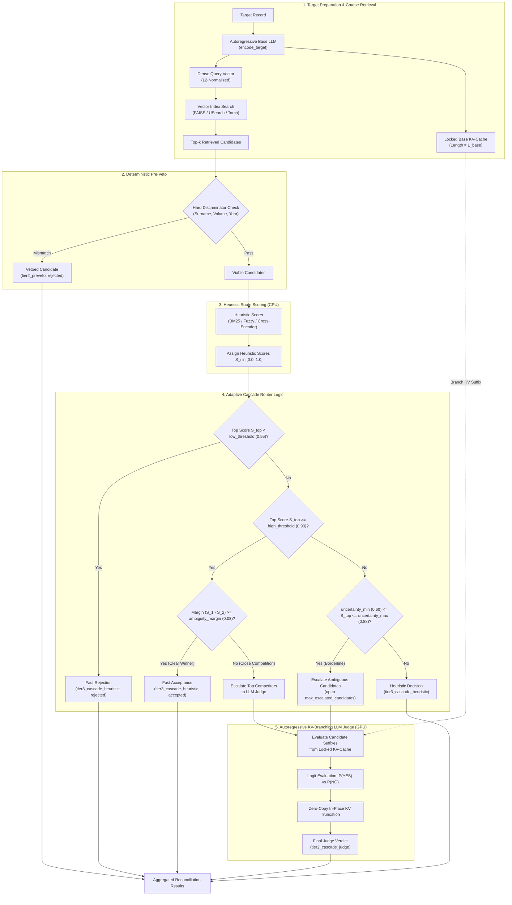
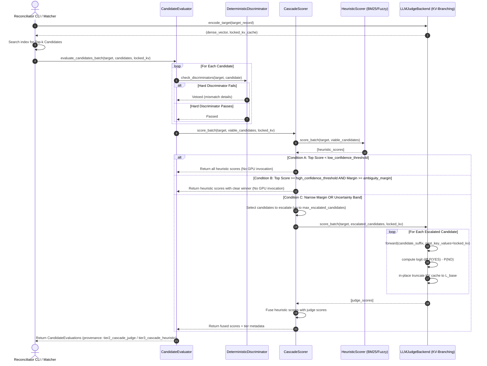
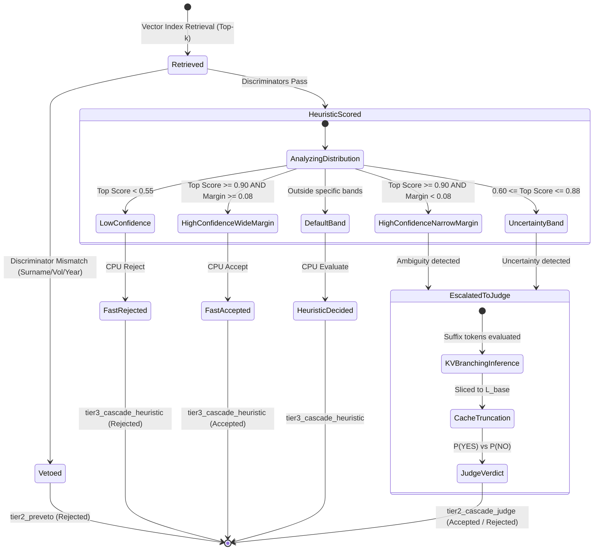

# Cascading Dual-Route Reranker and LLM Judge Architecture

## Executive Summary

This document specifies the technical architecture for the **Cascading / Adaptive Dual-Route Reranking Pipeline** in Reconciliator (`engine: "cascade"`). The system integrates fast deterministic heuristics (BM25, Fuzzy token matching, Cross-Encoder) with an autoregressive KV-Branching Large Language Model (LLM) judge into a single unified routing pipeline.

By performing coarse retrieval, hard deterministic pre-vetting, and heuristic score estimation upfront, the router classifies candidate sets dynamically. Straightforward acceptances and clear non-matches are resolved entirely on CPU with zero GPU cost. Only genuine ambiguities, close competitors, and borderline uncertainty cases are escalated to the autoregressive KV-Branching LLM Judge.

---

## 1. Motivation & The Resolution Dilemma

Bibliographic entity resolution at scale (e.g. 10M+ works, manifestations, and agents) presents a classic tradeoff between throughput and precision:

1. **Heuristic Rerankers (BM25, Fuzzy, Cross-Encoder)**:
   - *Pros*: Extremely high throughput ($\ge 5,000$ evaluations/second on CPU), zero VRAM footprint, deterministic behavior.
   - *Cons*: Prone to misclassifications on subtle semantic distinctions, complex multi-author attribution, and translated/transliterated titles.
2. **Autoregressive LLM Judges**:
   - *Pros*: Human-level discernment, deep contextual disambiguation, robust against noise and format variation.
   - *Cons*: GPU compute-intensive; even with KV-cache reuse, running every retrieved candidate through an autoregressive model limits pipeline throughput.

Empirical analysis of catalog reconciliation reveals that:
- **60%–70%** of candidate sets contain either an unmistakable exact match or solely distant false positives.
- **15%–25%** of candidate sets involve tight ambiguity: identical or near-identical titles by different authors, identical authors across consecutive publication years, or multi-volume editions where title similarity is $> 0.85$.

The **Cascading Dual-Route Reranker** bridges this gap: **cheap CPU heuristics handle the obvious ~80% of candidates, reserving the GPU LLM Judge exclusively for the ambiguous ~20%.**

---

## 2. Pipeline Architecture & Routing Logic

### 2.1 Complete Pipeline Flow Diagram



---

### 2.2 Sequence Interaction

The sequence diagram below details the exact message interactions between the coordinator, the candidate evaluator, the heuristic scorer, and the KV-branching judge backend.



---

### 2.3 Candidate State Lifecycle



---

## 3. Mathematical Decision Routing Formulation

Let $T$ denote the target query record and $C = \{c_1, c_2, \dots, c_n\}$ the set of candidate records surviving pre-veto checks.

### 3.1 Step 1: Deterministic Heuristic Scoring
Each candidate $c_i \in C$ is scored by the configured heuristic engine $\mathcal{H}$:
$$s_i^{\text{heur}} = \mathcal{H}(T, c_i) \in [0.0, 1.0]$$

Let the candidates be sorted such that $s_{(1)}^{\text{heur}} \ge s_{(2)}^{\text{heur}} \ge \dots \ge s_{(n)}^{\text{heur}}$, where:
- $s_{\text{top}} = s_{(1)}^{\text{heur}}$ is the highest heuristic score.
- $\Delta = s_{(1)}^{\text{heur}} - s_{(2)}^{\text{heur}}$ is the top-2 margin (with $\Delta = s_{\text{top}}$ if $|C| = 1$).

### 3.2 Step 2: Routing Invariants

The cascade router evaluates four mutually exclusive routing branches:

#### Condition A: Low-Confidence Fast Rejection
$$\text{If } s_{\text{top}} < \theta_{\text{low}} \quad (\text{default: } 0.55)$$
- **Action**: All candidates are rejected on the heuristic score alone.
- **GPU Cost**: $0$ FLOPs.
- **Tier Attribution**: `tier3_cascade_heuristic`.

#### Condition B: High-Confidence Clear Acceptance
$$\text{If } s_{\text{top}} \ge \theta_{\text{high}} \quad (\text{default: } 0.90) \quad \land \quad \Delta \ge \delta_{\text{margin}} \quad (\text{default: } 0.08)$$
- **Action**: The top candidate is confirmed as a match on heuristic score alone; remaining candidates are marked non-matches.
- **GPU Cost**: $0$ FLOPs.
- **Tier Attribution**: `tier3_cascade_heuristic`.

#### Condition C: High-Confidence Close Competition
$$\text{If } s_{\text{top}} \ge \theta_{\text{high}} \quad (\text{default: } 0.90) \quad \land \quad \Delta < \delta_{\text{margin}} \quad (\text{default: } 0.08)$$
- **Action**: The top candidates whose heuristic score satisfies $s_i^{\text{heur}} \ge (s_{\text{top}} - \delta_{\text{margin}})$ are escalated to the KV-Branching LLM Judge, capped at $m_{\text{max}}$ (`max_escalated_candidates`, default 5).
- **GPU Cost**: Only the top $k \le m_{\text{max}}$ candidates are evaluated with KV-cache reuse.
- **Tier Attribution**: Escalated candidates receive `tier2_cascade_judge`.

#### Condition D: Uncertainty Band
$$\text{If } \tau_{\text{min}} \le s_{\text{top}} \le \tau_{\text{max}} \quad (\text{default: } [0.60, 0.88])$$
- **Action**: All candidates with $s_i^{\text{heur}} \ge \tau_{\text{min}}$ (up to $m_{\text{max}}$) are escalated to the KV-Branching LLM Judge.
- **GPU Cost**: Evaluates only the ambiguous subset.
- **Tier Attribution**: Escalated candidates receive `tier2_cascade_judge`.

---

## 4. Configuration Specification

The cascade engine is fully exposed through the configuration surface without hardcoded magic numbers or hidden aliases.

### 4.1 YAML Configuration Snippet

```yaml
reconcile:
  rerank:
    engine: "cascade"  # Options: "cascade", "llm_judge", "bm25", "fuzzy", "cross_encoder", "noop"
    threshold: 0.65

    # Cascading Dual-Route Router Configuration
    cascade:
      heuristic_engine: "bm25"         # Heuristic engine: "bm25", "fuzzy", "cross_encoder"
      high_confidence_threshold: 0.90  # Above this with margin >= 0.08 -> fast acceptance (0 GPU)
      low_confidence_threshold: 0.55   # Below this -> fast rejection (0 GPU)
      ambiguity_margin: 0.08           # If top candidates differ by less than this, escalate to LLM judge
      uncertainty_band_min: 0.60       # Lower bound of uncertainty band
      uncertainty_band_max: 0.88       # Upper bound of uncertainty band
      max_escalated_candidates: 5      # Maximum candidates escalated to LLM judge per target

    # KV-Branching LLM Judge Configuration (used for escalated candidates)
    judge:
      model_name_or_path: "meta-llama/Llama-3.2-3B-Instruct"
      device: "auto"
      torch_dtype: "bfloat16"
      max_seq_len: 2048
      temperature: 0.0
      use_flash_attention: true
      in_place_cache_truncation: true

    # Heuristic Engine Configuration (used for the fast route)
    bm25:
      k1: 1.5
      b: 0.75
    fuzzy:
      scorer: "token_set_ratio"
```

### 4.2 Python Pydantic Configuration Model

The configuration schema is strictly typed via `CascadeRouterConfig` in `src/reconciliator/config.py`:

```python
class CascadeRouterConfig(BaseModel):
    model_config = ConfigDict(extra="forbid")

    heuristic_engine: str = Field(
        default="bm25",
        description="Fast heuristic engine to score candidates first: 'bm25', 'fuzzy', or 'cross_encoder'",
    )
    high_confidence_threshold: float = Field(
        default=0.90,
        ge=0.0,
        le=1.0,
        description="Heuristic score at or above which a candidate is accepted without LLM judge if margin holds",
    )
    low_confidence_threshold: float = Field(
        default=0.55,
        ge=0.0,
        le=1.0,
        description="Heuristic score below which candidates are rejected without LLM judge",
    )
    ambiguity_margin: float = Field(
        default=0.08,
        ge=0.0,
        le=1.0,
        description="Minimum score gap required between top candidate and 2nd candidate to avoid LLM escalation",
    )
    uncertainty_band_min: float = Field(
        default=0.60,
        ge=0.0,
        le=1.0,
        description="Lower bound of heuristic score uncertainty band; scores in this range trigger LLM escalation",
    )
    uncertainty_band_max: float = Field(
        default=0.88,
        ge=0.0,
        le=1.0,
        description="Upper bound of heuristic score uncertainty band",
    )
    max_escalated_candidates: int = Field(
        default=5,
        ge=1,
        description="Maximum number of ambiguous candidates to escalate to LLM judge per target",
    )
```

---

## 5. Decision Provenance & Traceability

Every reconciled match retains full auditability of the decision path via the `matched_tier` and `details` fields:

| Scenario | Evaluator Tier (`matched_tier`) | Score Source | GPU Invocations |
| :--- | :--- | :--- | :--- |
| Hard Discriminator Mismatch | `tier2_preveto` | Hard rule violation (`surname_mismatch`, `volume_mismatch`) | 0 |
| Fast Heuristic Accept ($s \ge 0.90, \Delta \ge 0.08$) | `tier3_cascade_heuristic` | BM25 / Fuzzy / Cross-Encoder | 0 |
| Fast Heuristic Reject ($s < 0.55$) | `tier3_cascade_heuristic` | BM25 / Fuzzy / Cross-Encoder | 0 |
| Ambiguous Competition ($\Delta < 0.08$) | `tier2_cascade_judge` | Autoregressive KV-Branching Logit Diff | 1 per escalated candidate |
| Uncertainty Band ($[0.60, 0.88]$) | `tier2_cascade_judge` | Autoregressive KV-Branching Logit Diff | 1 per escalated candidate |

This provenance ensures downstream consumers can distinguish between deterministic heuristic matches and deep LLM classifications during reporting, auditing, or human review.

