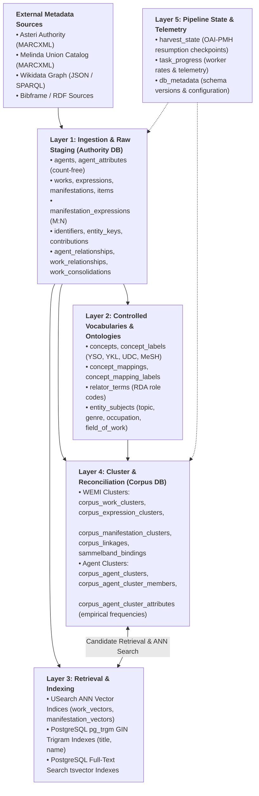
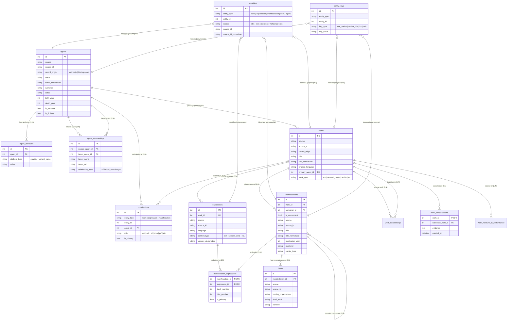
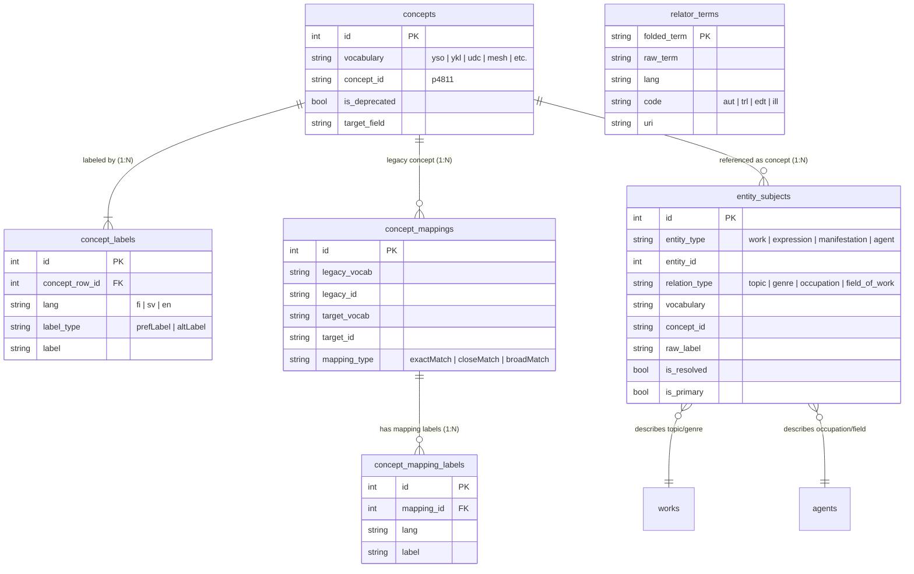
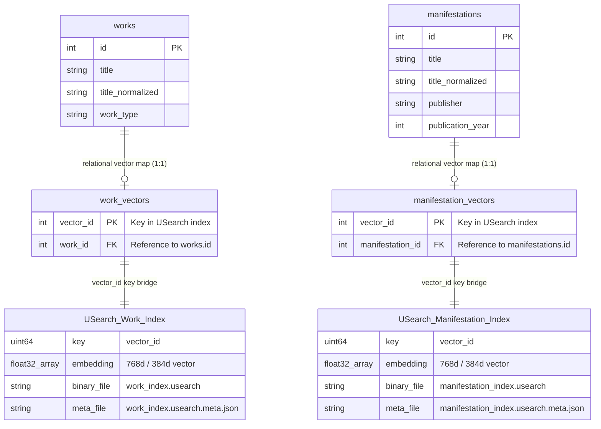
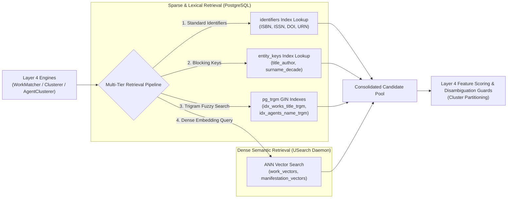
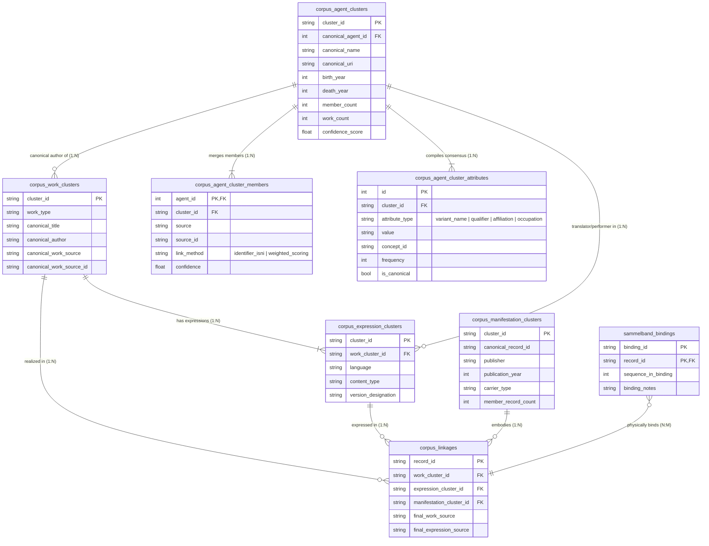
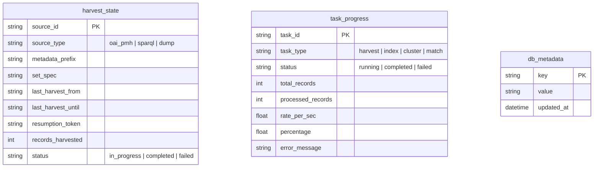
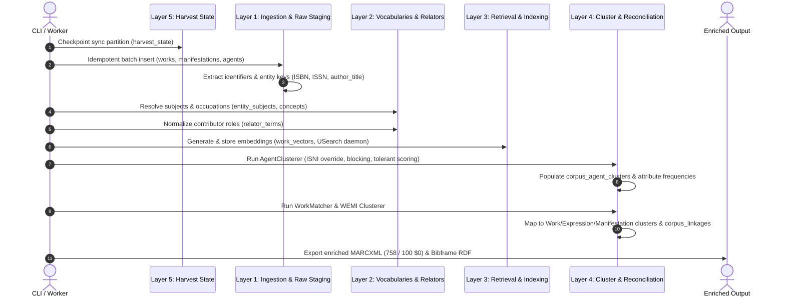

# Reconciliator Data Model Architecture

This document provides a comprehensive specification of the multi-layer data model in Reconciliator. It describes each layer's role, entities, and use cases, accompanied by Mermaid relationship diagrams.

---

## 1. Overview & Multi-Layer Architecture

Reconciliator organizes bibliographic and authority metadata into **five decoupled functional layers**:

1. **Ingestion & Raw Staging Layer**: Stores immutable, provenance-tracked, source-specific bibliographic and authority records. Ingestion is **100% idempotent** without heuristic merges or count aggregations.
2. **Controlled Vocabularies & Subject Ontologies Layer**: Standardizes concepts, subject headings, classification codes, and contributor relators across Finnish and international vocabularies (YSO, YKL, UDC, MeSH, RDA).
3. **Vector & Trigram Retrieval Index Layer**: Provides dual-index retrieval capabilities: dense semantic vector representations for multilingual similarity and fast sparse/trigram PostgreSQL indexes for lexical blocking.
4. **Cluster & Reconciliation Layer (Corpus Subsystem)**: Reconciles cross-source records into first-class **WEMI Intellectual Clusters** (Works, Expressions, Manifestations) and **Agent Identity Clusters** with empirical attribute frequency distributions and canonical representative hoisting.
5. **Pipeline State, Telemetry & Metadata Layer**: Manages resumable OAI-PMH harvesting checkpoints, worker thread telemetry, progress monitoring, and database version metadata.

### High-Level Architectural Graph

### Core Design Principles
- **Zero Hardcoding**: All weights, tolerances, blocking keys, authority precedence, and vocabularies are configured dynamically via [`defaults.yaml`].
- **Decoupled Relational Entities**: No JSON blob packing for queryable entities; relationships, subjects, and attributes are modeled as first-class relational tables.
- **Idempotency**: Ingesting a batch twice produces identical database state without duplicate rows or unbounded counter increments.
- **Strict Separation of Raw and Cluster Domains**: Raw staging preserves exact source evidence; consensus values, canonical entities, and frequencies are computed exclusively in the cluster layer. Work consolidation decisions are isolated in `work_consolidations` rather than mutating immutable raw work rows.

---

## 2. Layer 1: Ingestion & Raw Staging Layer

### Purpose & Use Cases
The Raw Staging Layer stores the ingested bibliographic and authority records as close to their source representation as possible while normalizing them into the IFLA LRM / FRBR conceptual model:
- **Authority Grounding**: Stores person and corporate bodies (`agents`) without artificial counts or premature merges.
- **Multi-Expression Support**: Supports complex manifestations (e.g. musical anthologies, multi-work vinyl records, translated omnibus editions) via the `manifestation_expressions` junction table.
- **Structural Linkages & Consolidation**: Captures sequential and parent-child work hierarchies (`work_relationships`), physical item copies (`items`), agent affiliations or pseudonyms (`agent_relationships`), and records audited canonical work equivalence decisions and rationale in `work_consolidations` without altering raw work entities.
- **Deterministic Keying**: Extracts polymorphic identifiers (ISBN, ISSN, DOI, URN, ISNI, VIAF, ORCID) into `identifiers` and blocking signatures into `entity_keys`.

### Entity-Relationship Diagram

---

## 3. Layer 2: Controlled Vocabularies & Subject Ontologies Layer

### Purpose & Use Cases
The Vocabulary Layer standardizes semantic metadata across multiple vocabularies and languages:
- **Concept Harmonization**: Ingests concepts from YSO (General Finnish Ontology), YKL, UDC, and MeSH.
- **Multilingual Subject Resolution**: Resolves Finnish, Swedish, and English preferred and alternative labels (`concept_labels`) into unified concept IDs.
- **Vocabulary Mapping**: Maps legacy or specialized vocabularies into target authority ontologies (`concept_mappings`).
- **Entity Subject Grounding**: Links Works, Expressions, Manifestations, and Agents to controlled concepts (`entity_subjects`) with specific relationship types (`topic`, `genre`, `occupation`, `field_of_work`).
- **Relator Standardization**: Maps raw textual role strings (e.g. `"kirjoittaja"`, `"författare"`, `"author"`) to standardized MARC/RDA relator codes (`relator_terms`).

### Entity-Relationship Diagram

---

## 4. Layer 3: Vector & Trigram Retrieval Index Layer

### Purpose & Use Cases
The Retrieval Index Layer acts as the **computational retrieval engine for Layer 4 (Cluster & Reconciliation)**. Pairwise comparison across millions of works and agents is $O(N^2)$, making brute-force reconciliation computationally impossible. Layer 3 reduces this search space into a high-precision candidate set:
- **Fast Lexical Blocking**: Uses PostgreSQL `pg_trgm` (trigram) GIN indexes on `title_normalized` and `name_normalized` to generate candidate match pairs in milliseconds.
- **Full-Text Lexical Search (FTS)**: Evaluates `to_tsvector('simple', serialized_text)` for unstructured bibliographic text matching.
- **Dense Semantic Retrieval**: Employs USearch vector index engines (`work_vectors`, `manifestation_vectors`, `agent_index`) managed by an IPC daemon to retrieve semantic nearest neighbors when lexical variations, differing subtitles, or language translations prevent exact token matching.

### Vector Index Architecture & Relational Mapping
Reconciliator uses a hybrid vector architecture that couples relational PostgreSQL mapping tables with high-performance USearch HNSW (Hierarchical Navigable Small World) binary indexes on disk:

### Inverted Trigram & Full-Text Search (FTS) Indexes
In addition to dense vector embeddings, Layer 3 provisions PostgreSQL GIN trigram and lexical text search indexes directly on Layer 1 entity tables:

| Index Name | Table & Target Column | Index Type / Opclass | Use Case |
| :--- | :--- | :--- | :--- |
| `idx_works_title_trgm` | `works.title_normalized` | `GIN (gin_trgm_ops)` | Fast fuzzy title matching, handling typos and punctuation differences |
| `idx_agents_name_trgm` | `agents.name_normalized` | `GIN (gin_trgm_ops)` | Fast fuzzy agent name candidate blocking |
| `idx_manifestations_title_trgm` | `manifestations.title_normalized` | `GIN (gin_trgm_ops)` | Fast fuzzy manifestation title blocking |
| `idx_works_fts` | `works.serialized_text` | `GIN (to_tsvector('simple', ...))` | Lexical search on serialized MARC fields (titles, notes, classifications) |
| `idx_expressions_fts` | `expressions.serialized_text` | `GIN (to_tsvector('simple', ...))` | Full-text search on language, notes, and music instrumentation |
| `idx_manifestations_fts` | `manifestations.serialized_text` | `GIN (to_tsvector('simple', ...))` | Full-text search across complete manifestation metadata |

### How Layer 4 Uses Layer 3
The engines in Layer 4 (`WorkMatcher`, `Clusterer`, and `AgentClusterer`) actively query Layer 3 in a progressive multi-tier funnel:
1. **Tier 1 (Exact Identifier Lookup)**: Queries `identifiers` for ISBN, ISSN, DOI, URN, ISNI, or VIAF matches.
2. **Tier 2 (Blocking Key Matching)**: Queries `entity_keys` for standardized bibliographic signatures (`title_author`, `author_title`, `surname_decade`).
3. **Tier 3 (Trigram Title & Author Fuzzy Search)**: Queries `pg_trgm` indexes with threshold cutoffs to capture typographic errors and punctuation shifts.
4. **Tier 4 (Dense Vector Semantic Search)**: Queries the USearch ANN vector daemon using dual-encoder embeddings to discover translations, cross-format adaptations (audiobooks, radio plays), and radically altered title formulations.

### Index & Retrieval Flow Diagram

---

## 5. Layer 4: Cluster & Reconciliation Layer (Corpus Subsystem)

### Purpose & Use Cases
The Cluster Layer stores the consolidated real-world entities produced by reconciliation:
- **WEMI Intellectual Clusters**:
  - `corpus_work_clusters`: Conceptual Work identity (e.g. *Sinuhe egyptiläinen*).
  - `corpus_expression_clusters`: Language, content type, and version designation of a work (e.g. Swedish translation by Ole Torvalds).
  - `corpus_manifestation_clusters`: Physical and digital publications, collapsing publisher and print run duplicates.
  - `corpus_linkages`: Record-level routing map from any source record ID to its exact Work, Expression, and Manifestation clusters.
  - `sammelband_bindings`: Models "bound-with" composite codices where multiple distinct bibliographic works are bound into a single physical binding.
- **Agent Identity Clusters**:
  - `corpus_agent_clusters`: Unified person or corporate entity head, electing a canonical record by configured source precedence (Asteri $\to$ Wikidata $\to$ Melinda).
  - `corpus_agent_cluster_members`: Complete provenance linking every member agent with its specific `link_method` (`identifier_isni`, `weighted_scoring`, etc.) and confidence score.
  - `corpus_agent_cluster_attributes`: Aggregated frequency counts for all variant names, qualifiers, affiliations, and occupations.

### Active Dependency on Layer 3 (Retrieval & Indexing)
Layer 4 does not perform passive storage; its clustering engines depend directly on Layer 3:
- **Work & Expression Clustering**: `Clusterer` and `WorkMatcher` query Layer 3 vector indices and trigram indexes to discover candidates across sources. Without Layer 3, cross-lingual work clustering (e.g. matching a Finnish original to its French edition with a completely translated title) would be impossible.
- **Agent Identity Clustering**: `AgentClusterer` queries Layer 3 multi-key blocking strategies (`name_normalized`, `surname_decade`, `folded_surname`, `variant_names`) to group candidate pairs before running tolerant scoring and Union-Find graph partitioning.
- **Target Record Routing**: Incoming records matched by `WorkMatcher` use Layer 3 to resolve against existing clusters, persisting the resulting coordinates into `corpus_linkages`.

### Entity-Relationship Diagram

---

## 6. Layer 5: Pipeline State, Telemetry & Metadata Layer

### Purpose & Use Cases
The Pipeline State Layer provides operational reliability and monitoring:
- **Resumable OAI-PMH Harvesting**: Tracks source synchronization partitions, timestamps, and resumption tokens (`harvest_state`), enabling fault-tolerant incremental sync.
- **Asynchronous Task Telemetry**: Stores worker progress, transfer rates (records/sec, bytes/sec), percentages, and error states (`task_progress`) for live terminal UI monitoring.
- **System Metadata**: Maintains schema versions, indexing timestamps, and configuration hashes (`db_metadata`).

### Entity Diagram

---

## 7. End-to-End Lifecycle & Data Flow

The following sequence diagram illustrates how an incoming bibliographic record is processed through all five layers of the data model:

---

## 8. Summary Table of Database Tables

| Table Name | Layer | Purpose | Primary Key |
| :--- | :---: | :--- | :--- |
| `agents` | 1 | Raw person and organization entities | `id` (autoincrement) |
| `agent_attributes` | 1 | Unweighted intrinsic qualifiers and variant names | `id` (autoincrement) |
| `agent_relationships` | 1 | Person-to-org affiliations and pseudonyms | `id` (autoincrement) |
| `works` | 1 | Distinct intellectual/artistic creations | `id` (autoincrement) |
| `expressions` | 1 | Linguistic/musical realizations of works | `id` (autoincrement) |
| `manifestations` | 1 | Physical/digital publication editions | `id` (autoincrement) |
| `manifestation_expressions` | 1 | M:N embodiment junction with track numbers | `(manifestation_id, expression_id)` |
| `items` | 1 | Physical copy holdings and shelf marks | `id` (autoincrement) |
| `identifiers` | 1 | Polymorphic external identifiers (ISBN, ISNI, etc.) | `id` (autoincrement) |
| `entity_keys` | 1 | Polymorphic blocking and lookup signatures | `id` (autoincrement) |
| `contributions` | 1 | Roles linking agents to works/expressions | `id` (autoincrement) |
| `work_relationships` | 1 | Work-to-work relationships (series, adaptations) | `id` (autoincrement) |
| `work_consolidations` | 1 | Reconciled work equivalences and evidence | `work_id` (FK to works.id) |
| `work_medium_of_performance`| 1 | Musical instrumentation and scoring details | `(work_id, medium_uri)` |
| `concepts` | 2 | Controlled vocabulary concept identifiers | `id` (autoincrement) |
| `concept_labels` | 2 | Multilingual preferred and alternative labels | `id` (autoincrement) |
| `concept_mappings` | 2 | Mappings across vocabulary systems | `id` (autoincrement) |
| `relator_terms` | 2 | Normalized contributor role term mappings | `folded_term` |
| `entity_subjects` | 2 | Subject/topic/genre/occupation linkages | `id` (autoincrement) |
| `work_vectors` | 3 | Work dense semantic embedding vectors | `vector_id` |
| `manifestation_vectors` | 3 | Manifestation dense embedding vectors | `vector_id` |
| `corpus_work_clusters` | 4 | Reconciled conceptual work clusters | `cluster_id` |
| `corpus_expression_clusters`| 4 | Reconciled expression clusters | `cluster_id` |
| `corpus_manifestation_clusters`| 4 | Reconciled manifestation clusters | `cluster_id` |
| `corpus_linkages` | 4 | Record-level routing map to WEMI clusters | `record_id` |
| `sammelband_bindings` | 4 | Composite bound-with volume constituent map | `(binding_id, record_id)` |
| `corpus_agent_clusters` | 4 | Reconciled agent identity clusters | `cluster_id` |
| `corpus_agent_cluster_members`| 4 | Member provenance and confidence scores | `agent_id` |
| `corpus_agent_cluster_attributes`| 4 | Empirical frequencies of consensus attributes | `id` (autoincrement) |
| `harvest_state` | 5 | OAI-PMH synchronization checkpoints | `source_id` |
| `task_progress` | 5 | Asynchronous worker telemetry and rates | `task_id` |
| `db_metadata` | 5 | Schema version and system configuration metadata | `key` |

