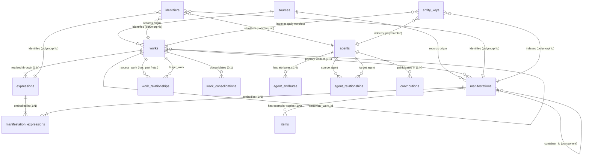
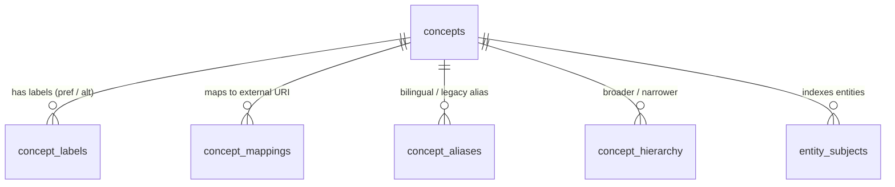
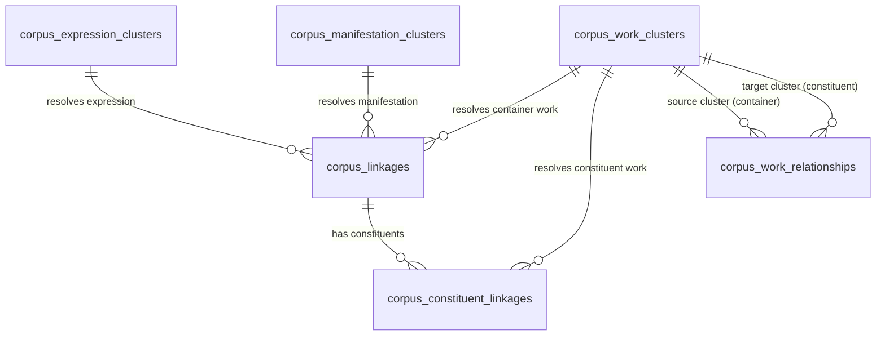

# Reconciliator Data Model Architecture

This document specifies the complete, authoritative database schema and entity model implemented in Reconciliator. It describes each table, relationship, index, and use case across all **43 relational tables** defined in [`src/reconciliator/database/schema.py`](file:///Users/mikkovihonen/Workspace/reconciliator/src/reconciliator/database/schema.py).

---

## 1. Storage Architecture Overview

Reconciliator operates on a single unified relational engine in **PostgreSQL 15+** (leveraging `pg_trgm` trigram similarity and full-text search extensions).

The 43 tables are organized into **ten decoupled functional domains**:

1. **System & Source Registry** (`db_metadata`, `sources`)
2. **Core IFLA LRM / FRBR WEMI Entities** (`works`, `expressions`, `manifestations`, `manifestation_expressions`, `items`)
3. **Agents & Contributions** (`agents`, `agent_attributes`, `agent_relationships`, `contributions`)
4. **Polymorphic Identifiers & Blocking Keys** (`identifiers`, `entity_keys`)
5. **Work Relationships & Cross-Source Consolidation** (`work_relationships`, `work_consolidations`)
6. **Dense Vector Embeddings** (`work_vectors`, `manifestation_vectors`)
7. **Harvester State & Operational Telemetry** (`harvest_state`, `task_progress`)
8. **Controlled Vocabularies & Subject Ontologies** (`concepts`, `concept_labels`, `concept_mappings`, `concept_mapping_labels`, `concept_aliases`, `concept_hierarchy`, `relator_terms`, `entity_subjects`)
9. **WEMI Multiplex Corpus Clustering** (`corpus_work_clusters`, `corpus_expression_clusters`, `corpus_manifestation_clusters`, `corpus_linkages`, `corpus_constituent_linkages`, `corpus_work_relationships`, `sammelband_bindings`)
10. **Agent Identity Clusters, Lifecycle & Review Auditing** (`corpus_agent_clusters`, `corpus_agent_cluster_members`, `corpus_agent_cluster_attributes`, `corpus_agent_relationships`, `cluster_lifecycle_events`, `cluster_redirections`, `review_changesets`, `changeset_operations`, `entity_pins`)

---

## 2. Core WEMI & Relationship Schema

### Entity-Relationship Diagram



### 2.1 WEMI Tables

#### `works`
The conceptual intellectual creation.
- `id` (INTEGER, PK, autoincrement)
- `source` (VARCHAR(64), NOT NULL): Origin source identifier (e.g. `melinda`, `kanto`, `koha`).
- `source_id` (VARCHAR(255), NOT NULL): Native record control number or content-derived hash.
- `record_origin` (VARCHAR(64), NOT NULL): Provenance catalog tag.
- `title` (VARCHAR(1024), NOT NULL): Primary or uniform title string.
- `title_normalized` (VARCHAR(1024), NOT NULL, indexed): Lowercase, punctuation-stripped search key.
- `original_language` (VARCHAR(16), nullable): ISO 639-2/3 code.
- `primary_agent_id` (INTEGER, FK `agents.id`, nullable).
- `work_type` (VARCHAR(64), NOT NULL, default `'text'`): Classification from SLM/Leader (e.g. `text`, `notated_music`, `audio`, `cartography`, `moving_image`).
- `canonical_work_id` (INTEGER, FK `works.id`, nullable): Self-referential pointer recording canonical work election by `consolidate-works`.
- *Constraints & Indexes*: Unique `(source, source_id)`, index on `canonical_work_id`, trigram index on `title_normalized`.

#### `expressions`
The specific intellectual or artistic realization of a work.
- `id` (INTEGER, PK, autoincrement)
- `work_id` (INTEGER, FK `works.id`, NOT NULL)
- `source` (VARCHAR(64), NOT NULL), `source_id` (VARCHAR(255), NOT NULL)
- `record_origin` (VARCHAR(64), NOT NULL)
- `language` (VARCHAR(16), nullable): Realization language.
- `content_type` (VARCHAR(64), nullable): RDA content type (e.g. `spoken_word`, `performed_music`, `text`).
- `version_designation` (VARCHAR(255), nullable): Edition/revision/arrangement statement.
- `original_script_title` (VARCHAR(1024), nullable)
- `title_normalized` (VARCHAR(1024), nullable)
- *Constraints*: Unique `(source, source_id)`.

#### `manifestations`
The physical or digital embodiment of an expression.
- `id` (INTEGER, PK, autoincrement)
- `work_id` (INTEGER, FK `works.id`, nullable): Primary work shortcut.
- `expression_id` (INTEGER, FK `expressions.id`, nullable): Primary expression shortcut.
- `source` (VARCHAR(64), NOT NULL), `source_id` (VARCHAR(255), NOT NULL)
- `record_origin` (VARCHAR(64), NOT NULL)
- `title` (VARCHAR(1024), NOT NULL), `title_normalized` (VARCHAR(1024), NOT NULL)
- `year` (INTEGER, nullable, indexed): Validated 4-digit publication year.
- `publisher` (VARCHAR(512), nullable)
- `place_of_publication` (VARCHAR(255), nullable)
- `edition_statement` (VARCHAR(255), nullable)
- `extent` (VARCHAR(255), nullable)
- `carrier` (VARCHAR(64), default `'volume'`): RDA carrier code.
- `format` (VARCHAR(32), default `'marcxml'`): Source serialization syntax.
- `container_id` (INTEGER, FK `manifestations.id`, nullable): Self-reference for host-item component parts (MARC 773).
- `is_component` (BOOLEAN, default `FALSE`): True when the manifestation is an article, chapter, or track.
- `component_type` (VARCHAR(32), nullable): `track`, `article`, `chapter`, `episode`.
- `pagination` (VARCHAR(128), nullable)
- *Constraints*: Unique `(source, source_id)`.

#### `manifestation_expressions`
M:N junction table mapping multiple expressions into complex manifestations (anthologies, sound recordings, polyglot editions).
- `id` (INTEGER, PK, autoincrement)
- `manifestation_id` (INTEGER, FK `manifestations.id`, NOT NULL)
- `expression_id` (INTEGER, FK `expressions.id`, NOT NULL)
- `track_number` (INTEGER, nullable): Position on disc/album.
- `disc_number` (INTEGER, default `1`)
- `duration` (VARCHAR(32), nullable)
- `is_primary` (BOOLEAN, default `TRUE`)
- *Constraints*: Unique `(manifestation_id, expression_id)`.

#### `items`
Exemplar copies, physical holdings, or digital instances.
- `id` (INTEGER, PK, autoincrement)
- `manifestation_id` (INTEGER, FK `manifestations.id`, NOT NULL)
- `source` (VARCHAR(64), NOT NULL), `source_id` (VARCHAR(255), NOT NULL)
- `holding_organization` (VARCHAR(128), nullable)
- `call_number` (VARCHAR(128), nullable)
- `barcode` (VARCHAR(64), nullable)
- `shelf_mark` (VARCHAR(128), nullable)
- `electronic_locator` (VARCHAR(1024), nullable): Actionable URL/URN.
- *Constraints*: Unique `(source, source_id)`.

---

## 3. Work Relationships & Pure-Graph Aggregates

Containment and hierarchical work relationships are modeled as pure graph edges in `work_relationships` and `corpus_work_relationships` (zero boolean flags or shims).

### `work_relationships`
Inter-work relationship edges between stored Works.
- `id` (INTEGER, PK, autoincrement)
- `source_work_id` (INTEGER, FK `works.id`, NOT NULL)
- `target_work_id` (INTEGER, FK `works.id`, nullable)
- `target_title` (VARCHAR(1024), nullable)
- `relationship_type` (VARCHAR(32), NOT NULL):
  - `'has_part'`: Container work contains constituent work (1-based `sequence_number`).
  - `'part_of'`: Constituent work is part of container work.
  - `'translation_of'`: Target is the original language work.
  - `'arranged_from'`: Target is the original composition.
  - `'adaptation_of'`, `'continuation_of'`, `'preceded_by'`, `'succeeded_by'`, etc.
- `target_uri` (VARCHAR(1024), nullable)
- `sequence_number` (INTEGER, nullable): 1-based track or sequence order.
- `confidence` (FLOAT, default `1.0`)
- *Indexes*: `idx_work_rel_source_type_seq` on `(source_work_id, relationship_type, sequence_number)`.

### Dynamic Aggregate Check
Determining whether a Work is an aggregate is queried dynamically from graph topology:
```sql
SELECT 1 FROM work_relationships 
WHERE source_work_id = :work_id AND relationship_type = 'has_part'
LIMIT 1;
```

---

## 4. Agents & Polymorphic Keys

### `agents`
Person, corporate, and conference authorities.
- `id` (INTEGER, PK, autoincrement)
- `source` (VARCHAR(64), NOT NULL), `source_id` (VARCHAR(255), NOT NULL)
- `record_origin` (VARCHAR(64), NOT NULL)
- `name` (VARCHAR(512), NOT NULL), `name_normalized` (VARCHAR(512), NOT NULL)
- `surname` (VARCHAR(255), nullable)
- `dates` (VARCHAR(128), nullable)
- `birth_year` (INTEGER, nullable), `death_year` (INTEGER, nullable)
- `is_personal` (BOOLEAN, default `TRUE`)
- `is_fictional` (BOOLEAN, default `FALSE`): Safeguards against transferring fictional identities to real persons.
- *Constraints*: Unique `(source, source_id)`.

### `contributions`
Polymorphic attribution linking agents to Works, Expressions, or Manifestations.
- `id` (INTEGER, PK, autoincrement)
- `entity_type` (VARCHAR(32), NOT NULL): `'work'`, `'expression'`, `'manifestation'`.
- `entity_id` (INTEGER, NOT NULL)
- `agent_id` (INTEGER, FK `agents.id`, NOT NULL)
- `role` (VARCHAR(32), default `'ctb'`): Normalized MARC/RDA relator code (e.g. `'aut'`, `'cmp'`, `'edt'`, `'trl'`, `'ill'`).
- `is_primary` (BOOLEAN, default `FALSE`)
- *Constraints*: Unique `(entity_type, entity_id, agent_id, role)`.

### `identifiers`
Polymorphic storage of standard, externally-meaningful identifiers.
- `id` (INTEGER, PK, autoincrement)
- `entity_type` (VARCHAR(32), NOT NULL): `'work'`, `'expression'`, `'manifestation'`, `'agent'`.
- `entity_id` (INTEGER, NOT NULL)
- `scheme` (VARCHAR(32), NOT NULL): `'isbn'`, `'issn'`, `'ismn'`, `'doi'`, `'urn'`, `'kanto_pn'`, `'kanto_cn'`, `'isni'`, `'viaf'`, `'wikidata'`.
- `value` (VARCHAR(512), NOT NULL)
- `value_normalized` (VARCHAR(512), NOT NULL, indexed): Stripped punctuation and hyphens for exact lookup.
- *Constraints*: Unique `(entity_type, entity_id, scheme, value_normalized)`.

### `entity_keys`
Polymorphic storage of derived blocking keys emitted during ingest.
- `id` (INTEGER, PK, autoincrement)
- `entity_type` (VARCHAR(32), NOT NULL): `'work'`, `'manifestation'`, `'agent'`.
- `entity_id` (INTEGER, NOT NULL)
- `key_type` (VARCHAR(32), NOT NULL): `'work'` (author+title), `'title_stem'`, `'uniform_title'`, `'music_work'`, `'citation'`, `'patent'`, `'analytic'`, `'analytic_title'`.
- `key_value` (VARCHAR(1024), NOT NULL)
- `key_normalized` (VARCHAR(1024), NOT NULL, indexed)

---

## 5. Controlled Vocabularies & Subject Ontologies

Standardizes concepts and subject headings across Finnish national ontologies (YSO, KAUNO, MUSO, SLM, SEKO).



- **`concepts`**: Concept identifiers (`uri`, `vocabulary`, `code`, `scheme`).
- **`concept_labels`**: Multilingual preferred and alternative labels (`concept_id`, `language`, `label`, `is_preferred`).
- **`concept_mappings`**: Cross-vocabulary concordances (`source_concept_id`, `target_uri`, `mapping_type` e.g. `exactMatch`, `closeMatch`).
- **`concept_aliases`**: Legacy thesaurus folding aliases (YSA $\rightarrow$ YSO, Kaunokki $\rightarrow$ KAUNO).
- **`relator_terms`**: RDA role terms mapped to 3-letter MARC relator codes.
- **`entity_subjects`**: Direct subject attribution (`entity_type`, `entity_id`, `concept_id`, `field_tag`, `category`).

---

## 6. WEMI Multiplex Corpus Clustering Subsystem

Tracks intra-corpus co-reference resolution and bottom-up constituent containment.



### `corpus_work_clusters`
- `cluster_id` (VARCHAR(64), PK): Deterministic hash `va_work_{sha256}`.
- `canonical_work_uri` (VARCHAR(1024), nullable): Authority work URI adopted by hoisting.
- `title` (VARCHAR(1024), NOT NULL), `author_key` (VARCHAR(255), nullable), `work_type` (VARCHAR(64), NOT NULL).
- `member_count` (INTEGER, NOT NULL, default `1`).

### `corpus_linkages`
Maps each container record to its resolved clusters.
- `record_id` (VARCHAR(255), PK)
- `work_cluster_id` (VARCHAR(64), FK `corpus_work_clusters.cluster_id`)
- `expression_cluster_id` (VARCHAR(64), FK `corpus_expression_clusters.cluster_id`)
- `manifestation_cluster_id` (VARCHAR(64), FK `corpus_manifestation_clusters.cluster_id`)
- `final_work_uri` (TEXT, nullable), `confidence` (FLOAT, default `1.0`).

### `corpus_constituent_linkages`
Stores $N$ constituent track/song/article links per container record.
- `id` (SERIAL, PK)
- `record_id` (VARCHAR, FK `corpus_linkages.record_id` ON DELETE CASCADE)
- `constituent_ordinal` (INTEGER, NOT NULL, default `1`): 1-based track or item position.
- `constituent_work_id` (VARCHAR, NOT NULL)
- `constituent_work_cluster_id` (VARCHAR, FK `corpus_work_clusters.cluster_id`)
- `title` (VARCHAR, NOT NULL), `creator` (VARCHAR, nullable)
- `field_tag` (VARCHAR(64), nullable): MARC `730`/`700` or RDF `bffi:hasPart`.
- `final_work_uri` (TEXT, nullable): Canonical authority URI injected during enrichment.
- `confidence` (FLOAT, default `1.0`)
- *Constraints*: Unique `(record_id, constituent_ordinal)`.

### `corpus_work_relationships`
Inter-cluster whole-part relationships between container clusters and constituent clusters.
- `id` (SERIAL, PK)
- `source_cluster_id` (VARCHAR, FK `corpus_work_clusters.cluster_id` ON DELETE CASCADE)
- `target_cluster_id` (VARCHAR, FK `corpus_work_clusters.cluster_id` ON DELETE CASCADE)
- `relationship_type` (VARCHAR(32), NOT NULL, default `'has_part'`)
- `sequence_number` (INTEGER, nullable)
- `confidence` (FLOAT, default `1.0`)
- *Constraints*: Unique `(source_cluster_id, target_cluster_id, relationship_type)`.

---

## 7. Review, Changesets & Pinning

Auditing and human-in-the-loop review operations:
- **`review_changesets`**: Batches of manual overrides or cluster merges (`status`, `author`, `reason`).
- **`changeset_operations`**: Atomic operations (`action`, `target_entity_type`, `parameters`).
- **`entity_pins`**: Explicit pinning locking an entity to a specific cluster or preventing unwanted automatic merges.
- **`cluster_lifecycle_events`** & **`cluster_redirections`**: Audit log recording cluster creations, splits, and tombstone redirections.

---

## 8. Indexing Architecture & Search Strategy

| Index Type | Targeted Columns | Purpose |
|---|---|---|
| B-Tree | `works.source_id`, `works.canonical_work_id`, `work_relationships(source_work_id, relationship_type, sequence_number)` | Fast primary key lookups, hierarchy traversal, and foreign key cascade seeks. |
| B-Tree Normalised | `identifiers.value_normalized`, `entity_keys.key_normalized` | Exact, O(1) Tier-1 identifier matching and blocking dispatch. |
| Trigram (`pg_trgm` GIN) | `works.title_normalized`, `agents.name_normalized` | Substring and typo-tolerant fuzzy matching without full table scans. |
| Vector ANN | `work_vectors`, `manifestation_vectors` | Dense cosine similarity nearest-neighbor semantic search (FAISS / PyTorch). |
