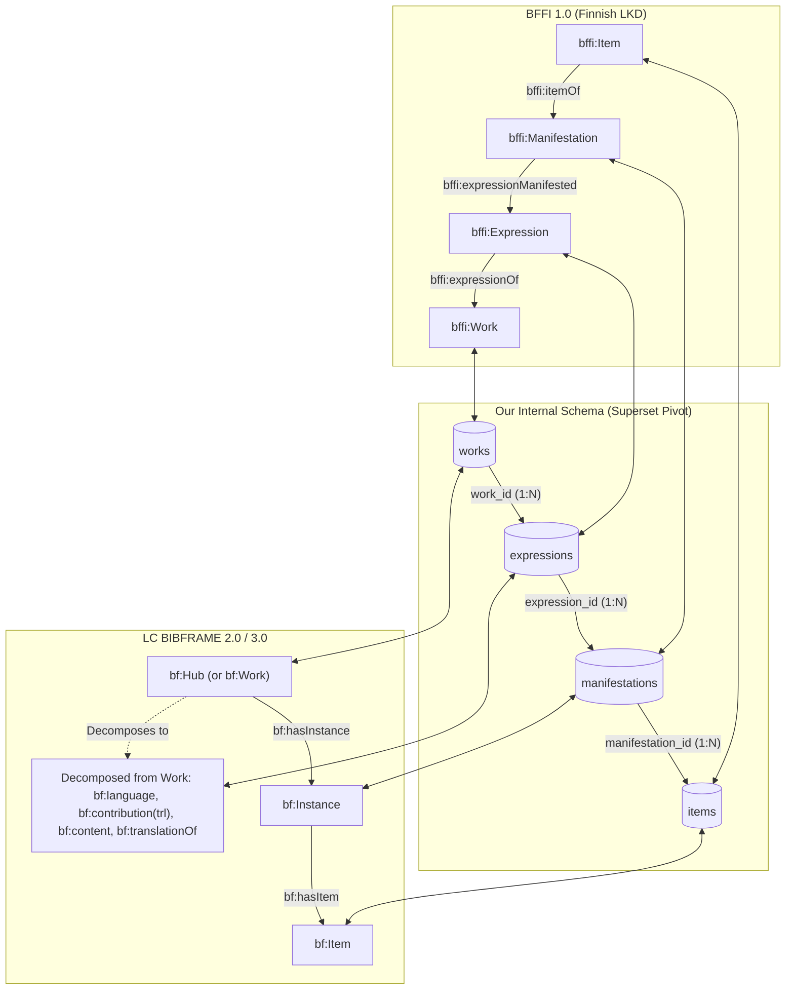
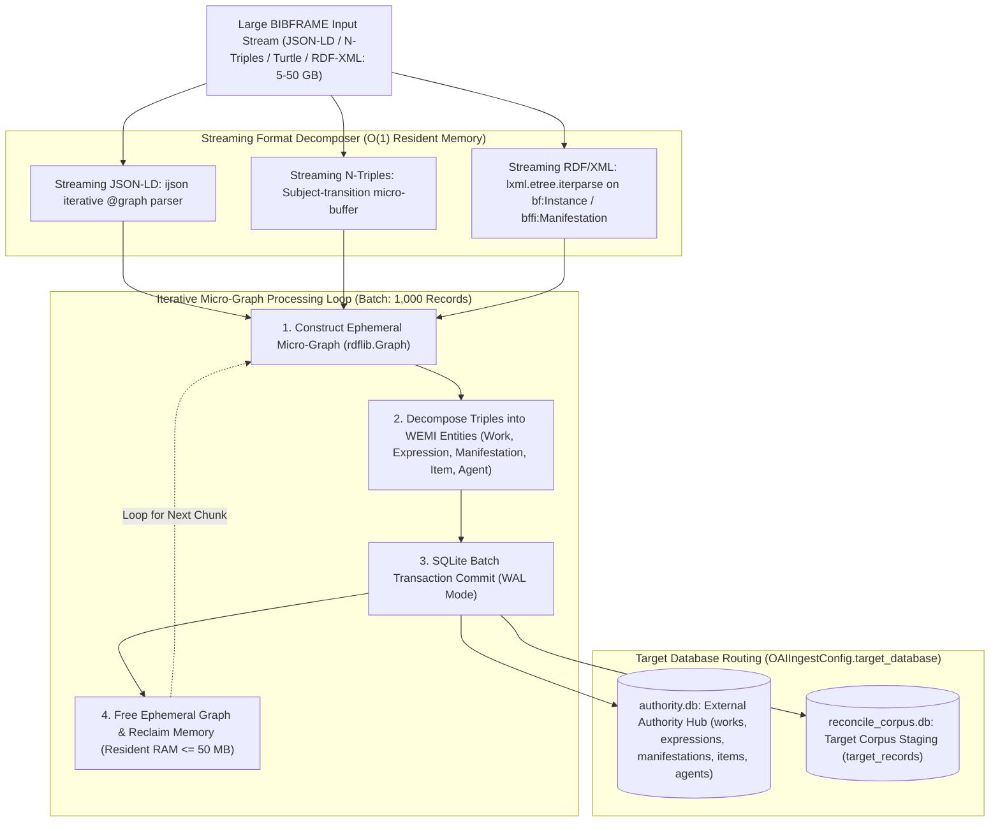
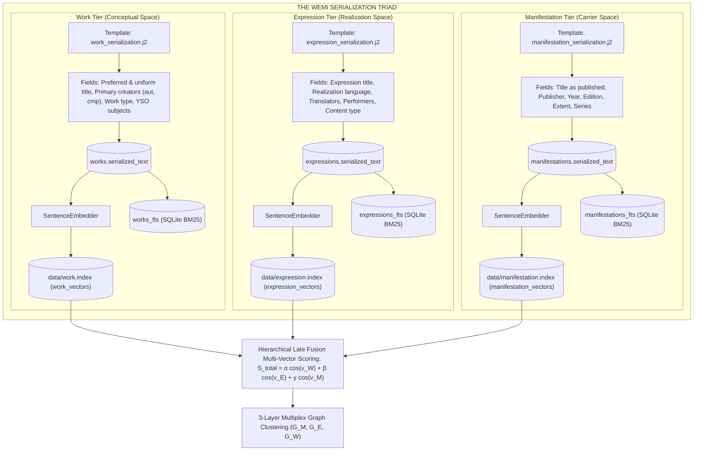
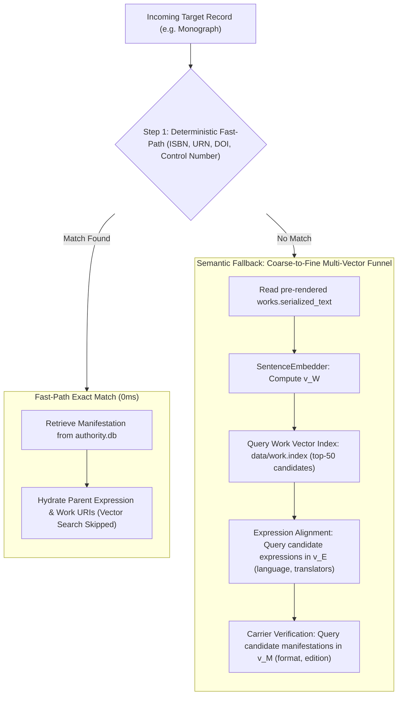
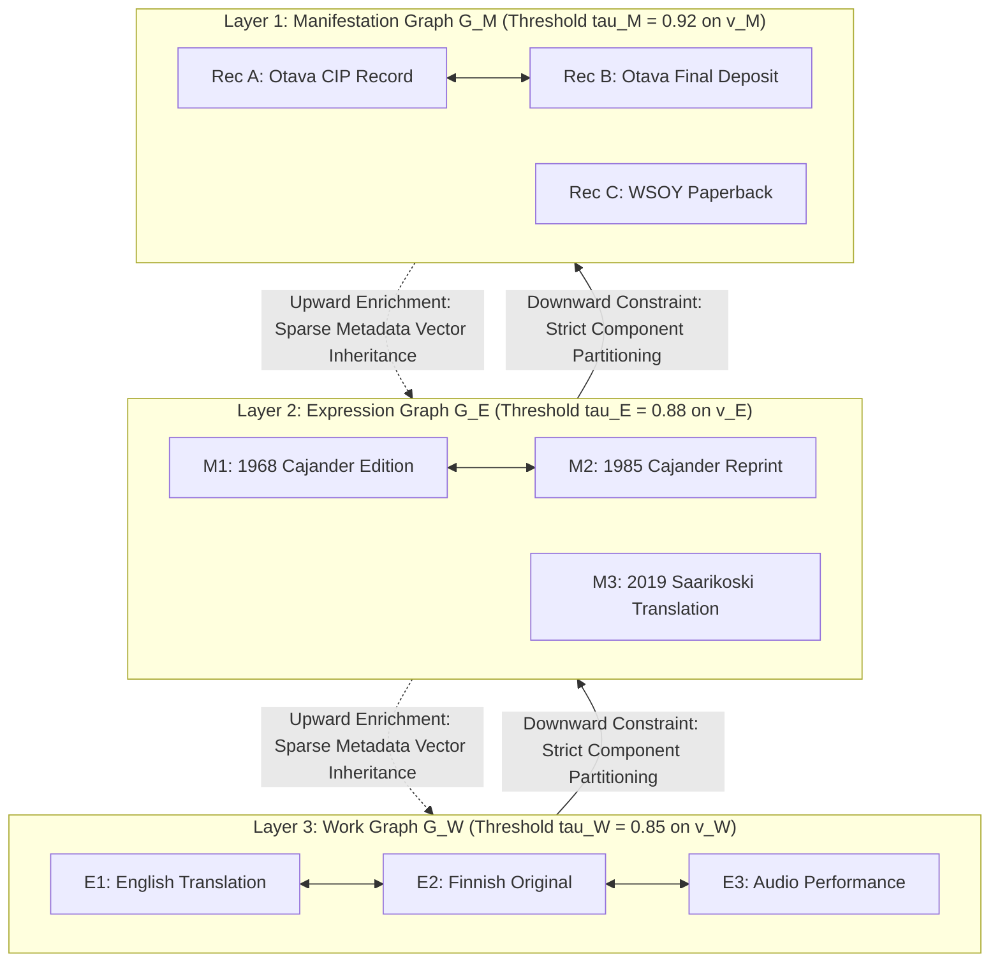

# Architecture & Implementation Plan: Work and Expression Linking Engine

**Document Version:** 1.9.0  
**Target System:** Reconciliator  
**Scope:** Greenfield WEMI (Work, Expression, Manifestation) Linking, External Authority Reconciliation, Intra-Corpus Co-Reference Resolution, and comprehensive domain support across all 42 major bibliographic, archival, physical, audiovisual, and digital material and aggregate types — including Monographs, Serials/Continuing Resources, Multi-Part Series, Recorded Sound, Notated Music, Article/Serial Components, Audiobooks/Spoken Word, Moving Image, Anthologies, Conference Proceedings, Theses/Dissertations, Cartographic Materials, Graphic Novels/Comics/Manga, Datasets/Digital Resources, Standards/Technical Reports, Government Publications/Grey Literature, 3D Objects/Realia, Archival Collections & Manuscripts, Still Images & Ephemera, Legal Statutes & Case Law, Patents & IP, Video Games & Interactive Media, Integrating Resources/Loose-Leaf, Board Games/Tabletop Games, Early Printed Books & Incunabula (C15–C18), Tactile & Accessible Media (Braille/DAISY), Software Source Code & Trained AI Models, Dramatic Works & Choreography, Broadcast Podcasts & Episodic Webcasts, Bound-With / Sammelbände Composite Volumes, Web Archives & Harvested Web Crawls, Oral Histories & Ethnographic Fieldwork, Broadcast Television & Radio Program Flow, Parallel Multilingual Editions & Polyglot Texts, Preservation Surrogates & Microform Facsimiles, Medieval Manuscript Fragments & Codicological Reconstructions (Fragmenta Membranea), Ephemera & Job Printing (Pienpainatteet), Exhibition Catalogues & Curated Display Aggregates, Scholarly Critical Editions & Textual Apparatus (Variorum Editions), Spatial Vector/Raster Geodata & GIS Web Services, Numismatics, Philately & Historical Seals, and 3D Cultural Heritage Digital Twins & XR Reconstructions — in MARCXML and BIBFRAME sources.

---

## 1. Executive Summary & Problem Formulation

### 1.1 Objective
Extend the Reconciliator engine from a manifestation-level matching tool into a **hierarchical WEMI entity reconciliation and co-reference clustering platform**. The engine must:
1. **Link to External Authorities**: Connect local bibliographic records to global Work and Expression authorities (Melinda/Asteri works, Wikidata QIDs, Library of Congress Hubs/Works, VIAF uniform titles).
2. **Link Within the Target Corpus**: Cluster and link records within the input corpus belonging to the **same Work** (e.g., all editions, translations, and formats) and the **same Expression** (e.g., same translation, musical performance, or software version), minting canonical cluster identifiers.
3. **Dual-Format Native Interoperability**: Ingest, reconcile, and natively enrich both **MARCXML** (MARC 21) and **BIBFRAME** (Finnish BFFI 1.0, LC BIBFRAME 2.0 / 3.0 / PMO) sources without lossy cross-translations.
4. **Specialized Domain Support (42 Material Types & Modes of Issuance)**:
   - **Recorded Sound (Music CDs)**: Support audio recording aggregates containing multiple constituent musical works and performances, handling composer vs. performer role splits, publisher numbers (`028`), ISRCs, and track analytics (`700 $t`).
   - **Notated Music (Printed Scores)**: Support musical score publications (full scores, vocal scores, piano reductions, parts) containing one or more musical works, with ISMNs, opus/thematic catalog numbers, medium of performance (`382`), and musical key/instrumentation metadata.
   - **Serials / Continuing Resources**: Support journals, newspapers, magazines, and annual reports as serial Works with ISSN-based identification, title change succession chains (MARC `780`/`785`), and volume/issue-level Manifestations.
   - **Article Repositories (Serial Components)**: Support component-part hierarchies (articles/chapters within journal issues or edited collections) using host-item linking (MARC `773`, `bf:partOf`), DOIs, and citation pagination.
   - **Multi-Part Monograph Series**: Support named series (MARC `490`/`830`) where each volume is an independent Work belonging to a series-level super-Work, with series numbering and open-ended growth.
   - **Audiobooks & Spoken Word**: Support multi-disc audiobook releases and podcast/radio play aggregates, distinguishing narrators (`nrt`) and readers from original text authors, linking the spoken word expression to the underlying textual work.
   - **Moving Image (Film & Video)**: Support DVD/Blu-ray compilations and TV series box sets containing multiple constituent moving image works, with directors (`drt`), screenwriters (`aus`), and production companies.
   - **Anthologies & Essay Collections**: Support edited volumes and literary anthologies containing multiple independent textual works by different authors, with editors (`edt`) and compilers (`com`) at the aggregate level and individual authors at the constituent work level.
   - **Conference Proceedings**: Support proceedings volumes as aggregates of conference papers, with conference/meeting metadata (MARC `111`/`711`), per-paper DOIs, and constituent work analytics.
   - **Theses & Dissertations**: Support academic works with dissertation notes (MARC `502`), institutional affiliations, degree types, and cross-repository deduplication (university repository, Melinda, Theseus/DSpace).
   - **Cartographic Materials**: Support maps, atlases, and globes with scale (`255`), coordinates (`034`), projection metadata, and atlas-as-aggregate sheet decomposition.
   - **Graphic Novels / Comics / Manga**: Support sequential art publications with complex creator roles (writer `aut`, illustrator `ill`, colorist, letterer), series numbering, and translation Expressions.
   - **Datasets / Digital Resources**: Support research datasets and data collections with DOIs, version numbers, and version-as-Expression modeling.
   - **Standards / Technical Reports**: Support ISO/SFS standards and technical reports (VTT, STUK) with standard numbers, edition/revision tracking, and supersession chains.
   - **Government Publications / Grey Literature**: Support ministry reports, white papers, and committee publications with institutional authors (MARC `110`/`710`) and limited standard identifiers.
   - **3D Objects / Realia / Kits**: Support museum objects, educational kits, and mixed-media realia (Leader/06 = `r`/`o`) with physical description-based matching.
   - **Archival Collections & Manuscripts**: Support fonds-to-item multi-level archival hierarchies (ISAD(G) / RiC), custodial provenance (`561`), manuscript letters/drafts (`t`, `d`), and linking preliminary drafts to published monograph Works.
   - **Still Images, Artworks & Ephemera**: Support photographs, prints, posters, and legal-deposit ephemera (`pienpainatteet`) with physical medium (`340`), artist/photographer roles (`art`, `pht`), and print/digitization fan-out modeling.
   - **Legal Norms, Statutes & Case Law**: Support official statutes (Finlex SDK), court decisions (ECLI), and EU law (CELEX) with legal uniform titles (`240`), enactment dates, and amendment/consolidation lineage tracking.
   - **Patents & Intellectual Property**: Support patent specifications (PRH, EPO, WIPO) with patent numbers (`013`), IPC/CPC classifications (`084`), inventor/assignee roles (`inv`, `asn`), and priority application families.
   - **Video Games & Interactive Media**: Support games and interactive software across platforms (PlayStation, Xbox, PC/Steam, Switch) with platform-dependent manifestations, system requirements (`538`), and PEGI ratings (`521`).
   - **Integrating Resources & Loose-Leaf**: Support loose-leaf legal/reference updates and maintained web resources (Leader/07 = `i`) using iteration replacement modeling rather than discrete issue succession.
   - **Board Games & Tabletop Games**: Support physical board games, card games, and tabletop systems with game designer (`dsr`) vs. artist (`ill`) roles, base game vs. expansion dependencies (`expansion_of`), multilingual rule sets (Nordic `041`), Big Box bundle aggregates, player demographics, EAN barcodes, and BoardGameGeek (BGG) identifiers.
   - **Early Printed Books & Incunabula (C15–C18 / Hand-Press Materials)**: Support hand-press period materials, incunabula, early Finnish/Nordic prints, and Turku Academy dissertations, using machine-readable Bibliographic Fingerprints (MARC `026`), ISTC and *Gesamtkatalog der Wiegendrucke* (GW) control numbers, printer workshop and colophon identification, signature collation formulas, and copy-specific state/issue discrimination.
   - **Tactile & Accessible Media (Braille / DAISY)**: Support Braille (Grade 1/2), DAISY 2.02 / DAISY 3 talking books, tactile graphics, and accessible digital texts (Celia, NLS, RNIB), modeling accessibility features (MARC `007`, `341`, `532`), and linking accessible reproduction expressions directly back to primary textual/notated canonical Works.
   - **Software Source Code & Trained AI Models**: Support computational research assets including Git repositories, software releases, and machine learning model checkpoints/weights (Software Heritage, Zenodo, Hugging Face), with SWHIDs (`swh:1:`), model checkpoint lineage (`fine_tuned_from`), base model dependencies, and semantic release versions.
   - **Dramatic Works, Choreography & Theatrical Staging**: Support stage plays, librettos, choreographic movement notation (Labanotation, Benesh), and theatrical staging realizations, separating original dramatic/movement Works (playwrights `aut`/`lbt`, choreographers `chr`) from staging production Expressions (stage directors `drt`, scenographers `std`, performers `act`) and archival performance manifestations.
   - **Broadcast Podcasts, Webcasts & Episodic Media**: Support digital episodic audio and video broadcast series distributed via RSS feeds, modeling show-level serial Works, episodic constituent Works and Expressions (with season/episode numeration, hosts `hst`, guests `ive`), and digital media enclosure manifestations (`guid`, audio stream URLs).
   - **Bound-With / Sammelbände (Item-Level Composite Aggregates)**: Support physical composite volumes where two or more distinct, unrelated Manifestations (often printed years or decades apart by different publishers) were bound together post-publication into a single physical Item (`Item`), resolving multi-parent item ownership and linking via MARC `777` (*Issued with*) and `501` (*With note*).
   - **Web Archives & Harvested Web Crawls**: Support legal deposit web harvesting (Finnish Web Archive / *Verkkoarkisto*, WARC / WACZ containers), linking target seed URLs (Works) to timestamped crawl snapshot runs (Expressions) and WARC container files / CDX indices (Manifestations) with Memento RFC 7089 Datetime URIs.
   - **Oral Histories & Ethnographic Fieldwork**: Support folklore, dialect, and oral history sound archives (SKS, Kotus, SLS), modeling interview sessions (Works), concurrent audio recordings and verbatim transcriptions / dialect glosses (co-equal Expressions with interviewer `ivr` and informant `ive` roles), and archival master WAV / PDF access packages (Manifestations) with access restrictions (`506`/`540`).
   - **Broadcast Television & Radio Program Flow**: Support continuous linear broadcasting archives (KAVI *Ritva*, BBC Archive), linking broadcast program Works to transmission event Expressions (scheduled air times, live broadcast variants, regional opt-outs) and off-air recorded stream Manifestations, identified via EIDR (`10.5240/...`), ISAN, and channel timecodes.
   - **Parallel Multilingual Editions & Polyglot Texts**: Support single physical Manifestations that simultaneously embody two or more distinct Expressions of the same Work side by side (e.g. Loeb Classical Library facing-page Greek/English editions, Finnish/Swedish bilingual statutes and official publications), resolving multiple Expression links (`manifestation_expressions`) under one unified Work.
   - **Preservation Surrogates & Microform Facsimiles**: Support microfilms, microfiches, and digitized preservation surrogates (Kansalliskirjasto *digi.kansalliskirjasto.fi*), modeling reproduction Manifestations explicitly linked to original print manifestations and parent Works via MARC `776`/`533` and digital preservation URNs.
   - **Medieval Manuscript Fragments & Codicological Reconstructions (*Fragmenta Membranea*)**: Support dismembered medieval codices and dispersed parchment fragments recycled in post-Reformation bailiff account book bindings (*voutien tilikirjat*), reconstructing lost parent manuscript Works and liturgical chant Expressions from physically separated leaves (`024 7 $2 fragmenta`, collation `500`).
   - **Ephemera, Job Printing & Commercial Broadsides (*Pienpainatteet*)**: Support legal deposit small prints, company annual reports, trade product catalogs (*tavaraluettelot*), price lists (*hinnastot*), and theater playbills lacking standard numbers, using corporate issuing body anchorages (`110`/`710`), chronological grouping (`362`), and form/genre terms (`655 #7 Pienpainatteet`).
   - **Exhibition Catalogues & Curated Display Aggregates**: Support dual-identity museum and gallery publications that serve simultaneously as scholarly monographic publications and as formal records of temporary cultural Events (`111`/`711`), establishing analytical links to exhibited constituent Visual Art Works (`700 12 $t`).
   - **Scholarly Critical Editions & Textual Apparatus (*Variorum Editions*)**: Support definitive literary editions (e.g. *Aleksis Kivi -kriittiset editiot*, *Jean Sibelius Works*) that synthesize base canonical authorial texts with diplomatic transcriptions, *apparatus criticus* variant readings from draft manuscripts, and extensive editorial commentary (`700 $4 edt`/`cwt`).
   - **Spatial Vector/Raster Geodata & GIS Web Services**: Support dynamic geodata services (Maanmittauslaitos, Syke, INSPIRE) encompassing ESRI Shapefiles, GeoTIFF rasters, and live web endpoints (WMS/WFS/OGC API), with EPSG coordinate reference system codes (`084 $2 epsg`) and geographic bounding polygons.
   - **Numismatics, Philately & Historical Seals**: Support coins, commemorative medals, postal stamps, and sigillography specimens, modeling issuing sovereign states (`110`), monetary face value denominations, engravers (`egr`), and standard numismatic/philatelic catalog numbering systems (Michel, Scott, Krause-Mishler).
   - **3D Cultural Heritage Digital Twins & XR Reconstructions**: Support photogrammetric 3D scans, polygon meshes (glTF/OBJ/USDZ), and virtual reality heritage environments documenting historical architecture, ruins, and museum artifacts, linking 3D spatial models back to physical monument Works via `digital_twin_of`.
5. **Greenfield Storage**: Implement a pure relational WEMI architecture in SQLite (`authority.db` and ephemeral `reconcile_corpus.db`), discarding legacy single-tier schemas.

---

## 2. Conceptual Entity Modeling (IFLA LRM & RDA)

### 2.1 The WEMI Hierarchy
Bibliographic metadata is organized into four distinct ontological levels:

```
┌────────────────────────────────────────────────────────────────────────┐
│                                 WORK                                   │
│  Abstract intellectual/artistic creation                               │
│  • Uniform Title, Original Language, Primary Creator (Composer/Author) │
│  • Subject Concept (YSO), Form/Genre (SLM), Medium of Performance      │
└───────────────────────────────────┬────────────────────────────────────┘
                                    │ 1:N
┌───────────────────────────────────▼────────────────────────────────────┐
│                              EXPRESSION                                │
│  Intellectual or artistic realization of a Work                        │
│  • Language of Expression, Content Type (text, spoken, audio)          │
│  • Secondary Contributors: Translator (trl), Arranger (arr),           │
│    Performer (prf), Conductor (cnd)                                    │
│  • Version/Edition Designation (e.g., 'Revised translation', 'Live')   │
└───────────────────────────────────┬────────────────────────────────────┘
                                    │ 1:N
┌───────────────────────────────────▼────────────────────────────────────┐
│                             MANIFESTATION                              │
│  Physical or digital embodiment of one or more Expressions             │
│  • Imprint: Publisher, Year, Publication Place                         │
│  • Carrier Type, Extent, Edition, Volume/Part Designation              │
│  • Standard Carrier Identifiers: ISBN, ISSN, URN, DOI, Publisher No    │
└───────────────────────────────────┬────────────────────────────────────┘
                                    │ 1:N
┌───────────────────────────────────▼────────────────────────────────────┐
│                                 ITEM                                   │
│  Single physical copy or digital access license                        │
│  • Barcode, Call Number, Shelf Location, Provenance / Condition        │
└────────────────────────────────────────────────────────────────────────┘
```

### 2.2 Container–Component (Whole–Part) Modeling for Aggregates

Monographs represent simple 1:1:1 ($W \rightarrow E \rightarrow M$) structures. More complex material types involve aggregates (multiple Works/Expressions in one Manifestation), series (open-ended Work groupings), or specialized metadata. The engine must recognize and model all of the following patterns:

#### 2.2.1 Material Type Reference

| Material Type | MARC Leader/06-07 | WEMI Pattern | Primary Agent(s) | Key Identifiers |
| :--- | :--- | :--- | :--- | :--- |
| **Monograph** | `a` (Language material), `am` | Simple 1:1:1 W→E→M | Author (`aut`) | ISBN, URN |
| **Recorded Sound (Music CD)** | `j` (Musical sound recording) | Aggregate: Album M → Track E's → Composition W's | Performer (`prf`), Conductor (`cnd`) | Publisher No (`028`), ISRC (`024`), EAN |
| **Notated Music (Printed Score)** | `c` (Notated music) / `d` (Manuscript) | Aggregate: Score M → Edition E → Composition W | Composer (`cmp`) | ISMN (`024 2`), Plate No (`028 20`), ISBN |
| **Serial / Continuing Resource** | `as` (Serial) | Serial: Serial W → Volume/Issue M's | Publisher (`pbl`) | ISSN, CODEN |
| **Article / Serial Component** | `a`/`b` + `773` (Component part) | Component: Article M → Article E → Article W, linked to Host Serial M | Author (`aut`) | DOI (`024 7`), Host ISSN (`773 $x`), Host ctrl no (`773 $w`) |
| **Multi-Part Series** | `am` + `490`/`830` | Series super-Work → Volume Works (each independent) | Varies per volume | Series ISSN (`830 $x`), volume ISBN |
| **Audiobook / Spoken Word** | `i` (Nonmusical sound recording) | Cross-format: Spoken E → shared textual W ← Print E | Narrator (`nrt`) | ISBN, Publisher No (`028`), EAN |
| **Moving Image (Film/Video)** | `g` (Projected medium) | Aggregate (if compilation): Box Set M → Film E's → Film W's | Director (`drt`) | EAN/UPC (`024`), Publisher No (`028`) |
| **Anthology / Essay Collection** | `a` (Language material) | Aggregate: Collection M → Constituent E's → Constituent W's | Editor (`edt`), Compiler (`com`) | ISBN |
| **Conference Proceedings** | `a` (Language material) + `111`/`711` | Aggregate: Proceedings M → Paper E's → Paper W's | Conference entity (`111`/`711`) | ISBN, per-paper DOI |
| **Thesis / Dissertation** | `a` (Language material) + `502` | Simple 1:1:1 W→E→M (with cross-repo dedup) | Author (`aut`), Degree supervisor (`ths`) | ISBN, URN:NBN, institutional handle |
| **Cartographic Material** | `e` (Printed map) / `f` (Manuscript map) | Simple or Aggregate (atlas → sheets) | Cartographer (`ctg`) | ISBN, Scale (`255`), Coordinates (`034`) |
| **Graphic Novel / Comics / Manga** | `a` (Language material) | Series super-Work → Volume Works → Translation E's | Writer (`aut`), Illustrator (`ill`) | ISBN, series ISSN |
| **Dataset / Digital Resource** | `m` (Computer file) | Versioned: Dataset W → Version E's → Access M's | Creator (`aut`), Research group | DOI, URN, Handle |
| **Standard / Technical Report** | `a` (Language material) | Supersession chain: Standard W → Edition/Revision E's | Standards body (`110`/`710`) | Standard number (e.g., `SFS-EN ISO 9001:2015`) |
| **Government Publication** | `a` (Language material) | Simple 1:1:1 W→E→M | Institutional author (`110`/`710`) | ISBN, URN:ISBN, ISSN (for series) |
| **3D Object / Realia / Kit** | `r` (3D artifact) / `o` (Kit) | Simple 1:1:1 W→E→M | Manufacturer / Creator | Physical description-based |
| **Archival Collection / Manuscript** | `t` (Manuscript text) / `d` (Manuscript music) | Multi-Level: Fonds → Series → File → Item | Creator (`cre`), Collector (`col`) | Fonds/Collection ID, Call number |
| **Still Image / Ephemera** | `k` (Two-dimensional graphic) | Simple or Portfolio Aggregate | Artist (`art`), Photographer (`pht`) | Photo/Poster ID, Call No, Physical Medium |
| **Legal Statute / Case Law** | `a` (Jurisdiction `110 1#`) | Lineage: Statute Work → Amendment/Consolidation W's | Jurisdictional body (`110`), Court | Säädösnumero (SDK), CELEX, ECLI |
| **Patent / Intellectual Property** | `a` (with `013` control) | Invention Work → Patent Family Manifestations | Inventor (`inv`), Assignee (`asn`) | Patent No (`013 $a`), IPC/CPC (`084`) |
| **Video Game / Interactive Media** | `m` (Computer file) | Platform-Dependent: Game W → Platform E's → Media M's | Designer (`dsr`), Developer Studio | Platform SKU, Barcode, PEGI ID |
| **Integrating Resource / Loose-Leaf** | `ai` (Integrating text) | Iteration: Resource W → Iteration M's (overwriting) | Editor (`edt`), Publisher (`pbl`) | ISSN, Loose-leaf binder ID |
| **Board Game / Tabletop Game** | `r` (Realia) / `o` (Kit) | System: Base Game W → Language/Edition E's → Box M's (+ Expansion W's) | Game Designer (`dsr`), Illustrator (`ill`) | EAN (`024`), Product No (`028 50`), BGG ID |
| **Early Printed Book / Incunabulum** | `a` (Language material pre-1800) | Hand-press: Text Work → State/Issue E's → Imprint M's → Copy-specific Items | Printer (`prt`), Typographer, Author (`aut`) | Fingerprint (`026`), ISTC (`024 7`), GW (`024 7`) |
| **Tactile & Accessible Media** | `a` (Braille) / `i` (DAISY) | Accessibility: Primary Work → Accessible E (Braille/DAISY) → Carrier M | Author (`aut`), Transcriber (`brl`), Narrator (`nrt`) | Celia / NLS ID, ISBN, DAISY ID, MARC `007`/`341`/`532` |
| **Software Source Code & AI Model** | `m` (Computer file) | Computational: Algorithm/Model W → Weights/Code E's → Repository/Package M's | Lead Programmer (`prg`), Model Creator (`mlm`) | SWHID (`024 7 $2 swhid`), HuggingFace ID, Git SHA, DOI |
| **Dramatic Work & Choreography** | `a` (Play) / `d` (Choreography) / `g` (Video) | Staging: Dramatic/Movement W → Staging/Production E's → Prompt book / Video M's | Playwright (`aut`), Choreographer (`chr`), Director (`drt`) | Production code, Premiere venue/date (`518`), Uniform title |
| **Podcast & Episodic Webcast** | `i` (Spoken sound) / `g` (Video) / `s` (Serial) | Episodic: Show Serial W → Episode W/E's → Enclosure Stream M's | Host (`hst`), Producer (`pro`), Interviewee (`ive`) | RSS Feed URL, RSS `guid` (`024 7`), Apple/Spotify ID |
| **Bound-With / Sammelband** | Varies (`am`, `c`, etc.) | Composite Item: Single physical Item M contains $N$ distinct, independent Manifestations | Multiple unrelated publishers / printers | Host Item Barcode (`852 $p`), MARC `777`, `501` "With" note |
| **Web Archive / Harvested Crawl** | `m` (Computer file) | Web Entity / Seed W → Crawl Snapshot E's (timestamped) → WARC/WACZ Package M's | Harvesting Agency, Crawler / Curator | Memento URI, WARC UUID, Seed URL hash |
| **Oral History & Fieldwork Collection** | `i` (Sound) / `a` (Transcript) | Interview Session W → Concurrent Audio & Transcript E's → Archival WAV / PDF M's | Interviewer (`ivr`), Informant (`ive`), Transcriber (`trc`) | Collection signum, Tape ID, Restrictions `506`/`540` |
| **Broadcast TV / Radio Program Flow** | `g` (Moving image) / `i` (Sound) | Program Work → Transmission Event E's (scheduled air times) → Off-air Stream M's | Broadcaster (`brd`), Producer (`pro`), Director (`drt`) | EIDR (`024 7 $2 eidr`), ISAN (`024 7 $2 isan`), Channel timecode |
| **Parallel Multilingual Edition** | `a` (Language material) | Multi-Expression Aggregate: Single Work W → Multiple Expressions ($E_1, E_2$) in 1 M | Author (`aut`), Translator (`trl`) | ISBN, Dual `041` languages, `546` parallel text note |
| **Preservation Surrogate / Microform** | Varies (`am`, `c`, `s`) | Reproduction: Base Work → Primary E → Reproduction M (microfilm/digital scan) | Digitizing agency, Microfilming lab | Digital URN (`urn.fi/URN:NBN:fi-fd...`), MARC `776`, `533` |
| **Medieval Manuscript Fragment** | `t` (Manuscript text) / `d` (Manuscript music) | Dismembered: Reconstructed Codex W → Fragment E's → Recycled Binding Items | Scribe, Notator, Paleographer (`pal`) | Fragment ID (`024 7 $2 fragmenta`), Collation `500` |
| **Ephemera / Job Printing** | `k` (Graphic) / `a` (Text) | Corporate Aggregate: Issuing Body W → Chronological E's → Ephemeral Leaflet M's | Corporate Body (`110`/`710`), Printer (`prt`) | Corporate slug, Season/Year (`362`), `655 Pienpainatteet` |
| **Exhibition Catalogue / Curated Aggregate** | `a` (Text) + `111`/`711` (Event) | Hybrid: Monograph M + Exhibition Event W ↔ Constituent Artworks | Curator (`cur`), Sponsoring Museum, Artists (`art`) | ISBN, Exhibition Name/Dates (`111`), Analytical `700 12 $t` |
| **Scholarly Critical Edition** | `a` (Language material) | Layered Composite: Base Literary W + Critical Apparatus/Commentary W → Monograph M | Author (`aut`), Critical Editor (`edt`), Commentator (`cwt`) | ISBN, Base Work URI, Uniform title, Critical note `500` |
| **Spatial Geodata & GIS Web Service** | `m` (Computer file) / `e` (Cartographic) | Layered Geo-Resource: Spatial Dataset W → Vector/Raster E's → Web Service M's | Cartographer (`ctg`), GIS Specialist (`gis`), Maanmittauslaitos | EPSG Code (`084 $2 epsg`), Bounding Polygon (`034`), WFS/WMS URL |
| **Numismatics & Philately** | `r` (Realia) / `k` (Graphic) | State Issue: Denomination/Design W → Mint/Print E's → Specimen M's | Issuing State/Sovereign (`110`), Engraver (`egr`) | Michel / Scott / KM No (`024 7`), Denomination `300` |
| **3D Cultural Heritage Digital Twin** | `m` (Computer file) | Reconstruction: Historical Monument W → 3D Model E → glTF/USDZ M | Model Creator (`mod`), Photogrammetrist, Museum | Mesh Hash, Coordinate URI, `digital_twin_of` Link |

#### 2.2.2 Detailed WEMI Structures per Aggregate Type

##### A. Recorded Sound (Music CDs / Streaming Albums)
```
Container        ┌──────────────────────────────────┐
(Album)          │ Manifestation (The Audio CD)      │
                 │ Label: Ondine, No: ODE 1020       │
                 │ Carrier: 'audio disc'             │
                 └──────────────┬───────────────────┘
                                │ manifestation_expressions (1:N, track_number)
                 ┌──────────────▼───────────────────┐
Components       │ Audio Expressions (Tracks)        │
(Tracks)         │ content_type: 'audio_music'       │
                 │ Perf: HKO, Cond: Mälkki           │
                 └──────────────┬───────────────────┘
                                │ expressionOf
                 ┌──────────────▼───────────────────┐
Constituent      │ Musical Works (Compositions)      │
Works            │ Sibelius: Symphony No. 1, op. 39  │
                 │ work_type: 'music'                │
                 │ Role: cmp (Jean Sibelius)          │
                 │ Medium: orchestra                  │
                 └──────────────────────────────────┘
```

##### B. Notated Music (Printed Scores)
Notated music has a fundamentally different WEMI split from recorded sound. The **Work** is the composition itself, the **Expression** represents a specific **edition/arrangement/reduction** (full score vs. vocal score vs. piano reduction vs. study score vs. parts), and the **Manifestation** is the printed publication:

```
Container        ┌───────────────────────────────────────┐
(Score Volume)   │ Manifestation (Printed Score/Parts)    │
                 │ Publisher: Breitkopf & Härtel           │
                 │ ISMN: 979-0-004-18200-5                 │
                 │ Plate No: EB 8548                       │
                 │ Carrier: 'volume' (score) / 'volume'    │
                 │          (parts set)                     │
                 └──────────────┬────────────────────────┘
                                │ manifestation_expressions (1:N if collection)
                 ┌──────────────▼────────────────────────┐
Expression       │ Score Expression                       │
(Edition/        │ content_type: 'notated_music'          │
 Arrangement)    │ language: 'zxx' (no linguistic content) │
                 │ edition_designation: 'Full Score' /      │
                 │   'Vocal Score' / 'Piano Reduction'     │
                 │ Arranger (arr) if reduction/arrangement │
                 └──────────────┬────────────────────────┘
                                │ expressionOf
                 ┌──────────────▼────────────────────────┐
Work             │ Musical Work (Composition)             │
                 │ Sibelius: Finlandia, op. 26             │
                 │ work_type: 'music'                      │
                 │ Role: cmp (Jean Sibelius)                │
                 │ Medium: orchestra                        │
                 │ Key: A♭ major (if applicable)            │
                 │ Thematic catalog: Op. 26                 │
                 └──────────────────────────────────────┘
```

**Key difference from Recorded Sound**: In notated music, a single physical score volume may contain **multiple Works** (e.g., *"Sibelius: Complete Symphonies — Study Score"* containing 7 symphonies). This creates a container-component relationship where each constituent Work has its own Expression (all sharing `content_type: 'notated_music'` but potentially differing in arrangement type).

**MARC specifics for Notated Music**:
- `028 20` — Plate number (engraving identifier, highly stable across reprints)
- `028 22` — Publisher number
- `024 2` — ISMN (International Standard Music Number, `979-0-...`)
- `382` — Medium of performance (e.g., `$a orchestra $n 1 $s 1 $2 lcmpt`)
- `384` — Key (`$a A-flat major`)
- `240` — Uniform title with opus number (`$a Symphonies, $n no. 1, op. 39, $r E minor`)
- `700 12 $t` — Analytical entries for individual pieces in a collection score

##### C. Article Repositories (Journal Articles / Book Chapters)
```
Container        ┌───────────────────────────────────────┐
(Host Journal)   │ Host Manifestation (Journal Issue/Vol) │
                 │ "Virittäjä", Vol. 127, No. 2 (2023)   │
                 │ ISSN: 0042-6806                        │
                 └───────────────────┬───────────────────┘
                                     │ container_id (1:N)
                 ┌───────────────────▼───────────────────┐
Components       │ Component Manifestation (The Article)  │
(Articles)       │ is_component: true                      │
                 │ component_type: 'article'               │
                 │ pagination: 'p. 180-205'                │
                 │ DOI: 10.1234/xyz                        │
                 └───────────────────┬───────────────────┘
                                     │ manifestation_expressions
                 ┌───────────────────▼───────────────────┐
Expression       │ Article Expression                      │
                 │ content_type: 'text'                    │
                 │ language: 'fin'                         │
                 └───────────────────┬───────────────────┘
                                     │ expressionOf
                 ┌───────────────────▼───────────────────┐
Work             │ Article Work                            │
                 │ Author: Virtanen, M. (role: 'aut')      │
                 │ work_type: 'text'                       │
                 └───────────────────────────────────────┘
```

##### D. Audiobooks & Spoken Word
The audiobook expression **realizes the same underlying textual Work** as the printed book. This cross-content-type linkage is essential:

```
                 ┌──────────────────────────────────────────┐
                 │            Shared Work                    │
                 │  Tolkien: The Lord of the Rings           │
                 │  work_type: 'text'                        │
                 │  Role: aut (J.R.R. Tolkien)               │
                 └────────┬──────────────────┬──────────────┘
                          │                  │
            ┌─────────────▼───┐    ┌─────────▼──────────────┐
            │ Text Expression │    │ Spoken Word Expression  │
            │ language: 'fin' │    │ language: 'fin'         │
            │ trl: Kersti Juva│    │ content_type:           │
            │ content_type:   │    │   'spoken_word'         │
            │   'text'        │    │ nrt: Ville Virtanen     │
            └────────┬────────┘    └─────────┬──────────────┘
                     │                       │
            ┌────────▼────────┐    ┌─────────▼──────────────┐
            │ Print Edition   │    │ Audiobook CD/Download   │
            │ ISBN: 978-...   │    │ Publisher No: ...       │
            │ carrier: volume │    │ carrier: audio disc /   │
            └─────────────────┘    │   online resource       │
                                   └────────────────────────┘
```

**MARC specifics for Audiobooks**:
- Leader/06 = `i` (Nonmusical sound recording)
- `700 $e kertoja` / `$e narrator` or `$4 nrt` — Narrator
- `028 02` — Publisher/distributor number
- The textual Work can be linked back via `240 $0` or `758` to the same Work URI as the printed edition

##### E. Moving Image (Film / Video Compilations)
```
Container        ┌──────────────────────────────────────┐
(Box Set)        │ Manifestation (DVD/Blu-ray Box Set)   │
                 │ "Aki Kaurismäki Collection"            │
                 │ Carrier: 'videodisc'                   │
                 │ EAN/UPC: 6438044366...                 │
                 └──────────────┬───────────────────────┘
                                │ manifestation_expressions (1:N, disc_number)
                 ┌──────────────▼───────────────────────┐
Components       │ Moving Image Expressions              │
(Films)          │ content_type: 'moving_image'          │
                 │ language: 'fin' (audio) / subtitles   │
                 └──────────────┬───────────────────────┘
                                │ expressionOf
                 ┌──────────────▼───────────────────────┐
Constituent      │ Moving Image Works                    │
Works            │ "Mies vailla menneisyyttä" (2002)     │
                 │ work_type: 'moving_image'             │
                 │ drt: Aki Kaurismäki                   │
                 │ aus: Aki Kaurismäki (screenwriter)    │
                 └──────────────────────────────────────┘
```

**MARC specifics for Moving Image**:
- Leader/06 = `g` (Projected medium)
- `700 12 $t` — Analytical entries for individual films in a compilation
- `508` — Creation/production credits (directors, producers)
- `511` — Performer/cast note
- `028` — Publisher / distributor number

##### F. Anthologies & Essay Collections
```
Container        ┌───────────────────────────────────────┐
(Anthology)      │ Manifestation (Printed Collection)     │
                 │ "Finnish Short Stories of the 20th C." │
                 │ ISBN: 978-951-...                      │
                 │ edt: Pekka Tarkka (editor)             │
                 └──────────────┬────────────────────────┘
                                │ manifestation_expressions (1:N)
                 ┌──────────────▼────────────────────────┐
Components       │ Text Expressions                       │
(Stories)        │ content_type: 'text'                   │
                 │ language: 'fin'                        │
                 └──────────────┬────────────────────────┘
                                │ expressionOf
                 ┌──────────────▼────────────────────────┐
Constituent      │ Independent Text Works                 │
Works            │ Alexis Kivi: "Seitsemän veljestä" (excerpt) │
                 │ Juhani Aho: "Rautatie"                │
                 │ Each with own aut, own Work URI        │
                 └──────────────────────────────────────┘
```

##### G. Serials & Continuing Resources (Journals, Periodicals, Newspapers)
Serials represent continuing intellectual works that unfold over time through sequential issues or volumes. A key complexity in serials is **title succession** (MARC `780`/`785`), where major title changes create distinct bibliographic Works connected in a historical chain:

```
                  ┌──────────────────────────────────────────────┐
                  │ Preceding Serial Work                        │
                  │ "Suomi: Kirjoituksia isänmaallisista..."     │
                  │ ISSN: 0355-1237                              │
                  └──────────────────────┬───────────────────────┘
                                         │ succeededBy (MARC 785 / bf:succeededBy)
                  ┌──────────────────────▼───────────────────────┐
                  │ Current Serial Work                          │
                  │ "Suomi: Suomalaisen Kirjallisuuden Seuran..."│
                  │ ISSN: 1238-4567                              │
                  └──────────────────────┬───────────────────────┘
                                         │ continues (MARC 780 / bf:precededBy)
                                         │ 1:N
                  ┌──────────────────────▼───────────────────────┐
Container         │ Serial Manifestation                         │
(Issues / Volumes)│ Vol. 142 (2020), No. 1–4                     │
                  │ ISSN-L: 0355-1237                            │
                  │ Publisher: Suomalaisen Kirjallisuuden Seura  │
                  └──────────────────────┬───────────────────────┘
                                         │ contains constituent articles (1:N)
                  ┌──────────────────────▼───────────────────────┐
Components        │ Component Manifestations (Articles)          │
                  │ Linked via 773 $w to Serial Manifestation    │
                  └──────────────────────────────────────────────┘
```

**MARC specifics for Serials**:
- Leader/07 = `s` (Serial)
- `022` — ISSN (`$a` current, `$y` incorrect, `$z` cancelled, `$l` ISSN-L)
- `780` — Preceding entry (continuation `$0`, former title)
- `785` — Succeeding entry (continued by `$0`, absorbed by)
- `310` — Current publication frequency (`$a` quarterly, annual)
- `362` — Dates of publication and volume designations

##### H. Multi-Part Monograph Series
Multi-part series (e.g. *Suomen kansan vanhat runot* or *Harry Potter*) involve two levels of Works: the **Series Work** (the overarching collection/series entity) and individual **Monograph Works** (each volume with its own distinct intellectual content and author/title):

```
                  ┌──────────────────────────────────────────────┐
                  │ Series Super-Work                            │
                  │ "Suomen kansan vanhat runot" (SKVR)          │
                  │ Series ISSN / Uniform Title                  │
                  └──────────────────────┬───────────────────────┘
                                         │ hasPart (1:N) / seriesMember
                  ┌──────────────────────▼───────────────────────┐
Constituent Work  │ Volume Work                                  │
(Specific Volume) │ SKVR I: Vienan läänin runot 1                │
                  │ Volume author/editor: A. Borenius            │
                  └──────────────────────┬───────────────────────┘
                                         │ realization (1:N)
                  ┌──────────────────────▼───────────────────────┐
Volume Expression │ Language / Version Expression                │
                  └──────────────────────┬───────────────────────┘
                                         │ manifestation (1:N)
                  ┌──────────────────────▼───────────────────────┐
Manifestation     │ Volume Manifestation                         │
                  │ ISBN: 978-951-...                            │
                  │ 490/830 Series statement + volume numbering  │
                  └──────────────────────────────────────────────┘
```

**MARC specifics for Multi-Part Series**:
- `490` / `830` — Series statement (untraced `490 0#` vs. series added entry `830 #0` with uniform title `$a`, volume number `$v`, ISSN `$x`, and authority URI `$0`).

##### I. Conference Proceedings
Conference proceedings are aggregates of peer-reviewed papers resulting from a specific scholarly event. The conference itself is an **Event Entity** (`CorporateName` / `MeetingName`), while the published book is an aggregate Manifestation containing individual paper Works:

```
                  ┌──────────────────────────────────────────────┐
                  │ Conference Event Entity                      │
                  │ "Nordic Conference on Computational          │
                  │  Linguistics (NODALIDA 2023)"                │
                  │ MARC 111/711, Asteri / VIAF ID               │
                  └──────────────────────┬───────────────────────┘
                                         │ outputOf (Event -> Publication)
                  ┌──────────────────────▼───────────────────────┐
Container         │ Proceedings Manifestation                    │
(Book / PDF)      │ "Proceedings of NODALIDA 2023"               │
                  │ ISBN: 978-9916-..., Editors (edt)            │
                  └──────────────────────┬───────────────────────┘
                                         │ contains constituent papers (1:N)
                  ┌──────────────────────▼───────────────────────┐
Constituent Work  │ Conference Paper Work                        │
(Paper)           │ Author: Korhonen, A. (aut)                   │
                  │ DOI: 10.18653/v1/2023.nodalida-1.5           │
                  │ Linked via MARC 773 to proceedings volume    │
                  └──────────────────────────────────────────────┘
```

**MARC specifics for Conference Proceedings**:
- `111` / `711` — Meeting name entry (`$a` meeting name, `$d` date, `$c` location, `$n` number of conference, `$0` URI)
- `700 12 $t` / `711 02 $t` — Analytical paper entries or conference paper links

##### J. Academic Theses & Dissertations
Academic theses (doctoral dissertations, master's theses, licentiate theses) are intellectual Works created in satisfaction of degree requirements. In Finnish academic repositories (Theseus, Osuva, Helda) and Melinda, they frequently exhibit **dual-manifestation pairs** (printed edition + open access institutional PDF repository copy):

```
                  ┌──────────────────────────────────────────────┐
                  │ Academic Thesis Work                         │
                  │ Author: Mäkinen, L. (aut)                    │
                  │ Title: "Neural Models for Morphologically    │
                  │         Rich Languages"                      │
                  │ Academic Degree: Doctoral dissertation       │
                  │ University / Faculty (dgg): Univ. of Helsinki│
                  │ Supervisor (ths): Salakoski, T.              │
                  └──────────────────────┬───────────────────────┘
                                         │ 1:1
                  ┌──────────────────────▼───────────────────────┐
                  │ Thesis Expression                            │
                  │ Language: fin / eng                          │
                  └───────────┬──────────────────────┬───────────┘
                              │ 1:N                  │
              ┌───────────────▼────────┐   ┌─────────▼───────────────┐
              │ Print Manifestation    │   │ Digital Repository PDF  │
              │ ISBN: 978-951-51-1234-5│   │ URN: URN:NBN:fi:hulib...│
              │ Diss. Univ. Helsinki   │   │ Handle: 10138/...       │
              └────────────────────────┘   └─────────────────────────┘
```

**MARC specifics for Theses**:
- `502` — Dissertation note (`$b` degree, `$c` granting institution, `$d` year)
- `700 $4 ths` — Thesis advisor / supervisor
- `710 $4 dgg` — Degree granting institution (university / faculty)
- `024 7 $2 urn` — Institutional repository URN:NBN

##### K. Cartographic Materials (Maps, Atlases, Remote Sensing)
Cartographic works depict geographic space. The primary distinguishing attributes are **mathematical data** (scale, projection, bounding coordinates) rather than textual or musical properties:

```
                  ┌──────────────────────────────────────────────┐
                  │ Cartographic Work                            │
                  │ Area: "Nuuksion kansallispuisto"             │
                  │ work_type: 'cartography'                     │
                  │ Coordinates (034): Bounding box lat/lon      │
                  │ Primary Cartographer (ctg): Maanmittauslaitos│
                  └──────────────────────┬───────────────────────┘
                                         │
                  ┌──────────────────────▼───────────────────────┐
                  │ Cartographic Expression                      │
                  │ Scale (255): 1:25 000                        │
                  │ Projection: ETRS-TM35FIN                     │
                  │ Edition / Revision Date: 2023                │
                  └──────────────────────┬───────────────────────┘
                                         │
                  ┌──────────────────────▼───────────────────────┐
                  │ Map Manifestation (Sheet / Folded Map)       │
                  │ Carrier: sheet / volume (if atlas)           │
                  │ ISBN / National Map Sheet No (024 / 028)     │
                  └──────────────────────────────────────────────┘
```

**MARC specifics for Cartographic Materials**:
- Leader/06 = `e` (Cartographic printed) / `f` (Cartographic manuscript)
- `034` — Coded cartographic mathematical data (scale, bounding coordinates `$d`, `$e`, `$f`, `$g`)
- `255` — Mathematical data statement (scale statement `$a`, projection `$b`, coordinates `$c`)
- `070` / `024` — National sheet index number

##### L. Graphic Novels, Comics & Manga
Sequential art represents an intersection of visual and textual storytelling with multi-tiered creative collaboration and long-running serial/anthology structures:

```
                  ┌──────────────────────────────────────────────┐
                  │ Comic Series Super-Work                      │
                  │ "Muumipeikko" / "Sandman"                    │
                  └──────────────────────┬───────────────────────┘
                                         │ 1:N
                  ┌──────────────────────▼───────────────────────┐
                  │ Volume / Issue Work                          │
                  │ Writer (aut): Gaiman, Neil                   │
                  │ Penciler / Illustrator (ill): Kieth, Sam     │
                  │ Colorist / Inker roles                       │
                  └──────────────────────┬───────────────────────┘
                                         │ 1:N
                  ┌──────────────────────▼───────────────────────┐
                  │ Translated Expression                        │
                  │ Language: fin, Translator (trl)              │
                  │ Lettering adaptation                         │
                  └──────────────────────┬───────────────────────┘
                                         │ 1:N
                  ┌──────────────────────▼───────────────────────┐
                  │ Album / Tankōbon Manifestation               │
                  │ ISBN, Carrier: volume                        │
                  └──────────────────────────────────────────────┘
```

**MARC specifics for Comics/Manga**:
- Leader/06 = `a`
- `655 #7 Sarjakuvat $2 yso/slm` — Form/genre heading
- Agent roles: `$4 aut` (Writer), `$4 ill` (Illustrator/Artist), `$4 clr` (Colorist), `$4 trl` (Translator)

##### M. Datasets & Digital Research Data
Research datasets are dynamic digital entities increasingly assigned DOIs (via DataCite) and deposited in open science repositories (Zenodo, Etsin, IDA):

```
                  ┌──────────────────────────────────────────────┐
                  │ Dataset Work                                 │
                  │ Creator (aut): Research Project Team         │
                  │ work_type: 'dataset'                         │
                  │ Spatial/temporal coverage                    │
                  └──────────────────────┬───────────────────────┘
                                         │ 1:N
                  ┌──────────────────────▼───────────────────────┐
                  │ Dataset Version Expression                   │
                  │ Version Designation: "Version 2.1.0"         │
                  │ File Formats: CSV, NetCDF, Parquet           │
                  └──────────────────────┬───────────────────────┘
                                         │ 1:N
                  ┌──────────────────────▼───────────────────────┐
                  │ Digital Manifestation (Data Package)         │
                  │ DOI: 10.23729/... (DataCite DOI)             │
                  │ Repository: Fairdata Etsin / Zenodo          │
                  └──────────────────────────────────────────────┘
```

**MARC specifics for Datasets**:
- Leader/06 = `m` (Electronic resource)
- `256` — Computer file characteristics
- `516` — Type of computer file or data note
- `538` — System details note (software requirements, data format)
- `024 7 $2 doi` — DataCite DOI

##### N. Standards & Technical Reports
Standards (e.g. SFS, ISO, CEN) and government technical reports (VTT, STUK) are characterized by rigid organizational attribution and strict **supersession / replacement lineages**:

```
                  ┌──────────────────────────────────────────────┐
                  │ Superseded Standard Work                     │
                  │ "SFS-EN ISO 9001:2008"                       │
                  └──────────────────────┬───────────────────────┘
                                         │ replacedBy (MARC 785 / bf:replacementOf)
                  ┌──────────────────────▼───────────────────────┐
                  │ Current Standard Work                        │
                  │ "SFS-EN ISO 9001:2015"                       │
                  │ Issuing Body (110): Suomen Standardisoimis-  │
                  │                     liitto SFS               │
                  │ work_type: 'standard'                        │
                  └──────────────────────┬───────────────────────┘
                                         │ 1:N
                  ┌──────────────────────▼───────────────────────┐
                  │ Official Language Expression (fin / swe / eng)│
                  └──────────────────────┬───────────────────────┘
                                         │ 1:N
                  ┌──────────────────────▼───────────────────────┐
                  │ Published Standard Manifestation             │
                  │ Standard Number: SFS-EN ISO 9001:2015        │
                  │ ICS Classification (084): 03.120.10          │
                  └──────────────────────────────────────────────┘
```

**MARC specifics for Standards & Reports**:
- `027` — Standard technical report number (STRN)
- `084` — International Classification for Standards (ICS) code
- `110` / `710` — Standards body or research laboratory corporate author
- `780` / `785` — Superseded by / supersedes standard link

##### O. Government Publications & Official Grey Literature
Official publications (state committee reports *komiteanmietinnöt*, government bills *hallituksen esitykset*, ministry publication series) feature hierarchical institutional authorship:

```
                  ┌──────────────────────────────────────────────┐
                  │ Official Document Work                       │
                  │ Issuing Ministry: Opetus- ja kulttuurimin.   │
                  │ Title: "Korkeakoulutuksen kehittäminen..."   │
                  │ Series: Opetus- ja kulttuuriministeriön      │
                  │         julkaisuja 2023:14                   │
                  └──────────────────────┬───────────────────────┘
                                         │
                  ┌──────────────────────▼───────────────────────┐
                  │ Open Access Government Manifestation         │
                  │ URN: URN:ISBN:978-952-... (Valto repository) │
                  │ Government series ISSN                       │
                  └──────────────────────────────────────────────┘
```

**MARC specifics for Government Publications**:
- `110 1#` / `710 1#` — Government body corporate entry (`$a Finland. $b Opetus- ja kulttuuriministeriö`)
- `024 7 $2 urn` — Valto / institutional repository permanent link

##### P. 3D Objects, Realia & Educational Kits
Realia encompass physical artefacts, museum objects, architectural models, and multi-media learning kits:

```
                  ┌──────────────────────────────────────────────┐
                  │ Realia Work                                  │
                  │ Creator / Manufacturer                       │
                  │ work_type: 'realia'                          │
                  └──────────────────────┬───────────────────────┘
                                         │
                  ┌──────────────────────▼───────────────────────┐
                  │ Physical Artefact Manifestation              │
                  │ Carrier Type (338): object / kit             │
                  │ Physical Description (300): material, dims   │
                  └──────────────────────────────────────────────┘
```

**MARC specifics for Realia**:
- Leader/06 = `r` (Three-dimensional artifact) or `o` (Kit)
- `300` — Physical extent and materials
- `340` — Physical medium

##### Q. Archival Collections & Literary Manuscripts
Archival materials follow **hierarchical multi-level arrangement** (ISAD(G) / Records in Contexts - RiC) rather than discrete independent publications. A central bibliographic objective is linking preliminary draft manuscripts (`draft_of`) to the final published canonical Work:

```
                  ┌──────────────────────────────────────────────┐
                  │ Archival Fonds / Collection                  │
                  │ "Mika Waltarin arkisto"                      │
                  │ Kansalliskirjasto käsikirjoituskokoelma      │
                  │ Creator (cre): Waltari, Mika                 │
                  └──────────────────────┬───────────────────────┘
                                         │ hasPart (1:N)
                  ┌──────────────────────▼───────────────────────┐
                  │ Archival Series / Box                        │
                  │ Kotelo 12: Käsikirjoitusluonnokset          │
                  └──────────────────────┬───────────────────────┘
                                         │ hasPart (1:N)
                  ┌──────────────────────▼───────────────────────┐
                  │ Manuscript Item (Draft Work)                 │
                  │ "Sinuhe egyptiläinen (käsikirjoitusversio)"  │
                  │ Leader/06 = 't' (Manuscript text)            │
                  │ Provenance (561): Lahjoitus tekijältä 1978   │
                  │ Draft Expression: Holograph manuscript       │
                  └──────────────────────┬───────────────────────┘
                                         │ draft_of (work_relationships)
                  ┌──────────────────────▼───────────────────────┐
                  │ Published Canonical Work                     │
                  │ "Sinuhe egyptiläinen" (W000100200)           │
                  │ work_type: 'text'                            │
                  └──────────────────────────────────────────────┘
```

**MARC specifics for Manuscripts & Archives**:
- Leader/06 = `t` (Manuscript language material) or `d` (Manuscript music)
- `541` — Immediate source of acquisition
- `545` — Biographical or historical data
- `561` — Ownership and custodial history (Provenance)
- `506` / `540` — Access / copyright restrictions
- `773` — Host collection link (Fonds/Series anchor)

##### R. Still Images, Artworks & Ephemera
Visual arts and cultural ephemera encompass photographs, art prints, original paintings, posters (*julisteet*), postcards, and legal-deposit ephemera (*pienpainatteet*):

```
                  ┌──────────────────────────────────────────────┐
                  │ Visual Art Work                              │
                  │ "Haavoittunut enkeli" (The Wounded Angel)    │
                  │ Artist (art): Simberg, Hugo                  │
                  │ work_type: 'still_image'                     │
                  │ Depicted Scene / Place (751): Helsinki       │
                  └──────────────────────┬───────────────────────┘
                                         │ 1:N
                  ┌──────────────────────▼───────────────────────┐
                  │ Visual Expression                            │
                  │ Content Type: 'still_image'                  │
                  │ Technique: Oil on canvas / Print / Negative  │
                  └───────────┬──────────────────────┬───────────┘
                              │                      │
              ┌───────────────▼────────┐   ┌─────────▼───────────────┐
              │ Original Painting      │   │ Art Print / Poster      │
              │ Ateneum Taidemuseo     │   │ Pienpainatekokoelma     │
              │ Physical: oil, 127x154 │   │ Offset print, paper     │
              └────────────────────────┘   └─────────────────────────┘
```

**MARC specifics for Visual Arts & Ephemera**:
- Leader/06 = `k` (Two-dimensional nonprojectable graphic)
- `340` — Physical medium and support (`$a` oil paint, `$b` canvas)
- `751` — Place associated with work / scene depicted
- Agent roles: `$4 art` (Artist), `$4 pht` (Photographer), `$4 ltg` (Lithographer), `$4 egr` (Engraver)

##### S. Legal Norms, Statutes & Case Law
Statutes (*Suomen säädöskokoelma / Finlex*), EU directives/regulations, and court rulings (*KKO, KHO, ECLI*) feature structured legislative uniform titles and **amendment/consolidation lineages**:

```
                  ┌──────────────────────────────────────────────┐
                  │ Base Statute Work                            │
                  │ "Tekijänoikeuslaki" (Copyright Act)          │
                  │ Uniform Title (240): Laki tekijänoikeudesta..│
                  │ Jurisdiction: Suomi (110 1#)                 │
                  │ Statute ID: SDK 19610404 (404/1961)          │
                  └──────────────────────┬───────────────────────┘
                                         │ amended_by / has_consolidation
                  ┌──────────────────────▼───────────────────────┐
                  │ Amendment Act Work                           │
                  │ "Laki tekijänoikeuslain muuttamisesta"       │
                  │ Statute ID: SDK 20230433 (433/2023)          │
                  │ DSM-direktiivin voimaansaattaminen           │
                  └──────────────────────┬───────────────────────┘
                                         │
                  ┌──────────────────────▼───────────────────────┐
                  │ Enacted Law Manifestation                    │
                  │ Säädöskokoelma 2023, s. 1-28                 │
                  │ Finlex URI: https://data.finlex.fi/eli/sd... │
                  └──────────────────────────────────────────────┘
```

**MARC specifics for Legal Materials**:
- `110 1#` — Government jurisdiction (`$a Finland. $t Lait, asetukset jne.`)
- `240 10` — Official uniform title (`$a Laki... $d 8.7.1961/404`)
- `024 7` — ELI (European Legislation Identifier) URI / Säädösnumero (SDK)
- `work_relationships`: `amends`, `amended_by`, `consolidated_in`

##### T. Patents & Intellectual Property
Patents (PRH, EPO, WIPO) represent documented technical inventions organized by the International Patent Classification (IPC/CPC) with priority lineages:

```
                  ┌──────────────────────────────────────────────┐
                  │ Inventive Work (Invention)                   │
                  │ Title: "Method for Biofuel Processing"       │
                  │ Inventor (inv): Laaksonen, K.                │
                  │ IPC Class (084): C10L 1/02                   │
                  │ Priority Application: FI 20215123            │
                  └──────────────────────┬───────────────────────┘
                                         │ patent_family_member (1:N)
                  ┌──────────────────────▼───────────────────────┐
                  │ Patent Application / Grant Manifestation     │
                  │ Patent No (013): FI 129456 B (Granted)       │
                  │ Assignee / Applicant (asn): Neste Oyj        │
                  │ Publication Date: 2023-05-15                 │
                  └──────────────────────────────────────────────┘
```

**MARC specifics for Patents**:
- `013` — Patent control information (`$a` Number, `$b` Country `FI`, `$c` Type of document `B1`, `$d` Date)
- `084` — IPC/CPC classification (`$a C10L 1/02 $2 ipc`)
- Agent roles: `$4 inv` (Inventor), `$4 asn` (Patent assignee / applicant)

##### U. Video Games & Interactive Media
Video games represent multi-disciplinary interactive Works. While the underlying story, mechanics, and asset design form a single Game Work, **platform requirements create distinct Expressions and Manifestations**:

```
                  ┌──────────────────────────────────────────────┐
                  │ Interactive Game Work                        │
                  │ "Alan Wake II"                               │
                  │ Studio / Developer (cre): Remedy Entertainment│
                  │ Lead Designer / Writer (dsr): Lake, Sam      │
                  │ work_type: 'interactive_game'                │
                  └──────────────────────┬───────────────────────┘
                                         │ platform_expression (1:N)
                  ┌──────────────────────▼───────────────────────┐
Platform          │ PlayStation 5 Expression                     │
Expression        │ Game Engine / PS5 build, PEGI 18 (521)       │
                  └──────────────────────┬───────────────────────┘
                                         │ 1:N
Physical/Digital  ┌──────────────────────▼───────────────────────┐
Manifestation     │ PS5 Disc / PlayStation Store Digital         │
                  │ Barcode (024): 64300...                      │
                  │ Carrier: computer disc / online resource     │
                  │ System Specs (538): PlayStation 5 console    │
                  └──────────────────────────────────────────────┘
```

**MARC specifics for Video Games**:
- Leader/06 = `m` (Computer file)
- `338` — Carrier type (`computer disc`, `online resource`)
- `521` — Target audience / age rating (`PEGI 18`, `ESRB M`)
- `538` — System requirements (`PlayStation 5`, `DirectX 12`)
- Agent roles: `$4 dsr` (Game designer), `$4 prg` (Programmer), `$4 cmp` (Game composer)

##### V. Integrating Resources & Loose-Leaf Publications
Integrating resources (loose-leaf reference manuals, legal compendiums, continuously updated portals) do not produce separate issues; rather, new updates **integrate into and overwrite the existing resource**:

```
                  ┌──────────────────────────────────────────────┐
                  │ Integrating Resource Work                    │
                  │ "Suomen laki: irtolehtijulkaisu"             │
                  │ work_type: 'integrating'                     │
                  │ Issuance: Integrating resource (Leader/07='i')│
                  └──────────────────────┬───────────────────────┘
                                         │
                  ┌──────────────────────▼───────────────────────┐
                  │ Integrating Expression                       │
                  │ Language: fin / swe                          │
                  │ Frequency (310): 4 päivityspakettia / vuosi  │
                  └──────────────────────┬───────────────────────┘
                                         │ successive replacement iterations
                  ┌──────────────────────▼───────────────────────┐
                  │ Current Integrated Manifestation             │
                  │ Base Volume + Lisälehti No. 34 (Syksy 2023)  │
                  │ Carrier: loose-leaf binder                   │
                  │ Updating Dates (362): 1995-                  │
                  └──────────────────────────────────────────────┘
```

**MARC specifics for Integrating Resources**:
- Leader/07 = `i` (Integrating resource)
- `310` — Updating frequency (`$a` 4 updates per year)
- `362` — Updating iteration dates

##### W. Board Games & Tabletop Games (Lautapelit ja pöytäpelit)
Board games represent physical ludic systems with distinct intellectual mechanics (Work), multilingual localized rulebooks/components (Expression), physical boxed products (Manifestation), and **expansion dependencies / Big Box aggregates**:

```
                  ┌──────────────────────────────────────────────┐
                  │ Base Board Game Work                         │
                  │ "Catan" (The Settlers of Catan)              │
                  │ Game Designer (dsr): Klaus Teuber            │
                  │ Original Year: 1995                          │
                  │ work_type: 'board_game'                      │
                  └──────────────┬───────────────────────────────┘
                                 │
                 ┌───────────────┴───────────────────────────────┐
                 │                                               │
                 │ realization (1:N)                             │ expansion_of (1:N)
                 ▼                                               ▼
  ┌──────────────────────────────┐                ┌──────────────────────────────┐
  │ Nordic Rules Expression      │                │ Expansion Work               │
  │ Languages (041): fin,swe,dan │                │ "Catan: Merenkulkijat"       │
  │ Rules Translator (trl)       │                │ (Seafarers of Catan)         │
  └──────────────┬───────────────┘                └──────────────┬───────────────┘
                 │                                               │
                 │ manifestation (1:N)                           │ manifestation_expressions
                 ▼                                               ▼
  ┌──────────────────────────────┐                ┌──────────────────────────────┐
  │ Standard Box Manifestation   │                │ "Big Box" Aggregate Box      │
  │ Publisher: Lautapelit.fi     │                │ Embodies BOTH Base Game Work │
  │ EAN (024): 643001827...      │                │ AND Seafarers Expansion Work │
  │ Product No (028): LFI-CATAN  │                │ Carrier: box / object        │
  │ Players (500): 3-4 pelaajaa  │                │ EAN (024): 400205169...      │
  │ Duration: 60-90 min          │                └──────────────────────────────┘
  │ Age (521): Ikäsuositus: 10+  │
  └──────────────────────────────┘
```

**MARC specifics for Board Games**:
- Leader/06 = `r` (Three-dimensional artifact) or `o` (Kit)
- `655 #7 Lautapelit $2 yso/slm` (Board games), `Strategialautapelit`, `Korttipelit`
- `024 3` — EAN / GTIN-13 barcode
- `028 50` / `028 52` — Publisher product / item code
- `041 0#` — Rule and card languages (`$a fin $a swe $a dan $a nor`)
- `300` — Component extent (`$a 1 pelilauta, 120 korttia, 96 puunappulaa, säännöt`)
- `500` / `521` — Players, playing time, and age recommendation
- `770` / `772` — Has expansion (`770`) / Expansion requires base game (`772`)

##### X. Early Printed Books & Incunabula (C15–C18 / Vanha painettu kirjallisuus)
Early printed books (hand-press period) require modeling distinct typesetting states and imprint issues under a canonical intellectual Work. Physical copies (Items) hold unique copy-specific evidence (rubrication, binding, manuscript marginalia, provenance):

```
Container        ┌──────────────────────────────────────────────────────────┐
(Manifestation)  │ Manifestation (Hand-Press Imprint / Issue)               │
                 │ Colophon: Michael Agricola, Rucouskiria (1544)           │
                 │ Printer: Amund Laurentsson, Stockholm                    │
                 │ Fingerprint (026): e-te e-re r-e- thal 1544R             │
                 │ Format: 4to (quarto), Collation: [4], CCXXXVI, [8] ff.   │
                 └──────────────┬───────────────────────────────────────────┘
                                │ manifestation_expressions (1:1)
                 ┌──────────────▼───────────────────────────────────────────┐
                 │ Expression (Hand-Press Textual State / Edition)          │
                 │ Language: fin (Early Modern Finnish)                     │
                 │ Content Type: 'text'                                     │
                 └──────────────┬───────────────────────────────────────────┘
                                │ expressionOf
                 ┌──────────────▼───────────────────────────────────────────┐
                 │ Canonical Work                                           │
                 │ Michael Agricola: Rucouskiria Bibliasta                  │
                 │ work_type: 'early_print' / 'text'                        │
                 │ Uniform Title (240): Rucouskiria                         │
                 └──────────────────────────────────────────────────────────┘
```

**MARC specifics for Early Printed Books**:
- Date1 < 1800; Leader/07 = `m`
- `026` — Bibliographic Fingerprint formula (`$a` First and second groups, `$b` Third and fourth groups, `$c` Date, `$d` Number of volume, `$2` feigb / stcn)
- `024 7` — `$2 istc` (Incunabula Short Title Catalogue ID), `$2 gw` (Gesamtkatalog der Wiegendrucke)
- `100 $4 aut` (Author), `700/710 $4 prt` (Printer / Typographer), `700 $4 wpr` (Woodcutter), `700 $4 egr` (Engraver)
- `300` — Signature collation formulas and leaf counts (`ff.`, `quarto`, `octavo`)
- `561` — Copy-specific provenance and ownership history

##### Y. Tactile & Accessible Media (Braille, DAISY-äänikirjat, koskettelukirjat)
Tactile and accessible materials (produced by agencies such as Celia in Finland or NLS/RNIB) are **alternative accessible Expressions** linked directly back to the primary canonical Work:

```
Base Work        ┌──────────────────────────────────────────────────────────┐
                 │ Canonical Literary Work                                  │
                 │ Tove Jansson: Muumipappa ja meri (1965)                  │
                 │ work_type: 'text', Author: aut (Tove Jansson)            │
                 └──────────────┬───────────────────────────────────────────┘
                                │
                 ┌──────────────┴───────────────────────────────────────────┐
                 │                                                          │
                 │ expressionOf (Standard)                                  │ accessible_reproduction_of
                 ▼                                                          ▼
  ┌──────────────────────────────┐                           ┌──────────────────────────────┐
  │ Print Swedish Expression     │                           │ Accessible Braille Expression│
  │ content_type: 'text'         │                           │ content_type: 'tactile_text' │
  │ language: 'swe'              │                           │ Transcription: Grade 2 Braill│
  └──────────────┬───────────────┘                           │ Transcriber (brl): Celia     │
                 │                                           └──────────────┬───────────────┘
                 │ manifestation                                            │ manifestation
                 ▼                                                          ▼
  ┌──────────────────────────────┐                           ┌──────────────────────────────┐
  │ Trade Book Manifestation     │                           │ Embossed Braille Volume      │
  │ Schildts, 1965               │                           │ Celia, 1982                  │
  │ ISBN: 951-50-...             │                           │ Carrier: tactile volume (338)│
  │ Carrier: volume              │                           │ Access (341): tactile        │
  └──────────────────────────────┘                           │ Summary (532): Pistekirjoitus│
                                                             └──────────────────────────────┘
```

**MARC specifics for Tactile & Accessible Media**:
- `007` byte 0 = `f` (Tactile material: braille, tactile graphic, combination) or `007` byte 0 = `s` (Sound recording / DAISY)
- `341` — Accessibility content (`$a tactileText`, `$b brailleGrade2`, `$a audioDescription`)
- `532` — Accessibility summary note (WCAG conformance, Celia accessibility certification)
- `700 $4 brl` (Braille embosser/transcriber), `700 $4 nrt` (DAISY spoken book narrator)
- `776` / `758` — Cross-references original print manifestation / canonical base Work

##### Z. Software Source Code, Computational Pipelines & Trained AI Models
Computational artifacts in research repositories (Zenodo, Software Heritage, Hugging Face) represent algorithms (Works), code distributions or model weight checkpoints (Expressions), and software distributions/repositories (Manifestations):

```
Work             ┌──────────────────────────────────────────────────────────┐
                 │ Algorithm / Model Architecture Work                      │
                 │ "FinBERT: Finnish Bidirectional Encoder"                 │
                 │ work_type: 'ai_model' / 'software'                       │
                 │ Creator (mlm/prg): TurkuNLP Group                        │
                 └──────────────┬───────────────────────────────────────────┘
                                │
                 ┌──────────────┴───────────────────────────────────────────┐
                 │                                                          │
                 │ expressionOf (Base Weights)                              │ fine_tuned_from (Lineage)
                 ▼                                                          ▼
  ┌──────────────────────────────┐                           ┌──────────────────────────────┐
  │ Base Model Weights Expression│                           │ Fine-Tuned Domain Weights    │
  │ content_type: 'model_weights'│                           │ "FinBERT-cased-v0.1-ner"     │
  │ Framework: PyTorch / SafeTen │                           │ content_type: 'model_weights'│
  └──────────────┬───────────────┘                           └──────────────┬───────────────┘
                 │                                                          │
                 │ manifestation                                            │ manifestation
                 ▼                                                          ▼
  ┌──────────────────────────────┐                           ┌──────────────────────────────┐
  │ Hugging Face Model Snapshot  │                           │ Hugging Face Fine-Tuned Repo │
  │ Identifier: TurkuNLP/bert-   │                           │ Identifier: TurkuNLP/bert-   │
  │   base-finnish-cased-v1      │                           │   base-finnish-cased-ner     │
  │ SWHID: swh:1:dir:...         │                           │ SWHID: swh:1:dir:...         │
  └──────────────────────────────┘                           └──────────────────────────────┘
```

**MARC specifics for Software & AI Models**:
- Leader/06 = `m` (Computer file)
- `024 7` — `$2 swhid` (Software Heritage Persistent Identifier), `$2 hf` (Hugging Face Model ID), `$2 doi` (Zenodo software DOI)
- `256` — Computer data and program characteristics (`$a Computer software and model weights`)
- `516` — Type of computer file / architecture specification (`$a PyTorch transformer checkpoint`)
- `538` — System requirements and runtime environment (CUDA version, Python runtime, GPU RAM)
- `700 $4 prg` (Programmer), `700/710 $4 mlm` (Model developer / trainer)

##### AA. Dramatic Works, Choreography & Theatrical Staging (Näytelmät ja koreografiat)
Performing arts separate the dramatic or choreographic creation (Work) from specific theatrical productions or stagings (Expressions) and published prompt scripts or video captures (Manifestations):

```
Dramatic         ┌──────────────────────────────────────────────────────────┐
Work             │ Dramatic Work (Play)                                     │
                 │ Aleksis Kivi: Lea (1869)                                 │
                 │ work_type: 'drama', Playwright (aut): Aleksis Kivi       │
                 └──────────────┬───────────────────────────────────────────┘
                                │
                 ┌──────────────┴───────────────────────────────────────────┐
                 │                                                          │
                 │ realization (Text Expression)                            │ staging_of (1:N)
                 ▼                                                          ▼
  ┌──────────────────────────────┐                           ┌──────────────────────────────┐
  │ Printed Play Script Express. │                           │ Premiere Staging Production  │
  │ content_type: 'text'         │                           │ Theater: Nya Teatern, 1869   │
  │ Language: 'fin'              │                           │ Stage Director (drt): Kaarlo │
  └──────────────┬───────────────┘                           │   Bergbom; Actress (act):    │
                 │                                           │   Hedvig Charlotte Raa       │
                 │ manifestation                             └──────────────┬───────────────┘
                 ▼                                                          │
  ┌──────────────────────────────┐                                          │ manifestation
  │ Published Playbook           │                                          ▼
  │ Imprint: Helsinki, 1869      │                           ┌──────────────────────────────┐
  │ Carrier: volume              │                           │ Archival Production Prompt   │
  └──────────────────────────────┘                           │   Book & Premiere Prompt MS  │
                                                             │ Carrier: manuscript volume   │
                                                             └──────────────────────────────┘
```

**MARC specifics for Drama & Choreography**:
- `655 #7 Näytelmät $2 yso/slm` (Plays), `Koreografiat` (Choreography), `Libretot` (Librettos)
- `100 $4 aut` (Playwright), `100 $4 lbt` (Librettist), `100 $4 chr` (Choreographer)
- `700 $4 drt` (Stage director), `700 $4 std` (Set / Scenographic designer), `700 $4 cst` (Costume designer), `700 $4 act` (Actor / Performer)
- `518` — Event information note (`$d` Date of premiere performance, `$p` Theatrical venue/city)
- `240 10` — Theatrical uniform title

##### BB. Broadcast Podcasts, Webcasts & Episodic Media (Podcastit ja verkko-ohjelmasarjat)
Podcasts form digital episodic serial aggregates where an ongoing Show/Channel (Serial Work) contains individual Episodes (Component Works & Expressions), embodied in digital audio/video streams (Manifestations):

```
Show Work        ┌──────────────────────────────────────────────────────────┐
(Serial)         │ Podcast Show Serial Work                                 │
                 │ "Tiedeykkönen"                                           │
                 │ work_type: 'podcast' / 'serial'                          │
                 │ Broadcaster/Publisher (pbl): Yleisradio (Yle Areena)     │
                 └──────────────┬───────────────────────────────────────────┘
                                │ has_part (1:N episodes)
Episode Work     ┌──────────────▼───────────────────────────────────────────┐
& Expression     │ Episode Component Work & Expression                      │
                 │ "Kvanttifysiikan uudet arvoitukset"                      │
                 │ Season: 2023, Episode: 42 (362 / 490 $v)                 │
                 │ Host (hst): Sisko Loikkanen; Interviewee (ive): Fyysikko │
                 │ content_type: 'spoken_word', Duration: 00:48:15          │
                 └──────────────┬───────────────────────────────────────────┘
                                │ manifestation (1:N)
Digital          ┌──────────────▼───────────────────────────────────────────┐
Manifestation    │ Digital Audio Enclosure Manifestation                    │
                 │ RSS GUID: yle:areena:podcast:tiedeykkonen:2023-10-15     │
                 │ Audio Format: AAC / MP3, 128 kbps                        │
                 │ Carrier: online resource (338)                           │
                 └──────────────────────────────────────────────────────────┘
```

**MARC specifics for Podcasts**:
- Leader/06 = `i` (Nonmusical sound) or `g` (Two-dimensional moving image for video podcasts); Leader/07 = `s` (Serial)
- `024 7` — `$2 guid` (RSS enclosure GUID), `$2 itunes` (Apple Podcasts episode ID), `$2 spotify`
- `300` — Playing duration (`$a 1 äänitiedosto (48 min)`)
- `700 $4 hst` (Podcast host), `700 $4 ive` (Interviewee / Guest expert), `700/710 $4 pro` (Producer / Production company)
- `773 08` — Host serial link to Podcast Show record (`$t Tiedeykkönen $x 2814-xxxx`)

##### CC. Bound-With / Sammelbände (Post-Publication Item-Level Composite Aggregates / Kokoomasidokset)
*Sammelbände* represent post-publication physical integration. Distinct, independently published Manifestations (often printed by different printers in different years) were bound together into a **single physical Item** by a collector or library:

```
Item             ┌──────────────────────────────────────────────────────────┐
(Physical Copy)  │ Single Physical Item (Composite Volume / Sammelband)     │
                 │ Library Barcode: 31234009876543                          │
                 │ Call Number: Fennica V. 12. sid.                         │
                 │ Binding Date: c. 1720, Full leather with gilt spine      │
                 └──────────────┬───────────────────────────────────────────┘
                                │ itemOf (1:N composite binding)
                 ┌──────────────┴───────────────────────────────────────────┐
                 │ Bound-With Item Sequence 1                               │ Bound-With Item Sequence 2
                 ▼                                                          ▼
  ┌──────────────────────────────┐                           ┌──────────────────────────────┐
  │ Independent Manifestation A  │                           │ Independent Manifestation B  │
  │ Imprint: Turku, 1685         │                           │ Imprint: Stockholm, 1702     │
  │ Printer: Johan Winter        │                           │ Printer: Henrik Keyser       │
  │ Note (501): Sidottu yhteen   │                           │ Note (501): Sidottu yhteen   │
  │   teoksen B kanssa           │                           │   teoksen A kanssa           │
  └──────────────┬───────────────┘                           └──────────────┬───────────────┘
                 │ manifestationOf                                          │ manifestationOf
                 ▼                                                          ▼
  ┌──────────────────────────────┐                           ┌──────────────────────────────┐
  │ Distinct Work A              │                           │ Distinct Work B              │
  │ Ericus Castren: Dissertatio  │                           │ Laurentius Tammelin: Oratio  │
  │ work_type: 'text'            │                           │ work_type: 'text'            │
  └──────────────────────────────┘                           └──────────────────────────────┘
```

**MARC specifics for Sammelbände / Bound-With**:
- `501` — "With" note (`$a Sidottu yhteen teoksen X kanssa, signum Y` / `$a Bound with: ... subsequent to publication`)
- `777 08` — "Issued with" / "Bound with" entry (`$t` Linked manifestation title, `$w` Record control number)
- `852 $p` — Shared copy barcode and `$c`/`$h` shared shelfmark
- Crucial WEMI constraint: **Do NOT merge Works A and B**. Each manifestation preserves its own independent Work and Expression identity; only the physical `Item` is shared via multi-manifestation binding pointers.

##### DD. Web Archives & Harvested Web Crawls (Verkkoarkisto / WARC / WACZ)
Web archives model harvested online captures under statutory legal deposit. A web domain, seed URL, or thematic harvest campaign is the abstract Work, individual crawl snapshots at discrete timestamps $T$ are Expressions, and physical WARC container files or WACZ packages are Manifestations:

```
Seed Work        ┌──────────────────────────────────────────────────────────┐
                 │ Web Harvesting Seed Work / Campaign                      │
                 │ "Suomalainen verkkoarkisto: Eduskuntavaalit 2023"        │
                 │ work_type: 'web_harvest', Target: vaalit.fi              │
                 │ Harvester (pbl): Kansalliskirjasto                       │
                 └──────────────┬───────────────────────────────────────────┘
                                │ realization (1:N crawl runs)
Crawl Snapshot   ┌──────────────▼───────────────────────────────────────────┐
Expression       │ Crawl Snapshot Expression (Timestamped)                  │
                 │ Capture Date: 2023-03-28T14:15:30Z                       │
                 │ Memento URI: http://verkkoarkisto.fi/web/20230328...     │
                 │ content_type: 'web_archive_snapshot'                     │
                 └──────────────┬───────────────────────────────────────────┘
                                │ manifestation (1:N)
WARC Package     ┌──────────────▼───────────────────────────────────────────┐
Manifestation    │ Web ARChive (WARC) Container Manifestation               │
                 │ WARC Record-ID: urn:uuid:7f3a8b20-1122-3344-5566...      │
                 │ Filename: KAVI-ELEC-20230328-001.warc.gz                 │
                 │ Carrier: online resource / digital archive file (338)    │
                 └──────────────────────────────────────────────────────────┘
```

**MARC specifics for Web Archives**:
- Leader/06 = `m` (Computer file); Leader/07 = `s` (Serial/integrating collection)
- `856 40` — `$u` Seed URL, `$z` Crawl capture date and archive portal access link
- `583 1#` — Action note (`$a harvested $c 2023-03-28 $2 nlf-crawl`)
- `024 7` — `$2 uri` Memento Datetime URI, `$2 uuid` WARC record ID

##### EE. Oral Histories & Ethnographic Fieldwork Collections (Muistitieto ja kenttä-äänitteet)
Oral history and folkloric collections (SKS, Kotus, SLS) capture spoken testimonies and folk traditions. A single informant interview session (Work) yields concurrent, co-equal Expressions: the recorded spoken audio and synchronous verbatim transcriptions or phonetic glosses:

```
Interview        ┌──────────────────────────────────────────────────────────┐
Session Work     │ Oral History Interview Work                              │
                 │ "Inkeriläisten kansanlaulujen keruu: Larin Paraske"      │
                 │ work_type: 'oral_history', Date: 1891                    │
                 │ Field Collector (col): Adolf Neovius                     │
                 └──────────────┬───────────────────────────────────────────┘
                                │
                 ┌──────────────┴───────────────────────────────────────────┐
                 │                                                          │
                 │ realization (Spoken Audio Take)                          │ realization (Verbatim Text Transcript)
                 ▼                                                          ▼
  ┌──────────────────────────────┐                           ┌──────────────────────────────┐
  │ Spoken Audio Expression      │                           │ Verbatim Transcript Express. │
  │ content_type: 'interview_aud'│                           │ content_type: 'text'         │
  │ Informant (ive): Larin Paras.│                           │ Transcriber (trc): Neovius   │
  │ Interviewer (ivr): Neovius   │                           │ Language: 'fin' (dialect)    │
  └──────────────┬───────────────┘                           └──────────────┬───────────────┘
                 │                                                          │
                 │ manifestation                                            │ manifestation
                 ▼                                                          ▼
  ┌──────────────────────────────┐                           ┌──────────────────────────────┐
  │ Archival Master Audio Tape   │                           │ Manuscript Field Notebook    │
  │ Repository: SKS Äänitearkisto│                           │ SKS Kansanrunousarkisto      │
  │ Signum: SKS-Ä-1891-042       │                           │ Signum: SKS KRA Neovius 12   │
  │ Restrictions (506): Avoin    │                           │ Restrictions (540): CC-BY    │
  └──────────────────────────────┘                           └──────────────────────────────┘
```

**MARC specifics for Oral Histories**:
- `100/700 $4 ive` (Interviewee / Informant), `700 $4 ivr` (Interviewer), `700 $4 col` (Collector), `700 $4 trc` (Transcriber)
- `506` / `540` — Access and reproduction restrictions / donor consent terms
- `518` — Date and geographic parish of fieldwork recording (`$d 1891 $p Sakkola`)
- `545` — Biographical data on informant and dialect community

##### FF. Broadcast Television & Radio Program Flow Archives (KAVI / Ritva)
Audiovisual preservation institutes archive continuous linear broadcasting. A television/radio program or news broadcast is a broadcasting Work, specific linear scheduled airings are broadcast Expressions, and digital captures are Manifestations:

```
Program Work     ┌──────────────────────────────────────────────────────────┐
                 │ Broadcast Program Work                                   │
                 │ "Ajankohtainen kakkonen"                                 │
                 │ work_type: 'broadcast_program'                           │
                 │ Broadcaster (brd): Yleisradio (Yle TV2)                  │
                 └──────────────┬───────────────────────────────────────────┘
                                │ realization (1:N scheduled airings)
Transmission     ┌──────────────▼───────────────────────────────────────────┐
Expression       │ Broadcast Transmission Expression                        │
                 │ Air Date & Time: 2015-12-08T21:00:00+02:00               │
                 │ Channel: Yle TV2 (DVB-T / HD)                            │
                 │ EIDR: 10.5240/1489-49A2-3956-4B2E-E023-M                 │
                 │ content_type: 'broadcast_stream'                         │
                 └──────────────┬───────────────────────────────────────────┘
                                │ manifestation (1:N)
Off-Air Master   ┌──────────────▼───────────────────────────────────────────┐
Manifestation    │ KAVI Ritva Off-Air Master Stream Manifestation           │
                 │ KAVI Program ID: ritva:ohjelma:20151208004               │
                 │ ISAN: 0000-0001-893A-0000-Z-0000-0000-U                 │
                 │ Format: MPEG-2 TS Broadcast Transport Stream             │
                 │ Carrier: digital master repository (338)                 │
                 └──────────────────────────────────────────────────────────┘
```

**MARC specifics for Broadcast Program Flow**:
- Leader/06 = `g` (Projected moving image) or `i` (Nonmusical sound for radio); Leader/07 = `m` or `s`
- `024 7` — `$2 eidr` (Entertainment Identifier Registry), `$2 isan` (International Standard Audiovisual Number)
- `518` — Broadcast air date and station (`$d 2015-12-08 21:00 $o Yle TV2`)
- `710 $4 brd` (Broadcaster / network), `700 $4 drt` (Director), `700 $4 pro` (Producer)

##### GG. Parallel Multilingual Editions & Polyglot Texts (Rinnakkaistekstit)
Parallel text publications represent an aggregate of **multiple Expressions within a single physical Manifestation**. A single printed or digital volume presents two or more language realizations of the **same Work** side by side:

```
Single Work      ┌──────────────────────────────────────────────────────────┐
                 │ Canonical Literary Work                                  │
                 │ Sophocles: Oedipus Rex                                   │
                 │ work_type: 'drama' / 'text', Author (aut): Sophocles     │
                 └──────────────┬───────────────────────────────────────────┘
                                │
                 ┌──────────────┴───────────────────────────────────────────┐
                 │                                                          │
                 │ realization (Greek Original Expression)                  │ realization (Finnish Verse Translation)
                 ▼                                                          ▼
  ┌──────────────────────────────┐                           ┌──────────────────────────────┐
  │ Original Greek Text Express. │                           │ Finnish Verse Translation    │
  │ content_type: 'text'         │                           │ content_type: 'text'         │
  │ language: 'grc'              │                           │ language: 'fin'              │
  └──────────────┬───────────────┘                           │ Translator (trl): Veijo Meri │
                 │                                           └──────────────┬───────────────┘
                 │                                                          │
                 └──────────────────────────────┬───────────────────────────┘
                                                │ BOTH expressions manifested in (1:N)
                                                ▼
                                 ┌──────────────────────────────┐
                                 │ Bilingual Facing-Page Book   │
                                 │ "Kuningas Oidipus /          │
                                 │  Oidipous Tyrannos"          │
                                 │ Languages (041): grc, fin    │
                                 │ Language Note (546): Kreikan-│
                                 │   ja suomenkieliset rinnakk. │
                                 │ ISBN: 978-951-0-12345-6      │
                                 │ Carrier: volume              │
                                 └──────────────────────────────┘
```

**MARC specifics for Parallel Texts**:
- `041 1#` — `$a fin $a grc $h grc` (Both present; `$h` original language)
- `546` — Language note (`$a Teksti muinaiskreikaksi ja suomeksi rinnakkain` / `$a Facing-page parallel text`)
- `manifestation_expressions`: Contains two rows for this single `manifestation_id`: one linking to `expression_id` (Greek) and one linking to `expression_id` (Finnish).

##### HH. Preservation Surrogates & Microform Facsimiles (Mikromuodot ja digitoidut korvikkeet)
Preservation reproductions (master microfilms, microfiche jackets, high-resolution preservation digital scans in *digi.kansalliskirjasto.fi*) are distinct **reproduction Manifestations** linked to the parent print publication and canonical Work:

```
Canonical Work   ┌──────────────────────────────────────────────────────────┐
                 │ Serial Work                                              │
                 │ "Uusi Suometar" (1869-1918)                              │
                 │ work_type: 'serial', ISSN: 1457-4683                     │
                 └──────────────┬───────────────────────────────────────────┘
                                │
                 ┌──────────────┴───────────────────────────────────────────┐
                 │                                                          │
                 │ manifestationOf (Original Print)                         │ has_reproduction (Preservation)
                 ▼                                                          ▼
  ┌──────────────────────────────┐                           ┌──────────────────────────────┐
  │ Original Print Manifestation │                           │ Digitized Preservation Surrog│
  │ Year: 1899                   │                           │ "Digi - Kansalliskirjasto"   │
  │ Carrier: volume / newspaper  │                           │ Carrier: online resource(338)│
  │ Condition: Happamoitunut     │                           │ URN: urn.fi/URN:NBN:fi-fd... │
  └──────────────┬───────────────┘                           │ Linking (776): Mikrofilmi /  │
                 │ reproduction_of                           │   Alkuperäinen painate       │
                 └──────────────────────────────────────────►│ Note (533): Digitoitu 2012   │
                                                             └──────────────────────────────┘
```

**MARC specifics for Preservation Surrogates**:
- `776 08` — Additional physical form entry (`$i Digitalisoitu laitos: $t Uusi Suometar $w (FI-MELINDA)001234567 $u http://urn.fi/...`)
- `533` — Reproduction note (`$a Digitoitu aineisto $b Helsinki $c Kansalliskirjasto $d 2012 $e 1 verkkoaineisto`)
- `007` — Physical characteristics of reproduction (microform reduction ratio, generation, film emulsion, or electronic file)

##### II. Medieval Manuscript Fragments & Codicological Reconstructions (Fragmenta Membranea)
```
Virtual Parent   ┌──────────────────────────────────────────────────────────┐
Codex Work       │ Reconstructed Medieval Codex Work                        │
                 │ "Missale Aboense Codicis Antiqui" (c. 1400)              │
                 │ work_type: 'codex_fragment', Uniform Title: Missale      │
                 └──────────────┬───────────────────────────────────────────┘
                                │ expressionOf (1:N)
                 ┌──────────────┴───────────────────────────────────────────┐
Dispersed Text & │ Liturgical Text & Neumatic Chant Expression              │
Chant Expression │ content_type: 'manuscript_fragment', lang: 'lat'         │
                 └──────────────┬───────────────────────────────────────────┘
                                │ manifestation_expressions (1:N)
                 ┌──────────────┴───────────────────────────────────────────┐
Fragment Items   │ Dispersed Physical Fragments (Fragmenta Membranea)       │
Recycled in      │ 1. F.M. I.24: Folio 1r-v (Kansalliskirjasto)             │
Bailiff Accounts │    recycled_in: Voutien tilikirjat, Häme 1556 (KA 3822)  │
                 │ 2. F.M. I.25: Folio 2r-v (Kansallisarkisto)              │
                 │    recycled_in: Voutien tilikirjat, Satakunta 1558       │
                 └──────────────────────────────────────────────────────────┘
```
**MARC specifics for Medieval Manuscript Fragments**:
- `024 7` — Persistent Fragment ID (`$a F.M. I.24 $2 fragmenta`)
- `500` — Codicological note (`$a Fragmentti purettu voudintilikirjasta Häme 1556 (KA 3822)`)
- `546` — Script & Notation (`$a Gotiikan kirjasinlaji, neliökirjoitusnotaatio`)
- `758` — Work link to virtual parent reconstructed codex (`$4 http://id.loc.gov/ontologies/bibframe/hasWork`)

##### JJ. Ephemera & Job Printing (Pienpainatteet / Commercial Catalogs)
```
Corporate Body   ┌──────────────────────────────────────────────────────────┐
Anchor Work      │ Corporate Publication Aggregate Work                     │
                 │ "Stockmannin tuoteluettelot ja hinnastot"                │
                 │ work_type: 'ephemera', Corporate Body: Oy Stockmann Ab   │
                 └──────────────┬───────────────────────────────────────────┘
                                │ expressionOf (Chronological Series)
                 ┌──────────────┴───────────────────────────────────────────┐
Seasonal Text &  │ Seasonal Price List / Catalog Expression                 │
Graphic Expr.    │ "Stockmannin syyskuvasto 1935", content_type: 'text'     │
                 └──────────────┬───────────────────────────────────────────┘
                                │ manifestationOf
Ephemeral Print  ┌──────────────┴───────────────────────────────────────────┐
Leaflet / Booklet│ Physical Leaflet Manifestation                           │
                 │ Year: 1935, Extent: 48 s. kuv., 655 #7: Pienpainatteet  │
                 └──────────────────────────────────────────────────────────┘
```

##### KK. Exhibition Catalogues & Curated Display Aggregates
```
Museum Event     ┌──────────────────────────────────────────────────────────┐
Work             │ Exhibition Event Work (MARC 111 / bf:Event)              │
                 │ "Edelfelt Pariisissa" (Ateneum 2023)                     │
                 │ work_type: 'event' / 'exhibition', Curator: Ateneum      │
                 └───────▲──────────────────────────────┬───────────────────┘
                         │ documentationOf              │ exhibitsWork (1:N)
Printed Monograph┌───────┴────────────────────┐  ┌──────▼───────────────────┐
Catalogue        │ Monographic Manifestation  │  │ Exhibited Constituent W  │
Manifestation    │ "Albert Edelfelt" (2023)   │  │ "Pariisitar" (1883)      │
                 │ ISBN: 978-952-7371-55-8    │  │ Artist: Albert Edelfelt  │
                 │ Carrier: volume            │  │ work_type: 'still_image' │
                 └────────────────────────────┘  └──────────────────────────┘
```

##### LL. Scholarly Critical Editions & Textual Apparatus (Variorum Editions)
```
Canonical Base   ┌──────────────────────────────────────────────────────────┐
Literary Work    │ Authorial Canonical Work                                 │
                 │ Aleksis Kivi: "Seitsemän veljestä" (1870)                │
                 │ work_type: 'text', Author: Aleksis Kivi                  │
                 └───────▲──────────────────────────────────────────────────┘
                         │ critical_edition_of
Scholarly Critical┌──────┴──────────────────────────────────────────────────┐
Edition Aggregate│ Critical Edition Work & Apparatus                        │
                 │ "Seitsemän veljestä : kriittinen editio" (SKS 2017)      │
                 │ work_type: 'critical_edition', Editor: Sakari Katajamäki │
                 └───────┬──────────────────────────────────────────────────┘
                         │ expressionOf
Annotated Text & ┌───────┴──────────────────────────────────────────────────┐
Variant Apparatus│ Critical Expression (Base Text + Apparatus Criticus)     │
                 │ content_type: 'text', contains manuscript variants       │
                 └───────┬──────────────────────────────────────────────────┘
                         │ manifestationOf
Scholarly Book   ┌───────┴──────────────────────────────────────────────────┐
Manifestation    │ Printed Scholarly Manifestation                          │
                 │ Publisher: SKS, ISBN: 978-952-222-835-2                  │
                 └──────────────────────────────────────────────────────────┘
```

##### MM. Spatial Vector/Raster Geodata & GIS Web Services
```
Spatial Dataset  ┌──────────────────────────────────────────────────────────┐
Resource Work    │ Spatial Dataset Work                                     │
                 │ "Maastotietokanta (National Topographic Database)"       │
                 │ work_type: 'geodata_service', Corporate: Maanmittauslaitos│
                 └──────────────┬───────────────────────────────────────────┘
                                │ expressionOf (Vector vs Raster vs API)
                 ┌──────────────┴───────────────────────────────────────────┐
Geospatial Vector│ Spatial Vector Layer Expression                          │
Layer Expression │ content_type: 'spatial_vector', CRS: EPSG:3067 (ETRS-TM35)│
                 └──────────────┬───────────────────────────────────────────┘
                                │ manifestationOf (Service vs File Package)
OGC Web Service /┌──────────────┴───────────────────────────────────────────┐
GeoPackage       │ GeoPackage Download / WFS 3.0 API Manifestation          │
Manifestation    │ Format: OGC API Features / GeoPackage, URL in 856 $u     │
                 └──────────────────────────────────────────────────────────┘
```

##### NN. Numismatics, Philately & Historical Seals
```
Sovereign Issue  ┌──────────────────────────────────────────────────────────┐
Work             │ Monetary Issue / Stamp Design Work                       │
                 │ "Suomi 1917 Itsenäisyys 100 vuotta 2 euron erikoisraha"  │
                 │ work_type: 'numismatic', Issuing Body: Suomen Rahapaja   │
                 └──────────────┬───────────────────────────────────────────┘
                                │ expressionOf
Engraved Die /   │ Engraved Die / Stamp Plate Expression                    │
Plate Expression │ content_type: 'numismatic_object', Engraver: Simon Daniels│
                 └──────────────┬───────────────────────────────────────────┘
                                │ manifestationOf
Minted Specimen /┌──────────────┴───────────────────────────────────────────┐
Postal Sheet     │ Physical Coin / Postage Sheet Manifestation              │
Manifestation    │ Michel No: FI 2344, KM No: 245, Metal: Cu/Ni, Face: 2 EUR│
                 └──────────────────────────────────────────────────────────┘
```

##### OO. 3D Cultural Heritage Digital Twins & XR Reconstructions
```
Physical Heritage┌──────────────────────────────────────────────────────────┐
Monument Work    │ Historical Monument / Site Work                          │
                 │ "Viipurin kaupunginkirjasto (Alvar Aalto, 1935)"         │
                 │ work_type: 'realia' / 'architecture', Architect: Aalto   │
                 └───────▲──────────────────────────────────────────────────┘
                         │ digital_twin_of
Reconstruction   ┌───────┴──────────────────────────────────────────────────┐
Model Work       │ 3D Reconstruction Model Work                             │
                 │ "Virtuaali-Viipuri 1939: Kirjasto"                       │
                 │ work_type: 'heritage_model', Modeler: VirtuaaliViipuri ry│
                 └───────┬──────────────────────────────────────────────────┘
                         │ expressionOf
Polygon Mesh     ┌───────┴──────────────────────────────────────────────────┐
Spatial Expr.    │ 3D Polygonal Mesh & Texture Expression                   │
                 │ content_type: 'three_dimensional_model', 4K photogrammetry│
                 └───────┬──────────────────────────────────────────────────┘
                         │ manifestationOf
Digital Asset    ┌───────┴──────────────────────────────────────────────────┐
Package          │ glTF / USDZ / WebXR Manifestation Package                │
                 │ Format: glTF 2.0 binary (.glb), System: WebGL/XR         │
                 └──────────────────────────────────────────────────────────┘
```

---

#### 2.2.3 The Agent Role Boundary

To prevent false matches across all 42 domains, agent roles must strictly govern the entity level across all four tiers of the IFLA LRM hierarchy (Work, Expression, Manifestation, Item):
- **Work-Level Creators (LRM-E2 / bf:Work)**:
  - Text & Articles: `aut` (Author), `lyr` (Lyricist).
  - Music & Scores: `cmp` (Composer), `pro` (Music producer / beatmaker).
  - Moving Image & Broadcast: `drt` (Film director - *RDA 19.2.1.1 Work creator*), `aus` (Screenwriter), `cre` (Creator), `anm` (Lead animator).
  - Dramatic Works & Choreography: `aut` (Playwright), `lbt` (Librettist), `chr` (Choreographer).
  - Comics & Manga: `aut` (Writer), `art` (Artist / Penciller / Concept creator).
  - Visual Arts & Ephemera: `art` (Artist), `pht` (Photographer), `scl` (Sculptor), `ltg` (Lithographer), `egr` (Engraver).
  - Architecture & 3D Heritage: `arc` (Architect), `mod` (3D modeler / digital reconstructor), `lsa` (Landscape architect).
  - Theses & Dissertations: `aut` (Author), `ths` (Thesis supervisor / Custos), `opn` (Opponent / Reviewer).
  - Cartography & Geodata: `ctg` (Cartographer), `gis` (Geographic information specialist), `srv` (Surveyor).
  - Patents & Inventions: `inv` (Inventor).
  - Video Games & Software: `dsr` (Game designer), `cre` (Game studio / developer), `prg` (Software author).
  - Machine Learning & Scientific Data: `mlm` (Model developer / trainer), `dtc` (Data creator / compiler).
  - Board Games: `dsr` (Game designer / author of mechanics), `cre` (Game creator).
  - Podcasts & Broadcast: `hst` (Podcast show creator / primary host), `brd` (Broadcasting organization).
  - Early Printed Books: `aut` (Author), `prt` (Early printer / typographer when acting as editor-publisher).
  - Oral Histories & Fieldwork: `col` (Collector / Fieldworker), `ivr` (Interviewer), `ive` (Interviewee / primary speaker).
  - Medieval Manuscripts & Codicology: `scr` (Scribe), `pal` (Paleographer / Manuscript reconstructor).
  - Scholarly Critical Editions: `edt` (Critical editor), `cwt` (Commentator for written text).
  - Curated Exhibitions & Heritage: `cur` (Exhibition curator).
  - Numismatics & Philately: `egr` (Engraver of dies/plates), `dsr` (Designer of coins/stamps), `110` (Issuing sovereign/mint).
  - Legal & Judicial: `pra` (Presiding judge / Chief Justice), `jud` (Judge / Court tribunal), `leg` / `enact` (Legislative body / Parliament).
  - Corporate & Official: `110`/`710` institutional authors (Committees, Ministries, Standards bodies, Research groups, Trade corporations).
  - Conferences: `111`/`711` meeting/conference entities.
  - Archival Collections: `cre` (Creator of fonds), `col` (Collector).
- **Expression-Level Realizers (LRM-E3 / bf:Expression)**:
  - Translations & Adaptations: `trl` (Translator / Rules translator), `arr` (Musical arranger), `orr` (Orchestrator), `ill` (Illustrator / Board game artist), `adp` (Adapter), `abr` (Abridger).
  - Added Commentary & Prefaces: `wpr` (Writer of preface / foreword / introduction), `wat` (Writer of added text), `wal` (Writer of added commentary), `anm` (Annotator).
  - Tactile & Accessibility: `brl` (Braille transcriber/embosser), `aud` (Audio describer for visually impaired), `sng` (Sign language interpreter / signer).
  - Music Performance: `prf` (Performer), `cnd` (Conductor), `itr` (Instrumentalist), `sng` (Singer / Vocalist), `mus` (Musician), `cht` (Choir director / Chorus master), `voc` (Vocalist).
  - Spoken Word & Audiobooks: `nrt` (Narrator), `spk` (Speaker), `rce` (Recording engineer), `sds` (Sound designer).
  - Oral Histories: `ive` (Interviewee / Informant when expression-specific take), `trc` (Transcriber).
  - Theater & Staging: `drt` (Theatrical stage director), `std` (Stage/set designer), `cst` (Costume designer), `act` (Actor), `dnc` (Dancer), `lgd` (Lighting designer).
  - Moving Image & Broadcast: `act` (Actor), `pro` (Producer), `tlv` (Subtitler), `dub` (Dubbing actor / director), `cng` (Cinematographer / Director of photography).
  - Comics & Manga Realization: `clr` (Colorist), `ink` (Inker), `ltr` (Letterer).
  - Podcasts: `hst` (Host of specific episode), `ive` (Guest speaker / Interviewee), `pan` (Panelist).
  - Software & Games: `prg` (Lead programmer / Engine developer), `cmp` (Soundtrack composer).
  - Spatial Geodata: `dtm` (Data manager), `prg` (API developer).
  - Archival Processing: `cur` (Curator), `anm` (Annotator).
- **Manifestation-Level Agents (LRM-E4 / bf:Instance)**:
  - Aggregates & Compilations: `edt` (Editor of anthology / proceedings / journal), `com` (Compiler), `red` (Editorial director / Editor-in-chief).
  - Publication & Typography: `pbl` (Publisher), `prt` (Printer / Typographer / Mint master), `dst` (Distributor), `mfp` (Manufacturer / Board game maker, e.g. Tactic, Lautapelit.fi), `dgg` (Degree granting institution).
  - Design & Physical Embodiment: `bsk` (Book designer / Cover artist), `bnd` (Binder / Bookbinder), `fac` (Facsimilist).
  - Legal, Sponsorship & Funding: `cph` (Copyright holder), `asn` (Patent assignee / applicant), `spn` (Sponsor), `fnd` (Funding body / Research council, e.g. Suomen Akatemia, EU Horizon), `iss` (Issuing corporate body).
  - Museum & Exhibition: `his` (Host institution / Sponsoring gallery).
  - Web Archiving: Crawler operator, Harvesting institution (`Kansalliskirjasto`, `Internet Archive`).
- **Item-Level Exemplar & Provenance Agents (LRM-E5 / bf:Item)**:
  - Provenance & Custody: `fmo` (Former owner / Ex-libris bookplate entity), `cur` (Curator / Custodian).
  - Inscriptions & Dedications: `sgn` (Signer / Autographer), `ins` (Inscriber of gift/dedication), `dnr` (Donor of physical exemplar).
  - Archival Custody: `rcp` (Recipient of letter / archival correspondence), `col` (Collector of private item holding).
  - Copy-Specific Modifications: `ann` (Annotator of handwritten marginalia), `bnd` (Binder of post-publication sammelband), `res` (Restorer / Conservator of codex).

#### 2.2.4 Unified `content_type` and `work_type` Enumerations

The internal schema uses controlled vocabularies for type disambiguation across all 42 domains, establishing complete symmetry across the WEMI layers (Work `work_type`, Expression `content_type`, and Manifestation `carrier_type`):

##### 1. `work_type` Enumeration (Conceptual Creation Level)

| `work_type` (on `works`) | Description | MARC Leader/06-07 Values |
| :--- | :--- | :--- |
| `text` | Textual monograph, article, chapter, report | `a`, `t` (Leader/07=`m`, `a`, `b`) |
| `thesis` | Academic dissertation, doctoral thesis, master's thesis | `a`, `t` (Leader/07=`m`, with `502` dissertation note) |
| `manuscript` | Unpublished literary manuscript, draft, correspondence letter | `t`, `d` (Leader/06=`t` manuscript text, `d` manuscript music) |
| `serial` | Continuing resource, periodical, journal, newspaper | `a` (Leader/07=`s`) |
| `integrating` | Integrating resource, loose-leaf publication | `a` (Leader/07=`i`) |
| `music` | Musical composition (notated or recorded) | `c`, `d`, `j` |
| `moving_image` | Film, video, television broadcast | `g` |
| `cartography` | Map, atlas, globe, remote sensing data | `e`, `f` |
| `audio_nonmusic` | Spoken word, audiobook, audio interview | `i` |
| `comic` | Graphic novel, comic strip, manga | `a` (with Form/Genre `yso/slm:sarjakuvat`) |
| `still_image` | Photograph, poster, print, art reproduction | `k` |
| `dataset` | Research dataset, digital database, computer data | `m` (with `516` dataset note) |
| `interactive_game` | Video game, interactive software | `m` (with `521` rating / `338` disc/online) |
| `board_game` | Board game, card game, tabletop game system | `r`, `o` (with Form/Genre `yso/slm:lautapelit`) |
| `standard` | Technical standard, specification, report | `a` (with STRN / ICS classification) |
| `legal` | Statute, decree, court decision, treaty | `a` (with Jurisdiction `110 1#`) |
| `patent` | Patent specification, utility model | `a` (with `013` patent control) |
| `archive_fonds` | Archival collection, personal archive, papers | `t`, `d` (with `561` provenance / `773`) |
| `event` | Conference, symposium, meeting | `111` / `711` |
| `realia` | 3D artifact, museum object, model, kit | `r`, `o` |
| `early_print` | Hand-press period book, incunabulum, early dissertation | `a` (pre-1800, with `026` fingerprint) |
| `tactile` | Tactile book, braille work, tactile map/diagram | `a`, `f`, `k` (with `007/00=f` or `341`) |
| `software` | Software source code, library, computational workflow | `m` (with `024 $2 swhid` or `256`) |
| `ai_model` | Machine learning model, neural network weights | `m` (with `024 $2 hf` or `516`) |
| `drama` | Theatrical play, dramatic text, libretto | `a` (with Form/Genre `yso/slm:näytelmät`) |
| `choreography` | Choreographic movement work, dance notation | `d` (with Form/Genre `yso/slm:koreografiat`) |
| `podcast` | Episodic broadcast audio/video serial | `i`, `g` (with `024 $2 guid` / serial mode) |
| `web_harvest` | Web archive harvest seed, domain crawl, web campaign | `m`, `s` (with `856 $z` crawl / `583`) |
| `oral_history` | Spoken interview testimony, ethnographic fieldwork | `i`, `a` (with `518` fieldwork / `545` informant) |
| `broadcast_program` | Linear broadcast television/radio program format | `g`, `i` (with EIDR/ISAN / broadcast airtime) |
| `codex_fragment` | Dismembered medieval parchment codex, recycled fragment | `t`, `d` (with `024 7 $2 fragmenta`) |
| `ephemera` | Corporate small print, product catalog, price list, playbill | `a`, `k` (with `655 #7 Pienpainatteet`) |
| `exhibition` | Curated museum exhibition event producing catalogues | `111` / `711` |
| `critical_edition` | Scholarly variorum edition with apparatus criticus | `a` (with `700 $4 cwt`/`edt` & critical notes) |
| `geodata_service` | Dynamic spatial geodata layer or OGC web service | `m`, `e` (with EPSG `084 $2 epsg` / WFS/WMS) |
| `numismatic` | Coin, commemorative medal, banknote, postage stamp | `r`, `k` (with Michel/Scott/KM no) |
| `heritage_model` | 3D cultural heritage digital twin, photogrammetry model | `m` (with `347 $2 gltf` / `digital_twin_of`) |
| `multimedia` | Interactive mixed-media package, educational software kit | `m`, `o` (with mixed carrier/content) |

##### 2. `content_type` Enumeration (Realization Level / RDA 6.9 & MARC 336)

| `content_type` (on `expressions`) | Description | RDA Content Type Term & Code |
| :--- | :--- | :--- |
| `text` | Written text (monograph, article, thesis) | text (`txt`) |
| `notated_music` | Printed musical score | notated music (`ntm`) |
| `audio_music` | Audio recording of music | performed music (`prm`) |
| `spoken_word` | Audio recording of speech / audiobook / podcast | spoken word (`spw`) |
| `sounds` | Environmental sounds, bioacoustics, sound effects | sounds (`snd`) |
| `moving_image` | Two-dimensional video, motion picture, television broadcast | two-dimensional moving image (`tdi`) |
| `three_dimensional_moving_image` | Stereoscopic 3D film, VR 360-degree moving image video | three-dimensional moving image (`tdm`) |
| `still_image` | Two-dimensional static graphic or photograph | still image (`sti`) |
| `cartographic_image` | Visual representation of geospatial data | cartographic image (`cri`) |
| `cartographic_dataset` | Digital vector / raster spatial data | cartographic dataset (`crd`) |
| `tactile_cartographic` | Raised-relief tactile map, tactile globe | cartographic tactile image (`crt` / `crn`) |
| `dataset` | Digital computer dataset | computer dataset (`dat`) |
| `computer_program` | Interactive software, game executable | computer program (`cop`) |
| `three_dimensional` | Tactile or physical 3D object representation | three-dimensional form (`tdf`) |
| `tactile_text` | Embossed braille text (Grade 1 / 2) | tactile text (`tct`) |
| `tactile_graphic` | Raised-line tactile diagram or embossed drawing | tactile image (`tcg`) |
| `tactile_notated_music` | Embossed braille music notation score | tactile notated music (`tcn`) |
| `software_code` | Source code files, repository trees, packages | computer program (`cop`) |
| `model_weights` | Trained machine learning model tensor weights | computer dataset (`dat`) |
| `choreographic_movement` | Notated dance movement (Laban / Benesh) | notated movement (`ntv`) |
| `web_archive_snapshot` | Temporal snapshot of website crawl at timestamp | computer dataset (`dat`) |
| `interview_audio` | Spoken fieldwork recording of informant interview | spoken word (`spw`) |
| `broadcast_stream` | Off-air linear broadcast stream recording | performed music / spoken word / moving image |
| `manuscript_fragment` | Medieval handwritten parchment text with neumes | text (`txt`) / notated music (`ntm`) |
| `spatial_vector` | Geospatial vector features (Shapefile, GeoPackage) | cartographic dataset (`crd`) |
| `spatial_raster` | Geospatial raster grid / satellite imagery (GeoTIFF) | cartographic image / dataset (`cri` / `crd`) |
| `numismatic_object` | Engraved die, minted coin, philatelic stamp specimen | three-dimensional form (`tdf`) |
| `three_dimensional_model` | Digital 3D mesh, point cloud, photogrammetric asset | three-dimensional form (`tdf`) / computer program (`cop`) |

##### 3. `carrier_type` Enumeration (Physical / Digital Carrier Level / RDA 3.3 & MARC 338)

| `carrier_type` (on `manifestations`) | Description | RDA Carrier Type Term & Code |
| :--- | :--- | :--- |
| `volume` | Bound printed codex, paperback, pamphlet, printed dissertation | volume (`nc`) |
| `sheet` | Flat single sheet, folded map sheet, broadside, poster | sheet (`nb`) |
| `audio_disc` | Optical / vinyl sound disc (CD, vinyl LP, SACD) | audio disc (`sd`) |
| `audiocassette` | Magnetic audio tape cassette, microcassette | audiocassette (`ss`) |
| `videodisc` | Optical video disc (DVD-Video, Blu-ray, 4K UHD Blu-ray) | videodisc (`vd`) |
| `videocassette` | Magnetic videotape cassette (VHS, U-matic, Betacam) | videocassette (`vf`) |
| `computer_disc` | Optical data disc (CD-ROM, DVD-ROM) | computer disc (`cd`) |
| `online_resource` | Digital network resource, PDF download, WARC web crawl, streaming media | online resource (`cr`) |
| `memory_card` | Solid-state flash memory card, game cartridge (Switch, SD card) | memory card (`cb`) |
| `microfilm_reel` | 16mm or 35mm micrographic roll film | microfilm reel (`hd`) |
| `microfiche` | Flat micrographic sheet with grid of micro-images | microfiche (`he`) |
| `braille_volume` | Embossed braille volume, thermoform relief binding | volume / tactile (`nc` / `t`) |
| `object` | Three-dimensional artifact, board game box, coin, specimen, physical kit | object (`nr`) |

---

#### 2.2.5 The Item Entity Boundary & Configurable Ingestion Scope (`include_items`)

In IFLA LRM and RDA, the **Item** (`items`, `bffi:Item`, `bf:Item`) represents a single physical exemplar or concrete digital file instance of a Manifestation (e.g. a specific copy sitting on a shelf with a specific barcode, shelfmark, binding, or donor inscription).

While OAI-PMH feeds and bibliographic dumps *can* supply Item and holding data (e.g. embedded MARC `852`/`9xx` holdings tags, OAI-PMH holding sets, or BIBFRAME `bf:hasItem` triples), the Reconciliator separates the core W-E-M pipeline from Item-level inventory tracking via a dedicated configuration surface (`include_items: bool = False`).

##### 1. Why Item Ingestion is Opt-In by Default
- **Storage & Payload Multiplication**: In an academic consortium or municipal library network (such as Finna/Melinda), a single widely-held Manifestation (e.g. an introductory textbook or popular novel) often has dozens or hundreds of physical item copies distributed across branch libraries. Ingesting item records by default would multiply the database row count and disk storage footprint by an order of magnitude ($10\times$ to $50\times$), the vast majority of which is routine inventory data irrelevant to intellectual Work and Expression reconciliation.
- **Volatile Circulation vs. Persistent Intellectual Identity**: Work and Expression reconciliation operates on persistent intellectual and editorial properties (authors, titles, languages, subjects, edition statements). In contrast, item data (current shelf location, barcodes, circulation status) is volatile and frequently mutated in local Integrated Library Systems (ILS / LSP: Alma, Koha, Sierra).
- **Core Pipeline Efficiency**: By default (`include_items = False`), the harvesting pipeline extracts and resolves only the core **W-E-M** triad:
  $$\text{Work} \iff \text{Expression} \iff \text{Manifestation}$$
  Item holding elements are cleanly ignored during ingestion, ensuring high throughput, compact FAISS/FTS indices, and low memory consumption.

##### 2. When to Enable Item Support (`include_items = True`, `reconcile_items = True`)
Item ingestion and reconciliation can be selectively enabled for specialized, high-value cataloging scenarios:
1. **Special Collections & Rare Book Provenance**: Ingesting historical feeds or dumps (e.g. *Fragmenta Membranea* medieval parchment fragments, or incunabula databases like Material Evidence in Incunabula - MEI) where copy-specific attributes attach to an individual physical exemplar: former owners (`fmo`), autographs/signatures (`sgn`), donor notes (`dnr`), inscribers (`ins`), and marginalia annotators (`ann`).
2. **Multi-ILS Union Holding Deduplication & Barcode Alignment**: Merging disparate branch library dumps or municipal union holding records where physical items must be deduplicated across consortium members.
3. **Composite Volumes & "Bound-With" (*Sammelbände*) Processing**: Resolving physical composite volumes where multiple distinct bibliographic Manifestations share the same physical binding and barcode (`target_records.sammelband_item_id`).
4. **Preservation Digital Surrogates**: Explicitly linking digital preservation master files (e.g. Digi.kansalliskirjasto.fi) to the specific damaged, unicum, or annotated physical exemplar from which the surrogate was scanned.

##### 3. Configuration Surface Integration
- **`OAIIngestConfig.include_items` (default `False`)**: When `True`, parsers extract `852`/`9xx` holdings and `bf:Item` subgraphs into the `items` table, copy-specific relators into `contributions (entity_type='item')`, and copy barcodes into `identifiers (entity_type='item')`.
- **`ClusterConfig.reconcile_items` (default `False`)**: When `True`, activates an optional 4th clustering tier ($G_I$ beneath $G_M$) to group duplicate physical holding entries and detect sammelbände bindings.

---

## 3. Standards Mapping: MARCXML & BIBFRAME

### 3.1 MARC 21 Mapping Matrix

| Entity / Function | MARC 21 Field & Subfield | Details & Finnish Cataloging Practice |
| :--- | :--- | :--- |
| **Work Entity (Canonical)** | **`758`** (`ind1='1'` or `#`)<br>`$a` Work title<br>`$0` Work URI<br>`$1` Wikidata QID<br>`$4` Relationship code/URI<br>`$2` Source (`bffi`, `uri`) | Canonical IFLA LRM / BIBFRAME bridge field.<br>`$4 http://id.loc.gov/ontologies/bibframe/hasWork`<br>`$4 http://rdaregistry.info/Elements/m/P30135` (*work manifested*) |
| **Work Uniform Title** | **`130` / `240`**<br>`$a` Uniform title<br>`$l` Language<br>`$m` Medium of performance<br>`$n` Number (opus)<br>`$r` Key<br>`$0` Authority URI / Asteri<br>`$1` Wikidata QID | `240 $0` holds Asteri Work Authority (`urn.fi/URN:NBN:fi:au:wa:...`). `$l` indicates language of expression. For music: `$m` medium, `$n` opus number, `$r` key. |
| **Expression Entity (Canonical)** | **`758`** (`ind1='2'` or `#`)<br>`$a` Expression title<br>`$0` Expression URI<br>`$4` Relationship | `$4 http://id.loc.gov/ontologies/bibframe/hasExpression`<br>`$4 http://rdaregistry.info/Elements/m/P30139` (*expression manifested*) |
| **Constituent Works / Track Analytics** | **`700` / `710` with `ind2='2'` and `$t`**<br>`$a` Composer/Author<br>`$t` Title of work<br>`$m` Medium, `$n` Number, `$r` Key<br>`$0` Work URI<br>`$4` Relationship | Used on Music CDs, scores, anthologies. `ind2=2` marks analytical entry.<br>`$4 http://rdaregistry.info/Elements/m/P30135` |
| **Music Publisher / Matrix Number** | **`028 02`** (Issue number)<br>**`028 20`** (Plate number)<br>`$a` Number value<br>`$b` Source / Label | Primary identifier for Sound Recordings (`028 02`, e.g. `ODE 1020-2`) and Notated Music (`028 20` plate number, e.g. `EB 8548`). |
| **ISMN (Music Scores)** | **`024 2`**<br>`$a` ISMN value | International Standard Music Number for printed scores (`979-0-...`). |
| **Medium of Performance** | **`382`**<br>`$a` Medium term<br>`$n` Player count<br>`$s` Total performers<br>`$2` Source vocabulary | Musical instrumentation. E.g., `$a orchestra $n 1 $s 1 $2 lcmpt`. Used on both notated music and recorded sound. |
| **Musical Key** | **`384`**<br>`$a` Key designation | E.g., `$a E minor`. Identifies tonal center of musical works. |
| **Host Item Entry (Articles / Chapters)** | **`773 08`**<br>`$t` Host title<br>`$x` ISSN / `$z` ISBN<br>`$g` Chronology & Pagination<br>`$w` Parent record control number | Canonical link from article to parent journal. E.g.:<br>`$t Virittäjä $x 0042-6806 $g Vol. 127 (2023), p. 180-205 $w (FI-MELINDA)000456789` |
| **Serial ISSN & ISSN-L** | **`022`**<br>`$a` Current ISSN<br>`$l` Linking ISSN (ISSN-L)<br>`$y` Incorrect / `$z` Cancelled | Primary key for serial work identification. Linking ISSN (`$l`) groups print and electronic manifestations of the same serial title. |
| **Serial / Standard Chronological Lineage** | **`780`** (Preceding Entry)<br>**`785`** (Succeeding Entry)<br>`$t` Title<br>`$x` ISSN<br>`$w` Control number / `$0` URI | Models title succession chains (`bf:precededBy` / `bf:succeededBy`) for serials and replacement lineage for standards (`bf:replacementOf`). |
| **Series Statement & Series Added Entry** | **`490`** (Series Statement)<br>**`830`** (Uniform Series Added Entry)<br>`$a` Series title<br>`$v` Volume numbering<br>`$x` Series ISSN<br>`$0` Series Authority URI | Links monographic volume works to their parent Series Super-Work (`bf:seriesStatement`, `bf:hasSeries`). |
| **Conference / Meeting Entry** | **`111` / `711`**<br>`$a` Meeting name<br>`$d` Date of meeting<br>`$c` Location / Place<br>`$n` Number of conference<br>`$0` Authority URI / Asteri | Models conference events producing proceedings volumes (`bf:Event`, `bffi:Conference`). |
| **Dissertation Note** | **`502`**<br>`$a` Full dissertation statement<br>`$b` Degree name (e.g. 'Väitöskirja')<br>`$c` Granting institution<br>`$d` Degree year | Identifies academic dissertation works and extracts degree granting institution (`710 $4 dgg`) and advisor (`700 $4 ths`). |
| **Cartographic Mathematical Data** | **`034`** (Coded coordinates)<br>`$d` West, `$e` East, `$f` North, `$g` South<br>**`255`** (Scale statement)<br>`$a` Scale ratio (e.g. `1:25 000`)<br>`$b` Projection, `$c` Coordinates text | Mathematical attributes defining cartographic works and expressions (`bf:Scale`, `bf:Cartographic`). |
| **Standard / Report Numbers** | **`027`** (Standard Tech Report No - STRN)<br>**`084`** (ICS Classification)<br>`$a` Standard number / code | Identifies technical standards and research reports (e.g. `SFS-EN ISO 9001:2015`, `VTT-R-01234-22`). |
| **Computer File / Dataset Characteristics** | **`256`** (Computer file characteristics)<br>**`516`** (Type of computer file/data)<br>**`538`** (System details note) | Identifies digital research dataset formats, file counts, and access systems. |
| **Physical Medium & 3D Object Specs** | **`300`** (Extent / Dimensions)<br>**`338`** (Carrier type: `object`, `kit`)<br>**`340`** (Physical medium) | Distinguishes physical realia, museum objects, and learning kits. |
| **Patent Control Information** | **`013`**<br>`$a` Patent/Application number<br>`$b` Country code (`FI`, `EP`, `US`)<br>`$c` Type code (`A1`, `B1`)<br>`$d` Date | Primary key for patent specifications. Indexed under `identifiers(scheme='patent_number')`. |
| **Archival Provenance & Custodial History** | **`561`** (Custodial History / Provenance)<br>**`541`** (Source of Acquisition)<br>**`545`** (Biographical/Historical data) | Essential for archival and manuscript reconciliation; distinguishes distinct accessions and personal papers. |
| **Interactive Media & Game Specifications** | **`521`** (Age / PEGI rating)<br>**`538`** (System Requirements / Platform) | Identifies video game platforms (PlayStation 5, Xbox, PC) and age advisory classifications. |
| **Legal Uniform Titles & Statute IDs** | **`240 10`** (Statute Uniform Title)<br>`$a` Law name, `$d` Enactment date/number<br>**`024 7`** (`$2 eli`, `$2 sdk`, `$2 ecli`, `$2 celex`) | Normalizes legislative works. ELI/SDK identifies Finnish acts; ECLI identifies case law; CELEX identifies EU law. |
| **Integrating Resource Updates** | **`310`** (Updating frequency)<br>**`362`** (Iteration dates) | Identifies loose-leaf publications and continuously updated databases. |
| **Depicted Scene & Visual Art Place** | **`751`**<br>`$a` Place depicted<br>`$0` Place URI (YSO-paikat / GeoNames) | Associates visual art works, paintings, and historical photographs with geographic depicted scenes. |
| **Board Game Product & BGG IDs** | **`024 3`** (EAN / GTIN-13)<br>**`028 50`** (Publisher product / item number)<br>**`024 7`** (`$2 bgg` BoardGameGeek ID) | Primary identifiers for tabletop and board games (e.g. Tactic item codes, Lautapelit.fi product numbers, BGG IDs). |
| **Board Game Expansion Dependencies** | **`770`** (Has supplement/expansion)<br>**`772`** (Expansion requires base game)<br>`$t` Title, `$w` Control no / `$0` URI | Models directional dependency between expansions and the base game Work (`work_relationships(relationship_type='expansion_of')`). |
| **Early Print Fingerprints & ISTC** | **`026`** (Fingerprint formula)<br>`$a` 1st/2nd group, `$b` 3rd/4th group, `$c` Year, `$2` feigb/stcn<br>**`024 7`** (`$2 istc`, `$2 gw`) | Identifies hand-press period editions, states, and incunabula without standard numbers. |
| **Accessibility & Tactile Media** | **`007`** (byte 0 = `f` tactile, `s` sound)<br>**`341`** (Accessibility content: `$a tactileText`, `$b brailleGrade2`)<br>**`532`** (Accessibility summary / WCAG) | Identifies Braille contraction grade, DAISY audio/text features, and tactile graphics. |
| **Software SWHID & AI Models** | **`024 7`** (`$2 swhid`, `$2 hf`)<br>**`256`** (Computer data/programs)<br>**`516`** (Type of computer file/model) | Persistent identifiers for software source code (`swh:1:`) and Hugging Face model checkpoints. |
| **Dramatic Works & Choreography** | **`240 10`** (Theatrical uniform title)<br>**`518`** (Premiere date `$d`, venue `$p`)<br>**`655 #7`** (`Näytelmät`, `Koreografiat`) | Links stage scripts, choreography movement notation, and staging production realizations. |
| **Podcasts & Broadcast Audio** | **`024 7`** (`$2 guid` RSS GUID, `$2 itunes`)<br>**`773 08`** (Host show series link)<br>**`300`** (Playing time / duration) | Identifies serial podcast channels, episodic constituent works, and digital audio stream enclosures. |
| **Bound-With / Sammelbände** | **`501`** ("With" note for composite volumes)<br>**`777 08`** ("Issued with" / "Bound with" entry)<br>**`852 $p`** (Shared physical copy barcode) | Preserves independent Work/Expression identities across multiple distinct publications bound into a single Item. |
| **Web Archives & Harvested Crawls** | **`856 40`** (`$u` Seed URL, `$z` Crawl timestamp)<br>**`583 1#`** (`$a harvested $c date $2 nlf-crawl`)<br>**`024 7`** (`$2 uri` Memento URI, `$2 uuid` WARC ID) | Identifies legal-deposit web crawl harvest snapshots and WARC container packages. |
| **Oral Histories & Fieldwork** | **`506` / `540`** (Access & usage restrictions)<br>**`518`** (`$d` Date, `$p` Parish/village of recording)<br>**`545`** (Informant bio data), Roles: `ive`, `ivr`, `col`, `trc` | Identifies ethnographic fieldwork sessions, informant permissions, and verbatim transcripts. |
| **Broadcast Program Flow (Radio/TV)**| **`024 7`** (`$2 eidr` EIDR ID, `$2 isan` ISAN code)<br>**`518`** (`$d` Air date/time, `$o` Station/channel)<br>**`710 $4 brd`** (Broadcasting organization) | Primary identifiers for continuous linear broadcasting schedules and off-air streams (KAVI Ritva). |
| **Parallel Multilingual Editions** | **`041 1#`** (`$a lang1 $a lang2 $h orig_lang`)<br>**`546`** (Language note: facing-page parallel text) | Identifies single Manifestations that simultaneously embody multiple language Expressions of 1 Work. |
| **Preservation Surrogates / Microforms**| **`776 08`** (`$i Digitalisoitu laitos / Mikrofilmi $w Control no $u URN`)<br>**`533`** (Reproduction note: agency, year, polarity)<br>**`007`** (Microform / digital surrogate specs) | Links preservation surrogates and microform facsimiles to parent print Manifestations. |
| **Medieval Manuscript Fragments** | **`024 7`** (`$2 fragmenta` e.g. `F.M. I.24`)<br>**`500`** (Codicological collation & provenance note)<br>**`546`** (Liturgical script, Latin text, neumes) | Reconstructs dispersed parchment leaves from dismantled medieval books bound into bailiff account books (*voutien tilikirjat*). |
| **Ephemera & Job Printing** | **`655 #7`** (`Pienpainatteet`, `Hinnastot`, `Tuoteluettelot`)<br>**`110` / `710`** (Issuing corporate body)<br>**`362`** (Seasonal/chronological coverage) | Identifies commercial trade catalogs, price lists, theater playbills, and election flyers cataloged collectively or by corporate body. |
| **Exhibition Catalogues & Events** | **`111` / `711`** (Exhibition name, venue `$c`, dates `$d`)<br>**`700 12 $t`** (Analytical exhibited artwork entries)<br>**`710 $4 his`** (Host museum / sponsoring gallery) | Connects published exhibition catalogues to cultural Event works and analytical links to exhibited constituent visual art Works. |
| **Scholarly Critical Editions** | **`700 $4 cwt` / `edt`** (Commentator / Critical editor)<br>**`500`** (Apparatus criticus & manuscript variant note)<br>**`240`** (Uniform title with critical version designation) | Models variorum editions uniting canonical base authorial texts with editorial manuscript variant apparatus and academic commentary. |
| **Spatial Geodata & GIS Services** | **`084`** (`$2 epsg` e.g. `EPSG:3067` ETRS-TM35FIN)<br>**`034`** (Bounding coordinates)<br>**`256`** (Vector features, raster resolution)<br>**`856 40 $u`** (WFS, WMS, OGC API endpoints) | Identifies dynamic spatial vector layers (Shapefile, GeoPackage), GeoTIFF rasters, and live geospatial web feature services. |
| **Numismatics & Philately** | **`024 7`** (`$2 michel`, `$2 scott`, `$2 km` Krause-Mishler)<br>**`300`** (Monetary face value denomination, metal alloy)<br>**`700 $4 egr`** (Die engraver) | Primary control fields for minted coins, commemorative medals, postage stamp issues, and sovereign seals. |
| **3D Cultural Heritage Digital Twins** | **`347`** (`$2 gltf`, `$2 obj`, `$2 usdz` 3D format specs)<br>**`538`** (System details: WebGL, VR/XR environments)<br>**`776 08`** (`$i Digitaalinen 3D-malli $w Monument ID`) | Models photogrammetric point clouds, 3D laser scans, and virtual reality digital twins linked back to physical monuments via `digital_twin_of`. |
| **Contents Note (Tracklist / TOC)** | **`505 0`** (Formatted)<br>**`505 00`** (Enhanced w/ `$t`, `$r`) | Track titles (`$t`), performers (`$r`), durations (`$g`). Used on music CDs, anthologies, multi-work score volumes. |
| **Creation/Production Credits** | **`508`**<br>Free-text credits | Directors, producers, cinematographers (Moving Image). |
| **Performer Note** | **`511`**<br>Free-text note | Cast, performers, narrators. Parsed for audiobook narrator and film cast extraction. |
| **Form / Genre Term** | **`655 #7`**<br>`$a` Genre heading<br>`$2` Source (`yso/slm`) | Disambiguates genres: `Sarjakuvat` (comics), `Väitöskirjat` (dissertations), `Kartat` (maps), `Äänikirjat` (audiobooks), `Käsikirjoitukset` (manuscripts), `Lautapelit` (board games), `Näytelmät` (plays), `Koreografiat` (dance), `Verkkoarkistot` (web archives), `Haastattelut` (interviews), `Pienpainatteet` (ephemera), `Näyttelyluettelot` (exhibition catalogs), `Kriittiset editiot` (critical editions), `Paikkatietoaineistot` (geodata), `Rahat` (coins). |
| **Intra-Corpus Sibling Links** | **`775` / `776`**<br>`$t` Title, `$b` Edition, `$w` Sibling record ID | Links other editions (`775`) or physical formats (`776`) within the corpus. |

---

### 3.2 BIBFRAME & Finnish BFFI 1.0 Mapping Matrix

The engine accommodates ontological and profile differences across international bibliographic networks by using the internal WEMI schema as a superset pivot:



---

### 3.2.1 Tri-Dialect Ontological Foundations & Profile Architecture

The Reconciliator engine natively handles three primary BIBFRAME profile dialects through declarative configuration descriptors located in `src/reconciliator/defaults/bibframe_profiles/` (`bffi_1.yaml`, `bibframe_2.yaml`, `bibframe_3.yaml`):

| Ontological Dimension | Finnish National Library BFFI 1.0 (`bffi_1`) | Library of Congress BIBFRAME 2.0 (`bibframe_2`) | LC BIBFRAME 3.0 & PMO (`bibframe_3`) | Reconciliator Greenfield Internal Pivot |
| :--- | :--- | :--- | :--- | :--- |
| **Standard Reference** | Kansalliskirjasto LKD (`https://schema.finto.fi/bffi/1-0-0/lkd.rdf`) | LC BIBFRAME 2.0 (`http://id.loc.gov/ontologies/bibframe/`) | LC BF 3.0 Draft + Performed Music Ontology (`http://performedmusicontology.org/`) | Unified 4-tier IFLA LRM / RDA relational graph |
| **WEMI Depth** | **Strict 4-Tier** (`Work`, `Expression`, `Manifestation`, `Item`) | **3-Tier Conflated** (`Work`, `Instance`, `Item`) | **3-Tier + Hub + Performance Event** | **Strict 4-Tier + Item Provenance** |
| **Work Entity** | `bffi:Work` (+ 9 typed subclasses) | `bf:Work` (conflates work & expression) | `bf:Hub` (centroid) / `bf:Work` (version) | `works` (`work_id`, `work_type`, preferred title) |
| **Expression Entity** | `bffi:Expression` (+ 10 typed subclasses) | *None* (implicit attributes on `bf:Work`) | `bf:Work` / `pmo:Performance` | `expressions` (`expression_id`, `content_type`, language) |
| **Manifestation / Instance** | `bffi:Manifestation`, `bffi:CollectionManifestation` | `bf:Instance` | `bf:Instance` | `manifestations` (`carrier_type`, imprint, ISBN/ISSN) |
| **Item Entity** | `bffi:Item` | `bf:Item` | `bf:Item` | `items` (holding org, shelfmark, barcode, provenance) |
| **Work–Expression Link** | `bffi:expressionOf` (inverse: `bffi:hasExpression`) | *N/A* (conflated) or `bf:hasExpression` | `bf:expressionOf` / `pmo:performedWork` | Foreign key `expressions.work_id REFERENCES works(id)` |
| **Expression–Instance Link** | `bffi:expressionManifested` | *N/A* (direct `bf:instanceOf`) | `pmo:recordedIn` / implicit via work | `manifestation_expressions(manifestation_id, expression_id)` |
| **Manifestation–Work Shortcut** | `bffi:workManifested`, `bffi:manifestationOfWork` | `bf:instanceOf` (points directly to `bf:Work`) | `bf:instanceOf` (points to `bf:Work` or `bf:Hub`) | `manifestations.work_id` (nullable shortcut foreign key) |
| **Agent Provenance Bridge** | `bffi:marcKey` (e.g. `1001 $aWaltari, Mika,$d1908-1979,$ewriter`) | `bflc:name00MatchKey`, `bflc:primaryContributorName00MatchKey` | `bflc:authorizedAccessPoint`, `bflc:name00MatchKey` | `agents`, `contributions(entity_type, role, field_tag)` |
| **Vocabulary Authority Schemes** | Asteri (`wa`, `pn`, `cn`, `mts`, `slm`), Finto YSO | LCNAF, LCSH, LC Genre/Form (LCGFT), MARC relators | LCNAF, LCSH, PMO medium terms, MARC relators | Multi-authority resolver with canonical URI folding |

---

### 3.2.2 The Comprehensive WEMI-BFFI-BIBFRAME Master Mapping Matrix

The tables below define the exact, property-by-property crosswalk between the Reconciliator database columns and incoming RDF triples across BFFI 1.0 and LC BIBFRAME dialects, anchored to corresponding MARC 21 source fields.

#### Table 1: Work Tier Mapping Matrix (`authority.db: works`)

| Reconciliator Column / Field | BFFI 1.0 (Finnish LKD Profile) | LC BIBFRAME 2.0 | LC BIBFRAME 3.0 & PMO | MARC 21 Origin Bridge | Ingestion & Disambiguation Semantics |
| :--- | :--- | :--- | :--- | :--- | :--- |
| **`work_uri`** (URI PK) | Subject IRI of `bffi:Work` or Asteri URI in `bffi:identifiedBy` | Subject IRI of `bf:Work` | Subject IRI of `bf:Hub` (or parent `bf:Work`) | `758 $0` or `130`/`240 $0` | Canonical URI. If blank node, mints `urn:reconciliator:work:<hash>`. Resolves Asteri `urn.fi/URN:NBN:fi:au:wa:...` to primary authority. |
| **`title`** (Preferred Title) | `bffi:title / bffi:Title / bffi:mainTitle` or `rdfs:label` | `bf:title / bf:Title / bf:mainTitle` or `rdfs:label` | `bf:title / bf:Title / bf:mainTitle` on `bf:Hub` | `130 $a` / `240 $a` (or `245 $a` if original) | Uniform preferred title of the abstract work. Strips non-filing characters and leading articles for normalization. |
| **`title_normalized`** | Transformed from `bffi:mainTitle` | Transformed from `bf:mainTitle` | Transformed from `bf:mainTitle` | `130 $a` / `240 $a` | Lowercase, whitespace folded, NFC normalized, diacritics stripped. |
| **`original_language`** | `bffi:languageOfRepresentativeExpression` or `bffi:language` | `bflc:language` on `bf:Hub` (or parsed from `bf:Work`) | `bflc:language` on `bf:Hub` | `041 $h` or `240 $l` (inverse) | ISO 639-2/B 3-letter code (e.g. `fin`, `swe`, `eng`). Identifies the creation language of the conceptual work. |
| **`primary_agent_id`** | `bffi:contribution [ a bffi:PrimaryContribution ; bffi:agent ?agent ]` | `bf:contribution [ a bflc:PrimaryContribution ; bf:agent ?agent ]` | `bf:contribution [ a bflc:PrimaryContribution ; bf:agent ?agent ]` | `100 $0` / `110 $0` / `111 $0` | Links to `agents` table. Falls back to first creator relator (`aut`, `cmp`, `drt`, `art`, `cre`, `inv`). |
| **`ykl_class`** | `bffi:classification [ a bffi:Classification ; bffi:source "ykl" ; rdf:value ?val ]` | `bf:classification [ a bf:Classification ; bf:source "ykl" ; rdf:value ?val ]` | `bf:classification [ a bf:Classification ; bf:source "ykl" ; rdf:value ?val ]` | `084 $a` (`$2 ykl`) | Finnish Public Library Classification notation (e.g. `84.2`, `78.1`, `59.11`). |
| **`work_type`** (38 Types) | Inferred from `rdf:type`: `bffi:MonographWork` $\rightarrow$ `text`, `bffi:MusicWork` $\rightarrow$ `music`, `bffi:SerialWork` $\rightarrow$ `serial`, etc. | Inferred from `rdf:type` (`bf:Text`, `bf:Audio`, `bf:MovingImage`) + `bf:genreForm` | Inferred from `bf:Hub` types + PMO types (`pmo:MusicalWork`) | `Leader/06-07`, `655 #7` (`$2 slm`/`yso`) | Mapped into the unified 38-value `work_type` enumeration (§2.2.4 Table 1). |
| **`subjects_json`** | Array of URIs from `bffi:subject` (Finto YSO `http://www.yso.fi/onto/yso/p...`) | Array of URIs from `bf:subject` (LCSH, FAST, YSO) | Array of URIs from `bf:subject` | `650 #7 $0` (`$2 yso`), `650 #0` (LCSH) | JSON array of folded canonical subject URIs. Strips literal-only nodes if URI is present. |
| **`serialized_text`** | Generated by `work_serialization.j2` | Generated by `work_serialization.j2` | Generated by `work_serialization.j2` | N/A | Materialized text string for Tripartite Work Indexing (`work.index`) and FTS5 (`works_fts`). |

---

#### Table 2: Expression Tier Mapping Matrix (`authority.db: expressions`)

| Reconciliator Column / Field | BFFI 1.0 (Finnish LKD Profile) | LC BIBFRAME 2.0 (Decomposed) | LC BIBFRAME 3.0 & PMO | MARC 21 Origin Bridge | Ingestion & Disambiguation Semantics |
| :--- | :--- | :--- | :--- | :--- | :--- |
| **`expression_uri`** (URI PK) | Subject IRI of `bffi:Expression` | Decomposed URI: `<WorkURI>#expr-<hash>` or `bf:hasExpression` IRI | Subject IRI of `pmo:Performance` or variant `bf:Work` | `758 $0` (with `ind1='2'`) | Canonical Expression IRI. Guaranteed unique per realization. |
| **`work_id`** (FK $\rightarrow$ `works`) | Target IRI of `bffi:expressionOf` | Subject IRI of parent `bf:Work` or target of `bf:translationOf` | Target IRI of `bf:expressionOf` or `pmo:performedWork` | `758 $0` (with `ind1='1'`) | Foreign key binding Expression to parent conceptual Work. |
| **`expression_title`** | `bffi:title / bffi:Title / bffi:mainTitle` on `bffi:Expression` | `bf:title / bf:Title / bf:mainTitle` on variant `bf:Work` | `bf:title` on `bf:Work` or label on `pmo:Performance` | `245 $a`, `$b` (or `242 $a` translation title) | Title as realized in this expression (e.g. translated title *Sinouhé l'Égyptien*). |
| **`content_type`** (28 Types) | Subclass of `bffi:Expression` (`bffi:MonographExpression` $\rightarrow$ `text`, `bffi:MusicAudioExpression` $\rightarrow$ `audio_music`) | Inferred from `bf:content` URI (e.g. `http://id.loc.gov/vocabulary/contentTypes/txt`) | `bf:content` or `pmo:Performance` $\rightarrow$ `performed_music` | `336 $b` (`txt`, `prm`, `spw`, `tdi`, `sti`) | Mapped into the unified 28-value `content_type` enumeration (§2.2.4 Table 2). |
| **`language`** | `bffi:languageOfExpression` (e.g. `"fin"`, `"swe"`, `"fra"`) or `bffi:language` | `bf:language` (e.g. `http://id.loc.gov/vocabulary/languages/fre`) | `bf:language` | `041 $a`, `546 $a` | ISO 639-2/B 3-letter language code of this expression. |
| **`version_designation`** | `bffi:versionDesignation` or `bffi:editionStatement` on Expression | `bf:version` or parsed from `bflc:versionMatchKey` | `bf:version` | `250 $a` (when intellectual version, e.g. "Kriittinen laitos") | Distinguishes revisions, critical versions, director's cuts, or abridgments. |
| **`arrangement_note`** | `bffi:arrangementOf` or `bffi:note` | `bf:arrangement` / `bf:arrangementOf` | `bf:arrangementOf` | `240 $o` ("arranged", "sovittaen") | Musical score or performance arrangement statement (e.g. "arranged for solo piano"). |
| **`medium_of_performance`** | `bffi:musicMedium` / `bffi:MusicMedium` | `bf:mediumOfPerformance` / `bf:MusicMedium` | `pmo:MediumOfPerformance` / `pmo:declaredMedium` | `382 $a` (`$2 lcmpt`), `240 $m` | Canonical medium of performance (instrumentation, choir, orchestra). |
| **`serialized_text`** | Generated by `expression_serialization.j2` | Generated by `expression_serialization.j2` | Generated by `expression_serialization.j2` | N/A | Materialized text string for Expression Indexing (`expression.index`) and FTS5 (`expressions_fts`). |

---

#### Table 3: Manifestation Tier Mapping Matrix (`authority.db: manifestations`)

| Reconciliator Column / Field | BFFI 1.0 (Finnish LKD Profile) | LC BIBFRAME 2.0 | LC BIBFRAME 3.0 & PMO | MARC 21 Origin Bridge | Ingestion & Disambiguation Semantics |
| :--- | :--- | :--- | :--- | :--- | :--- |
| **`manifestation_uri`** (PK) | Subject IRI of `bffi:Manifestation` | Subject IRI of `bf:Instance` | Subject IRI of `bf:Instance` | `001` control number or `024 7 $0` | Unique IRI of the publication / carrier instance. |
| **`carrier_type`** (13 Types) | `bffi:carrier` URI (e.g. `http://id.loc.gov/vocabulary/carriers/nc`) | `bf:carrier` URI (e.g. `http://id.loc.gov/vocabulary/carriers/cr`) | `bf:carrier` URI (e.g. `http://id.loc.gov/vocabulary/carriers/sd`) | `338 $b` (`nc`, `cr`, `sd`, `vd`, `nb`) | Mapped into the unified 13-value `carrier_type` enumeration (§2.2.4 Table 3). |
| **`edition_statement`** | `bffi:editionStatement` | `bf:editionStatement` | `bf:editionStatement` | `250 $a` | Physical edition statement (e.g. "2. painos", "1st paperback ed."). |
| **`publication_year`** | `bffi:provisionActivity / bffi:Publication / bffi:date` | `bf:provisionActivity / bf:Publication / bf:date` | `bf:provisionActivity / bf:Publication / bf:date` | `264 #1 $c` or `008/07-10` | 4-digit normalized calendar year. |
| **`publisher`** | `bffi:provisionActivity / bffi:Publication / bffi:agent / rdfs:label` | `bf:provisionActivity / bf:Publication / bf:agent / rdfs:label` | `bf:provisionActivity / bf:Publication / bf:agent / rdfs:label` | `264 #1 $b` | Imprint publishing organization name. |
| **`publication_place`** | `bffi:provisionActivity / bffi:Publication / bffi:place / rdfs:label` | `bf:provisionActivity / bf:Publication / bf:place / rdfs:label` | `bf:provisionActivity / bf:Publication / bf:place / rdfs:label` | `264 #1 $a` | City/town of publication. |
| **`series_title`** | `bffi:seriesStatement` | `bf:seriesStatement` | `bf:seriesStatement` | `490 $a` / `830 $a` | Collective title of parent monographic series. |
| **`series_numbering`** | `bffi:seriesEnumeration` | `bf:seriesEnumeration` | `bf:seriesEnumeration` | `490 $v` / `830 $v` | Volume/issue number within series (e.g. "Osa 14", "vol. 5"). |
| **`extent`** | `bffi:extent / bffi:Extent / rdfs:label` | `bf:extent / bf:Extent / rdfs:label` | `bf:extent / bf:Extent / rdfs:label` | `300 $a` | Physical extent (e.g. "456 s.", "1 CD-äänilevy (54 min)"). |
| **`dimensions`** | `bffi:dimensions` | `bf:dimensions` | `bf:dimensions` | `300 $c` | Physical dimensions (e.g. "21 cm", "12 in."). |
| **`work_id`** (Nullable FK) | Target IRI of `bffi:workManifested` or `bffi:manifestationOfWork` | Target IRI of `bf:instanceOf` (when targeting `bf:Work`) | Target IRI of `bf:instanceOf` (when targeting `bf:Hub`) | `758 $0` (with `ind1='1'`) | Shortcut pointer to Work entity. In BFFI, populated from direct shortcut link. |
| **`serialized_text`** | Generated by `manifestation_serialization.j2` | Generated by `manifestation_serialization.j2` | Generated by `manifestation_serialization.j2` | N/A | Materialized carrier text string for Manifestation Indexing (`manifestation.index`) and FTS5. |

---

#### Table 4: Item Tier Mapping Matrix (`authority.db: items`)

| Reconciliator Column / Field | BFFI 1.0 (Finnish LKD Profile) | LC BIBFRAME 2.0 | LC BIBFRAME 3.0 & PMO | MARC 21 Origin Bridge | Ingestion & Disambiguation Semantics |
| :--- | :--- | :--- | :--- | :--- | :--- |
| **`item_uri`** (PK) | Subject IRI of `bffi:Item` | Subject IRI of `bf:Item` | Subject IRI of `bf:Item` | `852 $p` (barcode) or local copy ID | Unique exemplar IRI. |
| **`manifestation_id`** (FK) | Target IRI of `bffi:itemOf` | Target IRI of `bf:itemOf` | Target IRI of `bf:itemOf` | `001` parent manifestation ID | Foreign key binding exemplar to physical/digital manifestation. |
| **`holding_organization`** | `bffi:heldBy` (ISIL or Finna code, e.g. `FI-Hul`) | `bf:heldBy` (ISIL or MARC org code) | `bf:heldBy` | `852 $a`, `$b` | Repository or holding library system identifier. |
| **`shelf_mark`** | `bffi:shelfMark` / `bffi:callNumber` | `bf:shelfMark` / `bf:callNumber` | `bf:shelfMark` / `bf:callNumber` | `852 $h`, `$i` | Call number / classification shelf location. |
| **`barcode`** | `bffi:identifiedBy [ a bf:Barcode ; rdf:value ?val ]` | `bf:identifiedBy [ a bf:Barcode ; rdf:value ?val ]` | `bf:identifiedBy [ a bf:Barcode ; rdf:value ?val ]` | `852 $p` | Physical barcode scanned on circulation item. |
| **`custodial_history`** | `bffi:custodialHistory` or `bffi:note` | `bf:custodialHistory` or `bf:immediateAcquisition` | `bf:custodialHistory` | `561 $a`, `541 $a` | Provenance notes, former owners, donor records. |
| **`item_condition`** | `bffi:itemCondition` | `bf:itemCondition` | `bf:itemCondition` | `583 $a` | Physical preservation state, damage, binding condition. |

---

#### Table 5: Structural Linkages & Inter-Entity Predicates

| Linkage Semantics | BFFI 1.0 Predicate | LC BIBFRAME 2.0 Predicate | LC BIBFRAME 3.0 & PMO Predicate | Target Internal Table & FK |
| :--- | :--- | :--- | :--- | :--- |
| **Work $\leftarrow$ Expression** | `bffi:expressionOf` | *Implicit* (decomposed from `bf:Work`) | `bf:expressionOf` / `pmo:performedWork` | `expressions.work_id REFERENCES works(id)` |
| **Expression $\leftarrow$ Manifestation** | `bffi:expressionManifested` | *Implicit* (via `bf:instanceOf`) | *Implicit* (via `pmo:recordedIn`) | `manifestation_expressions(manifestation_id, expression_id)` |
| **Work $\leftarrow$ Manifestation (Shortcut)** | `bffi:workManifested`, `bffi:manifestationOfWork` | `bf:instanceOf` | `bf:instanceOf` (to `bf:Hub`) | `manifestations.work_id REFERENCES works(id)` |
| **Manifestation $\leftarrow$ Item** | `bffi:itemOf` (inv: `bffi:hasItem`) | `bf:itemOf` (inv: `bf:hasItem`) | `bf:itemOf` (inv: `bf:hasItem`) | `items.manifestation_id REFERENCES manifestations(id)` |
| **Work $\rightarrow$ Derivative Work** | `bffi:derivativeOf` (inv: `bffi:hasDerivative`) | `bf:derivativeOf` (inv: `bf:hasDerivative`) | `bf:derivativeOf` | `work_relationships(relationship_type='derivative_of')` |
| **Work $\rightarrow$ Parent Super-Work** | `bffi:partOf` (inv: `bffi:hasPart`) | `bf:partOf` (inv: `bf:hasPart`) | `bf:partOf` | `work_relationships(relationship_type='part_of')` |
| **Work $\rightarrow$ Preceding Work (Lineage)** | `bffi:precededBy` (inv: `bffi:succeededBy`) | `bf:precededBy` (inv: `bf:succeededBy`) | `bf:precededBy` | `work_relationships(relationship_type='preceded_by')` |
| **Work $\rightarrow$ Central Hub** | *N/A* (BFFI uses `bffi:Work` directly) | *N/A* | `bflc:hasHub` | Centroid linkage in clustering graph |
| **Expression $\rightarrow$ Translation Source** | `bffi:translationOf` | `bf:translationOf` | `bf:translationOf` | `expressions.work_id` + `relationship_type='translation_of'` |

---

### 3.2.3 Finnish National Library (Kansalliskirjasto) BFFI 1.0 Cataloging Semantics

The National Library of Finland's Linked Data infrastructure (Melinda / Fennica / Viola / Asteri) operates under the **BFFI 1.0 (LKD)** specification (`https://schema.finto.fi/bffi/1-0-0/lkd.rdf`). Catalogers and ingest pipelines must account for seven distinctive Finnish architectural practices:

#### 1. Typed WEMI Class Specializations
Rather than using generic `bffi:Work` and `bffi:Expression` nodes everywhere, Finnish cataloging mints typed subclasses that encode domain-specific cataloging rules:
- **Work Subclasses**: `bffi:MonographWork`, `bffi:SerialWork`, `bffi:MusicWork`, `bffi:MovingImageWork`, `bffi:CartographyWork`, `bffi:NonMusicAudioWork`, `bffi:CollectionWork`, `bffi:AggregatingWork`.
- **Expression Subclasses**: `bffi:MonographExpression`, `bffi:SerialExpression`, `bffi:SeriesExpression`, `bffi:MusicAudioExpression`, `bffi:MovingImageExpression`, `bffi:CartographyExpression`, `bffi:NonMusicAudioExpression`, `bffi:CollectionExpression`, `bffi:AggregatingExpression`.
- **Manifestation Subclasses**: `bffi:Manifestation`, `bffi:CollectionManifestation`.
- **Item Subclasses**: `bffi:Item`.

#### 2. The `bffi:marcKey` Provenance Engine
Finnish BIBFRAME records embed the exact raw MARC 21 field that generated the RDF resource using `bffi:marcKey`. This enables lossless round-trip extraction of MARC indicators and subfields:
```turtle
# Agent contribution with bffi:marcKey
bffi:contribution [
    a bffi:Contribution ;
    bffi:marcKey "1001 $aWaltari, Mika,$d1908-1979,$ewriter" ;
    bffi:role <http://urn.fi/URN:NBN:fi:au:mts:m16> ; # kirjoittaja
    bffi:agent <http://urn.fi/URN:NBN:fi:au:pn:000123456>
] .
```
The Reconciliator parser applies a compiled regex (`^(\d{3})([0-9\s]{2})(.*)$`) to `bffi:marcKey`:
1. Group 1: Field Tag (`100` $\rightarrow$ stored in `contributions.field_tag`).
2. Group 2: Indicators (`1 ` $\rightarrow$ personal name, single surname).
3. Group 3: Subfields (`$aWaltari, Mika,$d1908-1979,$ewriter`).
If an agent has no authority URI, the parser extracts `$a` and `$d` to create an unlinked agent node.

#### 3. Asteri Authority URN Resolvers
Finnish national authority records in Asteri are identified by deterministic URN patterns under `urn.fi/URN:NBN:fi:au:`:
- **Work Authority (`wa`)**: `http://urn.fi/URN:NBN:fi:au:wa:000123456` $\rightarrow$ Mapped to `works.work_uri` or stored in `identifiers(scheme='asteri_work')`.
- **Personal Name Authority (`pn`)**: `http://urn.fi/URN:NBN:fi:au:pn:000123456` $\rightarrow$ Mapped to `agents.agent_uri`.
- **Corporate Name Authority (`cn`)**: `http://urn.fi/URN:NBN:fi:au:cn:000123456` $\rightarrow$ Mapped to corporate `agents.agent_uri`.
- **Meeting / Conference Authority (`mn`)**: `http://urn.fi/URN:NBN:fi:au:mn:000123456` $\rightarrow$ Mapped to event `agents.agent_uri`.
- **Role / Relator Vocabulary (`mts`)**: `http://urn.fi/URN:NBN:fi:au:mts:m16` $\rightarrow$ Mapped to RDA relator code (e.g. `m16` = `kirjoittaja` $\rightarrow$ `aut`; `m42` = `kääntäjä` $\rightarrow$ `trl`).
- **Form / Genre Vocabulary (SLM)**: `http://urn.fi/URN:NBN:fi:au:slm:s123` $\rightarrow$ Stored in `works.subjects_json` under vocabulary `slm`.

#### 4. Literal Agent Fallback via `bffi:simpleAgent`
When cataloging unestablished authors, local contributors, or school publications where no Asteri authority record has been minted, BFFI 1.0 supplies `bffi:simpleAgent`:
```turtle
bffi:contribution [
    a bffi:Contribution ;
    bffi:simpleAgent "Virtanen, Matti" ;
    bffi:role <http://urn.fi/URN:NBN:fi:au:mts:m16>
] .
```
The Reconciliator synthesizes an unlinked agent with `agent_uri='urn:reconciliator:agent:virtanen_matti'` and `is_personal=1`.

#### 5. Representative Expression vs. Realized Expression Properties
In alignment with IFLA LRM, BFFI 1.0 distinguishes between representative attributes inherent to the conceptual Work and realization attributes specific to an Expression:
- **Representative Language (on `bffi:Work`)**: `bffi:languageOfRepresentativeExpression` records the original language in which the work was initially conceived (LRM-E2-A2).
- **Realized Language (on `bffi:Expression`)**: `bffi:languageOfExpression` records the actual language of the specific translation or text expression.
- **Representative Music Medium (on `bffi:MusicWork`)**: `bffi:musicMediumOfRepresentativeExpression` records the original instrumentation intended by the composer.
- **Realized Music Medium (on `bffi:MusicAudioExpression`)**: `bffi:musicMedium` records the instrumentation utilized in a particular performance or score arrangement.

#### 6. Dual-Path Graph Traversal (Canonical vs. Shortcut)
BFFI 1.0 manifests both the canonical 4-tier traversal and a fast shortcut link:
```
Canonical Path:     Manifestation ──[expressionManifested]──► Expression ──[expressionOf]──► Work
Shortcut Path:      Manifestation ───────────────────[workManifested]─────────────────────► Work
```
When ingesting BFFI 1.0 graphs:
- If both `expressionManifested` and `workManifested` are present, the engine validates consistency: `workManifested` must match `expressionManifested -> expressionOf`.
- If only `workManifested` is present (a rare legacy migration artifact), the engine auto-synthesizes an intermediate `expressions` row so that downstream vector scoring ($S_{\text{total}}$) always finds an Expression node.

#### 7. Fennica National Bibliography Numbers
National bibliography records contain national deposit numbers in `bffi:identifiedBy`:
```turtle
bffi:identifiedBy [
    a bffi:Identifier ;
    bffi:source "fennica" ;
    rdf:value "urn:nbn:fi:bib:me:194500123"
] .
```
These are indexed into `identifiers(scheme='fennica', value='194500123')` and provide deterministic matching across library systems.

---

### 3.2.4 The 3-Tier vs. 4-Tier Semantic Gap & Algorithmic Disambiguation Engine

Because Library of Congress BIBFRAME 2.0 conflates Work and Expression into `bf:Work`, while Finnish BFFI 1.0 strictly separates them, the ingestion engine employs a deterministic graph decomposition pipeline:

```
                            Incoming RDF Graph
                                    │
           ┌────────────────────────┴────────────────────────┐
           ▼                                                 ▼
   [Profile: bffi_1]                                 [Profile: bibframe_2 / bibframe_3]
   Strict 4-Tier LRM                                 3-Tier Conflated (or Hub Centroid)
           │                                                 │
   Direct 1:1 Extraction                             Graph Decomposition Algorithm
   - bffi:Work ──► works                             (Inspect Hubs, Translations,
   - bffi:Expression ──► expressions                  Relators & Linguistic Properties)
   - bffi:Manifestation ──► manifestations                   │
           │                                                 ▼
           │                                         Partition Triples:
           │                                         Work vs. Expression Partitions
           │                                                 │
           └────────────────────────┬────────────────────────┘
                                    ▼
                     Target Reconciliator Database
                     ┌─────────────────────────────┐
                     │ authority.db                │
                     │ - works                     │
                     │ - expressions               │
                     │ - manifestations            │
                     │ - items                     │
                     │ - contributions             │
                     │ - identifiers               │
                     └─────────────────────────────┘
```

#### The Graph Decomposition Decision Matrix

The engine evaluates incoming resource nodes against the following deterministic decision matrix:

| Condition # | Profile | Graph Topology / Triples Present | Decomposition Action | Emitted Target Records |
| :--- | :--- | :--- | :--- | :--- |
| **C-1** | `bffi_1` | `?m a bffi:Manifestation ; bffi:expressionManifested ?e . ?e a bffi:Expression ; bffi:expressionOf ?w . ?w a bffi:Work .` | **Direct 1:1 Extraction**: Extract Work, Expression, Manifestation with their declared IRIs and relationships. | `works` (`work_uri=?w`), `expressions` (`expression_uri=?e`, `work_id=?w`), `manifestations` (`manifestation_uri=?m`) |
| **C-2** | `bffi_1` | `?m a bffi:Manifestation ; bffi:workManifested ?w .` (No `bffi:Expression` node present) | **Synthesize Default Expression**: Create Work from `?w`, Manifestation from `?m`, and synthesize a companion original expression `?w#expr-orig`. | `works`, synthesized `expressions`, `manifestations` |
| **C-3** | `bibframe_3` | `?i a bf:Instance ; bf:instanceOf ?w . ?w bflc:hasHub ?h .` | **Hub Hoisting**: Hoist `?h` as canonical `works` entry (`work_type='hub'`). Treat `?w` as `expressions` row (`work_id=?h`). Bind `?i` to `manifestations`. | `works` (`work_uri=?h`), `expressions` (`expression_uri=?w`, `work_id=?h`), `manifestations` (`manifestation_uri=?i`) |
| **C-4** | `bibframe_2` / `bibframe_3` | `?i a bf:Instance ; bf:instanceOf ?w . ?w bf:translationOf ?orig .` | **Translation Expression Decomposition**: Register `?orig` as parent `works` entry. Register `?w` as `expressions` entry with `relationship_type='translation_of'`. Bind `?i` to `manifestations`. | `works` (`work_uri=?orig`), `expressions` (`expression_uri=?w`, `work_id=?orig`), `manifestations` (`manifestation_uri=?i`) |
| **C-5** | `bibframe_3` (PMO) | `?i a bf:Instance . ?p a pmo:Performance ; pmo:recordedIn ?i ; pmo:performedWork ?w .` | **Music Performance Realization**: Register `?w` as `works` (`work_type='music'`). Register `?p` as `expressions` (`content_type='audio_music'`). Bind `?i` to `manifestations`. | `works` (`work_uri=?w`), `expressions` (`expression_uri=?p`, `work_id=?w`), `manifestations` (`manifestation_uri=?i`) |
| **C-6** | `bibframe_2` | `?i a bf:Instance ; bf:instanceOf ?w .` (Single `bf:Work`, no translation/hub links) | **Single-Work Partitioning**: Split `?w` attributes into Work partition (title, creator, subjects) and Expression partition (language, content type, secondary contributors). Synthesize companion expression ID. | `works` (`work_uri=?w`), `expressions` (`expression_uri=?w#expr-1`, `work_id=?w`), `manifestations` (`manifestation_uri=?i`) |

#### Attribute Partitioning Rules for LC BIBFRAME Decomposition:
When Condition **C-6** triggers, the engine deterministically segregates triples on `bf:Work`:
- **Work Partition** $\rightarrow$ Inserted into `works`:
  - Uniform Titles: `bf:title / bf:Title` (excluding translated titles).
  - Creators: `bf:contribution` where `bf:role` matches creator relators (`aut`, `cmp`, `drt`, `art`, `cre`, `inv`).
  - Subjects & Genres: `bf:subject`, `bf:genreForm`, `bf:classification`.
  - Date & History: `bf:originDate`, `bf:historyOfWork`, `bf:temporalCoverage`.
- **Expression Partition** $\rightarrow$ Inserted into `expressions`:
  - Linguistic Medium: `bf:language`.
  - Content Representation: `bf:content`.
  - Secondary Realizers: `bf:contribution` where `bf:role` matches expression relators (`trl`, `edt`, `ill`, `nrt`, `cnd`, `prf`, `arr`, `cwt`).
  - Performance Medium: `bf:mediumOfPerformance`, `pmo:MediumOfPerformance`.
  - Summaries & Notes: `bf:summary`, `bf:supplementaryContent`, `bf:notation`.

---

### 3.2.5 Concrete Worked Examples: BFFI 1.0, LC BIBFRAME, and Internal Database Projections

To demonstrate how the mapping matrices operate in practice, this section provides two complete, worked scenarios: a translated monograph and a performed musical work.

#### Scenario 1: Translated Monograph (*Sinuhe egyptiläinen* by Mika Waltari)
- **Conceptual Work**: *Sinuhe egyptiläinen* (novel written by Mika Waltari in Finnish, 1945).
- **Expression**: French translation *Sinouhé l'Égyptien* (translated by Jean-Pierre Minaudier, text content).
- **Manifestation**: French paperback edition published by Perrin in Paris, 2020 (ISBN: `978-2-262-08554-4`).

##### A. Finnish BFFI 1.0 RDF Turtle Representation:
```turtle
@prefix bffi: <http://urn.fi/URN:NBN:fi:schema:bffi:> .
@prefix rdf:  <http://www.w3.org/1999/02/22-rdf-syntax-ns#> .
@prefix rdfs: <http://www.w3.org/2000/01/rdf-schema#> .

# 1. Abstract Conceptual Work (BFFI Work)
<http://urn.fi/URN:NBN:fi:bib:me:W00100200> a bffi:MonographWork , bffi:Work ;
    bffi:title [
        a bffi:Title ;
        bffi:mainTitle "Sinuhe egyptiläinen"
    ] ;
    bffi:languageOfRepresentativeExpression "fin" ;
    bffi:originDate "1945" ;
    bffi:contribution [
        a bffi:PrimaryContribution ;
        bffi:marcKey "1001 $aWaltari, Mika,$d1908-1979,$ewriter" ;
        bffi:agent <http://urn.fi/URN:NBN:fi:au:pn:000123456> ;
        bffi:role <http://urn.fi/URN:NBN:fi:au:mts:m16> # kirjoittaja
    ] ;
    bffi:subject <http://www.yso.fi/onto/yso/p1234> ; # lääkärit
    bffi:genreForm <http://urn.fi/URN:NBN:fi:au:slm:s120> . # historialliset romaanit

# 2. French Realization (BFFI Expression)
<http://urn.fi/URN:NBN:fi:bib:me:E00100200-fre> a bffi:MonographExpression , bffi:Expression ;
    bffi:expressionOf <http://urn.fi/URN:NBN:fi:bib:me:W00100200> ;
    bffi:title [
        a bffi:Title ;
        bffi:mainTitle "Sinouhé l'Égyptien" ;
        bffi:subtitle "quinze livres de la vie du médecin Sinouhé"
    ] ;
    bffi:languageOfExpression "fre" ;
    bffi:contribution [
        a bffi:Contribution ;
        bffi:marcKey "7001 $aMinaudier, Jean-Pierre,$d1961-,$etranslator" ;
        bffi:agent <http://urn.fi/URN:NBN:fi:au:pn:000654321> ;
        bffi:role <http://urn.fi/URN:NBN:fi:au:mts:m42> # kääntäjä
    ] .

# 3. Physical French Publication (BFFI Manifestation)
<http://urn.fi/URN:NBN:fi:bib:me:M00100200-2020> a bffi:Manifestation ;
    bffi:expressionManifested <http://urn.fi/URN:NBN:fi:bib:me:E00100200-fre> ;
    bffi:workManifested <http://urn.fi/URN:NBN:fi:bib:me:W00100200> ; # Shortcut link
    bffi:identifiedBy [
        a bffi:Identifier ;
        bffi:source "isbn" ;
        rdf:value "978-2-262-08554-4"
    ] ;
    bffi:carrier <http://id.loc.gov/vocabulary/carriers/nc> ; # volume
    bffi:editionStatement "Nouvelle édition" ;
    bffi:provisionActivity [
        a bffi:Publication ;
        bffi:date "2020" ;
        bffi:agent [ a bffi:Agent ; rdfs:label "Perrin" ] ;
        bffi:place [ a bffi:Place ; rdfs:label "Paris" ]
    ] ;
    bffi:extent [ a bffi:Extent ; rdfs:label "654 p." ] ;
    bffi:dimensions "18 cm" .
```

##### B. Library of Congress BIBFRAME 2.0 RDF Turtle Representation:
```turtle
@prefix bf:   <http://id.loc.gov/ontologies/bibframe/> .
@prefix bflc: <http://id.loc.gov/ontologies/bflc/> .
@prefix rdf:  <http://www.w3.org/1999/02/22-rdf-syntax-ns#> .
@prefix rdfs: <http://www.w3.org/2000/01/rdf-schema#> .

# LC BIBFRAME 2.0 Translation Work Node
<http://id.loc.gov/resources/works/w9876543> a bf:Work , bf:Text ;
    bf:title [
        a bf:Title ;
        bf:mainTitle "Sinouhé l'Égyptien"
    ] ;
    bf:language <http://id.loc.gov/vocabulary/languages/fre> ;
    bf:translationOf <http://id.loc.gov/resources/works/w1234567> ; # Original Finnish Work
    bf:contribution [
        a bflc:PrimaryContribution ;
        bf:agent <http://id.loc.gov/authorities/names/n79040000> ; # Waltari, Mika
        bf:role <http://id.loc.gov/vocabulary/relators/aut>
    ] ;
    bf:contribution [
        a bf:Contribution ;
        bf:agent <http://id.loc.gov/authorities/names/n20020000> ; # Minaudier, Jean-Pierre
        bf:role <http://id.loc.gov/vocabulary/relators/trl>
    ] ;
    bf:subject <http://id.loc.gov/authorities/subjects/sh85101234> ; # Physicians
    bf:hasInstance <http://id.loc.gov/resources/instances/i9876543> .

# LC BIBFRAME 2.0 Instance Node
<http://id.loc.gov/resources/instances/i9876543> a bf:Instance ;
    bf:instanceOf <http://id.loc.gov/resources/works/w9876543> ;
    bf:carrier <http://id.loc.gov/vocabulary/carriers/nc> ;
    bf:identifiedBy [
        a bf:Isbn ;
        rdf:value "978-2-262-08554-4"
    ] ;
    bf:provisionActivity [
        a bf:Publication ;
        bf:date "2020" ;
        bf:agent [ a bf:Agent ; rdfs:label "Perrin" ] ;
        bf:place [ a bf:Place ; rdfs:label "Paris" ]
    ] .
```

##### C. Internal SQLite Database Rows Produced by Reconciliator Ingestion:

```sql
-- 1. works row (Abstract Conceptual Work)
INSERT INTO works (id, work_uri, source, source_id, title, title_normalized, original_language, primary_agent_id, work_type, subjects_json, serialized_text)
VALUES (
    1,
    'http://urn.fi/URN:NBN:fi:bib:me:W00100200',
    'melinda',
    'W00100200',
    'Sinuhe egyptiläinen',
    'sinuhe egyptilainen',
    'fin',
    101, -- Waltari, Mika
    'text',
    '["http://www.yso.fi/onto/yso/p1234"]',
    'TEOS: Sinuhe egyptiläinen | TEKIJÄ: Waltari, Mika | KIELI: fin | TYYPPI: text | AIHEET: lääkärit'
);

-- 2. expressions row (French Realization)
INSERT INTO expressions (id, expression_uri, work_id, source, source_id, expression_title, content_type, language, version_designation, serialized_text)
VALUES (
    501,
    'http://urn.fi/URN:NBN:fi:bib:me:E00100200-fre',
    1,
    'melinda',
    'E00100200-fre',
    'Sinouhé l''Égyptien',
    'text',
    'fre',
    'Nouvelle édition',
    'EKSPRESSIO: Sinouhé l''Égyptien | EMO-TEOS: Sinuhe egyptiläinen | TEKIJÄ: Waltari, Mika | KIELI: fre | SISÄLTÖ: text | KÄÄNTÄJÄ: Minaudier, Jean-Pierre'
);

-- 3. manifestations row (Perrin 2020 Paperback)
INSERT INTO manifestations (id, manifestation_uri, source, source_id, work_id, carrier_type, edition_statement, publication_year, publisher, publication_place, extent, dimensions, serialized_text)
VALUES (
    9001,
    'http://urn.fi/URN:NBN:fi:bib:me:M00100200-2020',
    'melinda',
    'M00100200-2020',
    1, -- Shortcut pointer to Work 1
    'volume',
    'Nouvelle édition',
    '2020',
    'Perrin',
    'Paris',
    '654 p.',
    '18 cm',
    'MANIFESTAATIO: Sinouhé l''Égyptien | JULKAISIJA: Perrin | VUOSI: 2020 | PAIKKA: Paris | MUOTO: volume | ISBN: 978-2-262-08554-4'
);

-- 4. manifestation_expressions binding
INSERT INTO manifestation_expressions (manifestation_id, expression_id)
VALUES (9001, 501);

-- 5. identifiers row
INSERT INTO identifiers (id, entity_type, entity_id, scheme, value, value_normalized)
VALUES (701, 'manifestation', 9001, 'isbn', '978-2-262-08554-4', '9782262085544');

-- 6. contributions rows
INSERT INTO contributions (id, entity_type, entity_id, agent_id, role, is_primary, field_tag)
VALUES
    (801, 'work', 1, 101, 'aut', 1, '100'),           -- Waltari as author on Work
    (802, 'expression', 501, 202, 'trl', 0, '700');     -- Minaudier as translator on Expression
```

---

#### Scenario 2: Performed Music Work (*Sibelius Symphony No. 5*)
- **Conceptual Work**: *Symphony No. 5 in E-flat major, Op. 82* (composed by Jean Sibelius, 1915, rev. 1919).
- **Expression**: Audio studio recording performed by Berliner Philharmoniker, conducted by Herbert von Karajan (recorded October 1968, Jesus-Christus-Kirche, Berlin).
- **Manifestation**: Vinyl LP release issued by Deutsche Grammophon in 1968 (Catalog No. `SLPM 138 973`).

##### A. Finnish BFFI 1.0 Music RDF Turtle Representation:
```turtle
@prefix bffi: <http://urn.fi/URN:NBN:fi:schema:bffi:> .
@prefix rdf:  <http://www.w3.org/1999/02/22-rdf-syntax-ns#> .
@prefix rdfs: <http://www.w3.org/2000/01/rdf-schema#> .

# 1. Musical Composition Work
<http://urn.fi/URN:NBN:fi:bib:me:W_SIBELIUS_SYM5> a bffi:MusicWork , bffi:Work ;
    bffi:title [
        a bffi:Title ;
        bffi:mainTitle "Sinfonia nro 5 es-duuri op. 82"
    ] ;
    bffi:originDate "1915/1919" ;
    bffi:musicMediumOfRepresentativeExpression [
        a bffi:MusicMedium ;
        rdfs:label "orkesteri"
    ] ;
    bffi:contribution [
        a bffi:PrimaryContribution ;
        bffi:agent <http://urn.fi/URN:NBN:fi:au:pn:000079040> ; # Sibelius, Jean
        bffi:role <http://urn.fi/URN:NBN:fi:au:mts:m24> # säveltäjä (cmp)
    ] .

# 2. Recorded Audio Performance Expression
<http://urn.fi/URN:NBN:fi:bib:me:E_SIBELIUS_SYM5_KARAJAN1968> a bffi:MusicAudioExpression , bffi:Expression ;
    bffi:expressionOf <http://urn.fi/URN:NBN:fi:bib:me:W_SIBELIUS_SYM5> ;
    bffi:musicMedium [
        a bffi:MusicMedium ;
        rdfs:label "sinfoniaorkesteri"
    ] ;
    bffi:contribution [
        a bffi:Contribution ;
        bffi:agent <http://urn.fi/URN:NBN:fi:au:pn:000079041> ; # Karajan, Herbert von
        bffi:role <http://urn.fi/URN:NBN:fi:au:mts:m31> # kapellimestari (cnd)
    ] ;
    bffi:contribution [
        a bffi:Contribution ;
        bffi:agent <http://urn.fi/URN:NBN:fi:au:cn:000081000> ; # Berliner Philharmoniker
        bffi:role <http://urn.fi/URN:NBN:fi:au:mts:m32> # esittäjä (prf)
    ] .

# 3. Vinyl Audio Disc Manifestation
<http://urn.fi/URN:NBN:fi:bib:me:M_DGLP_138973> a bffi:Manifestation ;
    bffi:expressionManifested <http://urn.fi/URN:NBN:fi:bib:me:E_SIBELIUS_SYM5_KARAJAN1968> ;
    bffi:carrier <http://id.loc.gov/vocabulary/carriers/sd> ; # audio disc
    bffi:identifiedBy [
        a bffi:Identifier ;
        bffi:source "issue_number" ;
        rdf:value "SLPM 138 973"
    ] ;
    bffi:provisionActivity [
        a bffi:Publication ;
        bffi:date "1968" ;
        bffi:agent [ a bffi:Agent ; rdfs:label "Deutsche Grammophon" ] ;
        bffi:place [ a bffi:Place ; rdfs:label "Hannover" ]
    ] .
```

##### B. LC BIBFRAME 3.0 & Performed Music Ontology (PMO) Representation:
```turtle
@prefix bf:   <http://id.loc.gov/ontologies/bibframe/> .
@prefix bflc: <http://id.loc.gov/ontologies/bflc/> .
@prefix pmo:  <http://performedmusicontology.org/ontology/> .
@prefix rdf:  <http://www.w3.org/1999/02/22-rdf-syntax-ns#> .
@prefix rdfs: <http://www.w3.org/2000/01/rdf-schema#> .

# Abstract Work Centroid (bf:Hub)
<http://id.loc.gov/resources/hubs/h8912345> a bf:Hub ;
    bf:title [
        a bf:Title ;
        bf:mainTitle "Symphony no. 5, op. 82, E-flat major"
    ] ;
    bf:contribution [
        a bflc:PrimaryContribution ;
        bf:agent <http://id.loc.gov/authorities/names/n79040000> ; # Sibelius, Jean
        bf:role <http://id.loc.gov/vocabulary/relators/cmp>
    ] .

# Studio Performance Event (pmo:Performance Expression)
<http://example.org/pmo/perf_karajan_1968> a pmo:Performance ;
    pmo:performedWork <http://id.loc.gov/resources/hubs/h8912345> ;
    pmo:recordedIn <http://example.org/instances/dg_138973> ;
    pmo:conductor <http://id.loc.gov/authorities/names/n79040001> ; # Karajan, Herbert von
    pmo:performer <http://id.loc.gov/authorities/names/n81000001> ; # Berliner Philharmoniker
    pmo:declaredMedium [
        a pmo:MediumOfPerformance ;
        rdfs:label "orchestra"
    ] .

# Audio Carrier Instance
<http://example.org/instances/dg_138973> a bf:Instance , bf:Audio ;
    bf:title [
        a bf:Title ;
        bf:mainTitle "Sibelius: Symphonie Nr. 5 / Tapiola"
    ] ;
    bf:carrier <http://id.loc.gov/vocabulary/carriers/sd> ;
    bf:identifiedBy [
        a bf:AudioIssueNumber ;
        rdf:value "SLPM 138 973"
    ] ;
    bf:provisionActivity [
        a bf:Publication ;
        bf:date "1968" ;
        bf:agent [ a bf:Agent ; rdfs:label "Deutsche Grammophon" ]
    ] .
```

##### C. Internal SQLite Database Rows Produced by Reconciliator Ingestion:
```sql
-- 1. works row (Musical Composition)
INSERT INTO works (id, work_uri, source, source_id, title, title_normalized, work_type, primary_agent_id, serialized_text)
VALUES (
    2,
    'http://urn.fi/URN:NBN:fi:bib:me:W_SIBELIUS_SYM5',
    'melinda',
    'W_SIBELIUS_SYM5',
    'Sinfonia nro 5 es-duuri op. 82',
    'sinfonia nro 5 es-duuri op. 82',
    'music',
    102, -- Sibelius, Jean
    'TEOS: Sinfonia nro 5 es-duuri op. 82 | TEKIJÄ: Sibelius, Jean | TYYPPI: music | SOITIN: orkesteri'
);

-- 2. expressions row (Audio Recording Performance)
INSERT INTO expressions (id, expression_uri, work_id, source, source_id, expression_title, content_type, language, medium_of_performance, serialized_text)
VALUES (
    502,
    'http://urn.fi/URN:NBN:fi:bib:me:E_SIBELIUS_SYM5_KARAJAN1968',
    2,
    'melinda',
    'E_SIBELIUS_SYM5_KARAJAN1968',
    'Sinfonia nro 5 es-duuri op. 82 (Karajan / Berliner Philharmoniker 1968)',
    'audio_music',
    NULL,
    'sinfoniaorkesteri',
    'EKSPRESSIO: Sinfonia nro 5 | EMO-TEOS: Sinfonia nro 5 es-duuri op. 82 | ESITTÄJÄT: Karajan, Herbert von (cnd), Berliner Philharmoniker (prf) | TYYPPI: audio_music'
);

-- 3. manifestations row (Vinyl LP)
INSERT INTO manifestations (id, manifestation_uri, source, source_id, work_id, carrier_type, publication_year, publisher, publication_place, serialized_text)
VALUES (
    9002,
    'http://urn.fi/URN:NBN:fi:bib:me:M_DGLP_138973',
    'melinda',
    'M_DGLP_138973',
    2,
    'audio_disc',
    '1968',
    'Deutsche Grammophon',
    'Hannover',
    'MANIFESTAATIO: Sibelius: Symphonie Nr. 5 | JULKAISIJA: Deutsche Grammophon | VUOSI: 1968 | MUOTO: audio_disc | LEVYNUMERO: SLPM 138 973'
);

-- 4. manifestation_expressions binding
INSERT INTO manifestation_expressions (manifestation_id, expression_id)
VALUES (9002, 502);

-- 5. identifiers row
INSERT INTO identifiers (id, entity_type, entity_id, scheme, value, value_normalized)
VALUES (702, 'manifestation', 9002, 'issue_number', 'SLPM 138 973', 'SLPM138973');

-- 6. contributions rows
INSERT INTO contributions (id, entity_type, entity_id, agent_id, role, is_primary, field_tag)
VALUES
    (803, 'work', 2, 102, 'cmp', 1, '100'),         -- Sibelius as composer on Work
    (804, 'expression', 502, 301, 'cnd', 0, '700'),   -- Karajan as conductor on Expression
    (805, 'expression', 502, 302, 'prf', 0, '710');   -- Berliner Philharmoniker as performer on Expression
```

---

### 3.2.6 BIBFRAME Hub Architecture (`bf:Hub`)

In Library of Congress cataloging practice, `bf:Hub` solves the problem of connecting multiple `bf:Work` instances that represent different translations, arrangements, or versions of the same conceptual work without creating circular or fragile peer-to-peer links.

1. **Hub Representation**:
   - A `bf:Hub` has its own URI (e.g. `http://id.loc.gov/resources/hubs/12345678`).
   - Contains the canonical uniform title (`bf:title`), authorized access point (`bflc:authorizedAccessPoint`), primary creator (`bf:contribution`), and standard classification.
2. **Ingestion & Hoisting Mechanics**:
   - During ingestion, any node of type `bf:Hub` or referenced by `bflc:hasHub` is extracted into `works` with `work_type='hub'`.
   - Sibling `bf:Work` nodes referencing the same hub inherit the hub's `work_id` as their parent Work identifier in `expressions`.
   - When the intra-corpus clusterer runs (§5.2), records associated with a `bf:Hub` form cluster centroids, pulling together local manifestations across language barriers and formats.

---

### 3.2.7 Performed Music Ontology (PMO) Specification

For recorded sound and notated music, standard BIBFRAME is insufficient to capture the distinction between a musical composition Work, a specific recorded performance Expression, and the audio release Manifestation. The engine models PMO data structures as follows:

```turtle
# Musical Composition (Abstract Work)
<http://id.loc.gov/resources/works/sibelius_sym5> a bf:Hub , bf:Work ;
    bf:title [ a bf:Title ; bf:mainTitle "Symphony no. 5, op. 82, E-flat major" ] ;
    bf:contribution [
        a bflc:PrimaryContribution ;
        bf:agent <http://id.loc.gov/authorities/names/n79040000> ; # Jean Sibelius
        bf:role <http://id.loc.gov/vocabulary/relators/cmp>
    ] .

# Recorded Studio Performance (PMO Expression)
<http://example.org/expression/perf_1968_berlin> a pmo:Performance , bffi:MusicAudioExpression ;
    pmo:performedWork <http://id.loc.gov/resources/works/sibelius_sym5> ;
    pmo:recordedIn <http://example.org/instance/dg_lp_1968> ;
    bf:temporalCoverage "1968-10" ;
    pmo:conductor <http://id.loc.gov/authorities/names/n79040001> ; # Herbert von Karajan
    pmo:performer <http://id.loc.gov/authorities/names/n81000001> . # Berliner Philharmoniker

# Physical Vinyl Release (Manifestation)
<http://example.org/instance/dg_lp_1968> a bf:Instance , bf:Audio ;
    bf:title [ a bf:Title ; bf:mainTitle "Sibelius: Symphonie Nr. 5" ] ;
    bf:identifiedBy [
        a bf:AudioIssueNumber ;
        rdf:value "SLPM 138 973"
    ] ;
    bf:provisionActivity [
        a bf:Publication ;
        bf:date "1968" ;
        bf:agent [ a bf:Agent ; rdfs:label "Deutsche Grammophon" ]
    ] .
```

- **Engine Ingestion Logic**:
  - `bf:Hub` / `performedWork` $\rightarrow$ `works` (`work_type='music'`).
  - `pmo:Performance` $\rightarrow$ `expressions` (`content_type='audio_music'`, with `conductor` and `performer` relators).
  - `bf:Instance` $\rightarrow$ `manifestations` (`carrier_type='audio_disc'`, issue number $\rightarrow$ `identifiers(scheme='audio_issue_number')`).

---

### 3.2.8 High-Performance Streaming Graph Processing Architecture ($O(1)$ RAM)

Standard RDF parsing libraries (including RDFLib's in-memory `Graph`) load the entire parsed RDF triple store into memory. For large institutional repositories, national library dumps, or multi-gigabyte files (e.g. 5–50 GB `.ttl`, `.nt`, or `.jsonld` containing tens of millions of triples), this causes out-of-memory (OOM) failures by requiring 15–20 bytes of Python heap per triple (exceeding 64 GB RAM).

The Reconciliator implements a **streaming micro-graph architecture** to guarantee constant $O(1)$ memory consumption regardless of input file size:



#### Streaming Pipelines per Serialization Format:
1. **Streaming JSON-LD (`jsonld_stream.py`)**:
   - Uses `ijson` (C-backend iterative JSON parser) to stream top-level array elements or objects within `@graph` without reading the entire JSON file into RAM.
   - Accumulates connected nodes belonging to a single `bf:Instance` (including its nested `bf:Work`, `bf:contribution`, `bf:title`, and `bf:identifiedBy` blank nodes).
   - Once an instance tree boundary is reached, converts the dictionary payload into an ephemeral `rdflib.Graph`, extracts WEMI records, executes SQLite batch inserts, and immediately destroys the graph.
2. **Streaming N-Triples & N-Quads**:
   - Because N-Triples is serialized line-by-line, a streaming subject-buffer reads triples sequentially.
   - Triples sharing the same subject IRI (and their dependent blank nodes `_:b...`) are buffered into a micro-graph.
   - Flushes to SQLite upon subject transition, maintaining under 50 MB resident memory.
3. **Streaming RDF/XML**:
   - Uses `lxml.etree.iterparse` with tag-level event triggers on `<rdf:Description>`, `<bf:Instance>`, or `<bffi:Manifestation>`.
   - Clears element trees (`elem.clear()`) after extracting each bibliographic resource.

---

## 4. Greenfield Database Schema Architecture

Both databases run in SQLite WAL mode (`PRAGMA journal_mode = WAL; PRAGMA foreign_keys = ON; PRAGMA synchronous = NORMAL;`).

### 4.1 Authority Database (`authority.db`)
Stores ingested Melinda, Wikidata, and Library of Congress authority catalogs.

```sql
-- 1. Agents Table (Creators, Contributors, Performers)
CREATE TABLE agents (
    id INTEGER PRIMARY KEY AUTOINCREMENT,
    agent_uri TEXT NOT NULL UNIQUE,              -- KANTO / Asteri / ISNI / LC / Wikidata URI
    source TEXT NOT NULL,                        -- 'asteri', 'isni', 'wikidata', 'loc'
    wikidata_qid TEXT,                           -- 'Q212267'
    name TEXT NOT NULL,                          -- 'Waltari, Mika'
    name_normalized TEXT NOT NULL,               -- Lowercase, folded diacritics
    surname TEXT,                                -- 'Waltari'
    is_personal BOOLEAN NOT NULL DEFAULT 1,
    is_fictional BOOLEAN NOT NULL DEFAULT 0      -- Blocks authority leak for fictional characters
);
CREATE INDEX idx_agents_uri ON agents(agent_uri);
CREATE INDEX idx_agents_qid ON agents(wikidata_qid);
CREATE INDEX idx_agents_name_norm ON agents(name_normalized);
CREATE INDEX idx_agents_surname ON agents(surname);


-- 2. Works Table (Abstract Intellectual Creations)
CREATE TABLE works (
    id INTEGER PRIMARY KEY AUTOINCREMENT,
    work_uri TEXT NOT NULL UNIQUE,               -- 'http://urn.fi/URN:NBN:fi:bib:me:W000100200'
    source TEXT NOT NULL,                        -- 'melinda', 'wikidata', 'loc'
    source_id TEXT NOT NULL,                     -- e.g. 'W000100200', 'Q212267'
    wikidata_qid TEXT,                           -- 'Q212267'
    title TEXT NOT NULL,                         -- Preferred / Uniform title
    title_normalized TEXT NOT NULL,
    original_language TEXT,                      -- ISO 639-2 / BCP 47 ('fin')
    primary_agent_id INTEGER REFERENCES agents(id) ON DELETE SET NULL,
    ykl_class TEXT,                              -- Finnish library classification ('84.2', '78.1')
    work_type TEXT NOT NULL DEFAULT 'text' CHECK(work_type IN (
        'text', 'thesis', 'manuscript', 'serial', 'integrating', 'music', 'moving_image', 'cartography',
        'audio_nonmusic', 'comic', 'still_image', 'dataset', 'interactive_game',
        'board_game', 'standard', 'legal', 'patent', 'archive_fonds', 'event', 'realia',
        'early_print', 'tactile', 'software', 'ai_model', 'drama', 'choreography', 'podcast',
        'web_harvest', 'oral_history', 'broadcast_program', 'codex_fragment', 'ephemera',
        'exhibition', 'critical_edition', 'geodata_service', 'numismatic', 'heritage_model',
        'multimedia'
    )),
    subjects_json TEXT NOT NULL DEFAULT '[]',    -- Array of canonical YSO/SLM URIs
    serialized_text TEXT,                        -- Pre-rendered output of work_serialization.j2
    created_at TIMESTAMP DEFAULT CURRENT_TIMESTAMP
);
CREATE INDEX idx_works_uri ON works(work_uri);
CREATE INDEX idx_works_qid ON works(wikidata_qid);
CREATE INDEX idx_works_source_id ON works(source, source_id);
CREATE INDEX idx_works_title_norm ON works(title_normalized);
CREATE INDEX idx_works_primary_agent ON works(primary_agent_id);
CREATE INDEX idx_works_type ON works(work_type);


-- 3. Expressions Table (Realizations: Languages, Translations, Arrangements, Audio, Versions)
CREATE TABLE expressions (
    id INTEGER PRIMARY KEY AUTOINCREMENT,
    work_id INTEGER NOT NULL REFERENCES works(id) ON DELETE CASCADE,
    expression_uri TEXT NOT NULL UNIQUE,         -- 'http://urn.fi/URN:NBN:fi:bib:me:E000100201'
    source TEXT NOT NULL,
    source_id TEXT NOT NULL,
    wikidata_qid TEXT,
    language TEXT NOT NULL,                      -- ISO 639-2 ('fin', 'eng', 'swe', 'zxx')
    content_type TEXT NOT NULL DEFAULT 'text' CHECK(content_type IN (
        'text', 'notated_music', 'audio_music', 'spoken_word', 'sounds', 'moving_image',
        'three_dimensional_moving_image', 'still_image', 'cartographic_image', 'cartographic_dataset',
        'tactile_cartographic', 'dataset', 'computer_program', 'three_dimensional',
        'tactile_text', 'tactile_graphic', 'tactile_notated_music', 'software_code', 'model_weights',
        'choreographic_movement', 'web_archive_snapshot', 'interview_audio', 'broadcast_stream',
        'manuscript_fragment', 'spatial_vector', 'spatial_raster', 'numismatic_object',
        'three_dimensional_model'
    )),
    title TEXT,                                  -- Expression-specific title
    version_designation TEXT,                    -- '2. korj. p.', 'Full Score', 'v2.1.0', 'PS5 Build', 'Nordic Edition'
    arrangement_note TEXT,                       -- 'Sovitus puhallinorkesterille', 'arr. for 2 pianos'
    serialized_text TEXT,                        -- Pre-rendered output of expression_serialization.j2
    created_at TIMESTAMP DEFAULT CURRENT_TIMESTAMP
);
CREATE INDEX idx_expressions_work_id ON expressions(work_id);
CREATE INDEX idx_expressions_uri ON expressions(expression_uri);
CREATE INDEX idx_expressions_lookup ON expressions(work_id, language, content_type);


-- 4. Manifestations Table (Physical/Digital Publications & Container/Component Hierarchy)
CREATE TABLE manifestations (
    id INTEGER PRIMARY KEY AUTOINCREMENT,
    work_id INTEGER REFERENCES works(id) ON DELETE SET NULL, -- Primary Work (nullable for multi-work anthologies/compilations)
    container_id INTEGER REFERENCES manifestations(id) ON DELETE CASCADE, -- Host Journal/Album/Atlas/Series/Archive/BigBox/Podcast
    is_component BOOLEAN NOT NULL DEFAULT 0,     -- 1 for Articles, Chapters, CD Tracks, Map Sheets, Archival Items, Episodes
    component_type TEXT CHECK(component_type IN (
        'track', 'article', 'chapter', 'paper', 'sheet', 'part',
        'fonds', 'series', 'file', 'item_part', 'iteration', 'episode',
        'braille_volume', 'code_release', 'crawl_job', 'broadcast_segment', 'interview_take',
        'fragment_leaf', 'exhibited_item', 'critical_apparatus', 'geodata_layer',
        'stamp_plate', 'coin_die', 'mesh_component', NULL
    )),
    manifestation_uri TEXT UNIQUE,               -- 'http://urn.fi/URN:NBN:fi:bib:instance:9912345678'
    source TEXT NOT NULL,
    source_id TEXT NOT NULL UNIQUE,              -- Melinda 001 or BIBFRAME Instance URI
    title TEXT NOT NULL,
    title_normalized TEXT NOT NULL,
    subtitle TEXT,
    publication_year INTEGER,
    publisher TEXT,
    publication_place TEXT,
    edition_statement TEXT,                      -- Preserves textual designation: '2. uud. p.', 'Facsimile reprint'
    edition_number INTEGER,                      -- Normalized integer if extractable, else NULL
    series_title TEXT,                           -- MARC 490/830 series title
    series_numbering TEXT,                       -- MARC 490/830 series numbering / volume
    volume_designation TEXT,                     -- '1. osa', 'Vol. 127', 'No. 2', 'Kotelo 12'
    issue_enumeration TEXT,                      -- 'No. 2', 'Heinäkuu 2023', 'Lisälehti 34'
    pagination TEXT,                             -- 'p. 180-205', 'xii, 450 s.', '1 karttalehti'
    extent TEXT,
    carrier_type TEXT NOT NULL DEFAULT 'volume' CHECK(carrier_type IN (
        'volume', 'sheet', 'audio_disc', 'audiocassette', 'videodisc', 'videocassette',
        'computer_disc', 'online_resource', 'memory_card', 'microfilm_reel', 'microfiche',
        'braille_volume', 'object'
    )),
    host_title TEXT,                             -- Preserved Journal/Collection/Series/Fonds title
    serialized_text TEXT,                        -- Pre-rendered output of manifestation_serialization.j2
    created_at TIMESTAMP DEFAULT CURRENT_TIMESTAMP
);
CREATE INDEX idx_manifestations_work_id ON manifestations(work_id);
CREATE INDEX idx_manifestations_container ON manifestations(container_id);
CREATE INDEX idx_manifestations_component ON manifestations(is_component, component_type);
CREATE INDEX idx_manifestations_year ON manifestations(publication_year);
CREATE INDEX idx_manifestations_series ON manifestations(series_title);
CREATE INDEX idx_manifestations_source_id ON manifestations(source, source_id);


-- 5. Manifestation-to-Expression Association (Supports Multi-Track & Multi-Expression Publications)
CREATE TABLE manifestation_expressions (
    manifestation_id INTEGER NOT NULL REFERENCES manifestations(id) ON DELETE CASCADE,
    expression_id INTEGER NOT NULL REFERENCES expressions(id) ON DELETE CASCADE,
    track_number INTEGER,                        -- CD Track / Sheet / Chapter / Game level position
    disc_number INTEGER DEFAULT 1,               -- Disc 1, Disc 2
    duration TEXT,                               -- '00:07:42'
    is_primary BOOLEAN NOT NULL DEFAULT 1,       -- 1 for album-level or monograph-level primary expression
    PRIMARY KEY (manifestation_id, expression_id)
);
CREATE INDEX idx_manif_exp_track ON manifestation_expressions(manifestation_id, track_number);


-- 6. Items Table (Physical Exemplars, Copy Provenance & Sammelbände)
-- NOTE: Populated when include_items=True in ingestion configuration (e.g. from OAI-PMH feeds embedding
-- MARC 852 holdings, BIBFRAME bf:Item graphs, or local ILS dumps). Disabled by default (include_items=False)
-- to prevent massive storage overhead from routine physical holding copies.
CREATE TABLE items (
    id INTEGER PRIMARY KEY AUTOINCREMENT,
    manifestation_id INTEGER NOT NULL REFERENCES manifestations(id) ON DELETE CASCADE,
    item_uri TEXT UNIQUE,                        -- 'http://urn.fi/URN:NBN:fi:bib:item:12345678'
    source TEXT NOT NULL,                        -- 'local_ils', 'fragmenta', 'mei'
    source_id TEXT NOT NULL,                     -- Local barcode or inventory ID
    holding_organization TEXT NOT NULL,          -- ISIL / FINNA code (e.g. 'FI-Hul', 'FI-Vaski')
    shelf_mark TEXT,                             -- 'Fennica 84.2 WAL', 'Kotelo 12'
    barcode TEXT,                                -- Scanned physical barcode (MARC 852 $p)
    custodial_history TEXT,                      -- Provenance notes (MARC 561)
    item_condition TEXT,                         -- Physical condition notes (MARC 583)
    created_at TIMESTAMP DEFAULT CURRENT_TIMESTAMP
);
CREATE INDEX idx_items_manif_id ON items(manifestation_id);
CREATE INDEX idx_items_barcode ON items(barcode);
CREATE INDEX idx_items_org ON items(holding_organization);


-- 7. Universal Polymorphic Identifiers
CREATE TABLE identifiers (
    id INTEGER PRIMARY KEY AUTOINCREMENT,
    entity_type TEXT NOT NULL CHECK(entity_type IN ('work', 'expression', 'manifestation', 'item', 'agent')),
    entity_id INTEGER NOT NULL,
    scheme TEXT NOT NULL,                        -- 'isbn', 'issn', 'issn_l', 'urn', 'doi', 'issue_number', 'plate_number', 'isrc', 'ismn', 'strn', 'handle', 'patent_number', 'eli', 'sdk', 'ecli', 'celex', 'platform_sku', 'bgg', 'ean', 'qid', 'asteri', 'fingerprint', 'istc', 'gw', 'swhid', 'huggingface', 'guid_rss', 'eidr', 'isan', 'warc_id', 'memento_uri', 'fragmenta', 'michel', 'scott', 'km', 'epsg', 'gltf_hash'
    value TEXT NOT NULL,                         -- Raw value
    value_normalized TEXT NOT NULL               -- Hyphen-stripped ISBN-13, uppercase URN, normalized DOI
);
CREATE INDEX idx_identifiers_lookup ON identifiers(scheme, value_normalized);
CREATE INDEX idx_identifiers_entity ON identifiers(entity_type, entity_id);


-- 8. Agent Contributions with Relator Roles
CREATE TABLE contributions (
    id INTEGER PRIMARY KEY AUTOINCREMENT,
    entity_type TEXT NOT NULL CHECK(entity_type IN ('work', 'expression', 'manifestation', 'item')),
    entity_id INTEGER NOT NULL,
    agent_id INTEGER NOT NULL REFERENCES agents(id) ON DELETE CASCADE,
    role TEXT NOT NULL,                          -- MARC relators: 'aut', 'cmp', 'trl', 'prf', 'cnd', 'edt', 'ill', 'ths', 'ctg', 'drt', 'inv', 'asn', 'art', 'pht', 'dsr', 'prg', 'brl', 'chr', 'lbt', 'mlm', 'hst', 'ive', 'ivr', 'col', 'trc', 'brd', 'std', 'cst', 'scr', 'pal', 'gis', 'egr', 'cur', 'mod', 'cwt', 'arc', 'opn', 'pra', 'jud', 'dtc', 'anm', 'scl', 'aud', 'sng', 'tlv', 'dub', 'ink', 'clr', 'ltr', 'wpr', 'wat', 'adp', 'abr', 'orr', 'bsk', 'cph', 'spn', 'fnd', 'iss', 'fac', 'fmo', 'sgn', 'ins', 'dnr', 'rcp', 'ann', 'res', etc.
    is_primary BOOLEAN NOT NULL DEFAULT 0
);
CREATE INDEX idx_contributions_entity ON contributions(entity_type, entity_id);
CREATE INDEX idx_contributions_agent ON contributions(agent_id, role);


-- 9. Inter-Work Relationships & Lineages (Succession, Series, Derivations, Legal, Board Games, Software, Surrogates & Archival)
CREATE TABLE work_relationships (
    id INTEGER PRIMARY KEY AUTOINCREMENT,
    source_work_id INTEGER NOT NULL REFERENCES works(id) ON DELETE CASCADE,
    target_work_id INTEGER NOT NULL REFERENCES works(id) ON DELETE CASCADE,
    relationship_type TEXT NOT NULL CHECK(relationship_type IN (
        'continues',                    -- Serial title change: source continues target (MARC 780)
        'continued_by',                 -- Serial title change: source continued by target (MARC 785)
        'supersedes',                   -- Standard/Report: source supersedes target
        'superseded_by',                -- Standard/Report: source superseded by target
        'series_member_of',             -- Multi-part: source volume is member of target series super-work
        'has_series_member',            -- Multi-part: source series super-work contains target volume
        'amends',                       -- Legal: source amendment act amends target base statute
        'amended_by',                   -- Legal: source base statute amended by target act
        'draft_of',                     -- Archival/Manuscript: source draft manuscript is draft of target published work
        'published_version_of',         -- Published work has draft source
        'patent_family_member',         -- Patent: source and target belong to same priority patent family
        'platform_variant_of',          -- Video Game: source platform expression variant of target game work
        'expansion_of',                 -- Board Game: source expansion requires target base game (MARC 772)
        'has_expansion',                -- Board Game: source base game has target expansion (MARC 770)
        'adaptation_of',                -- Graphic novel / dramatization adaptation of source
        'translation_of',               -- Work-level derivative
        'accessible_reproduction_of',   -- Tactile/DAISY accessible expression links to base work
        'has_accessible_reproduction',  -- Base work has accessible braille/audio reproduction
        'fine_tuned_from',              -- AI Model: source fine-tuned weights derived from target base model
        'implements_algorithm',         -- Software: source code implements target theoretical algorithm/paper
        'staging_of',                   -- Drama/Choreography: source theatrical production is staging of target dramatic work
        'choreography_for',             -- Choreography created for musical/dramatic work
        'bound_with',                   -- Composite Item: manifestations bound together post-publication (MARC 777/501)
        'harvest_of',                   -- Web Archive: crawl capture is temporal harvest of seed entity
        'reproduction_of',              -- Preservation Surrogate: digital scan / microfilm reproduction of source print (MARC 776/533)
        'has_reproduction',             -- Base print manifestation has digital/microfilm reproduction
        'parallel_expression_in',       -- Parallel text: expression realized alongside sibling in same manifestation
        'broadcast_of',                 -- Broadcast stream: transmission expression of program work
        'fragment_of_codex',            -- Codicology: dispersed parchment leaf belongs to virtual reconstructed parent codex
        'exhibits_work',                -- Exhibition: museum exhibition event exhibits visual art work (MARC 700 12 $t)
        'critical_edition_of',          -- Scholarly Critical Edition: variorum edition with apparatus criticus annotates canonical base work
        'spatial_layer_of',             -- Geodata: spatial vector/raster layer is part of composite geodata dataset
        'digital_twin_of'               -- 3D Heritage: virtual reality 3D mesh model is digital twin of physical architectural monument
    )),
    created_at TIMESTAMP DEFAULT CURRENT_TIMESTAMP
);
CREATE INDEX idx_work_rel_source ON work_relationships(source_work_id, relationship_type);
CREATE INDEX idx_work_rel_target ON work_relationships(target_work_id, relationship_type);


-- 10. Medium of Performance (Music Works)
CREATE TABLE work_medium_of_performance (
    work_id INTEGER NOT NULL REFERENCES works(id) ON DELETE CASCADE,
    medium_uri TEXT NOT NULL,                    -- YSO / PMO concept URI
    label TEXT NOT NULL,                         -- 'piano', 'orkesteri'
    player_count INTEGER,
    is_soloist BOOLEAN NOT NULL DEFAULT 0,
    PRIMARY KEY (work_id, medium_uri)
);


-- 11. Tripartite Vector Search Index Mappings (Work, Expression & Manifestation Tiers)
CREATE TABLE work_vectors (
    vector_id INTEGER PRIMARY KEY,               -- Positional row index in FAISS / PyTorch work.index
    work_id INTEGER NOT NULL REFERENCES works(id) ON DELETE CASCADE
);
CREATE INDEX idx_work_vectors_work_id ON work_vectors(work_id);

CREATE TABLE expression_vectors (
    vector_id INTEGER PRIMARY KEY,               -- Positional row index in FAISS / PyTorch expression.index
    expression_id INTEGER NOT NULL REFERENCES expressions(id) ON DELETE CASCADE
);
CREATE INDEX idx_expression_vectors_exp_id ON expression_vectors(expression_id);

CREATE TABLE manifestation_vectors (
    vector_id INTEGER PRIMARY KEY,               -- Positional row index in FAISS / PyTorch manifestation.index
    manifestation_id INTEGER NOT NULL REFERENCES manifestations(id) ON DELETE CASCADE
);
CREATE INDEX idx_manifestation_vectors_manif_id ON manifestation_vectors(manifestation_id);


-- 12. Tripartite FTS5 Lexical BM25 Virtual Tables
CREATE VIRTUAL TABLE works_fts USING fts5(
    work_id UNINDEXED,
    serialized_text,
    content='works',
    content_rowid='id',
    tokenize='unicode61 remove_diacritics 2'
);

CREATE VIRTUAL TABLE expressions_fts USING fts5(
    expression_id UNINDEXED,
    serialized_text,
    content='expressions',
    content_rowid='id',
    tokenize='unicode61 remove_diacritics 2'
);

CREATE VIRTUAL TABLE manifestations_fts USING fts5(
    manifestation_id UNINDEXED,
    serialized_text,
    content='manifestations',
    content_rowid='id',
    tokenize='unicode61 remove_diacritics 2'
);
```

---

### 4.2 Target Corpus Staging & Clustering Database (`reconcile_corpus.db`)
Created during Phase 2 reconciliation to support disk-backed intra-corpus co-reference clustering.

```sql
-- 1. Staged Target Records
CREATE TABLE target_records (
    record_id TEXT PRIMARY KEY,                  -- Target 001 controlfield or Instance IRI
    format TEXT NOT NULL,                        -- 'marcxml' or 'bibframe'
    work_type TEXT NOT NULL DEFAULT 'text',      -- 'text', 'serial', 'music', 'moving_image', 'cartography', etc.
    title TEXT NOT NULL,
    uniform_title TEXT,
    language TEXT,
    author_key TEXT,                             -- Primary creator surname slug
    title_stem TEXT NOT NULL,                    -- Normalized title root
    work_blocking_key TEXT NOT NULL,             -- hash(author_key + '::' + title_stem)
    music_work_key TEXT,                         -- hash(composer + '::' + uniform_title + '::' + opus)
    series_key TEXT,                             -- hash(series_title + '::' + series_issn)
    standard_key TEXT,                           -- Normalized standard/STRN number
    patent_key TEXT,                             -- Normalized patent number (e.g. FI129456B)
    statute_key TEXT,                            -- Normalized statute ID / SDK / ELI
    game_key TEXT,                               -- hash(developer_stem + '::' + game_title_stem)
    board_game_key TEXT,                         -- hash(designer_stem + '::' + board_game_title_stem)
    archival_fonds_key TEXT,                     -- hash(fonds_id + '::' + creator_stem)
    fingerprint_key TEXT,                        -- Normalized machine-readable fingerprint (026) / ISTC
    swhid_key TEXT,                              -- Software Heritage directory hash / HuggingFace Model ID
    podcast_key TEXT,                            -- hash(channel_title + '::' + season_episode_stem)
    sammelband_item_id TEXT,                     -- Shared physical item barcode (852 $p) or shelfmark
    web_seed_key TEXT,                           -- hash(seed_domain + '::' + crawl_year)
    broadcast_timecode_key TEXT,                 -- hash(broadcast_station + '::' + air_date + '::' + start_timecode)
    oral_history_key TEXT,                       -- hash(interviewee + '::' + interviewer + '::' + session_year)
    fragment_codex_key TEXT,                     -- hash(codex_uniform_title + '::' + century_est)
    ephemera_corp_key TEXT,                      -- hash(corporate_body_slug + '::' + genre_slug)
    exhibition_event_key TEXT,                   -- hash(exhibition_title_stem + '::' + venue_stem + '::' + event_year)
    critical_edition_key TEXT,                   -- hash(base_author + '::' + base_title + '::' + critical_editor)
    geodata_spatial_key TEXT,                    -- hash(epsg_code + '::' + spatial_coverage_slug)
    numismatic_issue_key TEXT,                   -- hash(issuing_authority + '::' + denomination + '::' + year)
    heritage_model_key TEXT,                     -- hash(monument_name_stem + '::' + modeler_stem)
    translators_signature TEXT,                  -- Normalized sorted list of translators
    year INTEGER,
    volume_designation TEXT,
    is_component BOOLEAN NOT NULL DEFAULT 0,
    host_citation_key TEXT,                      -- For articles: ISSN + Year + StartPage + Author
    serialized_work TEXT,                        -- Pre-rendered work_serialization.j2 for Tier 2 embedding
    serialized_expression TEXT,                  -- Pre-rendered expression_serialization.j2 for Tier 3 reranking
    serialized_manifestation TEXT,               -- Pre-rendered manifestation_serialization.j2 for duplicate clustering
    raw_payload BLOB NOT NULL
);
CREATE INDEX idx_target_work_block ON target_records(work_blocking_key);
CREATE INDEX idx_target_music_block ON target_records(music_work_key);
CREATE INDEX idx_target_series_block ON target_records(series_key);
CREATE INDEX idx_target_patent_block ON target_records(patent_key);
CREATE INDEX idx_target_statute_block ON target_records(statute_key);
CREATE INDEX idx_target_game_block ON target_records(game_key);
CREATE INDEX idx_target_board_game_block ON target_records(board_game_key);
CREATE INDEX idx_target_archive_block ON target_records(archival_fonds_key);
CREATE INDEX idx_target_fingerprint_block ON target_records(fingerprint_key);
CREATE INDEX idx_target_swhid_block ON target_records(swhid_key);
CREATE INDEX idx_target_podcast_block ON target_records(podcast_key);
CREATE INDEX idx_target_sammelband_block ON target_records(sammelband_item_id);
CREATE INDEX idx_target_web_block ON target_records(web_seed_key);
CREATE INDEX idx_target_broadcast_block ON target_records(broadcast_timecode_key);
CREATE INDEX idx_target_oral_history_block ON target_records(oral_history_key);
CREATE INDEX idx_target_fragment_block ON target_records(fragment_codex_key);
CREATE INDEX idx_target_ephemera_block ON target_records(ephemera_corp_key);
CREATE INDEX idx_target_exhibition_block ON target_records(exhibition_event_key);
CREATE INDEX idx_target_critical_block ON target_records(critical_edition_key);
CREATE INDEX idx_target_geodata_block ON target_records(geodata_spatial_key);
CREATE INDEX idx_target_numismatic_block ON target_records(numismatic_issue_key);
CREATE INDEX idx_target_heritage_block ON target_records(heritage_model_key);
CREATE INDEX idx_target_citation ON target_records(host_citation_key);


-- 2. Discovered Manifestation Duplicate Clusters (Carrier-Level Deduplication)
CREATE TABLE corpus_manifestation_clusters (
    cluster_id TEXT PRIMARY KEY,                 -- 'urn:reconciliator:manif:<sha256>'
    canonical_record_id TEXT NOT NULL REFERENCES target_records(record_id),
    publisher TEXT,
    publication_year INTEGER,
    edition_statement TEXT,
    extent TEXT,
    carrier_type TEXT,
    member_record_count INTEGER NOT NULL DEFAULT 1
);


-- 3. Discovered Work Clusters
CREATE TABLE corpus_work_clusters (
    cluster_id TEXT PRIMARY KEY,                 -- 'urn:reconciliator:work:<sha256>'
    work_type TEXT NOT NULL DEFAULT 'text',
    canonical_work_uri TEXT,                     -- Hoisted external URI if matched, else cluster_id
    wikidata_qid TEXT,
    canonical_title TEXT NOT NULL,
    canonical_author TEXT
);


-- 4. Discovered Expression Clusters
CREATE TABLE corpus_expression_clusters (
    cluster_id TEXT PRIMARY KEY,                 -- 'urn:reconciliator:exp:<sha256>'
    work_cluster_id TEXT NOT NULL REFERENCES corpus_work_clusters(cluster_id),
    canonical_expression_uri TEXT,               -- Hoisted external URI if matched, else cluster_id
    content_type TEXT NOT NULL DEFAULT 'text',
    language TEXT NOT NULL,
    version_designation TEXT,                    -- e.g. 'Full Score', 'v2.1.0', 'Unabridged'
    translators_json TEXT NOT NULL DEFAULT '[]',
    performers_json TEXT NOT NULL DEFAULT '[]'
);
CREATE INDEX idx_exp_cluster_work ON corpus_expression_clusters(work_cluster_id);


-- 5. Final Record-to-Cluster Resolution
CREATE TABLE corpus_linkages (
    record_id TEXT PRIMARY KEY REFERENCES target_records(record_id),
    manifestation_cluster_id TEXT REFERENCES corpus_manifestation_clusters(cluster_id),
    work_cluster_id TEXT NOT NULL REFERENCES corpus_work_clusters(cluster_id),
    expression_cluster_id TEXT NOT NULL REFERENCES corpus_expression_clusters(cluster_id),
    final_work_uri TEXT NOT NULL,
    final_expression_uri TEXT NOT NULL,
    sibling_manifestation_ids_json TEXT
);


-- 5. Post-Publication Item Composite Bindings (Sammelbände / Bound-With)
CREATE TABLE sammelband_bindings (
    binding_id TEXT NOT NULL,                    -- Host item barcode (852 $p) or shelfmark
    record_id TEXT NOT NULL REFERENCES target_records(record_id),
    sequence_in_binding INTEGER NOT NULL DEFAULT 1,
    binding_notes TEXT,                          -- 501 "With" note text
    PRIMARY KEY (binding_id, record_id)
);
CREATE INDEX idx_sammelband_binding ON sammelband_bindings(binding_id);
```

---

### 4.3 Ingestion Pipeline: Landing Wikidata into the WEMI Data Structure

Wikidata provides a global graph of cultural entities, works, editions, translations, creators, and subject concepts. However, Wikidata does not natively enforce the IFLA LRM WEMI hierarchy; rather, it uses a mix of generic items (`Q...`) connected by properties such as `P31` (instance of), `P279` (subclass of), and `P629` (edition or translation of).

The Reconciliator implements a dedicated **two-pass streaming ingestion engine** (`src/reconciliator/ingestion/wikidata.py`) that decomposes the Wikidata knowledge graph directly into the relational `authority.db` schema.

```
                              Wikidata JSON Dump
                            (latest-all.json.gz)
                                     │
           ┌─────────────────────────┴─────────────────────────┐
           ▼                                                   ▼
     [PASS 1: Agents & Entities]                 [PASS 2: Bibliographic Entities]
     - Filter Q5 (Human), Q43229 (Org)           - Filter Q571, Q7725634, Q3331189...
     - Extract P213 (ISNI), P214 (VIAF)          - Extract P1476 (Title), P50 (Author)
     - Extract P4108 (Asteri), Labels            - Extract P629 (Edition of Work QID)
           │                                                   │
           ▼                                                   ▼
  authority.db: agents                         authority.db: works / expressions
  (agent_id, name, wikidata_qid, ...)          (work_id, preferred_title, ...)
                                                               │
                                                   [Resolve Author & Work links]
                                                               │
                                                               ▼
                                                  authority.db: manifestations
                                                  (manifestation_id, isbn, pub_year)
```

#### 4.3.1 Wikidata Bibliographic Entity & Property Taxonomy

The engine maps Wikidata statements to internal WEMI types using the following taxonomy:

##### 1. Entity Classification (`P31` / `P279` $\rightarrow$ `works.work_type`)
| Wikidata QID | Wikidata Label | Reconciliator `work_type` |
| :--- | :--- | :--- |
| `Q7725634` | literary work | `monograph` |
| `Q571` | book | `monograph` |
| `Q47461344` | written work | `monograph` |
| `Q134556` / `Q2188189` / `Q105543609` | single / musical work / musical composition | `musical_work` |
| `Q11424` / `Q5398426` / `Q24862` | film / television series / short film | `moving_image` |
| `Q7397` / `Q19652` / `Q11660` | software / operating system / AI model | `software` |
| `Q1055436` / `Q187685` | thesis / doctoral thesis | `thesis` |
| `Q1002697` / `Q5633421` / `Q11032` | periodical / scientific journal / newspaper | `serial` |
| `Q13442814` / `Q18918145` | scholarly article / academic journal article | `serial_component` |
| `Q131436` / `Q17143431` | board game / tabletop game | `board_game` |
| `Q7889` | video game | `video_game` |
| `Q20078728` | research dataset | `research_dataset` |
| `Q193504` | technical standard | `standard` |
| `Q2539` / `Q40444998` | conference / academic conference | `proceedings` |
| `Q1172284` / `Q11688647` | statute / act of parliament | `legal_norm` |
| `Q253276` | patent | `patent` |
| `Q287376` / `Q132821` | map / atlas | `cartography` |
| `Q1004` / `Q8274` | comic / manga | `comic` |
| `Q24354` / `Q131084` | play / choreography | `drama_choreography` |
| `Q246483` | podcast | `podcast` |
| `Q3331189` | version, edition or translation | *Expression or Manifestation* |

##### 2. Core Metadata Properties
- **Titles**: `P1476` (title string) or multilingual labels (`rdfs:label`) prioritized by language (`fi` $\rightarrow$ `sv` $\rightarrow$ `en` $\rightarrow$ `de` $\rightarrow$ `mul`).
- **Original Language**: `P364` (original language of film or work) or `P407` (language of work or name) mapped to ISO 639-2 codes (e.g. `Q1412` $\rightarrow$ `fin`, `Q9027` $\rightarrow$ `swe`, `Q1860` $\rightarrow$ `eng`).
- **Dates**: `P577` (publication date) or `P571` (inception / creation date) parsed into ISO-8601 year strings.
- **Physical Extent**: `P1104` (number of pages).
- **Publisher**: `P123` (publisher entity QID) resolved to corporate agent name.

##### 3. Agent Contributor Properties & Relators
| Property | Property Label | Internal Relator Code | Target Table & Entity Type |
| :--- | :--- | :--- | :--- |
| `P50` | author | `aut` | `contributions` (`entity_type='work'`) |
| `P86` | composer | `cmp` | `contributions` (`entity_type='work'`) |
| `P57` | director | `drt` | `contributions` (`entity_type='work'`) |
| `P170` | creator | `cre` | `contributions` (`entity_type='work'`) |
| `P287` | game designer | `dsr` | `contributions` (`entity_type='work'`) |
| `P178` | developer (software/game) | `prg` | `contributions` (`entity_type='work'`) |
| `P84` | architect | `arc` | `contributions` (`entity_type='work'`) |
| `P98` | editor | `edt` | `contributions` (`entity_type='expression'`) |
| `P655` | translator | `trl` | `contributions` (`entity_type='expression'`) |
| `P110` | illustrator | `ill` | `contributions` (`entity_type='expression'`) |
| `P175` | performer | `prf` | `contributions` (`entity_type='expression'`) |
| `P345` | narrator / voice actor | `nrt` | `contributions` (`entity_type='expression'`) |

##### 4. Standard Number Identifiers
- `P212` $\rightarrow$ ISBN-13 (`identifiers.scheme = 'isbn'`)
- `P957` $\rightarrow$ ISBN-10 (`identifiers.scheme = 'isbn'`)
- `P236` $\rightarrow$ ISSN (`identifiers.scheme = 'issn'`)
- `P356` $\rightarrow$ DOI (`identifiers.scheme = 'doi'`)
- `P244` $\rightarrow$ Library of Congress Control Number (`identifiers.scheme = 'lccn'`)
- `P214` $\rightarrow$ VIAF ID (`identifiers.scheme = 'viaf'`)
- `P213` $\rightarrow$ ISNI (`identifiers.scheme = 'isni'`)
- `P227` $\rightarrow$ GND ID (`identifiers.scheme = 'gnd'`)
- `P4108` $\rightarrow$ Finnish National Authority / Asteri ID (`identifiers.scheme = 'asteri'`)
- `P1144` $\rightarrow$ LibraryThing Work ID (`identifiers.scheme = 'librarything'`)
- `P8383` $\rightarrow$ BoardGameGeek Game ID (`identifiers.scheme = 'bgg'`)
- `P345` $\rightarrow$ IMDb Title/Person ID (`identifiers.scheme = 'imdb'`)

##### 5. Structural Inter-Work & Expression Relationships
- `P629` (*edition or translation of*): Explicit link connecting an edition or translation item to its conceptual parent Work QID.
- `P144` (*based on*): Adaptation lineage $\rightarrow$ `work_relationships.relationship_type = 'adaptation_of'`.
- `P179` (*part of the series*): Series membership $\rightarrow$ `work_relationships.relationship_type = 'series_member_of'`.
- `P155` (*follows*) / `P156` (*followed by*): Sequential publication lineage $\rightarrow$ `work_relationships.relationship_type = 'continues'` / `'continued_by'`.
- `P527` (*has part*) / `P361` (*part of*): Whole-part constituent analytics $\rightarrow$ `work_relationships.relationship_type = 'has_series_member'` / `'series_member_of'`.
- `P737` (*influenced by*): Intellectual lineage $\rightarrow$ `work_relationships.relationship_type = 'adaptation_of'`.

---

#### 4.3.2 Two-Pass Streaming Ingestion Pipeline

To process multi-gigabyte gzipped Wikidata dumps (e.g. `latest-all.json.gz`, ~100 GB compressed, >1.5 TB uncompressed) with strictly bounded memory, ingestion runs in two decoupled passes:

##### Pass 1: Entity & Agent Pre-Scan
1. **Byte-Level Fast Scanning**:
   - Streams `latest-all.json.gz` line-by-line using `gzip.open`.
   - Uses ultra-fast byte pattern matching (`b'"Q5"'`, `b'"Q43229"'`, `b'"Q4830453"'`) to detect human and corporate entities before parsing full JSON.
2. **Metadata Extraction**:
   - Parses identified entity lines with `orjson`.
   - Extracts QID, primary name label, given name, family name, ISNI (`P213`), VIAF (`P214`), and Asteri/KANTO ID (`P4108`).
3. **Database Landing**:
   - Inserts records in 10,000-row transactions into `authority.db: agents`:
     ```sql
     INSERT OR IGNORE INTO agents (agent_id, agent_uri, name, family_name, given_name, source, wikidata_qid, isni, viaf)
     VALUES (?, ?, ?, ?, ?, 'wikidata', ?, ?, ?);
     ```
   - Populates an ephemeral SQLite lookup table `wikidata_authors` for fast QID-to-agent resolution during Pass 2.

##### Pass 2: Bibliographic Entity Ingestion & WEMI Resolution
1. **Bibliographic Signature Detection**:
   - Identifies candidate lines using fast byte signatures: `BIB_INDICATORS = (b'"P212"', b'"P957"', b'"P3595"', b'"P213"', b'"Q571"', b'"Q7725634"', b'"Q47461344"', b'"Q2085381"', b'"P1476"')`.
2. **Entity Role Classification**:
   - Evaluates whether the entity represents an **Abstract Work** or an **Edition/Manifestation**:
     - If `P629` is present OR the entity is typed as `Q3331189` (edition/translation): Classified as **Edition/Manifestation**.
     - Otherwise, if typed as a creative work (`Q7725634`, `Q571`, `Q2188189`, etc.) and lacks `P629`: Classified as **Abstract Work**.
3. **Landing an Abstract Work**:
   - Generates deterministic `work_id = 'wd:w:' || QID`.
   - Inserts into `authority.db: works`:
     ```sql
     INSERT OR REPLACE INTO works (
         work_id, work_uri, preferred_title, original_language,
         work_type, creation_year, source, wikidata_qid, titles_json
     ) VALUES (?, ?, ?, ?, ?, ?, 'wikidata', ?, ?);
     ```
   - Resolves creator QIDs (`P50`, `P86`, `P57`, `P170`, `P287`, `P178`, `P84`) against `agents` and inserts rows into `contributions`:
     ```sql
     INSERT OR IGNORE INTO contributions (entity_type, entity_id, agent_id, role, is_primary)
     VALUES ('work', ?, ?, ?, 1);
     ```
   - Resolves relationship properties (`P144`, `P179`, `P155`, `P156`, `P527`, `P361`) and inserts into `work_relationships`.
   - Resolves musical instrumentation (`P870`) and inserts into `work_medium_of_performance`.
4. **Landing an Edition / Translation (`P629`)**:
   - Extracts target Work QID from `P629`.
   - **Lazy Work Stub Synthesis**: If the parent Work QID has not yet been encountered in the stream, the engine inserts a lightweight Work stub:
     ```sql
     INSERT OR IGNORE INTO works (work_id, work_uri, preferred_title, source, wikidata_qid)
     VALUES ('wd:w:' || ?, 'http://www.wikidata.org/entity/' || ?, 'Unknown Work', 'wikidata', ?);
     ```
   - Extracts language (`P407`) and contributors (`P655` translator, `P110` illustrator, `P98` editor, `P175` performer, `P345` narrator).
   - Generates `expression_id = 'wd:e:' || QID || ':' || lang`.
   - Inserts into `authority.db: expressions`:
     ```sql
     INSERT OR REPLACE INTO expressions (
         expression_id, work_id, expression_uri, language,
         content_type, source, wikidata_qid
     ) VALUES (?, ?, ?, ?, ?, 'wikidata', ?);
     ```
   - Inserts contributor rows into `contributions`:
     ```sql
     INSERT OR IGNORE INTO contributions (entity_type, entity_id, agent_id, role, is_primary)
     VALUES ('expression', ?, ?, ?, 0);
     ```
   - Generates `manifestation_id = 'wd:m:' || QID`.
   - Inserts publication details (publisher `P123`, date `P577`, place `P291`, edition `P393`, page count `P1104`, carrier `P437`, series `P179`/`P478`) into `manifestations`:
     ```sql
     INSERT OR REPLACE INTO manifestations (
         manifestation_id, work_id, manifestation_uri, source, source_id,
         title, title_normalized, publisher, publication_year, publication_place,
         edition_statement, edition_number, extent, carrier_type,
         series_title, series_numbering
     ) VALUES (?, ?, ?, 'wikidata', ?, ?, ?, ?, ?, ?, ?, ?, ?, ?, ?, ?);
     ```
   - Binds manifestation to the expression via `manifestation_expressions`:
     ```sql
     INSERT OR IGNORE INTO manifestation_expressions (manifestation_id, expression_id, is_primary)
     VALUES (?, ?, 1);
     ```
   - Inserts all standard identifiers (ISBN-13 `P212`, ISBN-10 `P957`, ISSN `P236`, DOI `P356`, OCLC `P243`, etc.) into `identifiers`:
     ```sql
     INSERT OR IGNORE INTO identifiers (entity_type, entity_id, scheme, value, value_normalized)
     VALUES ('manifestation', ?, ?, ?, ?);
     ```

---

#### 4.3.3 Relational Landing Table Summary

| Source Wikidata Claim | Target Table | Target Columns & Value Mappings | Notes |
| :--- | :--- | :--- | :--- |
| **Pass 1: Agent Authorities** | | | |
| `QID` (`P31` $\in$ `Q5`, `Q43229`, `Q215380`, `Q11436`) | `agents` | `agent_id='wd:a:'\|\|QID`, `agent_uri='http://www.wikidata.org/entity/'\|\|QID`, `name=rdfs:label`, `name_normalized`, `family_name`, `given_name`, `agent_type` (`person`, `corporate_body`, `conference`), `wikidata_qid=QID`, `source='wikidata'`, `source_id=QID` | Canonical agent authority identity |
| `P569` / `P570` | `agents` | `birth_year`, `death_year` | 4-digit Gregorian years |
| `P213` (ISNI) | `identifiers` | `entity_type='agent'`, `entity_id=agent.id`, `scheme='isni'`, `value=raw`, `value_normalized=hyphenless_isni` | Standard agent identifier |
| `P214` (VIAF) | `identifiers` | `entity_type='agent'`, `entity_id=agent.id`, `scheme='viaf'`, `value=raw`, `value_normalized=digits_only` | Virtual International Authority File |
| `P4108` (Asteri / KANTO) | `identifiers` | `entity_type='agent'`, `entity_id=agent.id`, `scheme='asteri'`, `value=raw`, `value_normalized=normalized_id` | Finnish National Authority link |
| `P496` (ORCID) | `identifiers` | `entity_type='agent'`, `entity_id=agent.id`, `scheme='orcid'`, `value=raw`, `value_normalized=normalized_orcid` | Researcher identifier |
| **Pass 2: Creative Works** | | | |
| `QID` (Work item: `Q7725634`, `Q571`, etc.) | `works` | `work_id='wd:w:'\|\|QID`, `work_uri='http://www.wikidata.org/entity/'\|\|QID`, `wikidata_qid=QID`, `source='wikidata'`, `source_id=QID` | Canonical external Work identity |
| `P1476` / multilingual labels | `works` | `preferred_title`, `title_normalized`, `titles_json` | Primary title + multilingual alias array |
| `P364` / `P407` (on Work) | `works` | `original_language` | ISO 639-2 code (`fin`, `swe`, `eng`) |
| `P31` / `P279` (subclass of) | `works` | `work_type` | Controlled vocabulary (§2.2.4: `monograph`, `musical_work`, `game`, `map`, etc.) |
| `P577` / `P571` | `works` | `creation_year` | 4-digit year string |
| `P50` / `P86` / `P57` / `P170` / `P287` / `P178` / `P84` | `contributions` | `entity_type='work'`, `entity_id=work.id`, `agent_id=resolved_agent.id`, `role` (`aut`, `cmp`, `drt`, `cre`, `dsr`, `prg`, `arc`), `is_primary=1` | Primary creators (FK to `agents`) |
| `P870` (Instrumentation) | `work_medium_of_performance` | `work_id=work.id`, `medium_uri`, `label`, `player_count`, `is_soloist` | Musical medium of performance |
| `P144` (based on) | `work_relationships` | `source_work_id`, `target_work_id`, `relationship_type='adaptation_of'` | Adaptation lineage |
| `P179` (part of series) | `work_relationships` | `source_work_id`, `target_work_id`, `relationship_type='series_member_of'` | Series membership |
| `P155` / `P156` (follows / followed by) | `work_relationships` | `source_work_id`, `target_work_id`, `relationship_type='continues'` / `'continued_by'` | Sequential title lineage |
| `P527` / `P361` (has part / part of) | `work_relationships` | `source_work_id`, `target_work_id`, `relationship_type='has_series_member'` / `'series_member_of'` | Whole-part analytics |
| `P8383` (BGG ID) / `P345` (IMDb) | `identifiers` | `entity_type='work'`, `entity_id=work.id`, `scheme='bgg'` / `'imdb'`, `value=raw`, `value_normalized=raw` | Specialized domain Work IDs |
| **Pass 2: Expressions (Realizations)** | | | |
| Synthesized Expression (`P629` + `P407`) | `expressions` | `expression_id='wd:e:'\|\|QID\|\|':'\|\|lang`, `expression_uri='http://www.wikidata.org/entity/'\|\|QID\|\|'#exp-'\|\|lang`, `work_id=parent_work.id`, `language=ISO_639_2(P407)`, `source='wikidata'`, `wikidata_qid=QID` | Realization entity |
| Derived from Work type / `P31` / `P437` | `expressions` | `content_type` | Controlled vocabulary (§2.2.4: `text`, `spoken_word`, `notated_music`, etc.) |
| `P393` / `P1480` | `expressions` | `version_designation` | Edition statement (e.g. `'2. korj. p.'`) |
| `P655` / `P110` / `P98` / `P175` / `P345` | `contributions` | `entity_type='expression'`, `entity_id=expression.id`, `agent_id=resolved_agent.id`, `role` (`trl`, `ill`, `edt`, `prf`, `nrt`), `is_primary=0` | Realization contributors (translators, illustrators, editors) |
| **Pass 2: Manifestations (Carriers)** | | | |
| `QID` (Edition item) | `manifestations` | `manifestation_id='wd:m:'\|\|QID`, `manifestation_uri='http://www.wikidata.org/entity/'\|\|QID`, `work_id=parent_work.id`, `source='wikidata'`, `source_id=QID`, `title`, `title_normalized` | Publication carrier release |
| `P123` (publisher) | `manifestations` | `publisher` | Publishing organization label |
| `P577` (publication date) | `manifestations` | `publication_year` | Integer year (e.g. `2018`) |
| `P291` (place of publication) | `manifestations` | `publication_place` | Publication city/country |
| `P393` (edition) | `manifestations` | `edition_statement`, `edition_number` | Textual statement & parsed integer |
| `P1104` (number of pages) / extent | `manifestations` | `pagination`, `extent` | Extent string (e.g. `'xii, 450 s.'`) |
| `P437` / `P262` (carrier format) | `manifestations` | `carrier_type` | Controlled vocabulary (`volume`, `audio_disc`, `online_resource`, etc.) |
| `P179` (series) + `P478` (volume) | `manifestations` | `series_title`, `series_numbering`, `volume_designation` | Publication series metadata |
| **Manifestation–Expression Junction** | | | |
| Carrier-to-realization link | `manifestation_expressions` | `manifestation_id=manifestation.id`, `expression_id=expression.id`, `track_number=NULL`, `disc_number=1`, `is_primary=1` | M:N association table |
| **Standard Number Identifiers** | | | |
| `P212` / `P957` (ISBN-13 / ISBN-10) | `identifiers` | `entity_type='manifestation'`, `entity_id=manifestation.id`, `scheme='isbn'`, `value=raw`, `value_normalized=hyphenless_isbn13` | Normalized standard carrier identifier |
| `P236` (ISSN) | `identifiers` | `entity_type='manifestation'`, `entity_id=manifestation.id`, `scheme='issn'`, `value=raw`, `value_normalized=normalized_issn` | Serial identifier |
| `P356` (DOI) | `identifiers` | `entity_type='manifestation'`, `entity_id=manifestation.id`, `scheme='doi'`, `value=raw`, `value_normalized=lowercase_doi` | Digital object identifier |
| `P243` (OCLC control number) | `identifiers` | `entity_type='manifestation'`, `entity_id=manifestation.id`, `scheme='oclc'`, `value=raw`, `value_normalized=digits_only` | Union catalog control number |
| `P244` / `P1144` (LCCN / LibraryThing) | `identifiers` | `entity_type='manifestation'`, `entity_id=manifestation.id`, `scheme='lccn'` / `'librarything'`, `value=raw`, `value_normalized=normalized` | Cross-catalog identifiers |

---

### 4.4 Ingestion Pipeline: Landing OAI-PMH & ResourceSync Sources into the WEMI Data Structure

The Reconciliator harvests bibliographic records and authority feeds from remote repositories via **OAI-PMH (Open Archives Initiative Protocol for Metadata Harvesting)** and **ResourceSync (ANSI/NISO Z39.99)**.

```
       OAI-PMH Endpoint                     ResourceSync Endpoint
    (ListRecords / marc21 / bffi)           (CapabilityList / ChangeList)
                 │                                        │
                 └───────────────────┬────────────────────┘
                                     │
                    [OAIPMHHarvester / ResourceSyncHarvester]
                    - ResumptionToken handling & Retry-After backoff
                    - Multithreaded temporal date slicing (slice_days=30)
                    - Header status="deleted" filtering
                                     │
                                     ▼
                        [Format Router & Parser]
                                     │
           ┌─────────────────────────┴─────────────────────────┐
           ▼                                                   ▼
      [MARCXML Stream]                                  [BIBFRAME Stream]
  iter_marcxml_records()                             parse_bibframe_graph()
           │                                                   │
           ├─────────────────────────┬─────────────────────────┤
           │                         │                         │
           ▼                         ▼                         ▼
   [Destination 1]           [Destination 2]           [State Tracking]
    authority.db             reconcile_corpus.db       harvest_state
  External Authorities     Target Corpus Staging      Last Datestamp / Resume
```

#### 4.4.1 Harvesting Protocol Lifecycle & State Management

Harvesting is coordinated by `src/reconciliator/harvest/oai_pmh.py` and `src/reconciliator/ingestion/oai.py`:

##### 1. Harvesting Modes
- **Full Initial Harvest**: When `from_date` is omitted, the harvester calls `Identify` to discover `earliestDatestamp` and partitions the entire historical date range up to the current timestamp.
- **Incremental Harvest**: When `from_date` is specified (e.g. from the last run timestamp in `harvest_state`), only modified or newly created records are retrieved.
- **ResourceSync Synchronization**: Reads `resourcelist.xml` or `changelist.xml`, retrieving payloads via HTTP GET with concurrent thread pools.

##### 2. Temporal Partitioning (`slice_days`)
To bypass single-threaded OAI-PMH throughput bottlenecks and avoid timeouts on large repositories, the harvester divides date ranges into parallel slices (default: 30 days per slice):
```python
slices = partition_date_range(from_date, until_date, slice_days=30)
```
Each worker thread executes an independent OAI-PMH `ListRecords` query with its own resumption token chain.

##### 3. Resumption Token & Transient Error Handling
- Respects HTTP 429 / 503 `Retry-After` headers.
- Implements exponential backoff with jitter: $delay = \min(base\_delay \times 2^{attempt}, 60.0)$.
- Enforces polite request delays (`request_delay = 0.1s`).

##### 4. Persistent Harvest State (`harvest_state`)
Harvest state is tracked in SQLite to support incremental resuming without duplicate processing:
```sql
CREATE TABLE IF NOT EXISTS harvest_state (
    source_name TEXT PRIMARY KEY,
    endpoint_url TEXT NOT NULL,
    metadata_prefix TEXT NOT NULL,
    set_spec TEXT,
    last_harvested_datestamp TEXT NOT NULL,
    total_records_harvested INTEGER NOT NULL DEFAULT 0,
    last_run_at TEXT NOT NULL
);
```

---

#### 4.4.2 Format Routing & Record Extraction

Each harvested OAI `<record>` element is deconstructed into:
1. **OAI Header**:
   - `<identifier>`: e.g. `oai:doria.fi:10024/185421` or `oai:melinda.kansalliskirjasto.fi:001234567`. Stored as persistent record ID.
   - `<datestamp>`: Audit timestamp of record modification.
   - `status="deleted"`: Triggers deletion or marks the target record inactive.
2. **OAI Metadata Payload**:
   - Evaluated by `config.format`:
     - **MARCXML**: Parsed using streaming SAX / `lxml.etree.iterparse` (`parse_marc_record_elem`).
     - **BIBFRAME**: Parsed using `rdflib.Graph` or streaming JSON-LD/Turtle loaders (`parse_bibframe_graph`).
     - **Dublin Core / MODS**: Transformed via normalization crosswalks into standard internal entity dictionaries.

> [!IMPORTANT]
> **Configurable Item Ingestion Scope (`include_items: bool = False`)**:
> While OAI-PMH feeds and bibliographic dumps can carry Item and holding data (e.g. embedded MARC `852`/`9xx` holdings tags, OAI-PMH holding sets, or BIBFRAME `bf:Item` graphs), ingesting physical holding copies significantly multiplies storage requirements.
> By default, `OAIIngestConfig.include_items = False`, focusing harvesting on the core Work-Expression-Manifestation triad.
> Enabling `include_items = True` activates extraction into the `items` table, capturing copy barcodes (`852 $p`), shelfmarks (`852 $c`), holding institutions, copy condition, and provenance relators for specialized use cases (rare books, *sammelbände*, multi-ILS holding consolidation).

---

#### 4.4.3 Landing Path 1: Authority Ingestion (`authority.db`)

When harvesting external authority endpoints (e.g. Melinda Asteri Works OAI feed, Library of Congress Hubs/Works feed):
1. **Entity Extraction**:
   - Decomposes authority MARC records (MARC 21 Authority format) or BIBFRAME Works/Hubs into canonical WEMI entities.
   - For MARC 21 Authority:
     - `100 $t` / `130 $a` $\rightarrow$ `works.preferred_title`.
     - `024 7 $a` (URI) $\rightarrow$ `works.work_uri`.
     - `024 7 $2 asteri` / `isni` / `viaf` $\rightarrow$ `identifiers`.
     - `377 $a` $\rightarrow$ `works.original_language`.
     - `380 $a` $\rightarrow$ `works.work_type`.
     - `500 $t` / `510 $t` / `530 $a` $\rightarrow$ `work_relationships` (predecessor, successor, derivative).
2. **Database Landing**:
   - Ingests in 5,000-row batch transactions into `authority.db: works`, `expressions`, `manifestations`, `identifiers`, `agents`, and `work_relationships`.
   - Rebuilds B-Tree search indexes for exact matching funnels.

---

#### 4.4.4 Landing Path 2: Target Corpus Staging (`reconcile_corpus.db`)

When harvesting a client or target repository (e.g. university repositories, municipal libraries, museum databases) to be reconciled and enriched:
1. **Landing into Staging Table**:
   - Records are written directly to `reconcile_corpus.db: target_records`:
     ```sql
     INSERT INTO target_records (
         record_id, source, raw_record, original_xml,
         title, author, pub_year, language, carrier_type,
         isbn, issn, doi,
         work_cluster_key, expression_cluster_key,
         -- Precomputed domain blocking keys
         music_matrix_key, cartographic_spatial_key,
         thesis_institution_key, swhid_key,
         fragment_codex_key, ephemera_corp_key,
         exhibition_event_key, critical_edition_key,
         geodata_spatial_key, numismatic_issue_key,
         heritage_model_key
     ) VALUES (?, ?, ?, ?, ?, ?, ?, ?, ?, ?, ?, ?, ?, ?, ?, ?, ?, ?, ?, ?, ?, ?, ?, ?, ?);
     ```
2. **Feature Extraction During Ingestion**:
   - To maximize reconciliation throughput, blocking keys and normalized search signatures across all 35 blocking key families are computed during ingestion and indexed immediately in SQLite.
   - The original raw payload (`original_xml` or raw RDF string) is preserved untouched in SQLite for subsequent in-place enrichment.

---

## 5. Multi-Tier Reconciliation & Linking Algorithms

Reconciliation executes across two strictly decoupled dimensions:

```mermaid
flowchart TD
    Input["Target Input Corpus (MARCXML / BIBFRAME)"]

    subgraph Dim1["Dimension 1: External Authority Matching"]
    subgraph Dim1["Dimension 1: External Authority Matching Funnel"]
        direction TB
        D1_Match["Match Authority DB (Melinda / Wikidata)"]
        D1_Inherit["Inherit Work / Expression External URIs or QID"]
        D1_Match --> D1_Inherit
        D1_T1["Tier 1: Fast-Path Identifiers (ISBN, ISSN, URN, DOI, Control No)"]
        D1_T2["Tier 2: Work Semantic Search (Dense v_W + works_fts BM25)"]
        D1_T3["Tier 3: Expression Alignment (Language, Translators, v_E)"]
        D1_Inherit["Inherit External URIs / QIDs (Melinda / Wikidata)"]

        D1_T1 -->|Exact Match| D1_Inherit
        D1_T1 -->|Miss: Uncataloged| D1_T2
        D1_T2 -->|Top-k Works| D1_T3
        D1_T3 -->|Aligned| D1_Inherit
    end

    subgraph Dim2["Dimension 2: Internal Intra-Corpus Co-Reference"]
    subgraph Dim2["Dimension 2: Intra-Corpus Multiplex Graph Clustering"]
        direction TB
        D2_Extract["Blocking & Feature Key Extraction"]
        D2_Work["Work Clustering (Connected Components)"]
        D2_Exp["Expression Sub-Clustering"]
        D2_Extract --> D2_Work --> D2_Exp
        D2_Extract["42 Domain Blocking & Feature Keys Extraction"]
        D2_GM["Layer 1: Manifestation Graph G_M (Carrier Duplicate Deduplication)"]
        D2_GE["Layer 2: Expression Graph G_E (Realization Sub-Clustering)"]
        D2_GW["Layer 3: Work Graph G_W (Conceptual Work Families)"]

        D2_Extract --> D2_GM
        D2_GM --> D2_GE
        D2_GE --> D2_GW
    end

    Input --> D1_Match
    Input --> D1_T1
    Input --> D2_Extract

    Fusion["Graph Fusion: Cluster URIs promoted to external URIs or deterministic UUID URNs"]
    Fusion["Graph Fusion & Hoisting: Promote Clusters to External URIs or Mint Deterministic URNs"]

    D1_Inherit --> Fusion
    D2_Exp --> Fusion
    D2_GM --> Fusion
    D2_GE --> Fusion
    D2_GW --> Fusion

    subgraph Output["Lossless Dual-Format In-Place Mutation"]
        direction LR
        MARC["In-place MARCXML: 758 / 240 / 773 Enrichment"]
        BF["In-place BIBFRAME: Graph / JSON-LD Node Merge & owl:sameAs"]
    end

    Fusion --> MARC
    Fusion --> BF
```

### 5.1 Dimension 1: External Authority Matching Funnels

#### A. Monograph Matching Funnel
1. **Tier 1: Fast-Path Standard Identifiers**:
   - Exact query on `identifiers`: normalized ISBN-10/13, URN, control number.
   - On match: Retrieve `manifestation` $\rightarrow$ hydrate parent `expression_uri` and `work_uri`.
2. **Tier 2: Work-Level Semantic Search (Novel Edition Fallback)**:
   - When the target manifestation is uncataloged in Melinda:
   - Construct query text: `[Primary Author] + [Uniform Title or Main Title] + [Original Language] + [Subjects]`.
   - Query FAISS/Torch **Work Vector Index** for top-$k$ candidate works.
   - Evaluate candidates using `CandidateEvaluator` (verifying author surname, classification overlap).
3. **Tier 3: Expression Alignment**:
   - Match candidate expressions under the selected Work using target language (`008/35-37`) and translator names via `AgentAligner`.

#### B. Music CD Matching Funnel
1. **Tier 1: Publisher Issue Number & Barcodes**:
   - Match on MARC `028 02` (Publisher Number, e.g. `ODE 1020-2`) or `024` (EAN/UPC/ISRC).
   - In recorded sound, label + issue number provides near-100% precision.
2. **Tier 2: Album Title + Performer Alignment**:
   - Match performers (conductors, orchestras, soloists with roles `cnd`, `prf`, `itr`) using `AgentAligner`.
3. **Tier 3: Tracklist Jaccard Overlap**:
   - For CDs lacking publisher numbers:
   - Extract track titles and composers from MARC `700 $t` analytics and `505` contents notes.
   - Compute Jaccard overlap:
     $$\text{TrackOverlap} = \frac{|T_{\text{target}} \cap T_{\text{candidate}}|}{|T_{\text{target}} \cup T_{\text{candidate}}|}$$
   - If $\text{TrackOverlap} \ge 0.75$, accept candidate album and link constituent track works.

#### C. Article Repository Matching Funnel
1. **Tier 1: Persistent Identifiers**:
   - Exact match on **DOI** (`identifiers(scheme='doi')`) and URN (`identifiers(scheme='urn')`).
2. **Tier 2: Host Citation Key Match**:
   - When DOI is absent, compute:
     $$\text{HostCitationKey} = \text{ISSN} + \text{"::"} + \text{Year} + \text{"::"} + \text{StartPage} + \text{"::"} + \text{AuthorSurname}$$
     *(e.g., `0042-6806::2023::180::virtanen`)*
   - Matches retrieve the parent journal manifestation and exact article work.
3. **Tier 3: Host-Restricted Semantic Search**:
   - Filter to records matching parent `773 $w` or `ISSN`, then perform dense semantic search on article title.

#### D. Notated Music (Printed Score) Matching Funnel
Notated music poses unique challenges because the same musical Work can exist in many different score formats (full score, study score, vocal score, piano reduction, parts), each representing a distinct Expression.

1. **Tier 1: ISMN & Plate Number Exact Match**:
   - Query on `identifiers(scheme='ismn')` from MARC `024 2`.
   - Query on `identifiers(scheme='plate_number')` from MARC `028 20`. Plate numbers are **extremely stable** across reprints — a Breitkopf plate number from 1890 often still identifies the same engraving today.
   - On match: Hydrate parent `work_uri` and determine Expression variant from `edition_designation` (Full Score / Vocal Score / Parts).
2. **Tier 2: Composer + Uniform Title + Opus/Catalog Number**:
   - Construct the musical work signature from MARC `240`:
     $$\text{MusicWorkKey} = \text{Composer} + \text{"::"} + \text{UniformTitle} + \text{"::"} + \text{OpusNumber} + \text{"::"} + \text{Key} + \text{"::"} + \text{Medium}$$
     *(e.g., `sibelius::symphonies::op. 39::e minor::orchestra`)*
   - Query `works` using normalized `title_normalized` and `primary_agent_id`, filtering by `work_type='music'`.
   - Verify medium of performance overlap via `work_medium_of_performance`.
3. **Tier 3: Expression Discrimination (Score Format)**:
   - Once Work is identified, match Expression by:
     - `content_type = 'notated_music'`
     - `edition_designation` matching score format: `'Full Score'`, `'Vocal Score'`, `'Piano Reduction'`, `'Study Score'`, `'Parts'`
     - Arranger (`arr`) agent alignment for reductions and arrangements
   - If no matching Expression exists in the authority DB, a new Expression cluster is minted.
4. **Tier 4: Collection Score Analytics**:
   - For volumes containing multiple works (e.g., *"Complete Piano Sonatas"*):
   - Extract constituent work titles from MARC `700 $t` / `505 00 $t` analytics.
   - Match each constituent Work individually in the authority DB.
   - Link the container Manifestation to all resolved constituent Works via `manifestation_expressions`.

#### E. Audiobook & Spoken Word Matching Funnel
The critical insight for audiobooks is that the spoken word Expression **realizes the same underlying textual Work** as the printed book. This enables cross-format work linking.

1. **Tier 1: ISBN / Publisher Number Exact Match**:
   - Match on ISBN (audiobook editions often have dedicated ISBNs) or `028 02` publisher number.
2. **Tier 2: Cross-Format Work Resolution**:
   - Extract the underlying textual Work from the audiobook record:
     - MARC `240 $a` (Uniform Title) + `100 $a` (Author) identifies the textual Work.
     - MARC `758 $0` (if present) provides a direct Work URI.
   - Query `works` for the textual Work matching `(author, uniform_title)`.
   - Create a new Expression with `content_type='spoken_word'` linked to the existing textual Work.
3. **Tier 3: Narrator Alignment**:
   - Extract narrator from `700 $4 nrt` or `511` note.
   - Use `AgentAligner` to verify narrator identity and link to narrator's agent authority.
   - Distinguish different audiobook Expressions of the same Work by narrator (e.g., abridged vs. unabridged, different narrators).

#### F. Moving Image (Film / Video) Matching Funnel
1. **Tier 1: EAN/UPC Barcode & Publisher Number**:
   - Match on `024 $2 ean` / `024 $2 upc` or `028 02` distributor number.
2. **Tier 2: Film Title + Director Alignment**:
   - Construct work signature: `Director + "::" + Title + "::" + Year`.
   - Query `works` with `work_type='moving_image'`.
   - Align director (`drt`) and screenwriter (`aus`) via `AgentAligner`.
3. **Tier 3: Compilation Analytics (Box Sets)**:
   - For multi-film compilations (e.g., *"Aki Kaurismäki Collection"*):
   - Extract constituent film titles from `700 12 $t` and `505`.
   - Match each film Work individually.
   - Link the container Manifestation to all resolved film Works.

#### G. Anthology & Essay Collection Matching Funnel
1. **Tier 1: ISBN Exact Match**:
   - Standard ISBN lookup. Anthologies usually have unique ISBNs.
   - On match: The aggregate Work (the anthology itself) is linked. Constituent works are resolved separately.
2. **Tier 2: Aggregate Work Matching**:
   - Match the anthology as its own Work entity using `editor/compiler + collection title`.
   - Agent role filtering: **Only editors (`edt`) and compilers (`com`)** drive aggregate-level work matching. Individual `aut` entries with `ind2=2` (analytical) are constituent work authors, not aggregate creators.
3. **Tier 3: Constituent Work Analytics**:
   - Extract constituent work/author pairs from `700 12 $t` and `505 0` contents notes.
   - Match each constituent Work individually against the authority DB.
   - This enables linking the anthology to pre-existing Works (e.g., linking an excerpt of *Seitsemän veljestä* in an anthology to Aleksis Kivi's canonical Work URI).

#### H. Serials & Continuing Resources Matching Funnel
Serials unfold over time and undergo title changes that create distinct but historically connected Work entities.

1. **Tier 1: ISSN & Linking ISSN (ISSN-L) Exact Lookup**:
   - Query `identifiers` for `scheme='issn'` or `scheme='issn_l'`.
   - ISSN-L (`022 $l`) directly pivots and bridges print (`022 $a`) and digital online manifestations of the same serial.
2. **Tier 2: Chronological Succession Chain Traversal (MARC 780 / 785)**:
   - When a target issue has a changed title, trace `780` (preceding title) and `785` (succeeding title) entries.
   - Look up target control numbers (`$w`) or ISSNs (`$x`) in `work_relationships(relationship_type IN ('continues', 'continued_by'))`.
   - Correctly anchor the target serial issue to its historically accurate Serial Work entity.
3. **Tier 3: Key Title / Normalized Title + Corporate Publisher**:
   - For historical serials without an assigned ISSN:
   - Normalize key title (`222`) or main title (`245 $a`), matching against `works(work_type='serial')`.
   - Filter candidates by issuing corporate body (`110` / `710`) or publication place (`260/264 $a`).

#### I. Multi-Part Monograph Series Matching Funnel
1. **Tier 1: Series Uniform Title & Authority Link (MARC 830 / 490)**:
   - Extract series authority URI from `830 $0` or series ISSN from `830 $x` / `490 $x`.
   - Match the **Series Super-Work** in `works`.
2. **Tier 2: Volume Number Anchor & Constituent Monograph Work**:
   - Extract volume number from `830 $v` or `490 $v` (e.g., `'Osa 2'`, `'Vol. 5'`).
   - Query `manifestations(volume_designation)` and `work_relationships(relationship_type='series_member_of')`.
   - Match the volume-level Monograph Work using `(primary_author, volume_title)`.

#### J. Conference Proceedings Matching Funnel
1. **Tier 1: Proceedings Volume ISBN & Conference DOI**:
   - Exact query on `identifiers(scheme='isbn')` or `scheme='doi'`.
2. **Tier 2: Conference Event Entity Matching (MARC 111 / 711)**:
   - Extract meeting name (`$a`), conference number (`$n`), year/date (`$d`), and location (`$c`).
   - Construct meeting signature: `MeetingNameStem + "::" + Year + "::" + (Location or Number)`.
   - Query `agents` with corporate/meeting type and link to Asteri/VIAF conference authorities.
3. **Tier 3: Constituent Conference Paper Analytics**:
   - Extract individual papers from `700 12 $t` / `711 02 $t` or component records with `773`.
   - Match papers via per-paper DOIs or `(Author + Paper Title Stem)`.

#### K. Academic Theses & Dissertations Matching Funnel
1. **Tier 1: Institutional Repository Permanent URI (URN:NBN, Handle, DOI)**:
   - Look up `identifiers` for `urn:nbn:fi:...` (Theseus, Helda, Osuva, JYX) or institutional handles.
2. **Tier 2: Dissertation Note (MARC 502) + Author + Year**:
   - Extract author surname from `100 $a`, normalized title from `245`, degree from `502 $b`, and granting university from `502 $c` or `710 $4 dgg`.
   - Match against `works(work_type='text')` with subject classification in doctoral theses.
3. **Tier 3: Print vs. Institutional OA Repository Deduplication**:
   - Pair print manifestations (Melinda deposit with ISBN) with electronic repository manifestations (URN/PDF).
   - Both point to the same underlying Dissertation Work and Expression entities.

#### L. Cartographic Materials Matching Funnel
1. **Tier 1: National Sheet Number & Map ISBN**:
   - Query `identifiers` for sheet indices (e.g. Maanmittauslaitos peruskarttalehden numero, MARC `024`/`028`).
2. **Tier 2: Geospatial Bounding Box Coordinates Overlap (MARC 034)**:
   - Extract bounding coordinates (`$d` West, `$e` East, `$f` North, `$g` South).
   - Compute coordinate Intersection over Union (IoU) with candidate cartographic works:
     $$\text{CoordIoU} = \frac{\text{Area}(B_{\text{target}} \cap B_{\text{candidate}})}{\text{Area}(B_{\text{target}} \cup B_{\text{candidate}})}$$
   - If $\text{CoordIoU} \ge 0.95$, candidate covers the exact same geographic extent.
3. **Tier 3: Geographic Area Name + Scale Ratio (MARC 255) + Cartographer**:
   - Normalize scale ratio (e.g. `1:25000` $\rightarrow 25000$).
   - Match area subject (`651`) or uniform title, scale integer, and issuing cartographic agency (`ctg`).

#### M. Graphic Novels, Comics & Manga Matching Funnel
1. **Tier 1: ISBN & Series ISSN Lookup**:
   - Query on ISBN and comic series ISSN (`830 $x`).
2. **Tier 2: Comic Series + Volume Number + Creator Pair (Writer & Artist)**:
   - Filter `works(work_type='comic')`.
   - Match writer (`100 $4 aut`) AND illustrator (`700 $4 ill`).
   - Match volume number from `245 $n` or `830 $v`.
3. **Tier 3: Translated Expression Resolution**:
   - Match language and Finnish translator (`trl`) for foreign comics (Manga, Franco-Belgian BD).

#### N. Research Datasets & Digital Resources Matching Funnel
1. **Tier 1: DataCite DOI / Handle Exact Match**:
   - Query `identifiers(scheme='doi')` normalized to lowercase without resolver URL prefix.
2. **Tier 2: Research Project / Corporate Creator + Dataset Title**:
   - Match institutional creator (`110`/`710`) and dataset title stem from `245`.
3. **Tier 3: Dataset Version Discrimination**:
   - Inspect `edition_designation` (e.g. `v1.2` vs `v2.0` from `256`).
   - Different versions form distinct Expression entities under the same Dataset Work.

#### O. Standards & Technical Reports Matching Funnel
1. **Tier 1: Standard Number / STRN (MARC 027) Exact Lookup**:
   - Match on normalized standard code: `sfs-en-iso-9001-2015`.
2. **Tier 2: Replacement / Supersession Tracking (MARC 780 / 785)**:
   - Check `work_relationships(relationship_type IN ('supersedes', 'superseded_by'))`.
   - Connect revised standards to earlier editions while maintaining distinct Work entities.
3. **Tier 3: Standards Organization (110) + ICS Code (084)**:
   - Match organization (`SFS`, `ISO`, `VTT`, `STUK`) and international classification code.

#### P. Government Publications & Official Grey Literature Matching Funnel
1. **Tier 1: Valto Repository URN:ISBN & Publication Series Number**:
   - Query `identifiers` for Valto open-access URNs.
2. **Tier 2: Government Hierarchy + Publication Year + Report Number**:
   - Extract government body from `110 1#` (e.g. `Suomi. Opetus- ja kulttuuriministeriö`).
   - Match committee report number (e.g. `KM 2023:5` or ministry publication `2023:14`).

#### Q. 3D Objects, Realia & Educational Kits Matching Funnel
1. **Tier 1: Manufacturer Barcode / Product Code / Kit ISBN**:
   - Match on `024` (EAN/UPC) or kit ISBN.
2. **Tier 2: Title + Physical Carrier Description (MARC 300 / 338)**:
   - Filter `works(work_type='realia')`.
   - Match title and verify carrier type (`object`, `kit`).

#### R. Archival Collections & Manuscripts Matching Funnel
1. **Tier 1: Fonds/Collection Identifier & Call Number**:
   - Query `identifiers` on collection signature (e.g. Kansalliskirjasto käsikirjoituskokoelma kotelonumero/signum).
2. **Tier 2: Fonds Anchor + Creator Role (`100 $4 cre`) + Multi-Level Hierarchical Linking (`773`)**:
   - Resolve the parent Archival Fonds Work.
   - Attach file/item-level manuscripts to the fonds hierarchy via `manifestations(container_id)`.
3. **Tier 3: Draft-to-Published Work Lineage Resolution (`draft_of`)**:
   - Extract title stem and author from manuscript item (`Leader/06 = 't'`).
   - Query `works(work_type='text')` to detect if this manuscript represents a preliminary draft of a known published literary work.
   - On high-confidence match, create a `work_relationships(relationship_type='draft_of')` link connecting the draft to the canonical published Work URI.

#### S. Still Images, Artworks & Ephemera Matching Funnel
1. **Tier 1: Museum / Archive Accession Number & Photo Archive ID**:
   - Exact query on `identifiers(scheme='accession_number')` or permanent photo repository URI.
2. **Tier 2: Artist/Photographer (`art`/`pht`) + Depicted Scene (`751`) + Title Stem**:
   - Construct visual signature: `ArtistSurname + "::" + TitleStem + "::" + DepictedPlace`.
   - Filter `works(work_type='still_image')`.
3. **Tier 3: Physical Medium (`340`) & Reproduction Variant Alignment**:
   - Discriminate original artwork vs. photographic negative vs. offset poster print.
   - Reprints and digitized image manifestations link to the same underlying Visual Art Work.

#### T. Legal Norms, Statutes & Case Law Matching Funnel
1. **Tier 1: Säädösnumero (SDK), ELI URI, CELEX & ECLI Exact Match**:
   - Query `identifiers` for normalized legal IDs: `sdk:19610404`, `eli:sd/1961/404`, `celex:...`, `ecli:...`.
2. **Tier 2: Legislative Uniform Title (`240 10`) + Enactment Year**:
   - Normalize statutory uniform title (e.g., `laki tekijanoikeudesta`).
   - Match against jurisdiction `110 1# Finland` and enactment date from `$d`.
3. **Tier 3: Amendment & Consolidation Lineage Traversal**:
   - Trace amending acts (`muutossäädökset`) to base statutes via `work_relationships(relationship_type='amends')`.
   - Maintain distinct Work identities for each enacted statute while linking them in a consolidated statutory graph.

#### U. Patents & Intellectual Property Matching Funnel
1. **Tier 1: Patent & Application Number (`013`) Exact Lookup**:
   - Normalize country code and document number: `FI-129456-B1`.
2. **Tier 2: Priority Application Family Matching (Paris Convention Priority)**:
   - Query priority application identifier across global patent filings.
   - Co-reference foreign national phase entries to the same inventive Work entity.
3. **Tier 3: Inventor (`inv`) + Assignee (`asn`) + IPC/CPC Classification (`084`)**:
   - Match inventor surname and corporate assignee (e.g. `Laaksonen + Neste Oyj + C10L 1/02`).

#### V. Video Games & Interactive Media Matching Funnel
1. **Tier 1: Barcode (EAN/UPC) & Platform SKU**:
   - Exact match on `identifiers(scheme='ean')` or digital store SKU (e.g. PlayStation Store, Steam App ID).
2. **Tier 2: Game Studio / Designer (`cre`/`dsr`) + Canonical Title Stem**:
   - Filter `works(work_type='interactive_game')`.
   - Match developer studio (e.g. `Remedy Entertainment`) or lead creator (`Sam Lake`) and title stem.
3. **Tier 3: Platform Expression Discrimination (`538` System Specs)**:
   - Separate game platform expressions: PlayStation 5, Xbox Series X, Windows, Nintendo Switch.
   - All platform versions link to the single abstract Game Work via `work_relationships(relationship_type='platform_variant_of')`.

#### W. Integrating Resources & Loose-Leaf Publications Matching Funnel
1. **Tier 1: ISSN & Loose-Leaf Binder Control ID**:
   - Match on continuing resource ISSN or loose-leaf catalog entry.
2. **Tier 2: Resource Title + Issuing Body / Publisher**:
   - Filter `works(work_type='integrating')`.
   - Match title stem and corporate publisher.
3. **Tier 3: Successive Iteration Alignment (`310` / `362`)**:
   - Verify updating frequency and base publication date.
   - Treat loose-leaf replacement packet updates as modifying iterations of the ongoing Manifestation.

#### X. Board Games & Tabletop Games Matching Funnel
1. **Tier 1: EAN/GTIN-13 Barcode, Publisher Item Code & BGG ID**:
   - Exact query on `identifiers(scheme='ean')` (e.g. `643001827...`), publisher item code (`028 50` / `028 52`), or BoardGameGeek ID (`identifiers(scheme='bgg')`).
2. **Tier 2: Game Designer (`100 $4 dsr`/`cre`) + Canonical Game Title Stem**:
   - Filter `works(work_type='board_game')`.
   - Match game designer (e.g. `Klaus Teuber`, `Reiner Knizia`) and normalized title root.
   - Role separation: Ensure illustrator (`ill`) is treated as Expression-level realizer rather than Work creator.
3. **Tier 3: Base Game vs. Expansion Hierarchy Resolution (MARC 770 / 772)**:
   - Identify whether the record represents an expansion or standalone base game.
   - Connect expansions to parent base games via `work_relationships(relationship_type='expansion_of')`.
4. **Tier 4: "Big Box" Compilation Analytics**:
   - For multi-game / bundle boxes (e.g. *Catan Big Box*, *Carcassonne Big Box*):
   - Extract constituent games from `505` contents notes or `700 12 $t`.
   - Resolve both the Base Game Work and each Expansion Work, linking all to the single physical box Manifestation.

#### Y. Early Printed Books & Incunabula Matching Funnel
1. **Tier 1: Machine-Readable Fingerprint (`026`), ISTC & GW Identifiers**:
   - Exact query on `identifiers(scheme='fingerprint')` (e.g. STCN or FEIGB formula), `scheme='istc'` (Incunabula Short Title Catalogue), or `scheme='gw'` (*Gesamtkatalog der Wiegendrucke*).
2. **Tier 2: Typographical Colophon & Imprint Triad**:
   - Match early printer/typographer (`100`/`700`/`710 $4 prt`) + publication city + publication year window ($\pm 1$ year for uncertain hand-press dates).
   - Resolve against `works(work_type='early_print')` or classical/canonical uniform titles (`240 10`).
3. **Tier 3: Signature Collation Formula (`300` / `500`)**:
   - Align signature gather formulas (e.g., `A-Z⁸, 2A-2C⁴`) to separate distinct hand-press editions, states, and re-impositions.

#### Z. Tactile & Accessible Media (Braille & DAISY) Matching Funnel
1. **Tier 1: Source Work Identifier Cross-Reference (MARC `776` / `758`)**:
   - Extract source print ISBN, URN, or record ID from linking entry `776 $w` / `$z`.
   - Directly resolve the parent canonical Work and print Manifestation.
2. **Tier 2: Primary Creator (`100 $4 aut`) + Canonical Text Title**:
   - Filter candidate `works(work_type='text')`.
   - Match author and normalized title stem, verifying that the accessible record represents a reproduction rather than an adaptation.
3. **Tier 3: Accessibility Feature Classification (`007` / `341` / `532`)**:
   - Assign `content_type='tactile_text'` (Braille), `content_type='spoken_word'` (DAISY audio), or `'tactile_graphic'`.
   - Link the resulting accessible Expression to the parent Work via `work_relationships(relationship_type='accessible_reproduction_of')`.

#### AA. Software Source Code, Computational Pipelines & Trained AI Models Matching Funnel
1. **Tier 1: SWHID & Hugging Face Model ID Exact Query**:
   - Exact match on `identifiers(scheme='swhid')` (e.g., `swh:1:dir:...`, `swh:1:rev:...`) or `scheme='huggingface'` (`organization/model-name`).
2. **Tier 2: Git Repository URL + Commit Tree SHA / Semantic Version**:
   - Match canonical repository origin (`856 $u`) + semantic tag (`v1.2.0`) or Git tree hash.
3. **Tier 3: Model Architecture & Fine-Tuning Lineage**:
   - For fine-tuned weights, extract base model ID from `516` or `024 7`.
   - Construct lineage link: fine-tuned Expression $\rightarrow$ base model Work via `work_relationships(relationship_type='fine_tuned_from')`.

#### BB. Dramatic Works, Choreography & Theatrical Staging Matching Funnel
1. **Tier 1: Theatrical Uniform Title (`240 10`) + Playwright / Choreographer**:
   - Match playwright (`100 $4 aut`), librettist (`100 $4 lbt`), or choreographer (`100 $4 chr`) with canonical dramatic uniform title.
2. **Tier 2: Staging Production Event Resolution (`518`)**:
   - When matching theatrical production records or prompt manuscripts:
   - Extract premiere date (`518 $d`), theater venue (`518 $p`), and stage director (`700 $4 drt`).
   - Create distinct staging production Expression and link to parent Dramatic Work via `work_relationships(relationship_type='staging_of')`.
3. **Tier 3: Choreographic Movement Score Distinction**:
   - Separate notated movement scores (Labanotation / Benesh, `content_type='choreographic_movement'`) from performance video captures (`content_type='moving_image'`).

#### CC. Broadcast Podcasts, Webcasts & Episodic Media Matching Funnel
1. **Tier 1: RSS Enclosure GUID & Platform URIs (`024 7`)**:
   - Exact match on `identifiers(scheme='guid_rss')`, Apple Podcasts episode ID, or Spotify URI.
2. **Tier 2: Show Series Super-Work (`773` / `830`) + Episode Numeration**:
   - Match parent podcast series title (`773 $t` / `830 $a`) and season/episode designation (`$v` / `$g`, e.g. "Kausi 2023, jakso 42").
3. **Tier 3: Episode Title Stem + Host (`700 $4 hst`) + Publication Timestamp**:
   - Deduplicate multi-platform audio streams (AAC vs MP3 feeds) to the same Episode Component Work and Expression.

#### DD. Bound-With / Sammelbände Composite Aggregates Matching Funnel
1. **Tier 1: Shared Physical Holding Barcode (`852 $p`) & Shelfmark**:
   - Group records sharing the identical library copy barcode or archival shelfmark into a composite binding container.
2. **Tier 2: Bound-With Note Parsing (`501` / `777`)**:
   - Parse `501 $a` "With" notes and `777 $w` control numbers to verify intentional physical compilation.
3. **Tier 3: Entity Boundary Isolation**:
   - **Crucial Rule**: Keep constituent works strictly decoupled in the Work graph.
   - Insert rows into `sammelband_bindings(binding_id, record_id, sequence_in_binding)`.
   - Each constituent manifestation resolves its own independent Work and Expression external authorities.

#### EE. Web Archives & Harvested Crawls (WARC/WACZ) Matching Funnel
1. **Tier 1: Memento Persistent URI (`024 7 $2 uri`) & WARC Container UUID (`024 7 $2 uuid`)**:
   - Exact match on `identifiers(scheme='memento_uri')` (e.g. `http://wayback.kansalliskirjasto.fi/20230501120000/http://example.fi`) or container package UUID (`identifiers(scheme='warc_id')`).
2. **Tier 2: Canonical Seed Domain Triad (`856 40 $u`) + Harvest Timestamp (`856 $z` / `583 $c`)**:
   - Strip scheme, port, trailing slash, and tracking query params (`utm_*`, `ref`) from `$u`.
   - Match canonical seed URL host root against web entity `works(work_type='web_archive')`.
   - Align ISO 8601 harvest crawl timestamp to resolve the temporal snapshot Expression.
3. **Tier 3: Crawl Harvest Scope & Provenance Discrimination (`583 1#`)**:
   - Parse legal-deposit crawl job action note: `$a harvested $c 2023-05-01 $2 nlf-crawl`.
   - Assign `component_type='crawl_job'`, linking individual captured web pages/snapshots to the seed resource via `work_relationships(relationship_type='harvest_of')`.

#### FF. Oral Histories & Ethnographic Fieldwork Collections Matching Funnel
1. **Tier 1: Archival Field Recording Handle / Signum (`024 7` / `856 $u`)**:
   - Exact match on persistent repository handle (e.g. SKS or SLS sound archive identifier `identifiers(scheme='handle')`).
2. **Tier 2: Informant / Interviewee (`700 $4 ive`) + Field Interviewer (`700 $4 ivr`) + Session Date & Place (`518`)**:
   - Resolve the interview session Work by matching the interviewee informant, collecting interviewer, and recording session triad (`518 $d` date + `518 $p` parish/place).
   - Link contextual collector (`700 $4 col`) and biography note (`545`).
3. **Tier 3: Multi-Modal Audio/Transcript Co-Reference (`007` / `540` / `700 $4 trc`)**:
   - Link audio master recording expression (`content_type='spoken_word'`) with verbatim textual transcript expression (`content_type='text'`, transcriber `$4 trc`).
   - Propagate access consent and privacy embargo restrictions (`506` / `540`) across all realized expressions of the session Work.

#### GG. Broadcast TV & Radio Program Flow (KAVI / Ritva / EIDR / ISAN) Matching Funnel
1. **Tier 1: EIDR URI & ISAN Registration (`024 7 $2 eidr` / `024 7 $2 isan`)**:
   - Exact lookup in `identifiers(scheme='eidr')` (e.g., `10.5240/XXXX-XXXX-...`) or `identifiers(scheme='isan')`.
2. **Tier 2: Linear Transmission Triad: Station (`710 $4 brd` / `518 $o`) + Air Date (`518 $d`) + Scheduled Start Time**:
   - Match broadcasting organization (e.g. `Yle TV1`, `MTV3`, `Yle Radio Suomi`) + air transmission date + timecode.
   - Separate scheduled program broadcasts from continuous raw 24/7 channel flow captures (`KAVI Ritva arkistointi`).
3. **Tier 3: Program Hierarchy & Transmission Expression Discrimination**:
   - Assign `work_type='moving_image'` or `'audio_nonmusic'`, `component_type='broadcast_segment'`.
   - Link broadcast transmission expression to abstract Program Work via `work_relationships(relationship_type='broadcast_of')`.
   - Deduplicate rebroadcasts / reruns to the parent Program Work while creating distinct air-date Expressions.

#### HH. Parallel Multilingual Editions & Polyglot Texts Matching Funnel
1. **Tier 1: Canonical Base Work Identifier (`024`, `010`, `758`, `240 10`)**:
   - Match uniform title (`240 10`) or canonical Work authority URI.
2. **Tier 2: Language Matrix Parsing (`041 1# $a` / `$h`) + Parallel Text Note (`546`)**:
   - Verify indicator `041 1#` (item contains translations) and extract all language codes in `$a` alongside original language `$h`.
   - Parse `546` note (e.g., "Teksti suomeksi ja ruotsiksi rinnakkain" / "Facing Finnish and Swedish text").
3. **Tier 3: Multi-Expression Single-Manifestation Decomposition**:
   - **Crucial Architecture**: Do NOT split the physical publication into multiple fake manifestations.
   - Decompose into two (or more) co-equal Expression entities under the single Work:
     - $E_1$: Original language Expression (`language=fin`, author).
     - $E_2$: Translated language Expression (`language=swe`, translator `$4 trl`).
   - Insert rows into `manifestation_expressions` linking both $E_1$ and $E_2$ to the single `manifestation_id`.
   - Mark co-presence via `work_relationships(relationship_type='parallel_expression_in')`.

#### II. Preservation Surrogates & Microform Facsimiles Matching Funnel
1. **Tier 1: Source Manifestation Linkage (`776 08 $w` / `$u` / `533`)**:
   - Extract source print record control number (`776 $w`), print ISBN (`776 $z`), or URN (`776 $u`).
   - Query `manifestations` and `identifiers` to anchor directly to the existing primary print Manifestation.
2. **Tier 2: Publication Imprint Triad from Reproduction Note (`533`)**:
   - Parse `533 $a` (type of reproduction: `Mikrofilmi`, `Digitoitu`), `$c` (agency), `$d` (date of surrogate), and original publication date.
   - Match original author and title stem to ensure exact alignment with the canonical base Work.
3. **Tier 3: Surrogate Manifestation Generation without Work Duplication**:
   - **Crucial Rule**: The surrogate is a new Manifestation of the *existing* Expression, NOT a new Work.
   - Set `manifestations.component_type='preservation_surrogate'`, with `carrier_type` based on `007` (e.g. `microfilm_roll`, `online_resource`).
   - Insert link: `work_relationships(source_work_id, target_work_id, relationship_type='reproduction_of')` or manifestation-level reproduction link.

#### JJ. Medieval Manuscript Fragments & Codicological Reconstructions (Fragmenta Membranea) Matching Funnel
1. **Tier 1: Persistent Fragment Identifier (`024 7 $2 fragmenta`) Exact Lookup**:
   - Exact query on `identifiers(scheme='fragmenta')` (e.g., `F.M. I.24`, `F.M. V.12`).
2. **Tier 2: Codicological Collation & Bailiff Binding Note Traversal (`500` / `561`)**:
   - Parse historical bailiff account book provenance (e.g. *Voutien tilikirjat, Häme 1556, KA 3822*).
   - Match paleographical script classification (`546` e.g. Gothic textualis, rotunda) and liturgical content type (Missale, Antiphonarium, Breviarium, Graduale).
3. **Tier 3: Virtual Codex Work Association**:
   - Resolve against virtual reconstructed codex `works(work_type='codex_fragment')`.
   - Link individual physical fragment leaves to the parent virtual reconstructed codex via `work_relationships(relationship_type='fragment_of_codex')`.

#### KK. Ephemera, Job Printing & Commercial Broadsides (Pienpainatteet) Matching Funnel
1. **Tier 1: Corporate Body Anchor (`110` / `710`) + Genre / Product Heading (`655 #7`)**:
   - Normalize corporate author (e.g. `Oy Stockmann Ab`, `Suomen Höyrylaiva Osakeyhtiö`, `Kansallinen Kokoomus`).
   - Match controlled ephemera genre heading: `Pienpainatteet`, `Hinnastot`, `Tuoteluettelot`, `Teatteriohjelmat`, `Vaalijulisteet`.
2. **Tier 2: Chronological / Seasonal Imprint Window (`362` / `260 $c`)**:
   - Match publication year and seasonal issue designation (e.g. *Syysluettelo 1935*, *Kevät 1928*).
   - Resolve to company-level serial publication Work or annual catalog aggregate.
3. **Tier 3: Collective vs. Item-Level Manifestation Alignment**:
   - Distinguish single-sheet broadsides from multi-page trade catalogs (`300`).
   - For collective records (*kokoelmatason kuvailu*), map constituent trade issues as component iterations under the corporate entity Work.

#### LL. Exhibition Catalogues & Curated Heritage Aggregates Matching Funnel
1. **Tier 1: Monograph ISBN & Event Title Triad (`111` / `711`)**:
   - Exact match on publication `identifiers(scheme='isbn')` or exhibition name, opening year, and venue (`111 $a` + `$d` + `$c`, e.g. *Ateneum 2023*).
2. **Tier 2: Dual Work Resolution (Monograph Work + Exhibition Event Work)**:
   - Resolve Monographic Publication Work (`work_type='text'`) and Museum Event Work (`work_type='event'` / `work_type='exhibition'`).
   - Link publication manifestation to exhibition event via `work_relationships(relationship_type='documentation_of')`.
3. **Tier 3: Exhibited Constituent Artwork Analytics (`700 12 $t`)**:
   - Parse analytical added entries for exhibited masterworks (`700 12 $a Edelfelt, Albert $t Pariisitar`).
   - Query `works(work_type='still_image')` to link individual exhibited art pieces to the exhibition event Work via `work_relationships(relationship_type='exhibits_work')`.

#### MM. Scholarly Critical Editions & Textual Apparatus (Variorum Editions) Matching Funnel
1. **Tier 1: Canonical Base Work Identifier (`240 10 $0` / `758`)**:
   - Query `identifiers` and `works` for the underlying authorial literary or musical composition (e.g., Aleksis Kivi: *Seitsemän veljestä*, Jean Sibelius: *Kullervo*).
2. **Tier 2: Critical Editor / Editorial Board (`700 $4 edt` / `cwt`) + Series Statement (`490`/`830`)**:
   - Match critical editor or academic learned society (e.g. SKS, Svenska litteratursällskapet i Finland, Breitkopf & Härtel JSW committee).
   - Detect critical series indicators: *Kriittiset editiot*, *Jean Sibelius Works*, *Monumenta Musicae Svecicae*.
3. **Tier 3: Critical Edition Work & Apparatus Realization**:
   - **Crucial Rule**: Never collapse a critical edition into a mere reprint of the base text.
   - Create distinct `works(work_type='critical_edition')` for the editorial scholarship, linked to the canonical base Work via `work_relationships(relationship_type='critical_edition_of')`.
   - The Manifestation links simultaneously to the base literary Expression and the scholarly *apparatus criticus* Expression.

#### NN. Spatial Vector/Raster Geodata & GIS Web Services Matching Funnel
1. **Tier 1: EPSG Coordinate Reference System (`084 $2 epsg`) + Service Endpoint (`856 40 $u`)**:
   - Exact match on canonical OGC API, WFS, or WMS service URL, or GeoPackage / Shapefile persistent download URI.
2. **Tier 2: Coordinate Bounding Polygon / Box IoU (`034`) + Scale / Resolution (`255` / `256`)**:
   - Match ETRS-TM35FIN (EPSG:3067) or WGS 84 spatial bounding box with intersection-over-union $\text{IoU} \ge 0.95$.
   - Align spatial resolution (e.g. 2m raster DEM vs 1:10 000 vector topographic base).
3. **Tier 3: Dynamic Geospatial Layer & Service Expression Alignment**:
   - Classify `content_type='spatial_vector'` (GML, GeoJSON, Shapefile) vs `content_type='spatial_raster'` (GeoTIFF, Cloud-Optimized GeoTIFF).
   - Link specific thematic layers (cadastral, hydrography, road network) to the master geospatial dataset Work via `work_relationships(relationship_type='spatial_layer_of')`.

#### OO. Numismatics, Philately & Historical Seals Matching Funnel
1. **Tier 1: Standard Catalog Number Exact Match (`024 7 $2 michel` / `$2 scott` / `$2 km`)**:
   - Query numismatic and philatelic schemes: Michel stamp number, Scott catalog ID, or Krause-Mishler coin code (e.g. `FI-KM245`).
2. **Tier 2: Issuing State Authority (`110`) + Denomination (`300`) + Year Window**:
   - Match issuing sovereign authority (e.g. *Suomi*, *Venäjän keisarikunta*), face value denomination (e.g. *2 euroa*, *1 markka*), and emission year.
   - Resolve to the legislative monetary issue Work `works(work_type='numismatic')`.
3. **Tier 3: Die / Plate Engraver (`700 $4 egr`) & Mint Variety Discrimination**:
   - Align master die engraver and mint marks (e.g. Helsinki Mint sign *L*, *S*, *M*).
   - Separate proof issues, circulation strikes, and die varieties as distinct Expressions.

#### PP. 3D Cultural Heritage Digital Twins & XR Reconstructions Matching Funnel
1. **Tier 1: 3D Asset Hash / Repository URI (`024 7`) & Monument Link (`776 08`)**:
   - Exact match on 3D repository handle (e.g. Sketchfab, Zenodo 3D, Finna 3D model asset).
2. **Tier 2: Monument / Site Name Stem + Historic Time Layer + Modeler / Institution**:
   - Extract subject historic site or architectural monument (`651` / `751`, e.g. *Viipurin kaupunginkirjasto 1939*, *Turun tuomiokirkko*).
   - Match modeling institution or photogrammetrist (`700 $4 mod` / `pht`).
3. **Tier 3: Digital Twin Lineage to Physical Monument**:
   - Assign `work_type='heritage_model'`, `content_type='three_dimensional_model'`.
   - Link 3D reconstruction model Work back to the original physical architectural / archaeological monument Work via `work_relationships(relationship_type='digital_twin_of')`.

---

### 5.2 Dimension 2: Intra-Corpus Co-Reference Resolution & Clustering

Executes across all staged target records to discover shared works and expressions within the dataset:

#### Step 1: Multi-Key Blocking Pass
Generate deterministic blocking keys in $O(N)$ time:
- **Work Blocking Key (Monographs, Anthologies, Grey Lit)**: `sha256(normalize_author(author_surname) + "::" + stem(uniform_title or main_title))`
- **Citation Key (Articles, Chapters, Papers)**: `sha256(issn + "::" + year + "::" + start_page)`
- **Serial Blocking Key (Journals, Periodicals)**: `sha256(issn_l or (issn + "::" + title_stem))`
- **Series Super-Work Key (Multi-Part Series)**: `sha256(series_issn or (series_title_stem + "::" + publisher_stem))`
- **Music Blocking Key (Recorded Sound Albums)**: `sha256(publisher_prefix + "::" + album_title_stem)`
- **Music Work Key (Notated Music & Compositions)**: `sha256(composer_surname + "::" + uniform_title + "::" + opus_number)` — enables clustering full scores, vocal scores, parts, and recordings of the same composition
- **Cross-Format Key (Audiobooks)**: Uses the **same Work Blocking Key** as textual monographs (`author + title`), deliberately enabling audiobook Expressions to cluster with their print counterparts
- **Accessibility Reproduction Key (Braille / DAISY)**: Uses the **same Work Blocking Key** as textual monographs/scores (`author + title`), intentionally joining accessible reproduction expressions into the canonical base Work cluster
- **Moving Image Key**: `sha256(director_surname + "::" + title_stem + "::" + year)`
- **Cartographic Bounding Key**: `sha256(round(west, 1) + "::" + round(east, 1) + "::" + round(north, 1) + "::" + round(south, 1) + "::" + scale)`
- **Standard / Report Key**: `sha256(standard_code_normalized)`
- **Thesis Key**: `sha256(author_surname + "::" + title_stem + "::" + granting_institution)`
- **Patent Key**: `sha256(country_code + "::" + patent_number_normalized)`
- **Statute Key (Legal)**: `sha256(statute_sdk_or_eli or (jurisdiction + "::" + statute_uniform_title))`
- **Game Key (Video Games)**: `sha256(developer_stem + "::" + game_title_stem)`
- **Board Game Key**: `sha256(designer_surname + "::" + board_game_title_stem)`
- **Early Print Fingerprint Key**: `sha256(fingerprint_formula_normalized)` or `sha256(printer_surname + "::" + pub_place + "::" + year)`
- **Software / AI Key**: `sha256(swhid_or_hf_id or (developer_stem + "::" + software_title_stem))`
- **Drama / Staging Key**: `sha256(playwright_surname + "::" + play_uniform_title)`
- **Podcast Key**: `sha256(podcast_channel_title_stem + "::" + season_episode_stem)`
- **Sammelband Binding Key**: `sha256(library_barcode_or_shelfmark)`
- **Web Archive Seed Key**: `sha256(canonical_seed_domain + "::" + crawl_year)`
- **Broadcast Timecode Key**: `sha256(broadcasting_station + "::" + air_date + "::" + start_time)`
- **Oral History Key**: `sha256(interviewee_surname + "::" + interviewer_surname + "::" + recording_year)`
- **Parallel Multilingual Key**: Uses the **standard Work Blocking Key** of the original primary language text, intentionally clustering parallel editions with monolingual editions of the same work
- **Preservation Surrogate Key**: Uses `776 $w` source control number or `sha256(source_print_title + "::" + source_print_year)`
- **Manuscript Fragment Codex Key**: `sha256(codex_uniform_title + "::" + century_est)`
- **Ephemera Corporate Key**: `sha256(corporate_body_slug + "::" + ephemera_genre_slug)`
- **Exhibition Event Key**: `sha256(exhibition_title_stem + "::" + venue_stem + "::" + event_year)`
- **Critical Edition Key**: `sha256(base_author + "::" + base_title + "::" + critical_editor)`
- **Geodata Spatial Key**: `sha256(epsg_code + "::" + spatial_coverage_slug)`
- **Numismatic Issue Key**: `sha256(issuing_authority + "::" + denomination + "::" + emission_year)`
- **Heritage 3D Model Key**: `sha256(monument_name_stem + "::" + modeler_stem)`
- **Archival Fonds Key**: `sha256(fonds_identifier + "::" + creator_surname)`
- **Still Image Key**: `sha256(artist_surname + "::" + image_title_stem + "::" + depicted_place)`

#### Step 2: Work Graph Clustering
- For records sharing a blocking key, compute pairwise composite similarity:
  $$\text{Score}_{\text{work}} = w_1 \cdot \text{AuthorScore} + w_2 \cdot \text{TitleScore} + w_3 \cdot \text{ClassificationOverlap}$$
- Construct an undirected graph where edges satisfy $\text{Score}_{\text{work}} \ge \tau_{\text{work}}$ (default: $0.88$).
- Compute **Connected Components** to form discrete Work Clusters.

#### Step 3: Expression Sub-Clustering
Within each Work Cluster, partition records into Expression Clusters based on the content type:
- **Monographic texts**: Group by `(language, sorted_translators)`.
- **Recorded sound (Music CDs)**: Group by `(performer_set, recording_year)` — same orchestra/conductor = same recording Expression.
- **Notated music (Printed scores)**: Group by `(content_type='notated_music', edition_designation)` — Full Score, Vocal Score, Piano Reduction, Parts are all distinct Expressions of the same Work. Additionally, `arranger` distinguishes arrangements.
- **Audiobooks / Spoken word**: Group by `(content_type='spoken_word', narrator, abridged_flag)` — different narrators or abridged vs. unabridged produce different Expressions. All spoken word Expressions link to the same textual Work as print editions.
- **Moving image (Film/Video)**: Group by `(language_audio, subtitle_language)` — dubbed or subtitled versions are distinct Expressions.
- **Articles & Papers**: Group by `(language, content_type)` — typically 1:1 but bilingual journals may have parallel expressions.
- **Serials**: Serial manifestations are grouped by `(language, carrier_type)` (e.g. print vs electronic continuing resource).
- **Theses**: Group by `(language)` — print and repository PDF share the same Expression.
- **Cartography**: Group by `(scale, projection, edition_date)`.
- **Comics / Manga**: Group by `(language, translator)`.
- **Datasets**: Group by `(version_designation)`.
- **Standards**: Group by `(language)` — official language versions (e.g. Finnish vs. English text of an EN standard).
- **Video Games**: Group by `(platform, target_os)` — PS5 vs Xbox vs PC are distinct platform Expressions of the same Game Work.
- **Board Games**: Group by `(rules_languages_set, edition_variant)` — Nordic multilingual editions (`fin,swe,dan,nor`) vs original language editions, or 3D/Anniversary variants.
- **Early Printed Books**: Group by `(typesetting_state, imprint_issue)` — distinct typographical settings produce distinct Expressions.
- **Tactile / Accessible Media**: Group by `(content_type, accessibility_format, transcription_grade)` — Braille Grade 1 vs Grade 2, DAISY 2.02 vs DAISY 3 audio/text.
- **Software & AI Models**: Group by `(release_version, model_weights_precision)` — PyTorch FP16 vs GGUF Q4 vs source release commit.
- **Dramatic Works**: Group by `(staging_event, stage_director, theater_venue)` — text playbook Expression vs specific theater production Expression.
- **Podcasts**: Group by `(episode_number, audio_encoding)` — AAC 128k vs MP3 vs video webcast.
- **Web Archives**: Group by `(crawl_timestamp, seed_url)` — temporal snapshot crawl events form distinct Expressions.
- **Oral Histories**: Group by `(session_take_id, content_type)` — audio field master (`spoken_word`) vs verbatim transcript (`text`).
- **Broadcast TV/Radio Flow**: Group by `(channel_station, broadcast_timestamp, technical_resolution)` — off-air broadcast transmission events.
- **Parallel Multilingual Editions**: Decomposed into multiple simultaneous Expression records linked to the single Manifestation, one per parallel language with `sorted_translators`.
- **Preservation Surrogates**: Surrogate manifestations join the exact same Expression cluster as their source print Manifestation (content is identical expression; only carrier/preservation surrogate differs).
- **Medieval Manuscript Fragments**: Group by `(reconstructed_codex_id, script_classification, language)`.
- **Ephemera / Small Prints**: Group by `(corporate_body_slug, seasonal_issue_date)`.
- **Exhibition Catalogues**: Publication manifestations join the monographic catalogue Expression; exhibited constituent artworks join their individual visual art Expressions.
- **Scholarly Critical Editions**: Group by `(editorial_apparatus_edition, base_text_recension)`.
- **Spatial Geodata & Services**: Group by `(crs_epsg, spatial_layer_name, vector_or_raster_format)`.
- **Numismatics & Philately**: Group by `(engraver, die_variety, mint_finish)` — circulation vs proof strike.
- **3D Cultural Heritage Digital Twins**: Group by `(mesh_polygon_budget, photogrammetry_reconstruction_version)`.
- **Archival Manuscripts**: Group by `(draft_stage, physical_carrier)` — holograph drafts vs fair copies.
- **Still Images**: Group by `(technique, support)` — original oil vs photograph vs print reproduction.
- **Legal Norms**: Group by `(language, official_version)` — Finnish vs Swedish official enactments.
- **Patents**: Group by `(document_kind, language)` — A1 application vs B1 grant.
- **Integrating Resources**: Group by `(language, iteration_date)`.
- **Bound-With Composite Items**: Manifestations are grouped into `sammelband_bindings` while strictly retaining separate Work and Expression cluster memberships.
- **Anthologies**: The aggregate itself gets one Expression per language; constituent works within the anthology are matched and clustered independently.

#### Step 4: Cluster Identifier Assignment & Hoisting
- If **any** record in a cluster matched an external authority URI during Dimension 1:
  - **Hoist the external URI as the canonical identifier for the entire cluster**.
- If no external match exists:
  - Mint a deterministic cluster URN:
    `urn:reconciliator:work:<sha256(canonical_signature)>`
    `urn:reconciliator:exp:<sha256(canonical_signature)>`

---

#### 5.3 Tripartite Vector Indexing & The WEMI Serialization Triad Architecture

In a greenfield WEMI reconciliation engine, entity serialization, vector embedding, and search operate across **three distinct, isolated functional tiers**:
1. **Work Level (Conceptual Vector Space $\mathbf{v}_W$)**: Dense vector index (`data/work.index`) and conceptual FTS (`works_fts`) for high-recall discovery of the abstract intellectual creation (Tier 2 Semantic Fallback).
2. **Expression Level (Realization Vector Space $\mathbf{v}_E$)**: Dense vector index (`data/expression.index`) and realization FTS (`expressions_fts`) for semantic disambiguation of translations, audiobooks, and musical arrangements (Tier 3 Expression Alignment).
3. **Manifestation Level (Carrier Vector Space $\mathbf{v}_M$)**: Dense vector index (`data/manifestation.index`) and carrier FTS (`manifestations_fts`) for publication deduplication, duplicate print-run clustering, and carrier variant verification.



#### 5.3.1 Eliminating Carrier Noise from Semantic Search
In legacy single-tier systems, records were serialized with publisher, year, edition, and format tokens:
```jinja2
Nimeke: {{ title }} | Tekijät: {{ agents }} | Julkaisija: {{ publisher }} | Vuosi: {{ publication_year }} | Painos: {{ edition }} ...
```
In WEMI, this carrier noise actively harms matching:
- A 2018 paperback reprint of *Sinuhe egyptiläinen* (published by Otava in Helsinki) would be pulled in cosine space away from the 1945 original authority work (published by WSOY in Porvoo).
- An audiobook reading or Braille transcription would be pulled away from the printed monograph.

By stripping out all carrier properties, the **Work Serialization Template** projects every manifestation, edition, translation, and adaptation of a creative work into the **exact same tight semantic cluster** in vector space.

#### 5.3.2 The Greenfield WEMI Serialization Triad

##### A. Work Serialization Template (`reconciliator/templates/work_serialization.j2`)
Serializes pure conceptual metadata for dense embedding and work-level retrieval:
```jinja2
Nimeke: {{ preferred_title }} [Yhtenäistetty: {{ uniform_title }}] [Alkukielinen: {{ original_title }}] | Tekijät: {{ authors | map(attribute='name') | join(', ') }} | Tyyppi: {{ work_type }} | Kieli: {{ original_language }} | Aiheet: {{ subjects | map(attribute='pref_label') | join(', ') }} | Luokitus: {{ classifications | map(attribute='code') | join(', ') }}
```

##### B. Expression Serialization Template (`reconciliator/templates/expression_serialization.j2`)
Serializes realization and contributor metadata for Tier 3 translation alignment and reranking:
```jinja2
Teos: {{ work_title }} | Ilmiasu: {{ expression_title | default(work_title, true) }} [Kieli: {{ language }}] | Muoto: {{ content_type | default('teksti', true) }} | Kääntäjä: {{ translators | map(attribute='name') | join(', ') }} | Esittäjät: {{ performers | map(attribute='name') | join(', ') }} | Lukija: {{ narrators | map(attribute='name') | join(', ') }} | Versio: {{ version_designation }} | Sovitus: {{ arrangement_note }}
```

##### C. Manifestation Serialization Template (`reconciliator/templates/manifestation_serialization.j2`)
Serializes publication carrier details for intra-corpus duplicate deduplication and audit diffs:
```jinja2
Nimeke: {{ title }} : {{ subtitle }} | Julkaisija: {{ publisher }} ({{ publication_place }}) | Vuosi: {{ publication_year | default('', true) }} | Painos: {{ edition_statement }} | Muoto: {{ carrier_type }} | Laajuus: {{ extent }} | Sarja: {{ series_title }} {{ series_numbering }}
```

#### 5.3.3 Materialized Serialization Columns & Tripartite FTS5 BM25 Engine
To eliminate CPU-heavy Jinja2 template rendering during bulk query execution:
1. Every entity row computes its `serialized_text` string **once** during ingestion/harvesting.
2. Three SQLite FTS5 virtual tables (`works_fts`, `expressions_fts`, `manifestations_fts`) index `serialized_text` using `unicode61 remove_diacritics 2`.
3. Ingesting target records into `reconcile_corpus.db` pre-renders `serialized_work`, `serialized_expression`, and `serialized_manifestation`, allowing instant zero-copy access during all reconciliation phases.

#### 5.3.4 Tripartite Vector Spaces & Relational Storage Mapping
The engine builds and queries three distinct vector spaces, each isolated to its proper FRBR/LRM level of abstraction:

```
┌─────────────────────────────────────────────────────────────────────────────────┐
│ 1. Work Vector Space (v_W)       Conceptual Invariance                          │
│ File: data/work.index            - Invariant to language, translator, year, format│
│ Table: authority.db:work_vectors - Neighborhood: "Hamlet" English ≈ Finnish text│
└────────────────────────┬────────────────────────────────────────────────────────┘
                         │ 1:N expresses
┌────────────────────────▼────────────────────────────────────────────────────────┐
│ 2. Expression Vector Space (v_E) Realization Invariance                         │
│ File: data/expression.index      - Invariant to publisher, print run, binding   │
│ Table: authority.db:expression_vectors - Separates: Cajander suom. ≠ Saarikoski  │
└────────────────────────┬────────────────────────────────────────────────────────┘
                         │ 1:N embodies
┌────────────────────────▼────────────────────────────────────────────────────────┐
│ 3. Manifestation Vector Space (v_M) Carrier & Imprint Identity                  │
│ File: data/manifestation.index   - Invariant to cataloging variations / typos   │
│ Table: authority.db:manifestation_vectors - Separates: 2021 Otava ≠ 1945 WSOY    │
└─────────────────────────────────────────────────────────────────────────────────┘
```

The database maps the zero-indexed integer rows of each FAISS / PyTorch index directly to the primary keys of the respective SQLite entity tables:
```sql
CREATE TABLE work_vectors (
    vector_id INTEGER PRIMARY KEY,               -- Positional row in data/work.index
    work_id INTEGER NOT NULL REFERENCES works(id) ON DELETE CASCADE
);
CREATE INDEX idx_work_vectors_work_id ON work_vectors(work_id);

CREATE TABLE expression_vectors (
    vector_id INTEGER PRIMARY KEY,               -- Positional row in data/expression.index
    expression_id INTEGER NOT NULL REFERENCES expressions(id) ON DELETE CASCADE
);
CREATE INDEX idx_expression_vectors_exp_id ON expression_vectors(expression_id);

CREATE TABLE manifestation_vectors (
    vector_id INTEGER PRIMARY KEY,               -- Positional row in data/manifestation.index
    manifestation_id INTEGER NOT NULL REFERENCES manifestations(id) ON DELETE CASCADE
);
CREATE INDEX idx_manifestation_vectors_manif_id ON manifestation_vectors(manifestation_id);
```

##### Memory & Compute Optimization:
- **`work.index` (Always Hot in RAM/GPU)**: Compact conceptual space (~500k works in Finnish national bibliography). Serves as the high-throughput first-stage funnel.
- **`expression.index` & `manifestation.index` (Targeted Subspace Search)**: Queried specifically for candidate entities shortlisted by `work.index` or deterministic blocking keys, eliminating full-table scans over millions of manifestation rows.

---

#### 5.3.5 Hierarchical Multi-Vector Matching & Late Fusion Scoring
Reconciliation leverages all three vector spaces via a **Coarse-to-Fine Funnel** and **Cross-Layer Late Fusion**:


                  Incoming Target Record (e.g. Monograph)
                                    │
                                    ▼
       ┌────────────────────────────────────────────────────────┐
       │ Step 1: Deterministic Fast-Path (ISBN, URN, DOI, etc.) │
       └────────────────────────────┬───────────────────────────┘
                                    │
                    ┌───────────────┴───────────────┐
             [Exact Match Found]             [No Exact Match]
                    │                               │
                    ▼                               ▼
       Retrieve Manifestation           Read pre-rendered serialized_work
       Hydrate Work & Expression                    │
       (Vector search skipped: 0ms)                 ▼
                                        SentenceEmbedder.embed_texts()
                                                    │
                                                    ▼
                                        Query Work Vector Index: v_W (top-50)
                                                    │
                                                    ▼
                                        Expression Alignment: v_E
                                        - Query candidate expressions in v_E
                                        - Disambiguate translation / narrator
                                                    │
                                                    ▼
                                        Carrier Verification: v_M
                                        - Query candidate manifestations in v_M
                                        - Identify duplicate printings vs new ed.
```

##### Late Fusion Composite Scoring:
When evaluating candidate matches across ambiguous records (e.g. generic titles such as *"Valitut teokset"* or *"Johdatus fysiikkaan"*), the engine computes a weighted composite similarity score:
$$S_{\text{total}}(A, B) = \alpha \cdot \cos(\mathbf{v}_W^A, \mathbf{v}_W^B) + \beta \cdot \cos(\mathbf{v}_E^A, \mathbf{v}_E^B) + \gamma \cdot \cos(\mathbf{v}_M^A, \mathbf{v}_M^B)$$

The layer weights $\alpha, \beta, \gamma$ are dynamically calibrated based on the specific linking objective:
| Linking Objective | $\alpha$ (Work) | $\beta$ (Expression) | $\gamma$ (Manifestation) | Rationale |
| :--- | :---: | :---: | :---: | :--- |
| **Work Authority (MARC 758 Work / bf:instanceOf)** | **0.75** | 0.20 | 0.05 | Conceptual work similarity dominates; carrier details are ignored. |
| **Expression Authority (MARC 758 Expression)** | 0.35 | **0.55** | 0.10 | Realization language, translator, and content type dominate. |
| **Duplicate Manifestation Merging** | 0.15 | 0.25 | **0.60** | Publisher, year, pagination, and edition statement dominate. |

##### Orthogonal Title Disambiguation:
If two distinct authors publish books with the identical title *"Kootut runot"*:
- Carrier similarity $\cos(\mathbf{v}_M^A, \mathbf{v}_M^B)$ may be moderately high due to common Finnish library cataloging syntax.
- BUT Work vector similarity $\cos(\mathbf{v}_W^A, \mathbf{v}_W^B) \approx 0.10$ because author surnames and YSO topical subjects diverge completely.
- The low Work score immediately pulls $S_{\text{total}}$ below the reconciliation threshold ($\ge 0.85$), preventing catastrophic false-positive mergers.

---

#### 5.3.6 3-Layer Multiplex Graph Clustering

When reconciling an entire library corpus (intra-corpus clustering), the three vector indexes interact across a **3-Layer Multiplex Graph**:


[Layer 3: Work Graph G_W]          (Threshold tau_W = 0.85 on v_W)
  (E1: English) ◄────────────────► (E2: Finnish) ◄────────────────► (E3: Audio)
        │                                │                                │
        ▼                                ▼                                ▼
[Layer 2: Expression Graph G_E]    (Threshold tau_E = 0.88 on v_E)
  (M1: 1968 Cajander) ◄──────────► (M2: 1985 Cajander)            (M3: 2019 Saarikoski)
        │                                │                                │
        ▼                                ▼                                ▼
[Layer 1: Manifestation Graph G_M] (Threshold tau_M = 0.92 on v_M)
  (Rec A: Otava CIP) ◄───────────► (Rec B: Otava Final)           (Rec C: WSOY)
```

1. **Layer 1: Manifestation Graph ($G_M$)**:
   - Edges formed between target records where $\cos(\mathbf{v}_M^i, \mathbf{v}_M^j) \ge 0.92$ (and publisher/year blocking keys align).
   - **Output**: Populates `corpus_manifestation_clusters`, collapsing duplicate catalog records for the exact same publication run into a single canonical target entity.
2. **Layer 2: Expression Graph ($G_E$)**:
   - Edges formed where $\cos(\mathbf{v}_E^i, \mathbf{v}_E^j) \ge 0.88$ (and language/content-type align).
   - **Output**: Populates `corpus_expression_clusters`, grouping all reprints and physical editions of a specific translation or realization.
3. **Layer 3: Work Graph ($G_W$)**:
   - Edges formed where $\cos(\mathbf{v}_W^i, \mathbf{v}_W^j) \ge 0.85$ (and author/uniform title keys align).
   - **Output**: Populates `corpus_work_clusters`, assembling all expressions into a unified Work family and identifying or synthesizing the `bf:Hub` centroid.

##### Inter-Layer Message Passing:
- **Upward Enrichment (Sparse Record Recovery)**:
  - If record $R_1$ has sparse metadata (e.g. truncated title, missing author) but shares high carrier similarity in $G_M$ with fully cataloged record $R_2$, $R_1$ **inherits** the Expression and Work vectors from $R_2$.
  - This allows sparse records to be correctly placed in $G_E$ and $G_W$ without manual cataloger intervention.
- **Downward Constraint Propagation (Preventing Mega-Clusters)**:
  - Connected components in $G_M$ and $G_E$ are strictly partitioned by the connected components of $G_W$. Two records cannot be clustered together in $G_M$ or $G_E$ if their Work vectors $\mathbf{v}_W$ belong to separate Work clusters.

---

#### 5.3.7 Preservation of Existing Infrastructure
The core underlying classes remain intact and are directly leveraged:
- **`RecordTemplateEngine` (`template.py`)**: Generalizes to load any of `work_serialization.j2`, `expression_serialization.j2`, or `manifestation_serialization.j2` via configuration.
- **`SentenceEmbedder` (`embedder.py`)**: Reused as-is, retaining hardware acceleration (Apple Silicon MPS, NVIDIA CUDA, CPU fallback), dynamic dimension discovery, and FP16 inference.
- **`VectorIndex` (`indexer/base.py`, `faiss_engine.py`, `torch_engine.py`)**: Reused as-is for high-performance dense vector math and persistence (`.index` binary files), referencing `work_vectors`, `expression_vectors`, or `manifestation_vectors`.

---

## 6. Native Format Enrichment Mechanics

### 6.1 MARCXML In-Place Tree Mutation (`MARCXMLEnricher`)

#### A. Monograph Record Enrichment:
```xml
<!-- Injected Work Link -->
<datafield tag="758" ind1=" " ind2=" ">
  <subfield code="a">Sinuhe egyptiläinen</subfield>
  <subfield code="0">http://urn.fi/URN:NBN:fi:bib:me:W000100200</subfield>
  <subfield code="1">http://www.wikidata.org/entity/Q212267</subfield>
  <subfield code="4">http://id.loc.gov/ontologies/bibframe/hasWork</subfield>
  <subfield code="4">http://rdaregistry.info/Elements/m/P30135</subfield>
  <subfield code="2">bffi</subfield>
</datafield>

<!-- Injected Expression Link -->
<datafield tag="758" ind1=" " ind2=" ">
  <subfield code="a">The Egyptian (English translation by Walford)</subfield>
  <subfield code="0">http://urn.fi/URN:NBN:fi:bib:me:E000100201</subfield>
  <subfield code="4">http://id.loc.gov/ontologies/bibframe/hasExpression</subfield>
  <subfield code="4">http://rdaregistry.info/Elements/m/P30139</subfield>
  <subfield code="2">bffi</subfield>
</datafield>

<!-- Intra-Corpus Sibling Link -->
<datafield tag="775" ind1="0" ind2="8">
  <subfield code="t">Sinuhe egyptiläinen</subfield>
  <subfield code="w">target-rec-002</subfield>
</datafield>
```

#### B. Music CD Record Enrichment (Track Analytics):
```xml
<!-- Enriched Analytical Track Entry -->
<datafield tag="700" ind1="1" ind2="2">
  <subfield code="a">Sibelius, Jean,</subfield>
  <subfield code="d">1865-1957.</subfield>
  <subfield code="t">Symphonies,</subfield>
  <subfield code="n">no. 1, op. 39,</subfield>
  <subfield code="r">E minor.</subfield>
  <subfield code="0">http://urn.fi/URN:NBN:fi:bib:me:W000123456</subfield>
  <subfield code="4">http://rdaregistry.info/Elements/m/P30135</subfield>
</datafield>
```

#### C. Article Record Enrichment (Host Item Entry):
```xml
<!-- Enriched Article Record -->
<datafield tag="758" ind1=" " ind2=" ">
  <subfield code="a">Syntaktisia havaintoja vanhasta kirjasuomesta</subfield>
  <subfield code="0">urn:reconciliator:work:a1b2c3d4e5</subfield>
  <subfield code="4">http://id.loc.gov/ontologies/bibframe/hasWork</subfield>
</datafield>
<datafield tag="773" ind1="0" ind2="8">
  <subfield code="t">Virittäjä</subfield>
  <subfield code="x">0042-6806</subfield>
  <subfield code="g">Vol. 127, no. 2 (2023), p. 180-205</subfield>
  <subfield code="w">(FI-MELINDA)000456789</subfield>
  <subfield code="7">nnas</subfield>
</datafield>
```

#### D. Notated Music Record Enrichment (Score with Opus/Key/Medium):
```xml
<!-- Enriched Uniform Title with Work Link -->
<datafield tag="240" ind1="1" ind2="0">
  <subfield code="a">Symphonies,</subfield>
  <subfield code="n">no. 1, op. 39,</subfield>
  <subfield code="r">E minor</subfield>
  <subfield code="m">orchestra</subfield>
  <subfield code="0">http://urn.fi/URN:NBN:fi:bib:me:W000123456</subfield>
  <subfield code="1">http://www.wikidata.org/entity/Q845221</subfield>
</datafield>

<!-- Injected Work Link via 758 -->
<datafield tag="758" ind1=" " ind2=" ">
  <subfield code="a">Sibelius: Symphony no. 1, op. 39, E minor</subfield>
  <subfield code="0">http://urn.fi/URN:NBN:fi:bib:me:W000123456</subfield>
  <subfield code="1">http://www.wikidata.org/entity/Q845221</subfield>
  <subfield code="4">http://id.loc.gov/ontologies/bibframe/hasWork</subfield>
  <subfield code="2">bffi</subfield>
</datafield>

<!-- Injected Expression Link (Full Score) -->
<datafield tag="758" ind1=" " ind2=" ">
  <subfield code="a">Sibelius: Symphony no. 1 (Full Score)</subfield>
  <subfield code="0">http://urn.fi/URN:NBN:fi:bib:me:E000123457</subfield>
  <subfield code="4">http://id.loc.gov/ontologies/bibframe/hasExpression</subfield>
  <subfield code="2">bffi</subfield>
</datafield>
```

#### E. Audiobook Record Enrichment (Cross-Format Work Link):
```xml
<!-- Links audiobook to the same textual Work as the printed edition -->
<datafield tag="758" ind1=" " ind2=" ">
  <subfield code="a">Taru sormusten herrasta</subfield>
  <subfield code="0">http://urn.fi/URN:NBN:fi:bib:me:W000200100</subfield>
  <subfield code="4">http://id.loc.gov/ontologies/bibframe/hasWork</subfield>
  <subfield code="2">bffi</subfield>
</datafield>

<!-- Expression: spoken word realization, distinct from print text Expression -->
<datafield tag="758" ind1=" " ind2=" ">
  <subfield code="a">Taru sormusten herrasta (äänikirja, kertoja: Ville Virtanen)</subfield>
  <subfield code="0">urn:reconciliator:exp:f6a7b8c9d0</subfield>
  <subfield code="4">http://id.loc.gov/ontologies/bibframe/hasExpression</subfield>
  <subfield code="2">bffi</subfield>
</datafield>
```

#### F. Serial Record Enrichment (Title Succession Lineage):
```xml
<!-- Canonical Serial Work Link -->
<datafield tag="758" ind1=" " ind2=" ">
  <subfield code="a">Virittäjä</subfield>
  <subfield code="0">http://urn.fi/URN:NBN:fi:bib:me:W000300400</subfield>
  <subfield code="4">http://id.loc.gov/ontologies/bibframe/hasWork</subfield>
  <subfield code="2">bffi</subfield>
</datafield>

<!-- Preceding Title Link with Work Authority URI -->
<datafield tag="780" ind1="0" ind2="0">
  <subfield code="t">Kotikielen seuran aikakauskirja</subfield>
  <subfield code="x">0355-1237</subfield>
  <subfield code="w">(FI-MELINDA)000123999</subfield>
  <subfield code="0">http://urn.fi/URN:NBN:fi:bib:me:W000300399</subfield>
</datafield>
```

#### G. Multi-Part Series Record Enrichment:
```xml
<!-- Monograph Volume Work Link -->
<datafield tag="758" ind1=" " ind2=" ">
  <subfield code="a">Vienan läänin runot 1</subfield>
  <subfield code="0">http://urn.fi/URN:NBN:fi:bib:me:W000400501</subfield>
  <subfield code="4">http://id.loc.gov/ontologies/bibframe/hasWork</subfield>
  <subfield code="2">bffi</subfield>
</datafield>

<!-- Series Added Entry with Series Super-Work URI -->
<datafield tag="830" ind1=" " ind2="0">
  <subfield code="a">Suomen kansan vanhat runot ;</subfield>
  <subfield code="v">1</subfield>
  <subfield code="x">0081-6787</subfield>
  <subfield code="0">http://urn.fi/URN:NBN:fi:bib:me:W000400500</subfield>
</datafield>
```

#### H. Academic Thesis Record Enrichment:
```xml
<!-- Enriched Thesis Work Link -->
<datafield tag="758" ind1=" " ind2=" ">
  <subfield code="a">Neural Models for Morphologically Rich Languages</subfield>
  <subfield code="0">http://urn.fi/URN:NBN:fi:bib:me:W000500600</subfield>
  <subfield code="4">http://id.loc.gov/ontologies/bibframe/hasWork</subfield>
  <subfield code="2">bffi</subfield>
</datafield>

<!-- Enriched Degree Granting Institution -->
<datafield tag="710" ind1="2" ind2=" ">
  <subfield code="a">Helsingin yliopisto.</subfield>
  <subfield code="b">Humanistinen tiedekunta</subfield>
  <subfield code="0">https://urn.fi/URN:NBN:fi:au:org:000123</subfield>
  <subfield code="4">http://id.loc.gov/vocabulary/relators/dgg</subfield>
</datafield>
```

#### I. Legal Statute Record Enrichment (Finlex SDK & Uniform Title):
```xml
<!-- Official Statutory Uniform Title -->
<datafield tag="240" ind1="1" ind2="0">
  <subfield code="a">Tekijänoikeuslaki</subfield>
  <subfield code="d">8.7.1961/404</subfield>
  <subfield code="0">http://data.finlex.fi/eli/sd/1961/404</subfield>
</datafield>

<!-- Canonical Legal Work Link with ELI Identifier -->
<datafield tag="758" ind1=" " ind2=" ">
  <subfield code="a">Tekijänoikeuslaki 404/1961</subfield>
  <subfield code="0">http://data.finlex.fi/eli/sd/1961/404</subfield>
  <subfield code="4">http://id.loc.gov/ontologies/bibframe/hasWork</subfield>
  <subfield code="2">eli</subfield>
</datafield>
```

#### J. Archival Manuscript Record Enrichment (Draft-to-Published Link):
```xml
<!-- Custodial History & Provenance Note -->
<datafield tag="561" ind1=" " ind2=" ">
  <subfield code="a">Mika Waltarin henkilökohtainen käsikirjoituslahjoitus Kansalliskirjastolle 1978.</subfield>
</datafield>

<!-- Manuscript Draft Linking to Published Canonical Work -->
<datafield tag="758" ind1=" " ind2=" ">
  <subfield code="a">Sinuhe egyptiläinen (alkuperäinen käsikirjoitusversio)</subfield>
  <subfield code="0">http://urn.fi/URN:NBN:fi:bib:me:W000100200</subfield>
  <subfield code="4">http://rdaregistry.info/Elements/w/P10078</subfield> <!-- draft of -->
  <subfield code="2">bffi</subfield>
</datafield>
```

#### K. Video Game Record Enrichment (Platform Expression & PEGI):
```xml
<!-- Target Audience / PEGI Age Rating -->
<datafield tag="521" ind1=" " ind2=" ">
  <subfield code="a">PEGI 18: Voimakas väkivalta, karkea kielenkäyttö</subfield>
</datafield>

<!-- System Requirements Note -->
<datafield tag="538" ind1=" " ind2=" ">
  <subfield code="a">PlayStation 5 konsoli ; vähintään 85 Gt vapaata tallennustilaa.</subfield>
</datafield>

<!-- Canonical Game Work Link -->
<datafield tag="758" ind1=" " ind2=" ">
  <subfield code="a">Alan Wake II</subfield>
  <subfield code="0">urn:reconciliator:work:alanwake2game</subfield>
  <subfield code="4">http://id.loc.gov/ontologies/bibframe/hasWork</subfield>
</datafield>

<!-- Platform Expression Link (PS5 Build) -->
<datafield tag="758" ind1=" " ind2=" ">
  <subfield code="a">Alan Wake II (PlayStation 5 edition)</subfield>
  <subfield code="0">urn:reconciliator:exp:alanwake2ps5</subfield>
  <subfield code="4">http://id.loc.gov/ontologies/bibframe/hasExpression</subfield>
</datafield>
```

#### L. Board Game Record Enrichment (Expansion & BGG Link):
```xml
<!-- Canonical Base Game Work Link with BoardGameGeek URI -->
<datafield tag="758" ind1=" " ind2=" ">
  <subfield code="a">Catan</subfield>
  <subfield code="0">urn:reconciliator:work:catan1995</subfield>
  <subfield code="1">https://boardgamegeek.com/boardgame/13</subfield>
  <subfield code="4">http://id.loc.gov/ontologies/bibframe/hasWork</subfield>
</datafield>

<!-- Expansion Link to Base Game -->
<datafield tag="772" ind1="0" ind2="8">
  <subfield code="t">Catan</subfield>
  <subfield code="w">(FI-MELINDA)005432100</subfield>
  <subfield code="4">http://rdaregistry.info/Elements/w/P10190</subfield> <!-- expansion of -->
</datafield>

<!-- Localized Multilingual Nordic Rules Expression -->
<datafield tag="758" ind1=" " ind2=" ">
  <subfield code="a">Catan (Pohjoismainen nelikielinen laitos)</subfield>
  <subfield code="0">urn:reconciliator:exp:catannordic</subfield>
  <subfield code="4">http://id.loc.gov/ontologies/bibframe/hasExpression</subfield>
</datafield>
```

#### M. Early Printed Book Record Enrichment (Fingerprint & Canonical Work):
```xml
<!-- Machine-Readable Fingerprint (STCN / FEIGB formula) -->
<datafield tag="026" ind1=" " ind2=" ">
  <subfield code="a">e-te e-re</subfield>
  <subfield code="b">r-e- thal</subfield>
  <subfield code="c">1544R</subfield>
  <subfield code="2">feigb</subfield>
</datafield>

<!-- Canonical Work Authority Link -->
<datafield tag="758" ind1=" " ind2=" ">
  <subfield code="a">Rucouskiria Bibliasta</subfield>
  <subfield code="0">http://urn.fi/URN:NBN:fi:bib:me:W000991122</subfield>
  <subfield code="1">http://www.wikidata.org/entity/Q3738873</subfield>
  <subfield code="4">http://id.loc.gov/ontologies/bibframe/hasWork</subfield>
  <subfield code="2">bffi</subfield>
</datafield>
```

#### N. Tactile & Accessible Media Record Enrichment (Braille / Celia Link):
```xml
<!-- Accessibility Content Characteristics -->
<datafield tag="341" ind1="0" ind2=" ">
  <subfield code="a">tactileText</subfield>
  <subfield code="b">brailleGrade2</subfield>
</datafield>

<datafield tag="532" ind1="1" ind2=" ">
  <subfield code="a">Pistekirjoituslaitos. Tuotettu Celia-kirjastossa 1982.</subfield>
</datafield>

<!-- Link to Canonical Base Literary Work -->
<datafield tag="758" ind1=" " ind2=" ">
  <subfield code="a">Muumipappa ja meri</subfield>
  <subfield code="0">http://urn.fi/URN:NBN:fi:bib:me:W000554433</subfield>
  <subfield code="4">http://id.loc.gov/ontologies/bibframe/hasWork</subfield>
</datafield>

<!-- Accessible Expression Link -->
<datafield tag="758" ind1=" " ind2=" ">
  <subfield code="a">Muumipappa ja meri (pistekirjoitusversio)</subfield>
  <subfield code="0">urn:reconciliator:exp:muumipappabraille</subfield>
  <subfield code="4">http://id.loc.gov/ontologies/bibframe/hasExpression</subfield>
</datafield>
```

#### O. Software & AI Model Record Enrichment (SWHID & Lineage):
```xml
<!-- Software Heritage Persistent Identifier -->
<datafield tag="024" ind1="7" ind2=" ">
  <subfield code="a">swh:1:dir:c6f59e693f7b3034b0723849b2684357070d5471</subfield>
  <subfield code="2">swhid</subfield>
</datafield>

<!-- Hugging Face Repository Identifier -->
<datafield tag="024" ind1="7" ind2=" ">
  <subfield code="a">TurkuNLP/bert-base-finnish-cased-v1</subfield>
  <subfield code="2">hf</subfield>
</datafield>

<!-- Base Model Work Link -->
<datafield tag="758" ind1=" " ind2=" ">
  <subfield code="a">FinBERT (Finnish BERT Model Architecture)</subfield>
  <subfield code="0">urn:reconciliator:work:finbertmodel</subfield>
  <subfield code="4">http://id.loc.gov/ontologies/bibframe/hasWork</subfield>
</datafield>
```

#### P. Bound-With / Sammelband Record Enrichment (Item Composite Binding):
```xml
<!-- "With" Note for Composite Volume -->
<datafield tag="501" ind1=" " ind2=" ">
  <subfield code="a">Sidottu yhteen teoksen: Castrén, Ericus: Dissertatio (1685) kanssa. Yhteissidos.</subfield>
</datafield>

<!-- Bound-With Entry to Sibling Manifestation -->
<datafield tag="777" ind1="0" ind2="8">
  <subfield code="t">Dissertatio philologica de linguis...</subfield>
  <subfield code="w">(FI-MELINDA)001122334</subfield>
  <subfield code="4">http://rdaregistry.info/Elements/m/P30036</subfield> <!-- issued with / bound with -->
</datafield>

<!-- Independent Canonical Work Link (Preserved!) -->
<datafield tag="758" ind1=" " ind2=" ">
  <subfield code="a">Oratio de pace Nystadiensi</subfield>
  <subfield code="0">urn:reconciliator:work:tammelin1702</subfield>
  <subfield code="4">http://id.loc.gov/ontologies/bibframe/hasWork</subfield>
</datafield>
```

#### Q. Web Archive Record Enrichment (WARC Snapshot & Seed Link):
```xml
<!-- Seed URL & Harvest Timestamp -->
<datafield tag="856" ind1="4" ind2="0">
  <subfield code="u">http://www.hs.fi/</subfield>
  <subfield code="z">Kansalliskirjaston verkkoarkisto 2023-05-01</subfield>
</datafield>

<!-- Action Note for Harvest Crawl Job -->
<datafield tag="583" ind1="1" ind2=" ">
  <subfield code="a">harvested</subfield>
  <subfield code="c">2023-05-01T12:00:00Z</subfield>
  <subfield code="2">nlf-crawl</subfield>
</datafield>

<!-- Memento Persistent URI & WARC Container UUID -->
<datafield tag="024" ind1="7" ind2=" ">
  <subfield code="a">http://wayback.kansalliskirjasto.fi/20230501120000/http://www.hs.fi/</subfield>
  <subfield code="2">uri</subfield>
</datafield>
<datafield tag="024" ind1="7" ind2=" ">
  <subfield code="a">urn:uuid:8b3e945c-29b1-40e1-a0a3-bfca1587d46e</subfield>
  <subfield code="2">uuid</subfield>
</datafield>

<!-- Enriched Seed Entity Work Link -->
<datafield tag="758" ind1=" " ind2=" ">
  <subfield code="a">Helsingin Sanomat verkkojulkaisu</subfield>
  <subfield code="0">http://urn.fi/URN:NBN:fi:bib:me:W000998811</subfield>
  <subfield code="4">http://id.loc.gov/ontologies/bibframe/hasWork</subfield>
</datafield>

<!-- Temporal Snapshot Expression Link -->
<datafield tag="758" ind1=" " ind2=" ">
  <subfield code="a">Helsingin Sanomat (verkkoarkistoharavointi 2023-05-01)</subfield>
  <subfield code="0">urn:reconciliator:exp:hs20230501snapshot</subfield>
  <subfield code="4">http://id.loc.gov/ontologies/bibframe/hasExpression</subfield>
</datafield>
```

#### R. Oral History Fieldwork Record Enrichment (Informant Interview & Transcript):
```xml
<!-- Recording Event Session (Parish & Date) -->
<datafield tag="518" ind1=" " ind2=" ">
  <subfield code="d">1968-07-14</subfield>
  <subfield code="p">Ilomantsi, Hattuvaara</subfield>
</datafield>

<!-- Informant & Interviewer Relator Roles -->
<datafield tag="700" ind1="1" ind2=" ">
  <subfield code="a">Kettunen, Maria,</subfield>
  <subfield code="d">1895-1974,</subfield>
  <subfield code="4">ive</subfield> <!-- interviewee / informant -->
</datafield>
<datafield tag="700" ind1="1" ind2=" ">
  <subfield code="a">Turunen, Aimo,</subfield>
  <subfield code="d">1912-1996,</subfield>
  <subfield code="4">ivr</subfield> <!-- interviewer -->
</datafield>

<!-- Legal Consent & Usage Terms -->
<datafield tag="540" ind1=" " ind2=" ">
  <subfield code="a">Käyttö vain tieteelliseen tutkimukseen SKS:n tutkijasalissa.</subfield>
</datafield>

<!-- Interview Session Work Link -->
<datafield tag="758" ind1=" " ind2=" ">
  <subfield code="a">Maria Kettusen haastattelu Ilomantsissa 14.7.1968 (SKS ÄA 1968:42)</subfield>
  <subfield code="0">urn:reconciliator:work:sks1968kettunen</subfield>
  <subfield code="4">http://id.loc.gov/ontologies/bibframe/hasWork</subfield>
</datafield>

<!-- Verbatim Text Transcript Expression Link -->
<datafield tag="758" ind1=" " ind2=" ">
  <subfield code="a">Maria Kettusen haastattelun transkriptio (kirjoittanut Leena Lahti)</subfield>
  <subfield code="0">urn:reconciliator:exp:sks1968kettunentranscript</subfield>
  <subfield code="4">http://id.loc.gov/ontologies/bibframe/hasExpression</subfield>
</datafield>
```

#### S. Broadcast TV/Radio Flow Record Enrichment (KAVI Ritva / EIDR Air Event):
```xml
<!-- EIDR Persistent Identifier & Linear Air Event Note -->
<datafield tag="024" ind1="7" ind2=" ">
  <subfield code="a">10.5240/1489-49A2-3956-4B2D-E116-7</subfield>
  <subfield code="2">eidr</subfield>
</datafield>

<datafield tag="518" ind1=" " ind2=" ">
  <subfield code="d">2023-12-06T18:00:00+02:00</subfield>
  <subfield code="o">Yle TV1</subfield>
</datafield>

<datafield tag="710" ind1="2" ind2=" ">
  <subfield code="a">Yleisradio.</subfield>
  <subfield code="4">brd</subfield> <!-- broadcaster -->
</datafield>

<!-- Abstract Television Program Work Link -->
<datafield tag="758" ind1=" " ind2=" ">
  <subfield code="a">Linnan juhlat 2023</subfield>
  <subfield code="0">urn:reconciliator:work:linnanjuhlat2023</subfield>
  <subfield code="4">http://id.loc.gov/ontologies/bibframe/hasWork</subfield>
</datafield>

<!-- Linear Off-Air Broadcast Transmission Expression -->
<datafield tag="758" ind1=" " ind2=" ">
  <subfield code="a">Linnan juhlat 2023 (Yle TV1 suora lähetys 6.12.2023)</subfield>
  <subfield code="0">urn:reconciliator:exp:linnanjuhlat2023yletv1</subfield>
  <subfield code="4">http://id.loc.gov/ontologies/bibframe/hasExpression</subfield>
</datafield>
```

#### T. Parallel Multilingual Edition Enrichment (Bilingual Facing-Page 758 Pairs):
```xml
<!-- Language Matrix (Item contains translation; Finnish and Swedish facing text) -->
<datafield tag="041" ind1="1" ind2=" ">
  <subfield code="a">fin</subfield>
  <subfield code="a">swe</subfield>
  <subfield code="h">fin</subfield>
</datafield>

<datafield tag="546" ind1=" " ind2=" ">
  <subfield code="a">Suomenkielinen ja ruotsinkielinen teksti rinnakkain vastakkaisilla sivuilla.</subfield>
</datafield>

<!-- Single Canonical Work Link -->
<datafield tag="758" ind1=" " ind2=" ">
  <subfield code="a">Kalevala</subfield>
  <subfield code="0">http://urn.fi/URN:NBN:fi:bib:me:W000001001</subfield>
  <subfield code="1">http://www.wikidata.org/entity/Q130924</subfield>
  <subfield code="4">http://id.loc.gov/ontologies/bibframe/hasWork</subfield>
</datafield>

<!-- Parallel Expression 1: Original Finnish Runes -->
<datafield tag="758" ind1=" " ind2=" ">
  <subfield code="a">Kalevala (suomenkielinen alkuteksti)</subfield>
  <subfield code="0">http://urn.fi/URN:NBN:fi:bib:me:E000001001</subfield>
  <subfield code="4">http://id.loc.gov/ontologies/bibframe/hasExpression</subfield>
</datafield>

<!-- Parallel Expression 2: Swedish Translation by Collán -->
<datafield tag="758" ind1=" " ind2=" ">
  <subfield code="a">Kalevala (ruotsinnos: Karl Collan)</subfield>
  <subfield code="0">http://urn.fi/URN:NBN:fi:bib:me:E000001002</subfield>
  <subfield code="4">http://id.loc.gov/ontologies/bibframe/hasExpression</subfield>
</datafield>
```

#### U. Preservation Surrogate Record Enrichment (Digital Scan / Microform 776/533):
```xml
<!-- Preservation Reproduction Note -->
<datafield tag="533" ind1=" " ind2=" ">
  <subfield code="a">Elektroninen jäljennös (digitoitu laitos).</subfield>
  <subfield code="b">Helsinki :</subfield>
  <subfield code="c">Kansalliskirjasto,</subfield>
  <subfield code="d">2018.</subfield>
  <subfield code="5">FI-NL</subfield>
</datafield>

<!-- Link to Original Physical Source Manifestation -->
<datafield tag="776" ind1="0" ind2="8">
  <subfield code="i">Painetun laitoksen jäljennös:</subfield>
  <subfield code="t">Missale Aboense</subfield>
  <subfield code="d">Lübeck : Bartholomaeus Ghotan, 1488</subfield>
  <subfield code="w">(FI-MELINDA)000045612</subfield>
  <subfield code="4">http://rdaregistry.info/Elements/m/P30022</subfield> <!-- reproduction of -->
</datafield>

<!-- Preserves Parent Work Link -->
<datafield tag="758" ind1=" " ind2=" ">
  <subfield code="a">Missale Aboense</subfield>
  <subfield code="0">http://urn.fi/URN:NBN:fi:bib:me:W000999888</subfield>
  <subfield code="4">http://id.loc.gov/ontologies/bibframe/hasWork</subfield>
</datafield>

<!-- Expression Link (Shares Exact Same Expression as Original Print Edition) -->
<datafield tag="758" ind1=" " ind2=" ">
  <subfield code="a">Missale Aboense (1488 liturgia)</subfield>
  <subfield code="0">http://urn.fi/URN:NBN:fi:bib:me:E000999888</subfield>
  <subfield code="4">http://id.loc.gov/ontologies/bibframe/hasExpression</subfield>
</datafield>
```

#### V. Medieval Manuscript Fragment Record Enrichment (Fragmenta Membranea Leaf):
```xml
<!-- Fragment Persistent Identifier -->
<datafield tag="024" ind1="7" ind2=" ">
  <subfield code="a">F.M. I.24</subfield>
  <subfield code="2">fragmenta</subfield>
</datafield>

<!-- Codicological Collation & Bailiff Account Provenance Note -->
<datafield tag="500" ind1=" " ind2=" ">
  <subfield code="a">Pergamenttilehti purettu voudintilikirjan sidoksesta: Hämeen voutikunta 1556 (KA 3822). 1 fol., 31 x 22 cm.</subfield>
</datafield>

<!-- Liturgical Script & Neumatic Musical Notation -->
<datafield tag="546" ind1=" " ind2=" ">
  <subfield code="a">Teksti latinaa, gotico-antiqua -kirjasinlaji. Neliönuottikirjoitus 4-viivaisella punaisella nuottiviivastolla.</subfield>
</datafield>

<!-- Virtual Reconstructed Parent Codex Work Link -->
<datafield tag="758" ind1=" " ind2=" ">
  <subfield code="a">Missale Aboense Codicis Antiqui (reconstructed codex c. 1400)</subfield>
  <subfield code="0">urn:reconciliator:work:fragmenta_codex_aboense_1400</subfield>
  <subfield code="4">http://id.loc.gov/ontologies/bibframe/hasWork</subfield>
</datafield>

<!-- Dispersed Leaf Expression Link -->
<datafield tag="758" ind1=" " ind2=" ">
  <subfield code="a">Missale Aboense Codicis Antiqui: Canon Missae (fragment leaf F.M. I.24)</subfield>
  <subfield code="0">urn:reconciliator:exp:fragmenta_fmi24</subfield>
  <subfield code="4">http://id.loc.gov/ontologies/bibframe/hasExpression</subfield>
</datafield>
```

#### W. Ephemera & Job Printing Record Enrichment (Pienpainate Trade Catalog):
```xml
<!-- Issuing Corporate Body -->
<datafield tag="110" ind1="2" ind2=" ">
  <subfield code="a">Stockmann (yritys)</subfield>
  <subfield code="0">https://urn.fi/URN:NBN:fi:au:org:00054321</subfield>
</datafield>

<datafield tag="245" ind1="1" ind2="0">
  <subfield code="a">Stockmannin syysluettelo 1935.</subfield>
</datafield>

<!-- Controlled Genre Heading for Legal Deposit Ephemera -->
<datafield tag="655" ind1=" " ind2="7">
  <subfield code="a">Pienpainatteet</subfield>
  <subfield code="2">slm</subfield>
</datafield>
<datafield tag="655" ind1=" " ind2="7">
  <subfield code="a">Tuoteluettelot</subfield>
  <subfield code="2">slm</subfield>
</datafield>

<!-- Corporate Trade Catalog Series Work Link -->
<datafield tag="758" ind1=" " ind2=" ">
  <subfield code="a">Stockmannin tuoteluettelot ja hinnastot</subfield>
  <subfield code="0">urn:reconciliator:work:stockmann_ephemera_catalogs</subfield>
  <subfield code="4">http://id.loc.gov/ontologies/bibframe/hasWork</subfield>
</datafield>
```

#### X. Exhibition Catalogue Record Enrichment (Museum Event & Exhibited Works):
```xml
<!-- Exhibition Event Heading -->
<datafield tag="111" ind1="2" ind2=" ">
  <subfield code="a">Albert Edelfelt</subfield>
  <subfield code="c">Helsinki, Ateneumin taidemuseo</subfield>
  <subfield code="d">2023</subfield>
</datafield>

<datafield tag="710" ind1="2" ind2=" ">
  <subfield code="a">Ateneumin taidemuseo,</subfield>
  <subfield code="4">his</subfield> <!-- host institution -->
</datafield>

<!-- Analytical Added Entry for Exhibited Masterwork -->
<datafield tag="700" ind1="1" ind2="2">
  <subfield code="a">Edelfelt, Albert,</subfield>
  <subfield code="d">1854-1905.</subfield>
  <subfield code="t">Pariisitar</subfield>
  <subfield code="0">https://kokoelmat.fng.fi/app?si=A-1995-42</subfield>
  <subfield code="4">http://id.loc.gov/ontologies/bibframe/hasPart</subfield>
</datafield>

<!-- Published Exhibition Monograph Work Link -->
<datafield tag="758" ind1=" " ind2=" ">
  <subfield code="a">Albert Edelfelt (Ateneumin näyttelyjulkaisu 2023)</subfield>
  <subfield code="0">urn:reconciliator:work:edelfelt2023ateneum</subfield>
  <subfield code="4">http://id.loc.gov/ontologies/bibframe/hasWork</subfield>
</datafield>
```

#### Y. Scholarly Critical Edition Record Enrichment (Variorum with Apparatus Criticus):
```xml
<!-- Canonical Author -->
<datafield tag="100" ind1="1" ind2=" ">
  <subfield code="a">Kivi, Aleksis,</subfield>
  <subfield code="d">1834-1872</subfield>
</datafield>

<!-- Uniform Title with Critical Version Qualifier -->
<datafield tag="240" ind1="1" ind2="0">
  <subfield code="a">Seitsemän veljestä</subfield>
  <subfield code="s">Kriittinen editio</subfield>
  <subfield code="0">http://urn.fi/URN:NBN:fi:bib:me:W000055112</subfield>
</datafield>

<!-- Critical Editor & Commentator -->
<datafield tag="700" ind1="1" ind2=" ">
  <subfield code="a">Katajamäki, Sakari,</subfield>
  <subfield code="4">edt</subfield>
</datafield>

<!-- Scholarly Apparatus Note -->
<datafield tag="500" ind1=" " ind2=" ">
  <subfield code="a">Tieteellinen tekstikriittinen editio. Sisältää käsikirjoitusvariantit, tekstikriittisen apparaatin ja laajan kommentaariosan.</subfield>
</datafield>

<!-- Distinct Critical Edition Work Link -->
<datafield tag="758" ind1=" " ind2=" ">
  <subfield code="a">Seitsemän veljestä : kriittinen editio (SKS)</subfield>
  <subfield code="0">urn:reconciliator:work:kivi7veljestakriittinen</subfield>
  <subfield code="4">http://id.loc.gov/ontologies/bibframe/hasWork</subfield>
</datafield>
```

#### Z. Spatial Geodata Record Enrichment (INSPIRE / OGC API Service):
```xml
<!-- Coordinate Reference System (EPSG Code) -->
<datafield tag="084" ind1=" " ind2=" ">
  <subfield code="a">EPSG:3067</subfield>
  <subfield code="2">epsg</subfield>
</datafield>

<!-- Bounding Polygon Coordinates -->
<datafield tag="034" ind1="1" ind2=" ">
  <subfield code="d">E0190000</subfield>
  <subfield code="e">E0313000</subfield>
  <subfield code="f">N0700500</subfield>
  <subfield code="g">N0594500</subfield>
</datafield>

<!-- Live OGC Web Feature Service / Vector Download Endpoint -->
<datafield tag="856" ind1="4" ind2="0">
  <subfield code="u">https://avoin-paikkatieto.maanmittauslaitos.fi/geoserver/wfs</subfield>
  <subfield code="z">Maanmittauslaitoksen WFS 3.0 rajapintapalvelu</subfield>
</datafield>

<!-- Spatial Dataset Work Link -->
<datafield tag="758" ind1=" " ind2=" ">
  <subfield code="a">Maastotietokanta (vektoriaineisto)</subfield>
  <subfield code="0">urn:reconciliator:work:mml_maastotietokanta</subfield>
  <subfield code="4">http://id.loc.gov/ontologies/bibframe/hasWork</subfield>
</datafield>
```

#### AA. Numismatics & Philately Record Enrichment (Commemorative Coin):
```xml
<!-- Krause-Mishler Numismatic Identifier -->
<datafield tag="024" ind1="7" ind2=" ">
  <subfield code="a">FI-KM245</subfield>
  <subfield code="2">km</subfield>
</datafield>

<!-- Physical Monetary Characteristics -->
<datafield tag="300" ind1=" " ind2=" ">
  <subfield code="a">1 erikoisraha (kolikko) : kaksimetallinen (kuparipronssi/kuparinikkeli) ; halkaisija 25,75 mm, paino 8,5 g, nimellisarvo 2 EUR</subfield>
</datafield>

<datafield tag="700" ind1="1" ind2=" ">
  <subfield code="a">Daniels, Simon,</subfield>
  <subfield code="4">egr</subfield> <!-- die engraver -->
</datafield>

<!-- Monetary Issue Work Link -->
<datafield tag="758" ind1=" " ind2=" ">
  <subfield code="a">Suomen itsenäisyys 100 vuotta 2 euron juhlaraha (2017)</subfield>
  <subfield code="0">urn:reconciliator:work:suomi100kolikko2017</subfield>
  <subfield code="4">http://id.loc.gov/ontologies/bibframe/hasWork</subfield>
</datafield>
```

#### BB. 3D Cultural Heritage Digital Twin Record Enrichment (glTF / VR Heritage Model):
```xml
<!-- 3D Digital File Format Specifications -->
<datafield tag="347" ind1=" " ind2=" ">
  <subfield code="a">3D-mallitiedosto</subfield>
  <subfield code="b">glTF 2.0 binary (.glb)</subfield>
  <subfield code="c">142 MB (3.2 miljoonaa polygonia)</subfield>
  <subfield code="2">gltf</subfield>
</datafield>

<!-- Link to Physical Architectural Monument Work via digital_twin_of -->
<datafield tag="776" ind1="0" ind2="8">
  <subfield code="i">Fyysisen kohteen digitaalinen kaksonen:</subfield>
  <subfield code="t">Viipurin kaupunginkirjasto (Alvar Aalto, 1935)</subfield>
  <subfield code="w">urn:reconciliator:work:aalto_viipuri_library_1935</subfield>
  <subfield code="4">http://rdaregistry.info/Elements/w/P10298</subfield> <!-- digital twin of -->
</datafield>

<!-- 3D Reconstruction Model Work Link -->
<datafield tag="758" ind1=" " ind2=" ">
  <subfield code="a">Virtuaali-Viipuri 1939: Kaupunginkirjasto (3D-digitaalinen kaksonen)</subfield>
  <subfield code="0">urn:reconciliator:work:virtuaaliviipuri_kirjasto1939</subfield>
  <subfield code="4">http://id.loc.gov/ontologies/bibframe/hasWork</subfield>
</datafield>
```

---

### 6.2 BIBFRAME RDF & JSON-LD Graph Mutation (`enrich_bibframe_graph`)

#### 6.2.1 Node Merging Architecture
When sibling manifestations in the corpus belong to the same Work or Expression, they link to the **exact same RDF subject IRI** in the serialized graph, rather than generating redundant blank nodes:

```turtle
# Sibling Manifestation A
<http://example.org/instance/target-001> a bffi:Manifestation ;
    rdfs:label "The Egyptian (1949 hardcover)" ;
    bffi:workManifested <http://urn.fi/URN:NBN:fi:bib:me:W000100200> ;
    bffi:expressionManifested <http://urn.fi/URN:NBN:fi:bib:me:E000100201> .

# Sibling Manifestation B (Merged!)
<http://example.org/instance/target-002> a bffi:Manifestation ;
    rdfs:label "The Egyptian (2002 paperback)" ;
    bffi:workManifested <http://urn.fi/URN:NBN:fi:bib:me:W000100200> ;
    bffi:expressionManifested <http://urn.fi/URN:NBN:fi:bib:me:E000100201> .

# Shared Expression Node
<http://urn.fi/URN:NBN:fi:bib:me:E000100201> a bffi:Expression ;
    bffi:expressionOf <http://urn.fi/URN:NBN:fi:bib:me:W000100200> ;
    bffi:languageOfExpression "eng" ;
    bffi:contribution [
        a bffi:Contribution ;
        bffi:role <http://id.loc.gov/vocabulary/relators/trl> ;
        bffi:agent <http://urn.fi/URN:NBN:fi:au:pn:000654321> # Naomi Walford
    ] .

# Shared Work Node
<http://urn.fi/URN:NBN:fi:bib:me:W000100200> a bffi:Work ;
    owl:sameAs <http://www.wikidata.org/entity/Q212267> ;
    bffi:title [
        a bffi:Title ;
        bffi:mainTitle "Sinuhe egyptiläinen"
    ] ;
    bffi:contribution [
        a bffi:PrimaryContribution ;
        bffi:agent <https://urn.fi/URN:NBN:fi:au:pn:000123456> # Mika Waltari
    ] .
```

#### 6.2.2 Music CD Graph (Performed Music Ontology):
```turtle
<http://example.org/instance/cd-001> a bffi:Manifestation , bf:Audio ;
    rdfs:label "Sibelius: Symphonies 1 & 2" ;
    bffi:identifiedBy [
        a bffi:Identifier ;
        bffi:source "issue_number" ;
        rdf:value "ODE 1020-2"
    ] ;
    bf:hasPart <http://urn.fi/URN:NBN:fi:bib:me:E00099901> . # Track 1

<http://urn.fi/URN:NBN:fi:bib:me:E00099901> a bffi:MusicAudioExpression ;
    bffi:expressionOf <http://urn.fi/URN:NBN:fi:bib:me:W000123456> ; # Symphony No. 1
    bffi:contribution [
        a bffi:Contribution ;
        bffi:role <http://id.loc.gov/vocabulary/relators/cnd> ;
        bffi:agent <https://urn.fi/URN:NBN:fi:au:pn:000987654> # Susanna Mälkki
    ] .
```

#### 6.2.3 Non-Destructive In-Place Graph Mutation Rules
The BIBFRAME graph mutator (`src/reconciliator/loaders/bibframe/enricher.py`) updates RDF graphs under strict non-destructive constraints:

1. **Work URI Injection**:
   - For Finnish BFFI 1.0: If the manifestation node links to a blank or local work node, the triple `(instance_node, bffi:workManifested, old_node)` is replaced or augmented with `(instance_node, bffi:workManifested, URIRef(canonical_work_uri))`.
   - For LC BIBFRAME 2.0 / 3.0: Injects `(instance_node, bf:instanceOf, URIRef(canonical_work_uri))`. If a `bf:Hub` was resolved, injects `(canonical_work_node, bflc:hasHub, URIRef(hub_uri))`.
2. **Expression URI Injection**:
   - For BFFI: Injects `(instance_node, bffi:expressionManifested, URIRef(canonical_expression_uri))` and ensures `(canonical_expression_node, bffi:expressionOf, URIRef(canonical_work_uri))` is asserted.
   - For LC BF: If distinct expression modeling is enabled, asserts `(canonical_work_node, bf:hasExpression, URIRef(canonical_expression_uri))`.
3. **External Authority Equivalence Links (`owl:sameAs`)**:
   - Reconciled external identifiers are attached directly to the resolved Work node:
     ```python
     if result.wikidata_qid:
         g.add((work_node, OWL.sameAs, URIRef(f"http://www.wikidata.org/entity/{result.wikidata_qid}")))
     if result.asteri_uri:
         g.add((work_node, OWL.sameAs, URIRef(result.asteri_uri)))
     ```
4. **Agent Entity Hydration**:
   - Matched agents that exist as blank nodes or literal strings are elevated:
     - The blank node is augmented with `owl:sameAs` pointing to the authority URI (e.g. KANTO `https://urn.fi/URN:NBN:fi:au:pn:...`, ISNI, or VIAF).
     - If the agent was represented solely as a literal string in `rdfs:label`, it is preserved and connected to a structured `bf:Agent` resource.
5. **Graph Invariant Preservation**:
   - **Blank Node Stability**: Existing unmapped blank nodes (e.g. publication activities, copyright dates, notes) remain untouched with their original internal IDs.
   - **Custom & Vendor Triples**: All third-party predicates and namespace prefixes (e.g. `madsrdf:`, `schema:`, `dcterms:`, local ILS extensions) are preserved verbatim without schema filtering.
   - **Idempotency**: All graph assertions check `(s, p, o) not in g` before insertion to prevent triple duplication during repeated enrichment runs.

#### 6.2.4 Multi-Format Lossless Serialization & Round-Tripping
The enriched RDF graph is serialized back into the source format requested by the pipeline:
- **Turtle (`.ttl`)**: Serialized using RDFLib's turtle serializer with explicit namespace manager bindings (`bffi`, `bf`, `bflc`, `owl`, `skos`, `rdfs`), ensuring human-readable prefixes rather than autogenerated `ns1:`.
- **RDF/XML (`.rdf`, `.xml`)**: Formatted with standard XML declarations and entity references.
- **JSON-LD (`.jsonld`)**:
  - Compacted against the profile's canonical `@context` (e.g. `bffi_1.yaml` namespaces) using `pyld` or RDFLib JSON-LD serializer.
  - Guarantees that injected properties (e.g. `workManifested`, `expressionManifested`, `sameAs`) use short terms defined in the context rather than expanded URIs.
- **Verification Guarantee**: Round-tripping an enriched document through the parser verifies that the count of original triples is monotonically non-decreasing ($\Delta \ge 0$) and zero original triples are dropped.

---

## 7. Implementation Roadmap & Milestones

```
Phase 1: Greenfield Storage & Models ────────────┐
                                                 │
Phase 2: Ingestion & Parser Extensions ──────────┼──► Phase 5: Verification & Benchmarks
                                                 │
Phase 3: Domain Matching Funnels (A through PP) ─┤
                                                 │
Phase 4: Intra-Corpus Graph Clusterer ───────────┘
```

### Milestone 1: Greenfield Data Models & Relational Schema
- Rewrite `src/reconciliator/db.py` with complete WEMI DDL:
  - `works` with expanded `work_type` enum (35 controlled types: `text`, `serial`, `integrating`, `music`, `moving_image`, `cartography`, `audio_nonmusic`, `comic`, `still_image`, `dataset`, `interactive_game`, `board_game`, `standard`, `legal`, `patent`, `archive_fonds`, `event`, `realia`, `early_print`, `tactile`, `software`, `ai_model`, `drama`, `choreography`, `podcast`, `web_harvest`, `oral_history`, `broadcast_program`, `codex_fragment`, `ephemera`, `exhibition`, `critical_edition`, `geodata_service`, `numismatic`, `heritage_model`).
  - `expressions` with expanded `content_type` enum (24 controlled types: `text`, `notated_music`, `audio_music`, `spoken_word`, `moving_image`, `still_image`, `cartographic_image`, `cartographic_dataset`, `dataset`, `computer_program`, `three_dimensional`, `tactile_text`, `tactile_graphic`, `software_code`, `model_weights`, `choreographic_movement`, `web_archive_snapshot`, `interview_audio`, `broadcast_stream`, `manuscript_fragment`, `spatial_vector`, `spatial_raster`, `numismatic_object`, `three_dimensional_model`).
  - `manifestations` supporting container/component hierarchies (`track`, `article`, `chapter`, `paper`, `sheet`, `part`, `fonds`, `series`, `file`, `item_part`, `iteration`, `episode`, `braille_volume`, `code_release`, `crawl_job`, `broadcast_segment`, `interview_take`, `fragment_leaf`, `exhibited_item`, `critical_apparatus`, `geodata_layer`, `stamp_plate`, `coin_die`, `mesh_component`, `preservation_surrogate`).
  - `work_relationships` table for serial succession (`continues`/`continued_by`), series membership (`series_member_of`), statutory amendments (`amends`/`amended_by`), draft lineages (`draft_of`), board game expansions (`expansion_of`/`has_expansion`), accessibility reproductions (`accessible_reproduction_of`), AI model lineage (`fine_tuned_from`), theoretical algorithms (`implements_algorithm`), theatrical stagings (`staging_of`), choreography (`choreography_for`), composite bindings (`bound_with`), web crawls (`harvest_of`), preservation surrogates (`reproduction_of`/`has_reproduction`), parallel expressions (`parallel_expression_in`), broadcast flow (`broadcast_of`), codex reconstructions (`fragment_of_codex`), exhibition items (`exhibits_work`), variorum editions (`critical_edition_of`), GIS layer groupings (`spatial_layer_of`), 3D reconstructions (`digital_twin_of`), and patent families (`patent_family_member`).
  - `identifiers` polymorphic table with complete scheme vocabulary (`isbn`, `issn`, `issn_l`, `urn`, `doi`, `plate_number`, `isrc`, `ismn`, `strn`, `handle`, `patent_number`, `eli`, `sdk`, `ecli`, `celex`, `platform_sku`, `bgg`, `ean`, `qid`, `asteri`, `fingerprint`, `istc`, `gw`, `swhid`, `huggingface`, `guid_rss`, `eidr`, `isan`, `warc_id`, `memento_uri`, `fragmenta`, `michel`, `scott`, `km`, `epsg`, `gltf_hash`).
  - `sammelband_bindings` table in `reconcile_corpus.db` for post-publication multi-manifestation item clusters.
  - `harvest_state` table in `authority.db` and `reconcile_corpus.db` for tracking OAI-PMH resumption tokens, last harvested datestamps, and incremental sync state.
- Update `src/reconciliator/models.py` with `WorkEntity`, `ExpressionEntity`, `ComponentMetadata`, and `EntityRelationships`.
- Refactor `src/reconciliator/repository.py` to support multi-tier batch ingestion, relationship storage, and Work-level vector indexing.

### Milestone 2: Parser & Ingestion Extensions
- Extend `src/reconciliator/loaders/marcxml.py`:
  - Parse `758`, `130`, `240` (including `$m` medium, `$n` opus, `$r` key for music, theatrical titles, critical edition versions `$s`, and statutory uniform titles).
  - Parse `022` (ISSN, ISSN-L) and serial lineage fields `780`/`785`.
  - Parse series statement fields `490` and uniform series added entry `830`.
  - Parse conference / meeting entries `111` / `711`.
  - Parse academic dissertation notes `502` and degree institutions (`710 $4 dgg`, `700 $4 ths`).
  - Parse cartographic mathematical data `034` (coordinates) and `255` (scale/projection).
  - Parse spatial reference systems `084 $2 epsg` and computer file characteristics `256`.
  - Parse patent control information `013` and IPC/CPC classification `084`.
  - Parse archival custodial history / provenance `561` and acquisition source `541`.
  - Parse interactive media & game age ratings `521` (PEGI) and system requirements `538`.
  - Parse board game EAN `024 3`, publisher product code `028 50`/`52`, BGG IDs, and expansion links `770`/`772`.
  - Parse early printed book machine-readable fingerprints `026`, ISTC/GW numbers (`024 7`), and signature collation `300`/`500`.
  - Parse medieval manuscript fragment identifiers `024 7 $2 fragmenta`, codicological notes `500`, and liturgical scripts `546`.
  - Parse legal deposit ephemera headings `655 #7 Pienpainatteet` and corporate anchorages `110`/`710`.
  - Parse exhibition event entries `111`/`711` and analytical exhibited artwork entries `700 12 $t`.
  - Parse critical edition editors `700 $4 edt`/`cwt` and apparatus notes `500`.
  - Parse numismatic & philatelic catalog IDs `024 7 $2 michel`/`scott`/`km`, denominations `300`, and engravers `700 $4 egr`.
  - Parse 3D digital file formats `347 $2 gltf`/`obj`/`usdz` and digital twin reproduction links `776 08`.
  - Parse accessibility features `007`, `341`, and `532`.
  - Parse software and AI persistent identifiers `024 7` (`$2 swhid`, `$2 hf`), `256`, and `516`.
  - Parse dramatic/choreographic performance event notes `518` and theatrical uniform titles `240 10`.
  - Parse podcast RSS enclosure GUIDs `024 7 $2 guid`, durations `300`, and show links `773 08`.
  - Parse bound-with / sammelbände "With" notes `501`, issued with entries `777`, and shared copy barcodes `852 $p`.
  - Parse web archive seed URLs `856 40 $u`, crawl action notes `583 1# $2 nlf-crawl`, Memento URIs `024 7 $2 uri`, and WARC UUIDs `024 7 $2 uuid`.
  - Parse oral history recording sessions `518` (date `$d`, place `$p`), informant bio `545`, usage restrictions `506`/`540`, and relator roles (`ive`, `ivr`, `col`, `trc`).
  - Parse broadcast linear schedules `024 7` (`$2 eidr`, `$2 isan`), air date/time `518 $d`, channel/station `518 $o`, and broadcaster `710 $4 brd`.
  - Parse parallel multilingual edition language matrix `041 1#` (`$a` multi-languages, `$h` original) and parallel text notes `546`.
  - Parse preservation surrogate notes `533`, reproduction links `776 08`, and microform/digital characteristics `007`.
  - Parse integrating resource updating frequency `310` and dates `362`.
  - Parse depicted scene / place `751` and physical medium `340` for visual arts.
  - Parse `028` (Publisher/Plate Numbers), `024` (EAN, ISMN, ISRC, DOI, URN, ELI, SDK, ECLI), `027` (STRN).
  - Parse `382` (Medium of Performance) and `384` (Musical Key).
  - Parse `773` (Host Item Entries), `775`/`776` (Sibling Links).
  - Parse analytical `700 $t` / `710 $t` / `711 $t` with `ind2=2`.
  - Parse `505 00` enhanced contents notes (`$t` title, `$r` performer/author, `$g` duration/pagination).
  - Parse `508` (Credits) and `511` (Performer Note).
  - Detect aggregate, material type, and mode of issuance from Leader/06-07 codes (`c`/`d` notated music, `e`/`f` cartography, `g` moving image, `i` audio nonmusic, `j` sound recording, `k` visual graphic, `m` computer file/game/dataset/software/model, `r`/`o` realia/board game/kit, `t` manuscript, `as` serial, `ai` integrating).
- Extend `src/reconciliator/loaders/bibframe/`:
  - Implement streaming micro-graph parsers in `rdflib_loader.py` and `jsonld_stream.py` to guarantee constant $O(1)$ memory consumption across multi-gigabyte files (using `ijson` for JSON-LD, streaming N-Triples subject buffer, and `iterparse` for RDF/XML).
  - Implement algorithmic Work-Expression decomposition (`decompose_bibframe_work`) to cleanly split 3-tier LC BIBFRAME 2.0/3.0 `bf:Work` nodes into normalized `works` and `expressions` entities.
  - Ingest `bf:Hub` resources as cluster centroids into `works(work_type='hub')`.
  - Support Performed Music Ontology (PMO) classes (`pmo:Performance`, `pmo:MediumOfPerformance`, `pmo:recordedIn`) and relator roles.
  - Traverse `bf:partOf`, `bf:hasPart`, `bf:hasSeries`, `bf:precededBy`, `bf:succeededBy`, `bf:supplement`, `bf:reproductionOf`, and `bf:derivativeOf`.
  - Support multi-parent composite item bindings (`bf:itemOf` multiple instances) for Sammelbände.
  - Support broadcasting classes (`bf:Broadcast`, `bf:temporalCoverage`), web crawl harvests, and 3D digital twins.
- Refactor `src/reconciliator/ingestion/wikidata.py`:
  - Implement the two-pass streaming ingestion pipeline for `latest-all.json.gz`:
    - **Pass 1**: Byte-pattern scanning of `Q5` (human) and `Q43229` (corporate) entities into `authority.db: agents` and temporary QID index.
    - **Pass 2**: Streaming extraction of creative works, `P629` edition/translation linking, lazy Work stub synthesis, and landing into `works`, `expressions`, `manifestations`, and `identifiers`.
- Extend `src/reconciliator/harvest/oai_pmh.py` and `src/reconciliator/ingestion/oai.py`:
  - Support multithreaded temporal date slicing (`partition_date_range`) with configurable `slice_days`.
  - Persist harvest state in `harvest_state` table to enable reliable incremental syncing.
  - Route harvested payloads to either Authority Ingestion (`authority.db`) or Target Corpus Staging (`reconcile_corpus.db`).

### Milestone 3: External Reconciliation Funnels
- Implement `WorkMatcher` in `src/reconciliator/matcher.py` with specialized domain funnels (A through PP):
  - **Funnel A (Monographs)**: ISBN/URN exact → Work vector fallback → Expression alignment.
  - **Funnel B (Recorded Sound)**: Publisher number/ISRC/EAN exact → Album title + performer alignment → Jaccard tracklist.
  - **Funnel C (Articles / Serial Components)**: DOI/URN exact → Host Citation Key → Host-restricted semantic search.
  - **Funnel D (Notated Music)**: ISMN/Plate number exact → Composer + Uniform Title + Opus/Key/Medium → Score format discrimination → Collection score analytics.
  - **Funnel E (Audiobooks)**: ISBN/Publisher number exact → Cross-format Work resolution (same Work as print) → Narrator alignment.
  - **Funnel F (Moving Image)**: EAN/UPC exact → Director + Title + Year → Compilation analytics.
  - **Funnel G (Anthologies)**: ISBN exact → Editor/Compiler + Collection title → Constituent work analytics.
  - **Funnel H (Serials)**: ISSN/ISSN-L exact → Title succession chain traversal (780/785) → Key title + corporate publisher.
  - **Funnel I (Multi-Part Series)**: Series uniform title (830) / series ISSN → Volume anchor ($v) + constituent work.
  - **Funnel J (Conference Proceedings)**: ISBN/DOI exact → Meeting name/year/place (111/711) → Constituent paper DOIs.
  - **Funnel K (Theses & Dissertations)**: Institutional repository URN/handle → Author + Title + Dissertation note (502) → Print/electronic deduplication.
  - **Funnel L (Cartography)**: Sheet index / map ISBN → Coordinate bounding box IoU (034) → Geographic area + scale ratio (255).
  - **Funnel M (Comics & Manga)**: ISBN/Series ISSN → Series + Volume + Writer/Artist pair → Translated expression resolution.
  - **Funnel N (Datasets)**: DataCite DOI / Handle → Creator research group + title → Version expression discrimination.
  - **Funnel O (Standards & Reports)**: Standard/STRN number exact → Replacement tracking (780/785) → Standards body + ICS code.
  - **Funnel P (Government Publications)**: Valto URN:ISBN → Ministry corporate hierarchy + report number.
  - **Funnel Q (3D Objects / Realia)**: Barcode / product code → Title + Physical carrier description (300/338).
  - **Funnel R (Archival Manuscripts)**: Collection signum → Fonds anchor (`cre`) + `773` hierarchy → Draft-to-published link (`draft_of`).
  - **Funnel S (Still Images & Ephemera)**: Archive photo ID → Artist/Photographer (`art`/`pht`) + Depicted place (`751`) → Medium (`340`).
  - **Funnel T (Legal Norms & Statutes)**: Säädösnumero (SDK) / ELI / CELEX / ECLI exact → Uniform title (`240 10`) + enactment date → Amendment chain (`amends`).
  - **Funnel U (Patents & IP)**: Patent number (`013`) exact → Priority application family matching → Inventor + Assignee + IPC (`084`).
  - **Funnel V (Video Games)**: EAN / platform SKU exact → Studio/Designer (`dsr`/`cre`) + title stem → Platform expression (`538`).
  - **Funnel W (Integrating Resources)**: ISSN / loose-leaf control ID → Title + publisher → Successive iteration alignment (`310`/`362`).
  - **Funnel X (Board Games & Tabletop Games)**: EAN / publisher item code / BGG ID exact → Game Designer (`dsr`) + Title stem → Base game vs. expansion hierarchy (`770`/`772` / `expansion_of`) → Big Box bundle compilation analytics.
  - **Funnel Y (Early Printed Books & Incunabula)**: Fingerprint formula (`026`) / ISTC / GW exact → Colophon printer workshop + city + year window → Signature collation alignment (`300`/`500`).
  - **Funnel Z (Tactile & Accessible Media)**: Source ISBN / control number in `776` → Base canonical Work resolution → Accessibility feature discrimination (`007`/`341`/`532`).
  - **Funnel AA (Software Source Code & Trained AI Models)**: SWHID (`024 $2 swhid`) / Hugging Face model ID exact → Git commit tree SHA / semantic version tag → Base model fine-tuning lineage (`fine_tuned_from`).
  - **Funnel BB (Dramatic Works & Choreography)**: Theatrical uniform title (`240 10`) + Playwright/Choreographer → Premiere staging resolution (`518` date/venue + `700 $4 drt`) → Choreographic notation discrimination.
  - **Funnel CC (Broadcast Podcasts & Episodic Media)**: RSS enclosure GUID / Apple/Spotify URI exact → Show series title (`773 $t`) + season/episode numeration (`$v`) → Host + timestamp deduplication.
  - **Funnel DD (Bound-With / Sammelbände)**: Shared copy barcode (`852 $p`) & shelfmark → Bound-with note verification (`501`/`777`) → Entity boundary isolation (preserve independent Works/Expressions across bound items).
  - **Funnel EE (Web Archives & Harvested Crawls)**: Memento URI / WARC UUID exact → Canonical seed domain triad (`856 $u`) + harvest timestamp (`856 $z`/`583 $c`) → Crawl harvest scope & `harvest_of` lineage.
  - **Funnel FF (Oral Histories & Ethnographic Collections)**: Archival handle / signum exact → Informant (`ive`) + interviewer (`ivr`) + session date/place (`518`) → Multi-modal audio/transcript co-reference (`540`/`trc`).
  - **Funnel GG (Broadcast TV & Radio Flow)**: EIDR URI / ISAN exact → Linear transmission station (`710 $4 brd`/`518 $o`) + air date (`518 $d`) + start timecode → Program hierarchy & `broadcast_of` transmission expression.
  - **Funnel HH (Parallel Multilingual Editions)**: Canonical base Work ID → Language matrix `041 1#` + parallel text note `546` → Multi-expression single-manifestation decomposition (`manifestation_expressions` & `parallel_expression_in`).
  - **Funnel II (Preservation Surrogates & Microforms)**: Source print control no (`776 $w`)/reproduction note `533` → Print author + canonical title stem + original publication year → Reproduction Manifestation generation without duplicate Work creation.
  - **Funnel JJ (Medieval Manuscript Fragments)**: Fragment ID (`024 7 $2 fragmenta`) exact → Bailiff account book binding note (`500`/`561`) + script classification (`546`) → Virtual reconstructed parent codex association (`fragment_of_codex`).
  - **Funnel KK (Ephemera & Job Printing)**: Corporate body (`110`/`710`) + Genre heading (`655 #7 Pienpainatteet`) → Chronological/seasonal imprint window (`362`) → Collective vs item iteration alignment.
  - **Funnel LL (Exhibition Catalogues & Events)**: Monograph ISBN / Event triad (`111`/`711` name, venue, dates) → Dual Work resolution (catalogue + exhibition event) → Exhibited constituent artwork analytics (`700 12 $t` / `exhibits_work`).
  - **Funnel MM (Scholarly Critical Editions)**: Canonical base Work ID (`240 10 $0` / `758`) → Critical editor (`700 $4 edt`/`cwt`) + critical series statement (`830`) → Critical Edition Work & apparatus realization (`critical_edition_of`).
  - **Funnel NN (Spatial Geodata & GIS Web Services)**: EPSG code (`084 $2 epsg`) + service endpoint (`856 $u`) → Bounding polygon IoU (`034`) + resolution (`256`) → Vector vs raster layer alignment (`spatial_layer_of`).
  - **Funnel OO (Numismatics, Philately & Seals)**: Michel / Scott / KM catalog no (`024 7`) exact → Issuing sovereign state (`110`) + denomination (`300`) + emission year → Die/plate engraver (`700 $4 egr`) & mint variety discrimination.
  - **Funnel PP (3D Cultural Heritage Digital Twins)**: 3D asset hash / repository URI → Monument name stem + historic time layer (`651`/`751`) + modeler/institution (`700 $4 mod`) → `digital_twin_of` lineage to physical monument.
  - Deploy Work-level vector search fallback for uncataloged editions across all textual, musical, and artistic domains.

### Milestone 4: Intra-Corpus Graph Clusterer
- Implement `CorpusClusterer` in `src/reconciliator/clusterer.py`:
  - Disk-backed SQLite staging in `reconcile_corpus.db`.
  - Multi-key blocking generation across all 35 blocking key families (`work`, `citation`, `serial`, `series`, `music`, `music_work`, `cross_format`, `accessible_repro`, `moving_image`, `cartographic`, `standard`, `thesis`, `patent`, `statute`, `game`, `board_game`, `fingerprint`, `swhid`, `drama`, `podcast`, `sammelband_binding`, `web_archive`, `broadcast_timecode`, `oral_history`, `parallel_multilingual`, `preservation_surrogate`, `fragment_codex`, `ephemera_corp`, `exhibition_event`, `critical_edition`, `geodata_spatial`, `numismatic_issue`, `heritage_model`, `archival_fonds`, `still_image`).
  - Graph connected-component clustering with domain-specific edge weights.
  - Content-type-aware expression sub-clustering (see §5.2 Step 3).
  - Composite item binding tracking in `sammelband_bindings`.
  - Cluster URI minting and external URI hoisting.

### Milestone 5: Format Enrichers & Verification
- Upgrade `src/reconciliator/xml_enricher.py`:
  - Inject `758` Work/Expression links for all 42 material types.
  - Enrich `240` uniform titles with `$0`/`$1` authority URIs (including opus/key for music, theatrical titles, critical edition designations, and legislative titles).
  - Enrich `773 $w` host item entries, `775`/`776` sibling links, and `776 08` preservation reproduction & digital twin links.
  - Enrich `780`/`785` serial/standard lineage entries with predecessor/successor Work URIs.
  - Enrich `830 $0` series added entries with Series Super-Work URIs.
  - Enrich `770`/`772` board game expansion and supplement dependencies.
  - Enrich `026` early print fingerprints and `341`/`532` accessibility characteristics.
  - Enrich `777`/`501` bound-with composite volume links.
  - Enrich `710 $4 dgg` degree granting institutions and `502` dissertation notes.
  - Enrich analytical `700 $t` / `711 $t` with `$0` constituent Work URIs.
  - Enrich `561` archival provenance notes and `013` patent control fields.
  - Enrich `856 $z`/`583 1#` web harvest notes and `024 7` Memento/WARC identifiers.
  - Enrich `518` recording/broadcast events and `700`/`710` specialized relator roles (`ive`, `ivr`, `trc`, `brd`, `scr`, `pal`, `gis`, `egr`, `cur`, `mod`, `cwt`).
  - Enrich `041 1#` / `546` parallel multilingual editions with dual facing `758` expression statements.
  - Enrich `024 7 $2 fragmenta` medieval fragment control fields and codicological links.
  - Enrich `655 #7 Pienpainatteet` ephemera with corporate series authorities.
  - Enrich `111`/`711` exhibition events with documented catalogue Work URIs.
  - Enrich `084 $2 epsg` and `034` geodata endpoints with spatial dataset URIs.
  - Enrich `024 7 $2 km`/`michel`/`scott` numismatic/philatelic issues with monetary Work URIs.
- Upgrade `src/reconciliator/loaders/bibframe/enricher.py`:
  - Merge shared RDF nodes and link PMO classes.
  - Handle `bf:MusicNotation`, `bf:Audio`, `bf:StillImage`, `bf:Cartographic`, `bf:Electronic`, `bf:Broadcast`, `bf:Event`, `geosparql:hasGeometry`, and accessibility expression distinctions.
  - Inject `owl:sameAs` for cross-format Work identity (audiobook ↔ print, manuscript draft ↔ published work, accessible reproduction ↔ print, web harvest ↔ seed URL, 3D model ↔ physical monument).
  - Link `bf:hasSeries`, `bf:precededBy`, `bf:succeededBy`, `bf:hasPart`, `bf:supplement`, `bf:reproductionOf`, `bf:derivativeOf`, and multi-instance `bf:itemOf` composite bindings.
- Extend TSV reporting in `src/reconciliator/reports.py` with `work_reports` and `expression_reports`, including complete material type breakdown across all 42 domains.
- Build end-to-end integration tests using real Finnish National Library fixtures (`sample_melinda.xml`, `sample_bffi_natlibfi.ttl`) covering monographs, notated music scores, serials, academic theses, board games, rare books, braille/accessible media, web archives, oral histories, broadcast media, parallel texts, legal/archival records, medieval manuscript fragments, ephemera, exhibition catalogues, critical editions, geodata/GIS layers, numismatics, and 3D heritage digital twins.

---

## 8. Configuration Surface Impact & Specification

With the mandate of **zero backward-compatibility constraints**, the configuration surface is designed as a pure, uncluttered greenfield architecture. All legacy single-tier compromises, dual template fallbacks, and aliasing layers are discarded.

### 8.1 Pure Greenfield Configuration Architecture
1. **Native WEMI First**: The configuration maps directly to the 4-tier conceptual model. Vector search is explicitly configured for **abstract Works**, and clustering is configured for **intra-corpus co-reference resolution**.
2. **Minimal & Explicit**: No redundant aliases (e.g. `index_path` vs `work_index_path`). Every parameter has an unambiguous, single purpose.
3. **Pydantic Validation**: All fields enforce strict typing, path validation, and range bounds.

---

### 8.2 Streamlined Pydantic Schemas (`src/reconciliator/config.py`)

```
AppConfig
 ├── storage: StorageConfig (authority_db, vocab_db, progress_db, corpus_db, work_index)
 ├── embedding: EmbeddingConfig (model_name, template_path -> work_serialization.j2)
 ├── download_skosmos: dict[str, SkosmosDownloadConfig]
 ├── ingest_vocab: VocabIngestConfig
 ├── ingest_oai: dict[str, OAIIngestConfig] (target_database, slice_days)
 ├── ingest_wikidata: WikidataIngestConfig (pass1_only, extract_works)
 ├── reconcile: ReconcileConfig (work_reports, expression_reports, cluster, enrichment)
 ├── telemetry: TelemetryConfig
 └── normalization: NormalizationConfig
```

#### Detailed Model Definitions:

##### 1. `StorageConfig`
```python
class StorageConfig(BaseModel):
    authority_db: Path = Path("data/authority.db")              # Canonical WEMI Authority SQLite DB
    vocab_db: Path = Path("data/vocab.db")                      # Value Vocabularies SQLite DB
    progress_db: Path = Path("data/progress.db")                # Task tracking & progress state
    corpus_db: Path = Path("data/reconcile_corpus.db")          # Ephemeral Target Corpus Staging & Clustering DB
    work_index: Path = Path("data/work.index")                  # Work Vector Index (Conceptual Tier)
    expression_index: Optional[Path] = Path("data/expression.index") # Expression Vector Index (Realization Tier)
    manifestation_index: Optional[Path] = Path("data/manifestation.index") # Manifestation Vector Index (Carrier Tier)
    vector_engine: VectorEngineConfig = Field(default_factory=VectorEngineConfig)
```

##### 2. `EmbeddingConfig`
```python
class EmbeddingConfig(BaseModel):
    model_name: str = "TurkuNLP/sbert-cased-finnish-paraphrase"
    template_path: Path = Path("reconciliator/templates/work_serialization.j2") # Pure Work template
    device: Literal["auto", "cuda", "mps", "cpu"] = "auto"
    batch_size: int = 64
    force_template: bool = False
```

##### 3. `OAIIngestConfig`
```python
class OAIIngestConfig(BaseModel):
    enabled: bool = True
    source_type: Literal["oai", "file", "resourcesync"] = "oai"
    format: Literal["marcxml", "bibframe"] = "marcxml"
    schema_profile: Optional[str] = None                        # "bffi_1" | "bibframe_3" | "bibframe_2"
    input_path: Optional[Path] = None
    oai_url: Optional[str] = None
    resourcesync_url: Optional[str] = None
    metadata_prefix: str = "marc21"
    set_spec: Optional[str] = None
    target_database: Literal["authority", "corpus"] = "authority" # Direct routing: authority.db vs reconcile_corpus.db
    include_items: bool = False                                 # If True, extracts & lands Item entities (852 holdings, bf:Item). Disabled by default to prevent storage bloat.
    workers: int = 4
    from_date: Optional[str] = None
    until_date: Optional[str] = None
    slice_days: int = 30                                         # Temporal partition chunk for parallel harvesting
    batch_size: int = 500
    request_delay: float = 0.1
    timeout: float = 60.0
    normalization: Optional[RecordNormalizationConfig] = None
```

##### 4. `WikidataIngestConfig`
```python
class WikidataIngestConfig(BaseModel):
    dump_path: Path = Path("data/wikidata/latest-all.json.gz")
    batch_size: int = 1000
    pass1_only: bool = False                                     # If true, terminates after agent pre-scan
    extract_works: bool = True                                   # If true, runs Pass 2 WEMI decomposition & P629 linking
    normalization: Optional[RecordNormalizationConfig] = None
```

##### 5. `ReconcileConfig`
```python
class TemplateSetPathsConfig(BaseModel):
    """Paths to the WEMI Serialization Triad templates."""
    model_config = ConfigDict(extra="forbid")
    work: Path = Path("reconciliator/templates/work_serialization.j2")
    expression: Path = Path("reconciliator/templates/expression_serialization.j2")
    manifestation: Path = Path("reconciliator/templates/manifestation_serialization.j2")

class MultiplexClusterThresholds(BaseModel):
    """Thresholds for the 3-layer multiplex graph clustering."""
    work: float = 0.85
    expression: float = 0.88
    manifestation: float = 0.92

class ClusterConfig(BaseModel):
    """Configuration for intra-corpus multiplex graph clustering."""
    enabled: bool = True
    similarity_threshold: float = 0.85
    max_cluster_size: int = 2000
    blocking_families: Union[list[str], Literal["all"]] = "all"  # Enable all 35 blocking families or subset
    thresholds: MultiplexClusterThresholds = Field(default_factory=MultiplexClusterThresholds)
    message_passing: bool = True                                 # Enable upward enrichment & downward constraints
    reconcile_items: bool = False                                # Special-case 4th tier: physical holding / sammelbände / copy provenance clustering

class EnrichmentTogglesConfig(BaseModel):
    """Fine-grained toggles for native format tree mutation."""
    inject_work_links: bool = True          # MARC 758 / bffi:workManifested / bf:instanceOf
    inject_expression_links: bool = True    # MARC 758 / bffi:expressionManifested
    inject_hub_links: bool = True           # LC bflc:hasHub
    inject_same_as: bool = True             # owl:sameAs for Wikidata QIDs / Asteri URNs
    inject_component_links: bool = True     # Analytical 700 $t / 773 host item links

class ReconcileConfig(BaseModel):
    target_file: Path
    format: Literal["auto", "marcxml", "bibra", "bibframe"] = "auto"
    schema_profile: Optional[str] = None
    output_file: Optional[Path] = None
    enrich: bool = True
    fold_legacy: bool = True
    threshold: float = 0.85
    
    # WEMI Serialization Triad Templates
    templates: TemplateSetPathsConfig = Field(default_factory=TemplateSetPathsConfig)

    # Reports across all 4 dimensions
    work_reports: ReportSetPathsConfig = Field(
        default_factory=lambda: ReportSetPathsConfig(
            detailed_file=Path("data/reports/work_reconciliation_uris.tsv"),
            summary_file=Path("data/reports/work_reconciliation_summary.tsv")
        )
    )
    expression_reports: ReportSetPathsConfig = Field(
        default_factory=lambda: ReportSetPathsConfig(
            detailed_file=Path("data/reports/expression_reconciliation_uris.tsv"),
            summary_file=Path("data/reports/expression_reconciliation_summary.tsv")
        )
    )
    agent_reports: ReportSetPathsConfig
    subject_reports: ReportSetPathsConfig

    cluster: ClusterConfig = Field(default_factory=ClusterConfig)
    enrichment: EnrichmentTogglesConfig = Field(default_factory=EnrichmentTogglesConfig)
    rerank: RerankConfig = Field(default_factory=RerankConfig)
    link_policy: Literal["priority_fallback", "all"] = "priority_fallback"
    vocabularies: list[str] = Field(
        default_factory=lambda: ["KANTO", "YSO", "MUSO", "KAUNO", "SLM", "SEKO", "VIAF", "ISNI", "WIKIDATA"]
    )
    agent_priority: list[str] = Field(
        default_factory=lambda: ["KANTO", "ISNI", "VIAF", "WIKIDATA"]
    )
    subject_priority: list[str] = Field(
        default_factory=lambda: ["YSO", "KAUNO", "MUSO", "SLM", "SEKO", "WIKIDATA"]
    )
```

---

### 8.3 Canonical Greenfield `config.yaml` Reference

```yaml
# config.yaml - Greenfield Configuration for Reconciliator WEMI Engine

# 1. Storage & Database Endpoints
storage:
  authority_db: "data/authority.db"               # Greenfield WEMI Authority DB (works, expressions, manifestations)
  vocab_db: "data/vocab.db"                       # Value Vocabularies DB (YSO, KAUNO, SLM, etc.)
  progress_db: "data/progress.db"                 # Ingestion & task state
  corpus_db: "data/reconcile_corpus.db"           # Target Corpus Staging & Clustering DB
  work_index: "data/work.index"                   # Work Vector Index (Conceptual Tier)
  expression_index: "data/expression.index"       # Expression Vector Index (Realization Tier)
  manifestation_index: "data/manifestation.index" # Manifestation Vector Index (Carrier Tier)
  vector_engine:
    backend: "auto"       # "auto" | "faiss" | "torch"
    device: "auto"        # "auto" | "mps" | "cuda" | "cpu"
    threads: null

# 2. Embedding Model & Work-Level Serialization Template
embedding:
  model_name: "TurkuNLP/sbert-cased-finnish-paraphrase"
  template_path: "reconciliator/templates/work_serialization.j2" # Pure Work template (author + title + subjects)
  device: "auto"        # "auto" | "cuda" | "mps" | "cpu"
  batch_size: 64
  force_template: false

# 3. Skosmos Value Vocabularies Downloader
download_skosmos:
  finto: "sources/skosmos/finto.example.yaml"

# 4. Value Vocabularies & Migration Ingestion
ingest_vocab:
  input_path: "data/vocabularies"
  vocabularies: ["yso", "yso-paikat", "kauno", "muso", "slm", "seko"]
  legacy_thesauri: ["ysa", "allars", "kaunokki", "musa"]

# 5. OAI-PMH & MARCXML Authority Sources Ingestion
ingest_oai:
  melinda:
    enabled: true
    source_type: "oai"
    format: "marcxml"
    oai_url: "https://oai.melinda.kansalliskirjasto.fi/oai"
    metadata_prefix: "marc21"
    target_database: "authority"                  # "authority" -> authority.db, "corpus" -> reconcile_corpus.db
    include_items: false                          # Set true to harvest 852 holdings & physical items (disabled by default to prevent storage bloat)
    workers: 4
    slice_days: 30                                # Temporal date slicing for parallel harvesting
    batch_size: 500

# 6. Wikidata Authority Ingestion (Two-Pass Streaming)
ingest_wikidata:
  dump_path: "data/wikidata/latest-all.json.gz"
  batch_size: 1000
  pass1_only: false                               # Set true to run only Pass 1 (Creator/Agent pre-scan)
  extract_works: true                             # Enable Pass 2 WEMI decomposition & P629 edition linking

# 7. Target Reconciliation, Clustering & Enrichment
reconcile:
  target_file: "tests/fixtures/sample_target.xml"
  format: "auto"        # "auto" | "marcxml" | "bibra" | "bibframe"
  schema_profile: null  # "bffi_1" | "bibframe_3" | "bibframe_2" | path to custom yaml
  output_file: "data/enriched_records.xml"
  enrich: true
  fold_legacy: true
  threshold: 0.85

  # WEMI Serialization Triad Templates
  templates:
    work: "reconciliator/templates/work_serialization.j2"
    expression: "reconciliator/templates/expression_serialization.j2"
    manifestation: "reconciliator/templates/manifestation_serialization.j2"

  # Intra-Corpus Multiplex Graph Clustering
  cluster:
    enabled: true                                 # Enable intra-corpus multiplex clustering
    similarity_threshold: 0.85                    # Base fallback threshold
    max_cluster_size: 2000                        # Guard against anomalous mega-clusters
    blocking_families: "all"                      # "all" or specific list of blocking families to execute
    thresholds:
      work: 0.85                                  # Layer 3 Work family cluster threshold
      expression: 0.88                            # Layer 2 Realization cluster threshold
      manifestation: 0.92                         # Layer 1 Carrier duplicate threshold
    message_passing: true                         # Enable upward enrichment & downward constraint propagation
    reconcile_items: false                        # Special-case 4th tier: physical holding / sammelbände / copy provenance clustering

  # Format Mutation & Enrichment Toggles
  enrichment:
    inject_work_links: true                       # MARC 758 / bffi:workManifested / bf:instanceOf
    inject_expression_links: true                 # MARC 758 / bffi:expressionManifested
    inject_hub_links: true                        # LC bflc:hasHub
    inject_same_as: true                          # owl:sameAs for Wikidata QIDs / Asteri URNs
    inject_component_links: true                  # Analytical 700 $t / 773 host item links

  # Complete 4-Dimension TSV Reporting Suite
  work_reports:
    detailed_file: "data/reports/work_reconciliation_uris.tsv"
    summary_file: "data/reports/work_reconciliation_summary.tsv"
  expression_reports:
    detailed_file: "data/reports/expression_reconciliation_uris.tsv"
    summary_file: "data/reports/expression_reconciliation_summary.tsv"
  agent_reports:
    detailed_file: "data/reports/agent_reconciliation_uris.tsv"
    summary_file: "data/reports/agent_reconciliation_summary.tsv"
  subject_reports:
    detailed_file: "data/reports/subject_reconciliation_uris.tsv"
    summary_file: "data/reports/subject_reconciliation_summary.tsv"

  # Pluggable Reranker & Matching Discriminators
  rerank:
    enabled: true
    engine: "bm25"                                # "bm25" | "cross_encoder" | "fuzzy" | "noop"
    dense_weight: 0.6
    rerank_weight: 0.4
    top_k: 50
    short_circuit:
      enabled: true
      threshold: 0.98
    require_volume_match: true
    require_surname_match: true
    max_year_difference: 5
    year_penalty_threshold: 1

  link_policy: "priority_fallback"
  vocabularies: ["KANTO", "YSO", "MUSO", "KAUNO", "SLM", "SEKO", "VIAF", "ISNI", "WIKIDATA"]
  agent_priority: ["KANTO", "ISNI", "VIAF", "WIKIDATA"]
  subject_priority: ["YSO", "KAUNO", "MUSO", "SLM", "SEKO", "WIKIDATA"]

# 8. Telemetry & Progress Monitoring
telemetry:
  heartbeat_interval_seconds: 1.0
  watch_interval_seconds: 1.0

# 9. Global Normalization Rules
normalization: "sources/global/global.example.yaml"
```


