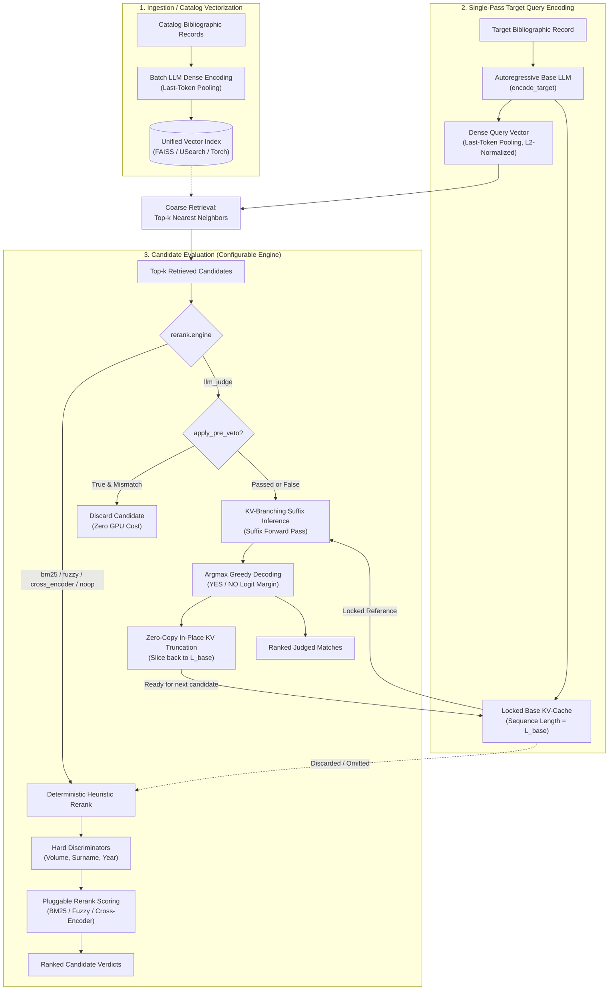
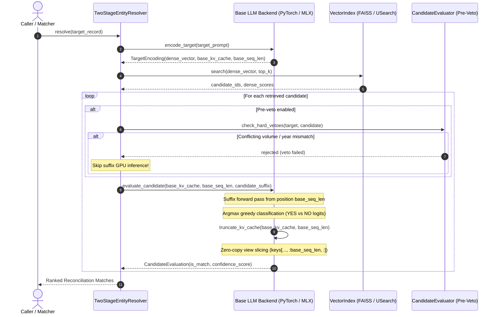
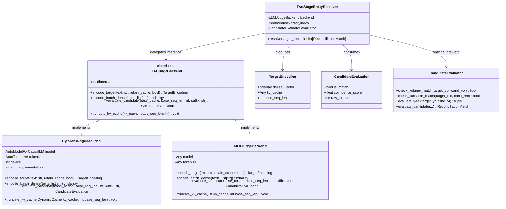
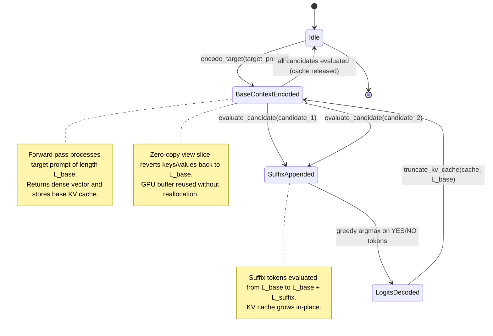
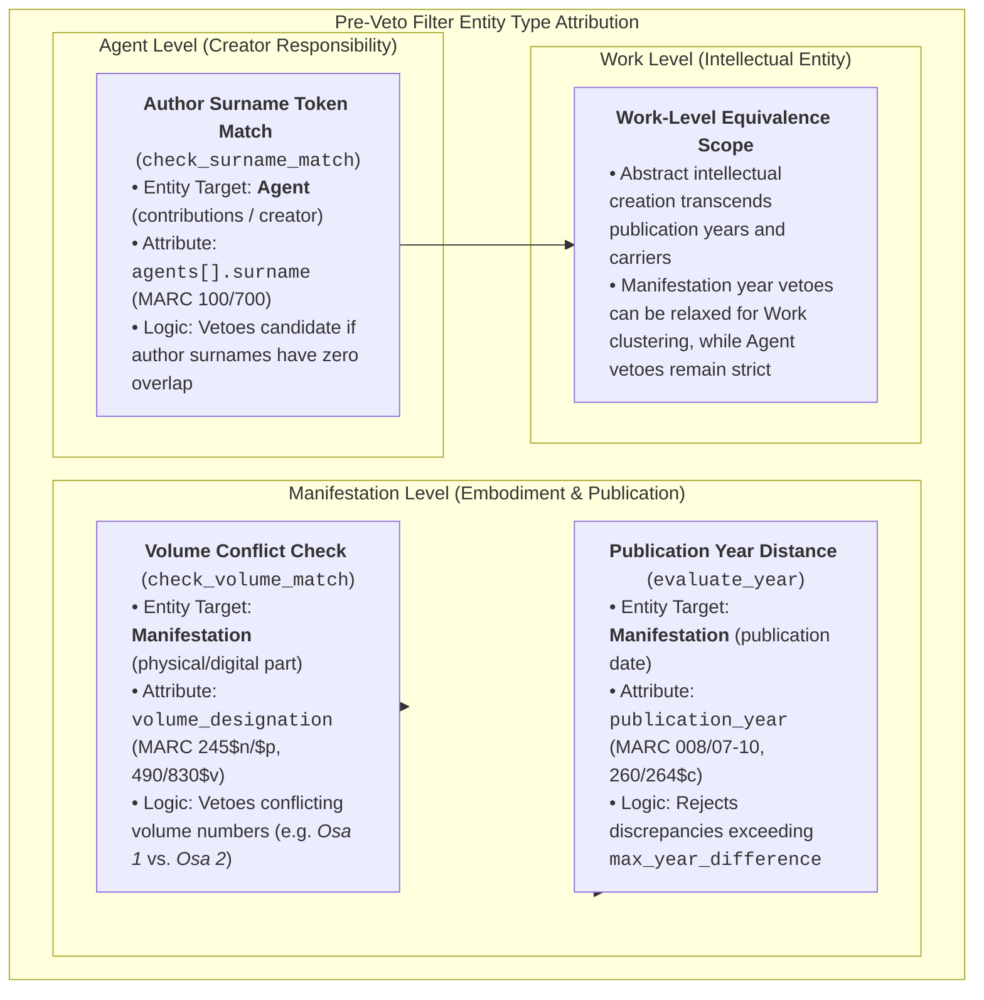
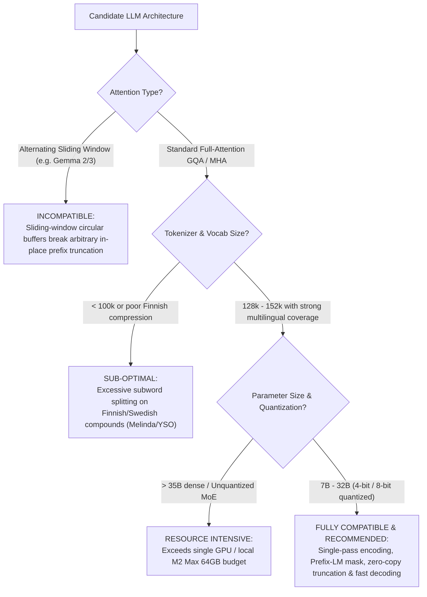
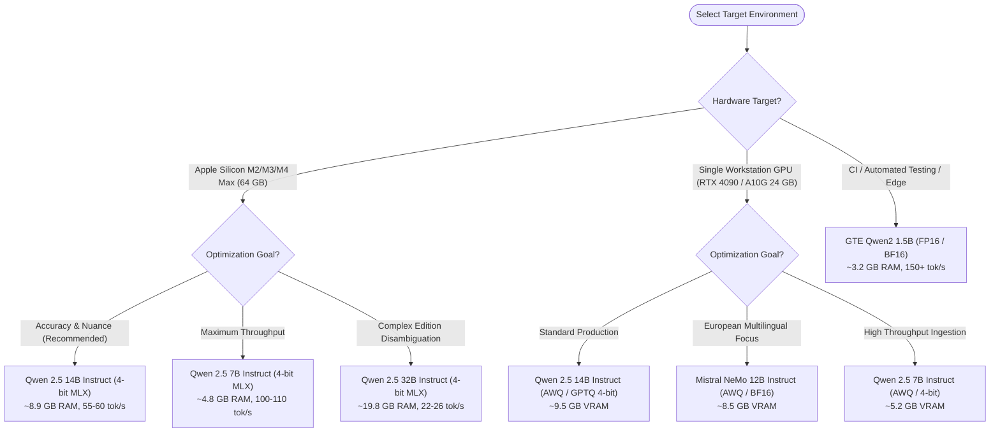
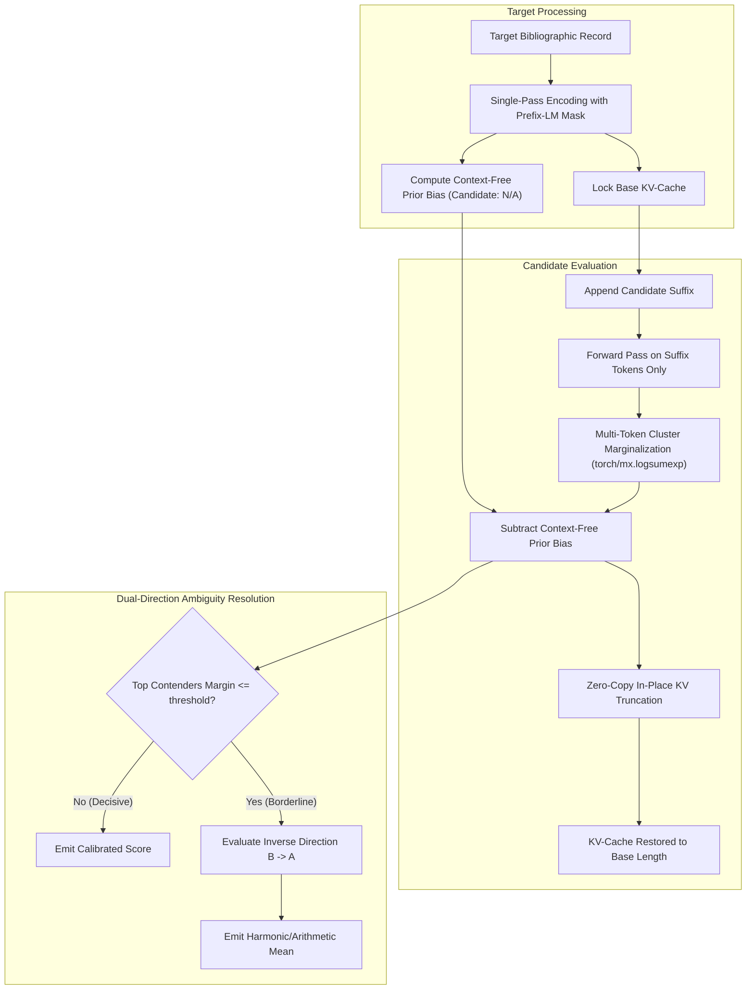

# Two-Stage Entity Resolution & KV-Branching LLM Judge Architecture

## Executive Summary

This document specifies the technical architecture for the high-throughput, two-stage entity resolution and deduplication pipeline in Reconciliator. The system unifies dense vector retrieval with an autoregressive base Large Language Model (LLM) judge, eliminating redundant computations through single-pass target encoding, locked KV-cache reuse, and $\mathcal{O}(1)$ zero-copy in-place KV-cache truncation.

Both the **KV-Branching LLM Judge** and classical **Deterministic Heuristics (BM25, Fuzzy, Cross-Encoder, Hard Discriminators)** share the **exact same dense vectors** generated by the **same Base LLM**. The vector index is built once and serves both evaluation modes interchangeably at runtime.

---

## 1. Problem Statement & Motivation

Traditional multi-stage entity resolution and deduplication pipelines exhibit two major computational inefficiencies:

1. **Model Redundancy**: A bi-encoder (such as SentenceTransformers) is used to create dense embeddings for index search, while a separate cross-encoder or LLM is used to evaluate candidates. This requires loading two separate models into memory and parsing records twice.
2. **Context Re-computation in LLM Judges**: In standard LLM judge evaluation across $k$ candidate records, the target entity and evaluation instructions are re-tokenized and re-processed $k$ times. For 20–50 candidates, over 90% of GPU compute is wasted re-encoding the exact same target prefix:
   $$\text{Standard Complexity} = \mathcal{O}\left(\sum_{i=1}^k (L_{\text{target}} + L_{\text{cand}, i})\right) \approx \mathcal{O}(k \cdot L_{\text{target}})$$

### The Solution: KV-Branching with Zero-Copy Truncation

By unifying vector indexing and LLM judgment into a single autoregressive base LLM:
1. **Single-Pass Target Encoding**: The target record is passed through the autoregressive LLM **once**. The final hidden state (via last-token pooling) yields the L2-normalized dense vector for coarse retrieval, while the multi-layer KV-cache ($past\_key\_values$) is captured and locked as the base context of length $L_{\text{base}}$.
2. **Coarse Candidate Retrieval**: The dense vector queries the unified vector index (FAISS, USearch, or Torch) to retrieve the top-$k$ nearest neighbors.
3. **KV-Branching Candidate Suffix Inference**: For each retrieved candidate, only the candidate-specific suffix is evaluated starting from token position $L_{\text{base}}$.
4. **Zero-Copy In-Place Truncation**: After decoding the classification token (`YES` vs `NO`), the KV-cache key and value tensor views are sliced back to $L_{\text{base}}$ in-place with zero memory allocation or buffer copying:
   $$\text{Unified Complexity} = \mathcal{O}\left(L_{\text{target}} + \sum_{i=1}^k L_{\text{cand}, i}\right)$$

---

## 2. System Architecture

### 2.1 Unified Architecture Flow



### 2.2 Sequence Diagram: Two-Stage KV-Branching Resolution



### 2.3 Class & Protocol Architecture



### 2.4 KV-Cache Lifecycle State Machine



---

## 3. Core Protocol & Dual-Backend Abstraction

Inference is encapsulated behind a unified interface (`LLMJudgeBackend`), supporting hardware-native acceleration across platforms:

```python
class LLMJudgeBackend(Protocol):
    dimension: int

    def encode_target(self, text: str, retain_cache: bool = True) -> TargetEncoding:
        """Process target entity once to extract dense vector and base KV-cache."""
        ...

    def encode_batch_dense(self, texts: list[str]) -> np.ndarray:
        """Batch dense encoding for vector index ingestion."""
        ...

    def evaluate_candidate(
        self, base_cache: Any, base_seq_len: int, candidate_suffix: str
    ) -> CandidateEvaluation:
        """Evaluate candidate suffix, decode decision, and truncate cache back to base_seq_len."""
        ...

    def truncate_kv_cache(self, kv_cache: Any, base_seq_len: int) -> None:
        """Zero-copy in-place truncation of the key/value tensors back to base_seq_len."""
        ...
```

### Apple Silicon MLX Backend (`MLXJudgeBackend`)
* **Framework**: Native Apple MLX (`mlx.core`, `mlx-lm`).
* **Memory Management**: Direct Metal unified memory allocation; weights remain resident in GPU/Metal memory buffers without CPU-GPU bus transfers.
* **Prompt Cache Slicing**: Slices key and value array views back to sequence length $L_{\text{base}}$:
  ```python
  for layer_cache in kv_cache:
      layer_cache.keys = layer_cache.keys[..., :base_seq_len, :]
      layer_cache.values = layer_cache.values[..., :base_seq_len, :]
  ```

### Nvidia CUDA PyTorch Backend (`PytorchJudgeBackend`)
* **Framework**: PyTorch with `transformers.AutoModelForCausalLM` and `AutoTokenizer`.
* **Attention Kernel**: Hardware-accelerated SDPA (`torch.nn.functional.scaled_dot_product_attention`) or FlashAttention-2 (`attn_implementation="flash_attention_2"`).
* **KV-Cache Slicing**: Uses `DynamicCache` with in-place tensor view slicing:
  ```python
  for layer in kv_cache.layers:
      layer.keys = layer.keys[..., :base_seq_len, :]
      layer.values = layer.values[..., :base_seq_len, :]
  ```
  In PyTorch, slicing `t[..., :L, :]` creates an offset strided view without invoking memory allocation or deepcopy.

---

## 4. Dense Vector Extraction: Last-Token Pooling

In causal autoregressive decoders, the attention mask is lower triangular:
$$\text{Attention}(Q, K, V)_{i, j} = 0 \quad \forall j > i$$

Because each token can attend to all prior tokens, the final token in the prompt sequence (position $L_{\text{base}} - 1$, typically the End-of-Sequence token) contains the accumulated contextual representation of the entire record. 

Dense vectors are extracted as:
$$\mathbf{h}_{\text{last}} = \mathbf{H}[-1, L_{\text{base}} - 1, :]$$
$$\mathbf{v}_{\text{dense}} = \frac{\mathbf{h}_{\text{last}}}{\|\mathbf{h}_{\text{last}}\|_2}$$

This normalized dense representation is used directly by FAISS, USearch, and Torch index engines for cosine similarity retrieval.

---

## 5. Pre-Veto Optimization & Entity Type Attribution

While KV-branching suffix evaluation takes only ~15–20 ms per candidate on Apple Silicon M2 Max, running 20 candidates per record across 100,000 records still totals ~300,000 GPU inferences.

To maximize throughput, the pipeline incorporates **Deterministic Pre-Veto Filters** evaluated by `CandidateEvaluator`. Crucially, these filters are not generic string heuristics—each filter directly maps to a specific tier of the **IFLA LRM / WEMI** model or the related **Agent** entity model.



### 5.1 Pre-Veto Filters by Entity Type

| Pre-Veto Filter | Target Entity Type | Metadata Attributes (MARC Fields) | Rejection Logic & Semantic Rationale | Work vs. Manifestation Scope |
| :--- | :--- | :--- | :--- | :--- |
| **Author Surname Match** (`check_surname_match`) | **Agent** (Creator Attribution) | `agents[].surname`, `agents[].name` (MARC `100$a`, `700$a`) | **Rejects on zero author overlap**: If two records have distinct, non-overlapping author surnames (e.g. *Waltari* vs. *Topelius*), they cannot represent the same Work or Manifestation regardless of semantic title similarity. | **Strict for both Work and Manifestation**: Valid across all WEMI layers unless the work is an anonymous/folkloric creation. |
| **Volume Conflict Check** (`check_volume_match`) | **Manifestation** (and sub-Expression parts) | `volume_designation`, `series_numbering` (MARC `245$n`, `245$p`, `490$v`, `830$v`) | **Rejects conflicting volume designations**: Normalized via `normalize_volume()` (handling prefixes like *osa*, *del*, *vol.*, and Roman numerals). If Record A is *Osa 1* and Record B is *Osa 2*, they represent distinct physical parts/manifestations. | **Strict for Manifestation and Multi-Part Work sets**: Prevents distinct volumes of multi-part sets from collapsing into a single manifestation. |
| **Publication Year Distance** (`evaluate_year`) | **Manifestation** (Publication Event) | `publication_year` (MARC `008/07-10`, `260$c`, `264$c`) | **Rejects excessive publication date divergence**: Calculates absolute difference $|y_T - y_C| > \text{max\_year\_difference}$. Filters out distant reprints, adaptations, or unrelated homonymous works. | **Configurable by Resolution Target**: Strict for **Manifestation** matching (default: 3–5 years tolerance); relaxed or bypassed for **Work** consolidation where 19th-century originals and 21st-century reprints share Work identity. |

When `apply_pre_veto: true`, ~70–80% of spurious vector neighbors are dropped in sub-microsecond CPU time before invoking GPU suffix inference, preserving GPU throughput for genuinely ambiguous candidates.

---

## 6. Model Evaluation & Suitability Analysis

The two-stage entity resolution pipeline unifies dense retrieval with autoregressive LLM judgment. Because the judge evaluates candidates via **KV-branching suffix passes with zero-copy cache truncation**, not all modern LLMs are architecturally compatible. This section defines the four mandatory suitability criteria and evaluates major contemporary open-weights models.

### 6.1 Architectural Suitability Criteria



1. **Standard Full-Attention KV Cache (No Sliding Window)**:
   - Models with sliding-window attention (SWA) or alternating local/global layers (such as **Google Gemma 2 and Gemma 3**) are **incompatible** with arbitrary zero-copy in-place truncation. SWA maintains a circular rolling KV buffer where position offsets wrap around; slicing `t[..., :base_seq_len, :]` corrupts the rolling index and causes catastrophic degradation on subsequent candidates.
   - Models with standard Grouped Query Attention (GQA) and full causal attention (e.g., Qwen 2.5, Mistral NeMo, Llama 3.1) maintain contiguous, linearly indexed KV states that can be sliced back to $L_{\text{base}}$ in $\mathcal{O}(1)$ time without buffer copying.

2. **Multilingual Tokenizer Compression (Finnish & Swedish)**:
   - Bibliographic records in Melinda, Fennica, and YSO feature agglutinative Finnish compound words (e.g., *kirjallisuudentutkimus*, *ylioppilastutkintotodistus*) and Nordic diacritics (*å*, *ä*, *ö*).
   - Tokenizers with smaller or English-biased vocabularies split Nordic words into 3–5 subword fragments, inflating sequence length and diluting attention.
   - Models with large multilingual vocabularies (e.g., **Qwen's 152k vocabulary** or **Mistral's 128k Tekken tokenizer**) achieve high token compression (~1.35 tokens/word in Finnish vs. >2.10 tokens/word in Llama 3).

3. **Prefix-LM 4D Attention Masking Support**:
   - The model must accept an explicit 4D attention mask (`[batch, 1, seq_len, seq_len]`) or custom SDPA mask during the target encoding pass to allow bidirectional attention among query tokens without causal masking artifacts.

4. **Hardware Footprint & Decoding Latency**:
   - In production on Apple Silicon (M2 Max 64 GB) or single workstation GPUs (e.g., RTX 4090 / A10G 24 GB), the model must run in 4-bit or 8-bit quantization with a working RAM footprint under 20 GB, ensuring sufficient memory remains for PostgreSQL, vector indexes, and OS cache while delivering $\ge 30\text{ tokens/sec}$ decode speed.

---

### 6.2 Model Suitability Matrix

| Model Family | Model Identifier | Architecture | Vocab Size | Finnish/Swedish Compression | KV Slicing Compatibility | RAM (4-bit) | Decode Speed (M2 Max) | Overall Verdict |
| :--- | :--- | :--- | :--- | :--- | :--- | :--- | :--- | :--- |
| **Qwen 2.5 14B Instruct** | `mlx-community/Qwen2.5-14B-Instruct-4bit`<br/>`Qwen/Qwen2.5-14B-Instruct` | Standard GQA | **152k** | **Exceptional** (~1.35 tok/word) | **Full** (Linear contiguous) | **~8.9 GB** | **~55–60 tok/s** | **Recommended Default**: Outstanding bibliographic nuance, calibrated binary logits, high Nordic density. |
| **Mistral NeMo 12B Instruct** | `mlx-community/Mistral-Nemo-Instruct-2407-4bit`<br/>`mistralai/Mistral-Nemo-Instruct-2407` | Standard GQA | **128k (Tekken)** | **High** (~1.48 tok/word) | **Full** (Linear contiguous) | **~7.5 GB** | **~65–70 tok/s** | **Excellent Alternative**: Co-developed with NVIDIA; strong European language reasoning and clean instruction compliance. |
| **Qwen 2.5 7B Instruct** | `mlx-community/Qwen2.5-7B-Instruct-4bit`<br/>`Qwen/Qwen2.5-7B-Instruct` | Standard GQA | **152k** | **Exceptional** (~1.35 tok/word) | **Full** (Linear contiguous) | **~4.8 GB** | **~100–110 tok/s** | **High-Throughput Default**: Ultra-low latency, optimal for large-scale ingestion batches. |
| **Qwen 2.5 32B Instruct** | `mlx-community/Qwen2.5-32B-Instruct-4bit`<br/>`Qwen/Qwen2.5-32B-Instruct` | Standard GQA | **152k** | **Exceptional** (~1.35 tok/word) | **Full** (Linear contiguous) | **~19.8 GB** | **~22–26 tok/s** | **Maximum Nuance**: Resolves difficult multi-part editions and translations; requires 64 GB unified RAM. |
| **Meta Llama 3.1 8B Instruct** | `mlx-community/Meta-Llama-3.1-8B-Instruct-4bit`<br/>`meta-llama/Meta-Llama-3.1-8B-Instruct` | Standard GQA | **128k (tiktoken)** | **Moderate** (~2.10 tok/word) | **Full** (Linear contiguous) | **~5.2 GB** | **~90–100 tok/s** | **Acceptable**: Fast and reliable, but splits Finnish compounds into significantly more subwords. |
| **Google Gemma 2 (9B / 27B)** | `google/gemma-2-9b-it`<br/>`mlx-community/gemma-2-9b-it-4bit` | Alternating SWA | **256k** | **High** (~1.42 tok/word) | **Incompatible** (Circular SWA buffer) | **~6.0 GB** | N/A | **Unsuitable**: Alternating local sliding-window attention breaks arbitrary prefix-cache reuse and truncation. |
| **DeepSeek-V3 / R1 (671B MoE)** | `deepseek-ai/DeepSeek-V3` | MoE (37B active) | **128k** | **High** | **Incompatible** (Local hardware limit) | **>350 GB** | N/A | **Unsuitable**: Exceeds single-node/local memory; excessive latency for sub-millisecond candidate judging. |
| **GTE Qwen2 1.5B** | `Alibaba-NLP/gte-Qwen2-1.5B-instruct` | Standard GQA | **152k** | **Exceptional** | **Full** (Linear contiguous) | **~3.2 GB (FP16)**| **~150+ tok/s** | **Testing & CI**: Ultra-compact footprint for automated integration suites. |

---

### 6.3 Model Selection Guide by Deployment Profile



## 6.5 Cross-Encoder Parity & Calibration Architecture

To match and exceed the discrimination accuracy of bidirectional cross-encoders (such as DeBERTa-v3 or `bge-reranker-large`) while preserving the $\mathcal{O}(1)$ KV-branching latency advantage, the LLM Judge incorporates four parity pillars:



### 1. Multi-Token Logit Marginalization
Instruction-tuned models emit diverse surface forms for decision tokens. Rather than evaluating a single token ID (`YES` vs `NO`), the judge resolves candidate token clusters:
* $\mathcal{T}^+ = \{\text{"YES"}, \text{" YES"}, \text{"Yes"}, \text{" Yes"}, \text{"True"}, \text{"Match"}\}$
* $\mathcal{T}^- = \{\text{"NO"}, \text{" NO"}, \text{"No"}, \text{" No"}, \text{"False"}, \text{"Different"}\}$

Raw confidence margins are computed using log-sum-exp pooling:
$$\text{margin}_{\text{raw}} = \text{logsumexp}_{t \in \mathcal{T}^+}(\text{logit}_t) - \text{logsumexp}_{t \in \mathcal{T}^-}(\text{logit}_t)$$

### 2. Context-Free Prior Calibration
Autoregressive LLMs often have intrinsic positive or negative bias. During `encode_target()`, the base model evaluates a neutral candidate (`Candidate: N/A...`) to calculate baseline bias:
$$\text{bias} = \text{margin}_{\text{neutral}}$$
During candidate scoring, this background prior is subtracted:
$$\text{margin}_{\text{calibrated}} = \text{margin}_{\text{raw}} - \text{bias}$$
$$\text{confidence} = \sigma(\text{margin}_{\text{calibrated}})$$

### 3. Prefix-LM Attention Masking
Standard causal masks prevent query tokens from attending forward. With Prefix-LM masking enabled, target prompt tokens attend bidirectionally ($q_i \leftrightarrow q_j$), providing the exact same all-to-all query representation as cross-encoders while keeping the multi-layer KV-cache completely static and reusable.

### 4. Symmetric Dual-Direction Scoring
To eliminate order asymmetry ($f(A, B) \ne f(B, A)$) on borderline candidates, when top contenders differ by less than `symmetric_margin_threshold` (default $0.05$), the judge evaluates the inverse presentation ($B \rightarrow A$) and averages the resulting probabilities.

---

## 7. Configuration Surface Reference

```yaml
reconcile:
  rerank:
    enabled: true
    engine: "llm_judge"            # Options: "llm_judge", "bm25", "cross_encoder", "fuzzy", "noop"
    top_k: 20                     # Candidates retrieved from shared vector index
    apply_pre_veto: true           # Apply deterministic hard discriminators before LLM suffix eval
    require_volume_match: true    # Pre-veto rule: reject conflicting volumes
    require_surname_match: true   # Pre-veto rule: require author surname token overlap
    max_year_difference: 5        # Pre-veto rule: reject large publication year discrepancies
    judge:
      backend: "auto"             # "auto" (MLX on Apple Silicon, PyTorch on CUDA/CPU), "mlx", "torch"
      model_name: "mlx-community/Qwen2.5-14B-Instruct-4bit"
      quantization: "4bit"        # For MLX: "4bit", "8bit"
      device: "auto"
      torch_dtype: "auto"         # For PyTorch: "float16", "bfloat16", "float32"
      attn_implementation: "auto" # "sdpa", "flash_attention_2"
      pooling_strategy: "last_token"
      batch_size: 16
      positive_token: "YES"
      negative_token: "NO"
      target_template: "Task: Determine if two bibliographic records represent the same intellectual work.\nCriteria: Editions, translations, and reprints match. Different volumes, parts, or authors do not match.\n\nTarget Record: {text}\n"
      candidate_suffix_template: "Candidate Record: {text}\n\nQuestion: Do Target Record and Candidate Record represent the same work? Answer YES or NO: "
      max_seq_length: 2048
      calibrate_prior: true       # Context-free prior bias subtraction
      marginalize_tokens: true    # Multi-token logsumexp cluster marginalization
      prefix_lm_mask: true        # Bidirectional attention within query prefix
      symmetric_scoring: true     # Symmetric inverse scoring on borderline contenders
      symmetric_margin_threshold: 0.05
      adaptive_cot: false         # Reasoning verification fallback for deadlocks
      adaptive_cot_max_tokens: 64
```

