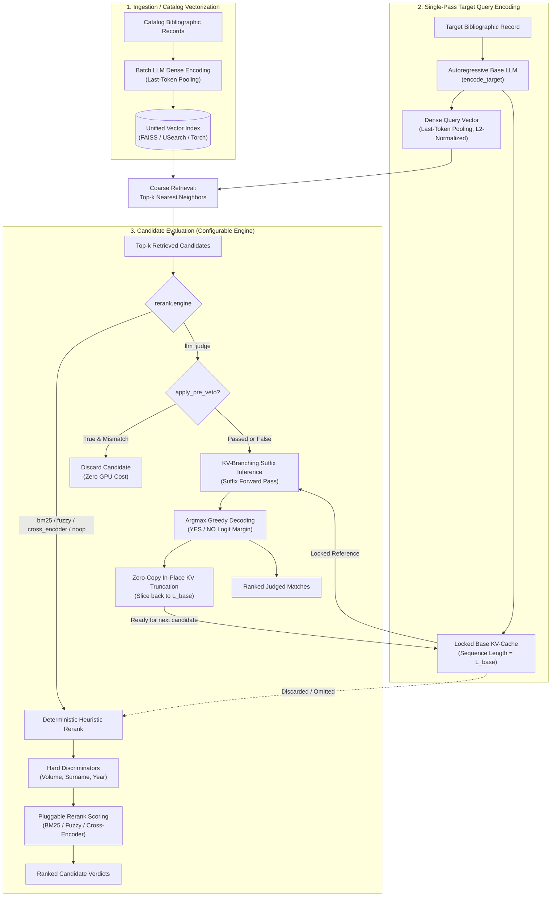
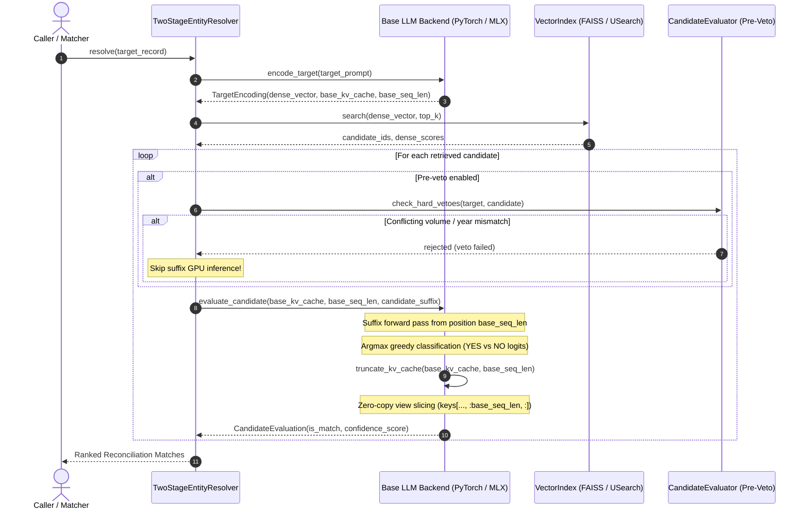
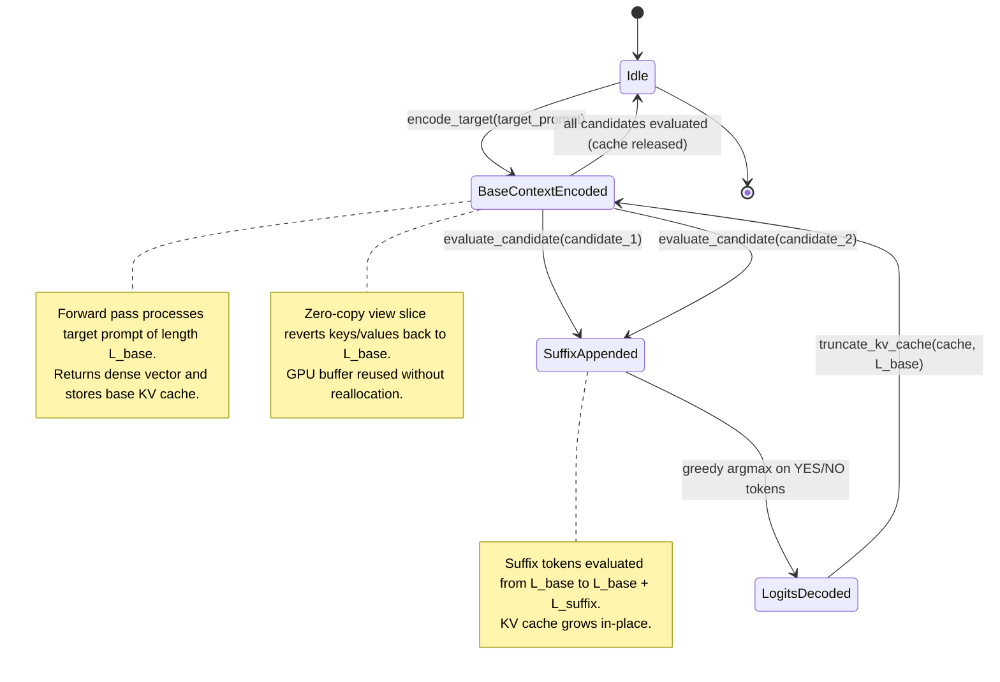

# Two-Stage Entity Resolution & KV-Branching LLM Judge Architecture

## Executive Summary

This document specifies the technical architecture for the high-throughput, two-stage entity resolution and deduplication pipeline in Reconciliator. The system unifies dense vector retrieval with an autoregressive base Large Language Model (LLM) judge, eliminating redundant computations through single-pass target encoding, locked KV-cache reuse, and $\mathcal{O}(1)$ zero-copy in-place KV-cache truncation.

Both the **KV-Branching LLM Judge** and classical **Deterministic Heuristics (BM25, Fuzzy, Cross-Encoder, Hard Discriminators)** share the **exact same dense vectors** generated by the **same Base LLM**. The vector index is built once and serves both evaluation modes interchangeably at runtime.

---

## 1. Problem Statement & Motivation

Traditional multi-stage entity resolution and deduplication pipelines exhibit two major computational inefficiencies:

1. **Model Redundancy**: A bi-encoder (such as SentenceTransformers) is used to create dense embeddings for index search, while a separate cross-encoder or LLM is used to evaluate candidates. This requires loading two separate models into memory and parsing records twice.
2. **Context Re-computation in LLM Judges**: In standard LLM judge evaluation across $k$ candidate records, the target entity and evaluation instructions are re-tokenized and re-processed $k$ times. For 20–50 candidates, over 90% of GPU compute is wasted re-encoding the exact same target prefix:
   $$\text{Standard Complexity} = \mathcal{O}\left(\sum_{i=1}^k (L_{\text{target}} + L_{\text{cand}, i})\right) \approx \mathcal{O}(k \cdot L_{\text{target}})$$

### The Solution: KV-Branching with Zero-Copy Truncation

By unifying vector indexing and LLM judgment into a single autoregressive base LLM:
1. **Single-Pass Target Encoding**: The target record is passed through the autoregressive LLM **once**. The final hidden state (via last-token pooling) yields the L2-normalized dense vector for coarse retrieval, while the multi-layer KV-cache ($past\_key\_values$) is captured and locked as the base context of length $L_{\text{base}}$.
2. **Coarse Candidate Retrieval**: The dense vector queries the unified vector index (FAISS, USearch, or Torch) to retrieve the top-$k$ nearest neighbors.
3. **KV-Branching Candidate Suffix Inference**: For each retrieved candidate, only the candidate-specific suffix is evaluated starting from token position $L_{\text{base}}$.
4. **Zero-Copy In-Place Truncation**: After decoding the classification token (`YES` vs `NO`), the KV-cache key and value tensor views are sliced back to $L_{\text{base}}$ in-place with zero memory allocation or buffer copying:
   $$\text{Unified Complexity} = \mathcal{O}\left(L_{\text{target}} + \sum_{i=1}^k L_{\text{cand}, i}\right)$$

---

## 2. System Architecture

### 2.1 Unified Architecture Flow



### 2.2 Sequence Diagram: Two-Stage KV-Branching Resolution



### 2.3 Class & Protocol Architecture


### 2.4 KV-Cache Lifecycle State Machine



---

## 3. Core Protocol & Dual-Backend Abstraction

Inference is encapsulated behind a unified interface (`LLMJudgeBackend`), supporting hardware-native acceleration across platforms:

```python
class LLMJudgeBackend(Protocol):
    dimension: int

    def encode_target(self, text: str, retain_cache: bool = True) -> TargetEncoding:
        """Process target entity once to extract dense vector and base KV-cache."""
        ...

    def encode_batch_dense(self, texts: list[str]) -> np.ndarray:
        """Batch dense encoding for vector index ingestion."""
        ...

    def evaluate_candidate(
        self, base_cache: Any, base_seq_len: int, candidate_suffix: str
    ) -> CandidateEvaluation:
        """Evaluate candidate suffix, decode decision, and truncate cache back to base_seq_len."""
        ...

    def truncate_kv_cache(self, kv_cache: Any, base_seq_len: int) -> None:
        """Zero-copy in-place truncation of the key/value tensors back to base_seq_len."""
        ...
```

### Apple Silicon MLX Backend (`MLXJudgeBackend`)
* **Framework**: Native Apple MLX (`mlx.core`, `mlx-lm`).
* **Memory Management**: Direct Metal unified memory allocation; weights remain resident in GPU/Metal memory buffers without CPU-GPU bus transfers.
* **Prompt Cache Slicing**: Slices key and value array views back to sequence length $L_{\text{base}}$:
  ```python
  for layer_cache in kv_cache:
      layer_cache.keys = layer_cache.keys[..., :base_seq_len, :]
      layer_cache.values = layer_cache.values[..., :base_seq_len, :]
  ```

### Nvidia CUDA PyTorch Backend (`PytorchJudgeBackend`)
* **Framework**: PyTorch with `transformers.AutoModelForCausalLM` and `AutoTokenizer`.
* **Attention Kernel**: Hardware-accelerated SDPA (`torch.nn.functional.scaled_dot_product_attention`) or FlashAttention-2 (`attn_implementation="flash_attention_2"`).
* **KV-Cache Slicing**: Uses `DynamicCache` with in-place tensor view slicing:
  ```python
  for layer in kv_cache.layers:
      layer.keys = layer.keys[..., :base_seq_len, :]
      layer.values = layer.values[..., :base_seq_len, :]
  ```
  In PyTorch, slicing `t[..., :L, :]` creates an offset strided view without invoking memory allocation or deepcopy.

---

## 4. Dense Vector Extraction: Last-Token Pooling

In causal autoregressive decoders, the attention mask is lower triangular:
$$\text{Attention}(Q, K, V)_{i, j} = 0 \quad \forall j > i$$

Because each token can attend to all prior tokens, the final token in the prompt sequence (position $L_{\text{base}} - 1$, typically the End-of-Sequence token) contains the accumulated contextual representation of the entire record. 

Dense vectors are extracted as:
$$\mathbf{h}_{\text{last}} = \mathbf{H}[-1, L_{\text{base}} - 1, :]$$
$$\mathbf{v}_{\text{dense}} = \frac{\mathbf{h}_{\text{last}}}{\|\mathbf{h}_{\text{last}}\|_2}$$

This normalized dense representation is used directly by FAISS, USearch, and Torch index engines for cosine similarity retrieval.

---

## 5. Pre-Veto Optimization

While KV-branching suffix evaluation takes only ~15–20 ms per candidate on Apple Silicon M2 Max, running 20 candidates per record across 100,000 records still totals ~300,000 GPU inferences.

To maximize throughput, the pipeline includes **Deterministic Pre-Veto Filters**:
* **Volume Conflict Check**: Candidates with conflicting volume numbers (e.g. *Osa 1* vs. *Osa 2*) are rejected instantly.
* **Publication Year Distance**: Candidates exceeding `max_year_difference` are rejected instantly.
* **Author Surname Token Match**: Candidates with completely mismatched author surnames are rejected instantly.

When `apply_pre_veto: true`, ~70–80% of spurious vector neighbors are dropped in sub-microsecond CPU time before triggering GPU suffix inference.

---

## 6. Model Selection Guide for Apple Silicon (M2 Max 64 GB)

| Model Name | HuggingFace Identifier | Weights | RAM Footprint | Decode Speed | Recommended Use |
| :--- | :--- | :--- | :--- | :--- | :--- |
| **Qwen 2.5 14B Instruct** | `mlx-community/Qwen2.5-14B-Instruct-4bit` | 4-bit MLX | **~8.9 GB** | **~55–60 tok/s** | **Default Production**: Best balance of Finnish/Swedish vocabulary (152k tokens), calibrated binary logits, and speed. |
| **Qwen 2.5 7B Instruct** | `mlx-community/Qwen2.5-7B-Instruct-4bit` | 4-bit MLX | **~4.8 GB** | **~100–110 tok/s** | **High Throughput**: For large batch ingestion and reconciliation. |
| **Qwen 2.5 32B Instruct** | `mlx-community/Qwen2.5-32B-Instruct-4bit` | 4-bit MLX | **~19.8 GB** | **~22–26 tok/s** | **Maximum Nuance**: Deep bibliographic discrimination for complex editions. |
| **GTE Qwen2 1.5B** | `Alibaba-NLP/gte-Qwen2-1.5B-instruct` | FP16/BF16 | **~3.2 GB** | **~150+ tok/s** | **Testing & CI**: Ultra-fast causal embedding & judge. |

---

## 7. Configuration Surface Reference

```yaml
reconcile:
  rerank:
    enabled: true
    engine: "llm_judge"            # Options: "llm_judge", "bm25", "cross_encoder", "fuzzy", "noop"
    top_k: 20                     # Candidates retrieved from shared vector index
    apply_pre_veto: true           # Apply deterministic hard discriminators before LLM suffix eval
    require_volume_match: true    # Pre-veto rule: reject conflicting volumes
    require_surname_match: true   # Pre-veto rule: require author surname token overlap
    max_year_difference: 5        # Pre-veto rule: reject large publication year discrepancies
    judge:
      backend: "auto"             # "auto" (MLX on Apple Silicon, PyTorch on CUDA/CPU), "mlx", "torch"
      model_name: "mlx-community/Qwen2.5-14B-Instruct-4bit"
      quantization: "4bit"        # For MLX: "4bit", "8bit"
      device: "auto"
      torch_dtype: "auto"         # For PyTorch: "float16", "bfloat16", "float32"
      attn_implementation: "auto" # "sdpa", "flash_attention_2"
      pooling_strategy: "last_token"
      batch_size: 16
      positive_token: "YES"
      negative_token: "NO"
      target_template: "Instruct: Given a bibliographic record, retrieve matching catalog works.\nQuery: {text}\n"
      candidate_suffix_template: "Candidate: {text}\nDoes this refer to the same work? Answer YES or NO: "
      max_seq_length: 2048
```

